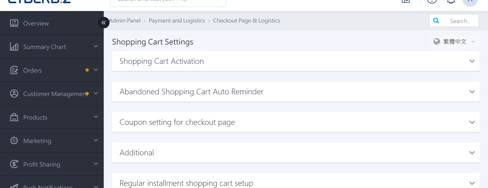
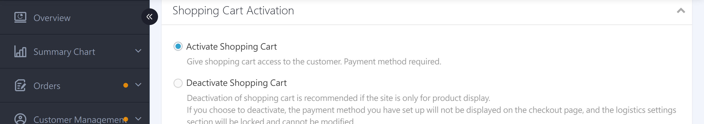
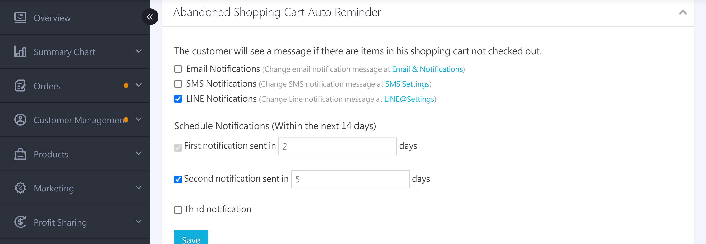
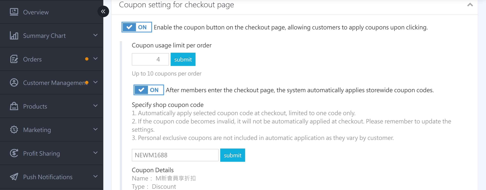
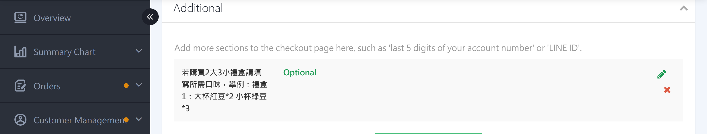
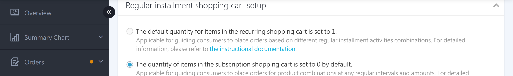

{ title="Cart Settings page" .hero-page }

## Cart Settings Overview { #intro-cart-settings }

"Cart Settings" is located at the top section of the "Payment & Logistics" > "Checkout & Logistics Settings" page in the back office. It controls the shopping flow customers go through before formal checkout. Here you can decide whether the site allows online purchases, whether to proactively remind customers to return and check out, whether the checkout page shows the coupon field, and whether to ask customers for specific information.

!!! info "Tip"
    All settings on this page are grouped by section, and each section is collapsed by default. Click a section title to expand it. After you expand a section, make your changes and save them for the changes to take effect.

---

## Page Overview { #overview-cart-settings }

| Section | Purpose | Plan Restriction |
| :-- | :-- | :-- |
| [Cart Activation Settings](#operate-cart-settings-activation) | Decide whether the site allows online purchases | All plans |
| [Automatic Reminders for Unfinished Cart Items](#operate-cart-settings-reminder) | Automatically remind customers with items left in their cart to return and check out | PLUS / Enterprise |
| [Checkout coupon Settings](#operate-cart-settings-coupon) | Whether to show the coupon button on the checkout page and automatically apply store-wide coupon codes | All plans |
| [Additional Information](#operate-cart-settings-extra-info) | Add custom questions to the checkout flow | All plans |
| [Recurring Purchase Cart Settings](#operate-cart-settings-periodic) | Set the default item quantity in the cart for recurring purchase campaigns | Enterprise |

!!! note "Note"
    Depending on your plan and store settings, some sections may not appear. If you cannot find a section listed above, your plan does not have that feature enabled.

---

## Prerequisites and Limitations { #prerequisites-cart-settings }

Some settings appear on the page only after the related feature is activated.

!!! plan "Activation Requirement"
    * **Automatic Reminders for Unfinished Cart Items**: Most paid plans include this feature. The **LINE OA reminder** channel requires PLUS or higher, or Enterprise.
    * **Recurring Purchase Cart Settings**: Enterprise.

---

## Steps { #operate-cart-settings }

Navigation path: Back Office > "Payment & Logistics" > "Checkout & Logistics Settings." Make changes in the "Cart Settings" section at the top of the page.

### Turn the Cart on or Off { #operate-cart-settings-activation }

If your site only displays products (brand website) and does not offer online purchases, you can turn off the cart feature.

1. **Expand the section:** Click the "Cart Activation Settings" section title.
2. **Select a mode:** Select **"Enable Cart Feature"** (allow customers to place orders on the site) or **"Disable Cart Feature"** (display products only).
3. **Note:** After you select "Disable," the payment methods you have set up will no longer appear on the checkout page, and the **Logistics Settings section will be locked** [^cart-off].

[^cart-off]: If no payment method has been set up, the system displays a red alert in this section to remind you that customers will not be able to complete checkout.

{ title="Turn the Cart On or Off" }

!!! warning "Caution"
    If the "Enable Cart Feature" option is grayed out and cannot be selected, the system has restricted your store to cart-off mode. Contact your CYBERBIZ sales representative to confirm.

---

### Set up Automatic Reminders for Unfinished Cart Items { #operate-cart-settings-reminder }

[:lucide-tag:{ title="Applicable Plans" }](../../../resources/conventions#適用方案) | PLUS / Enterprise

The maximum reminder window depends on the customer type: **Members** up to 40 days, **guests** up to 14 days.

When a customer adds items to the cart but does not complete checkout, the system can automatically send a reminder to bring the customer back to complete the order.

1. **Expand the section:** Click the "Automatic Reminders for Unfinished Cart Items" section title.
2. **Select reminder channels:** Check the notification channels you want to enable: **Enable Email Reminder**, **Enable SMS Reminder**, or **Enable LINE OA Reminder**[^line-plan]. You can edit each channel's notification content on the corresponding "Email & Reminders," "SMS Settings," or "LINE@ Settings" page.
3. **Set the reminder frequency:** After you enable any channel, a "Reminder Frequency" setting appears below. You can set up to three reminders and enter the number of days after which each one is sent.
4. **Done:** Click **Save** to apply the settings.

For the activation requirements of each reminder channel, see [Unfinished Cart Reminder Channel Comparison](../references/cart-reminder-channels-reference.md#cart-reminder-channels){ data-preview }.

[^line-plan]: The LINE OA reminder appears only when the corresponding feature is activated (PLUS or higher, or Enterprise).

{ title="Set Up Automatic Reminders for Unfinished Cart Items" }

---

### Checkout Coupon Settings { #operate-cart-settings-coupon }

Control whether the checkout page shows the coupon field, and whether store-wide coupon codes are automatically applied to customers.

1. **Expand the section:** Click the "Checkout coupon Settings" section title.
2. **Show the coupon button:** When enabled, customers see the coupon button on the checkout page. Clicking it applies the coupon or coupon code.
3. **Set the per-order limit:** Enter a number in the "Per-Order coupon Limit" field. The maximum is **10**.

    !!! info ""
        This limit is the combined total of coupon and coupon codes. You cannot set separate usage limits for each.

        Using multiple coupon (codes) together is available for **Expert PLUS** and **Enterprise**. The EC storefront and POS system must be configured separately. For detailed rules, see [Multiple coupon Stacking Setup Guide](../../marketing/coupon/multiple-coupons.md){ title="Multiple coupon Stacking Setup Guide" }.

4. **Specify a store-wide coupon code to apply automatically:** In the "Specify Store-Wide Coupon Code" setting, enter the coupon code. When a customer enters the checkout page and meets the coupon conditions, the system applies it automatically[^coupon-auto].

    !!! info ""
        This feature is available for **Expert PLUS** and **Enterprise**. Expert PLUS can link one coupon code, and Enterprise can link up to five. For detailed setup, see [Set Up Automatic Coupon Application at Checkout](../../marketing/coupon/setup-promo-codes.md#operate-promo-codes-auto-apply){ title="Set Up Automatic Coupon Application at Checkout" }.

5. **Done:** Click **Save** or **"Submit"** to apply the settings.

[^coupon-auto]: The automatic application count is still subject to the "Per-Order coupon Limit" setting. Personal coupon are not included in automatic application. If the specified coupon code is no longer valid, the system does not apply it automatically.

{ title="Checkout coupon Settings" }

---

### POS Checkout Coupon Settings { #operate-cart-settings-pos-coupon }

If you also use the POS system, you can configure the coupon usage rules for the POS checkout page in the back office.

1. **Expand the section:** Click the "POS Checkout coupon Settings" section title.
2. **Set the per-order limit:** Enter a number in the "Per-Order coupon Limit" field. The default is **10**, and the limit cannot exceed **10**.
3. **Done:** Click **"Submit"** to apply the settings.

{ title="POS Checkout coupon Settings" }

---

### Add Checkout Extra Information Field { #operate-cart-settings-extra-info }

If you want to ask customers for additional information during checkout (for example, "Last Five Digits of Account" or "LINE ID"), you can add a custom field here.

1. **Expand the section:** Click the "Additional Information" section title.
2. **Add a field:** Click **"Add Extra Field"** and enter the field name (for example, "Last Five Digits of Account") in the pop-up window.
3. **Set whether the field is required:** If needed, select "Required Field," then click **Add**.
4. **Manage fields:** Created fields appear in the table. You can edit or delete them at any time.

{ title="Add Checkout Extra Information Field" }

!!! note "Note"
    You can add up to **3** extra fields. After you reach the limit, the "Add Extra Field" button is hidden automatically. If your store is multilingual, you set field names separately for each language.

---

### Recurring Purchase Cart Default Quantity { #operate-cart-settings-periodic }

[:lucide-tag:{ title="Applicable Plans" }](../../../resources/conventions#適用方案) | Enterprise

When you run a recurring purchase campaign, you can set the default item quantity that members see when they enter the cart.

1. **Expand the section:** Click the "Recurring Purchase Cart Settings" section title.
2. **Select the default quantity:** Select **"Recurring purchase cart item quantity defaults to 1"** (suited to fixed product bundles) or **"Recurring purchase cart item quantity defaults to 0"** (suited to letting customers choose products on the campaign page).
3. **Done:** The system saves your selection immediately.

{ title="Recurring Purchase Cart Default Quantity" }

---

## Frequently Asked Questions { #faq-cart-settings }

??? quote"Why can't I change logistics settings after turning off the cart?"
    { #faq-cart-settings-logistics-locked }
    This is by design. When the cart is off, the site does not offer online purchases, so both payment and logistics settings are locked. To reconfigure logistics, first return to the "Cart Activation Settings" section at the top of this page and turn the cart feature on.

??? quote"I set up unfinished cart reminders, but customers did not receive notifications."
    { #faq-cart-settings-reminder-not-sent }
    Check the following items in order:

    * Confirm that you selected the corresponding reminder channel (Email, SMS, or LINE OA) and saved your changes.
    * SMS and LINE OA reminders use CYBER coins. If your balance is insufficient, sending will fail, so check your balance first.
    * Reminders are sent after the customer leaves items in the cart, based on the number of days you set. They are not sent before that number of days has passed.

??? quote"Why do customers keep receiving unfinished cart notifications after they have placed an order?"
    { #faq-cart-settings-reminder-after-order }
    Ask the customer to check whether other devices still have unfinished cart items.

    Unfinished cart reminders are **tied to the device** (for example, phone, tablet, or computer). If a customer logs in to their member account on two or more devices and adds items to the cart, the system does not automatically clear the carts on the other devices when checkout is completed on one device. This can cause duplicate notifications.

??? quote"Why don't I see the "Recurring Purchase Cart Settings" or "Unfinished Cart Reminders" section in my back office?"
    { #faq-cart-settings-section-missing }
    These sections appear only after the related feature is activated. See [Prerequisites and Limitations][prerequisites-cart-settings]{ data-preview }, or contact your CYBERBIZ sales representative to confirm whether your plan is activated.

??? quote"How many coupon can be used at checkout at one time?"
    { #faq-cart-settings-coupon-limit }
    Each order can use up to **10** coupon or coupon codes. The actual number you can use is determined by the "Per-Order coupon Limit" setting.

---

## Next Steps { #next-steps-cart-settings }

After you finish the cart settings, you can continue with the following workflows:

- :lucide-receipt:{ .lg }  
  [__Order Settings__](order-settings.md){ title="Order Settings" }  
  Set order amount thresholds, unpaid and failed payment reminders, and automatic closing and cancellation rules.

- :lucide-truck:{ .lg }  
  [__Logistics Settings__](logistics-settings.md){ title="Logistics Settings" }  
  Adjust delivery rules, convenience store pickup names, scheduled delivery time slots, and return eligibility days.

---

## References { #reference-cart-settings }

* [Unfinished Cart Reminder Channel Comparison](../references/cart-reminder-channels-reference.md)
[prerequisites-cart-settings]: #prerequisites-cart-settings
