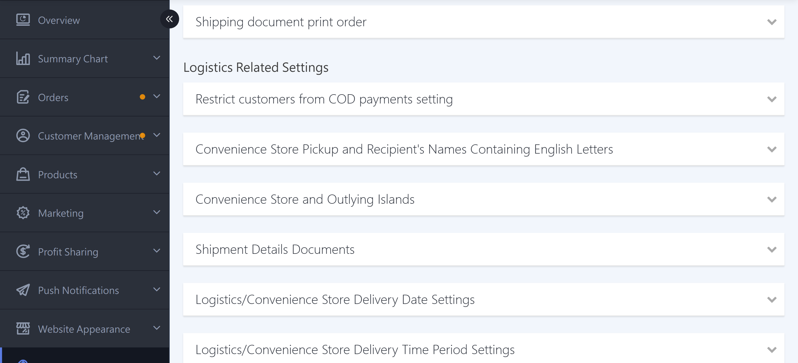
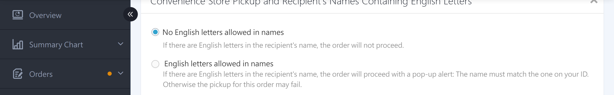
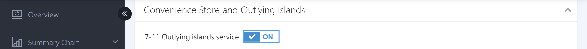
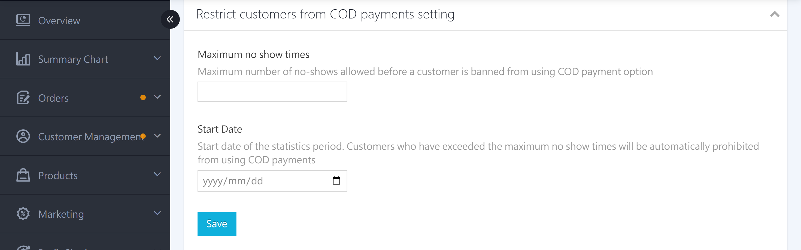
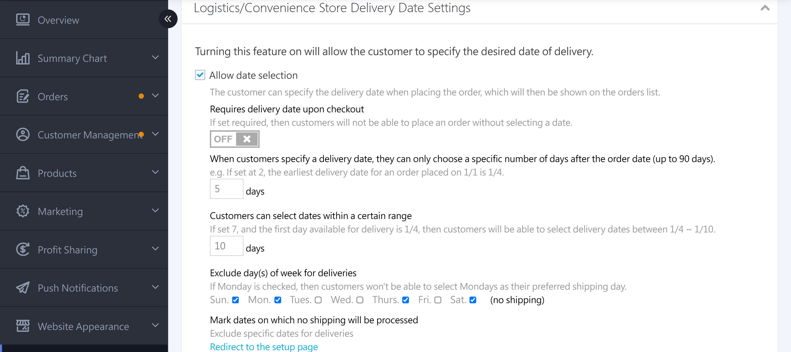
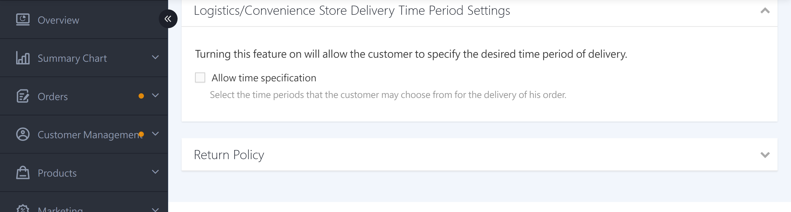
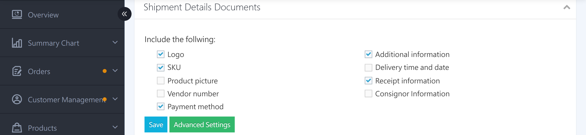
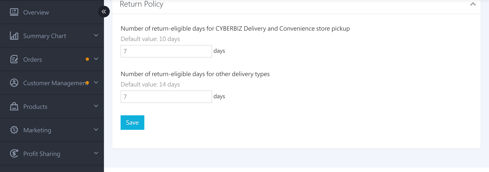

{ title="Logistics settings page"  .hero-page }

## Logistics Settings Overview { #intro-logistics-settings }

"Logistics Settings" is in the "Payments & Logistics" > "Checkout & Logistics Settings" page, in the "Logistics Settings" section at the bottom. It lets you fine-tune delivery details and the delivery preferences customers can choose. Here, you can set convenience store pickup name rules and island delivery, shipping detail print fields, whether customers can choose delivery dates and time slots, and the number of days customers can request returns on the storefront.

!!! info "Tip"
    If you turn off "Cart Activation Settings" at the top of the page, this section is locked and cannot be configured. Enable the cart feature before you set up logistics.

---

## Page Feature Overview { #overview-logistics-settings }

| Section | Purpose | Plan Restrictions |
| :-- | :-- | :-- |
| [Customer Convenience Store Cash-on-Delivery Blocking Settings](#operate-logistics-settings-cod-restrict) | Automatically blocks convenience store cash on delivery for customers with repeated uncollected orders | All plans |
| [Convenience Store Name Rules](#operate-logistics-settings-cvs) | Whether the recipient name can contain letters or numbers | All plans |
| [Convenience Store Island Delivery Settings](#operate-logistics-settings-cvs) | Whether to allow 7-11 island delivery | All plans |
| [Shipping Detail Print Settings](#operate-logistics-settings-fulfillment-print) | Sets the shipping detail fields shown on the shipping slip | All plans |
| [Customer-Selectable Delivery Date Settings](#operate-logistics-settings-delivery-date) | Lets customers choose a delivery date (including advanced rules) | Basic features on all plans / Advanced (PLUS / Enterprise) |
| [Customer-Selectable Time Slot Settings](#operate-logistics-settings-delivery-time) | Lets customers choose a delivery time slot | All plans |
| [Return Period Adjustment Settings](#operate-logistics-settings-return-timing) | Sets the number of days customers can request a return on the storefront | PLUS / Enterprise |

---

## Prerequisites and Restrictions { #prerequisites-logistics-settings }

!!! plan "Plan / Activation Requirements"
    * **Customer-Selectable Delivery Date Settings**: Turning this on or off and "Prep Days" are basic features. Advanced rules (required delivery date, selectable days, and fixed weekly no-ship days) require PLUS or higher, or Enterprise.
    * **Return Period Adjustment Settings**: The "Return Period Adjustment Settings" feature requires PLUS or higher, or Enterprise. "Partial Return Requests on the Storefront" requires Enterprise.

---

## Steps { #operate-logistics-settings }

Path: In the admin, go to "Payments & Logistics" > "Checkout & Logistics Settings," then scroll down to the "Logistics Settings" section.

### Set up Convenience Store Name Rules and Island Delivery { #operate-logistics-settings-cvs }

For Convenience Store pickup, you can set rules for the recipient's name format and allow island delivery.

1. **Convenience Store Name Rules:** Expand the "Whether to Allow Recipient Names with Letters or Numbers for CVS Pickup" section and choose one: **"Turn On CVS Name Check"** (checkout is blocked if the name contains letters or numbers) or **"Turn Off CVS Name Check"** (checkout is still allowed, but a reminder shows that the name must match the ID).

    { title="CVS Name Rules" }

2. **Convenience Store Island Delivery Settings:** Expand the "CVS Island Delivery Settings" section, then enable the **Enable 7-11 Island Delivery** toggle to allow island pickup.

    { title="CVS Island Delivery Settings" }

---

### Set up Customer Convenience Store Cash-on-Delivery Blocking { #operate-logistics-settings-cod-restrict }

For customers who repeatedly place convenience store cash-on-delivery orders but don't pick them up, the system can automatically block them from using convenience store cash on delivery again. This reduces losses from abandoned orders.

1. **Expand the section:** Click the title of the "Customer CVS Cash-on-Delivery Blocking Settings" section to expand it.
2. **Set the uncollected order limit:** In "Uncollected Order Limit," enter the maximum number of uncollected orders allowed.
3. **Set the counting start date:** In "Counting Start Date," select the date to start counting from. From that date to today, if a customer's uncollected orders exceed the limit, the system automatically blocks their convenience store cash on delivery.
4. **Finish:** Click **Save**.

{ title="Set Up Customer CVS Cash-on-Delivery Blocking" }

!!! note "Note"
    To restore convenience store cash on delivery for a blocked member, edit "Account Settings" in that member's details.

---

### Set up Customer-Selectable Delivery Dates { #operate-logistics-settings-delivery-date }

Lets customers choose their preferred delivery date at checkout. You can also apply prep days and no-ship date rules.

1. **Expand the section:** Click the title of the "Logistics/CVS Customer-Selectable Delivery Date Settings" section to expand it.
2. **Turn on customer-selectable delivery dates:** Select **Turn On / Off Customer-Selectable Delivery Dates**. Customers can then choose a delivery date when they place an order.
3. **Set prep days:** In "Days After Order Date Customers Can Select for Delivery," enter the prep days (up to 90 days)[^prepare-day].
4. **Set advanced rules:** Set **Weekly Fixed No-Ship Days** and **Specific No-Ship Dates**.

    !!! info "Advanced Rule Plan Availability"
        - **Weekly Fixed No-Ship Days**: Available on PLUS and Enterprise.
        - **Specific No-Ship Dates**: Available on Advanced (including PLUS), Expert (including PLUS), and Enterprise.

            > If you are on **Professional PLUS** and have added the [recurring payment feature](../../marketing/other-tools/subscription-campaign-page.md), the system also unlocks the **Specific No-Ship Dates** feature.

[^prepare-day]: Example: If prep days is set to 2 and a customer places an order on Jan 1, the earliest selectable delivery date is after Jan 3 (Jan 3 not included).

{ title="Set Up Customer-Selectable Delivery Dates" }

---

### Set up Customer-Selectable Delivery Time Slots { #operate-logistics-settings-delivery-time }

Lets customers choose a delivery time slot (all day / morning / afternoon / evening) and lets you customize the description text for each slot.

1. **Expand the section:** Click the title of the "Logistics/CVS Customer-Selectable Time Slot Settings" section to expand it.
2. **Turn on customer-selectable time slots:** Select **"Turn On / Off Customer-Selectable Time Slots"**.
3. **Select the time slots to display:** Select the time slots you want to offer. In the field on the right, you can customize the "Option Content" description text for each slot[^time-clear].

[^time-clear]: If you uncheck all time slots, the system automatically turns off customer-selectable time slots and hides the advanced settings.

{ title="Set Up Customer-Selectable Delivery Time Slots" }

---

### Set up Shipping Detail Print Fields { #operate-logistics-settings-fulfillment-print }

Customize the fields to show in the shipping slip details to help warehouse and shipping staff work more efficiently.

1. **Expand the section:** Click the title of the "Shipping Detail Print Settings" section to expand it.
2. **Select the items to display:** Select the fields you need: order payment method, product image, product SKU, product vendor number, invoice information, delivery date and time slot, additional order information, shipping staff information, display logo image, and more.
3. **Finish:** Click **Save**.

{ title="Set Up Shipping Detail Print Fields" }

- :lucide-printer:{ .lg }  [__Set Up and Print Shipping Details__](../../orders/order-settings/shipping-detail-print.md)

---

### Set up Front-End Return Request Period { #operate-logistics-settings-return-timing }

Sets the number of days customers can request a return from the storefront member center. Shipping integrations and custom logistics can be set separately.

1. **Expand the section:** Click the title of the "Return Period Adjustment Settings" section to expand it.
2. **Set return days:** Enter the return days for "CYBERBIZ home delivery and CVS pickup" and "other shipping methods" separately[^return-zero].
3. **(Optional) Turn on partial returns on the storefront:** If you have activated the corresponding feature, select **"Turn On Partial Returns on the Storefront"** to let customers select the items they want to return on the return request page.
4. **Finish:** Click **Save**.

For the default return periods and calculation start points for each shipping method, see [Storefront Return Period Reference](../references/return-eligible-days-reference.md#specs-return-eligible-days){ data-preview }.

[^return-zero]: Entering 0 means customers cannot request returns on the storefront. Leaving the field blank uses the system default number of days.

{ title="Set Up Front-End Return Request Period" }

---

<!-- ### Set Up Uber Direct Priority Logistics { #operate-logistics-settings-uber-direct } -->
<!---->
<!-- Connect Uber Direct Priority Logistics to provide fast package delivery. -->
<!---->
<!-- 1. **Expand the section:** Click the title of the "Uber Direct Priority Logistics" section to expand it. -->
<!-- 2. **Fill in merchant information:** Enter the company name, E-mail, contact phone, merchant type, and product type, and check to agree to the contract terms. -->
<!-- 3. **Confirm** Click **Confirm** to finish setup. -->
<!---->
<!--  -->
<!---->
<!-- !!! warning "Warning" -->
<!--     Once Uber Direct merchant information is saved, it cannot be changed (in some cases, only the product type can be adjusted). Double-check the information before submitting. You can also turn on "Package Pickup PIN Verification" to require customers to give the PIN to the driver to complete pickup. -->
<!---->
<!-- --- -->

## FAQ { #faq-logistics-settings }

??? quote "Why are the logistics settings sections unclickable or locked?"
    { #faq-logistics-settings-locked }
    This is usually because the cart feature is turned off. When the cart is off, the logistics settings are locked too. Go back to "Cart Activation Settings" at the top of this page and enable the cart feature to set up logistics.

??? quote "What does entering 0 for return days mean?"
    { #faq-logistics-settings-return-zero }
    Entering 0 means **do not allow** customers to request returns on the storefront. To use the system default days, **leave the field blank** (CYBERBIZ home delivery / CVS pickup default is 10 days; other shipping methods default to 14 days). See [Storefront Return Period Reference](../references/return-eligible-days-reference.md#specs-return-eligible-days){ data-preview }.

??? quote "Can't find "Delivery Date Required" or "Set Specific No-Ship Dates"?"
    { #faq-logistics-settings-advanced-date-missing }
    Turning customer-selectable delivery dates and prep days on or off is a basic feature available on all plans. However, "Delivery Date Required," "Selectable Days," and "Weekly Fixed No-Ship Days" require the "Advanced Delivery Selection" feature, and "Set Specific No-Ship Dates" requires the "Specific No-Ship Dates" feature. See [Prerequisites and Restrictions][prerequisites-logistics-settings]{ data-preview } or contact your sales representative.

---

## Next Steps { #next-steps-logistics-settings }

After you finish the logistics settings, you can continue with the following workflows:

- :lucide-shopping-cart:{ .lg }  
  [__Cart Settings__](cart-settings.md){ title="Cart Settings" }  
  Adjust cart behavior before checkout, including cart activation, unpaid-checkout reminders, and coupon settings.

- :lucide-receipt:{ .lg }  
  [__Order Settings__](order-settings.md){ title="Order Settings" }  
  Set order amount thresholds, unpaid and failed-payment reminders, auto-close, and cancellation rules.

---

## See Also { #reference-logistics-settings }

* [Storefront Return Period Reference](../references/return-eligible-days-reference.md)

[prerequisites-logistics-settings]: #prerequisites-logistics-settings
