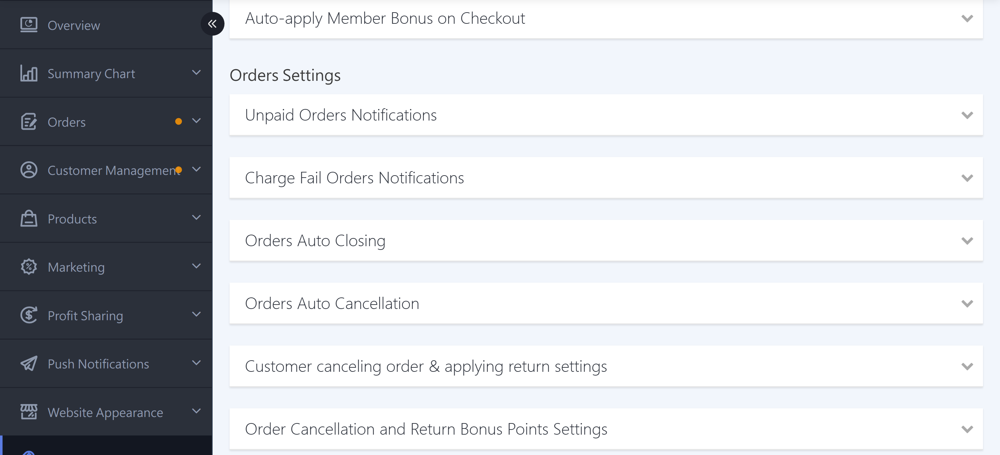
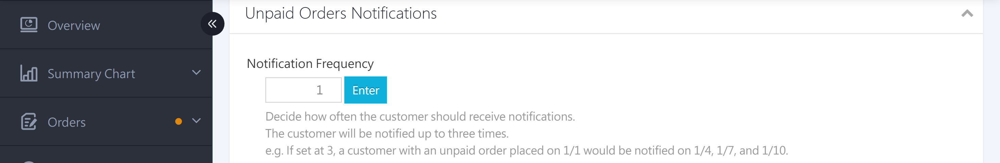
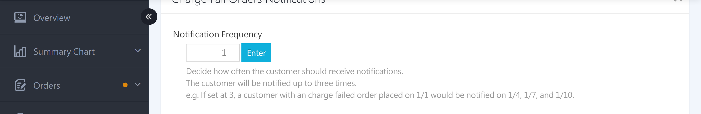
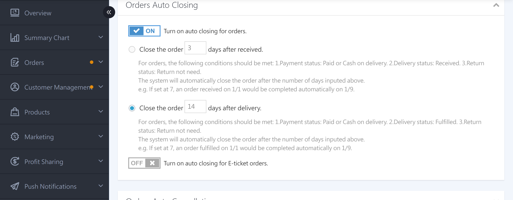
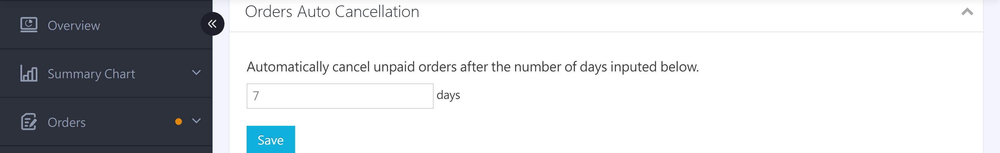
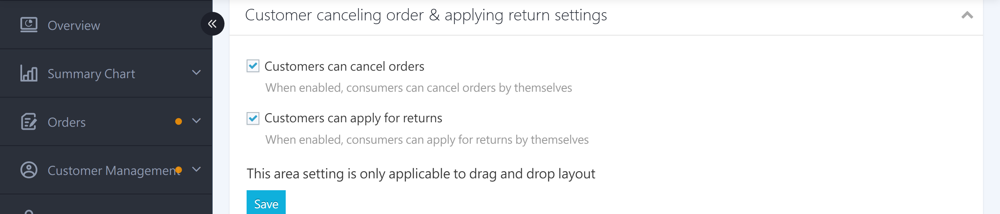
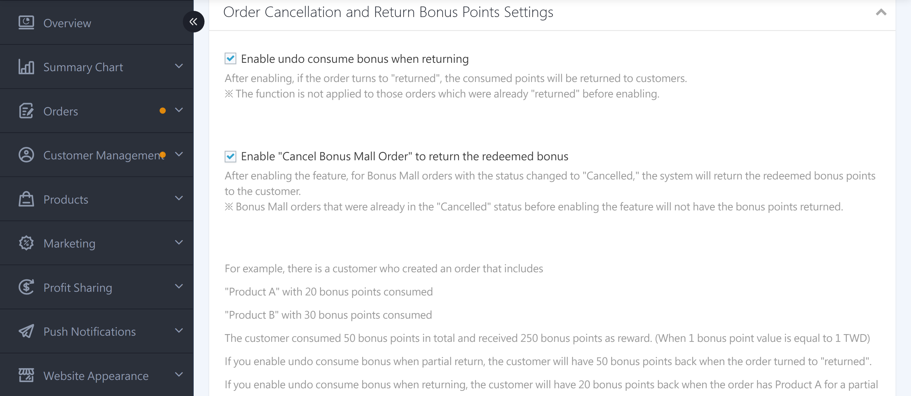
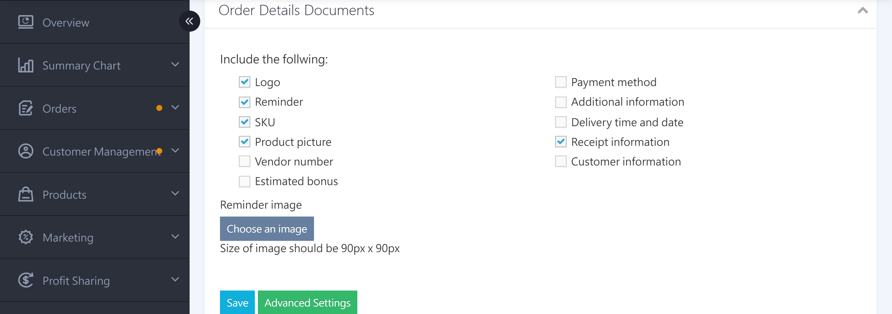
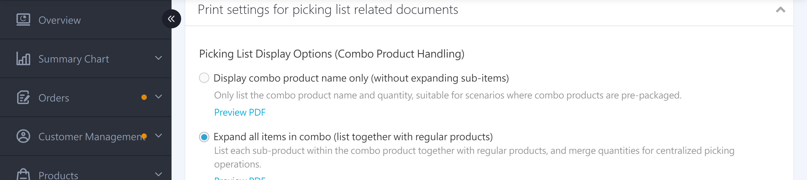

{ title="Order Settings Page"  .hero-page }

## Order Settings Overview { #intro-order-settings }

The “Order Settings” section is in the middle of the Checkout & Logistics Settings page (“Payments & Logistics” > “Checkout & Logistics Settings”) in the back office. It covers the automated rules for orders, from creation and reminders to closing and printing. With these settings, you can control minimum order amounts, reduce lost unpaid orders, have the system automatically close and cancel overdue orders, and choose which fields appear on printed documents.

!!! info "Tip"
    Settings are grouped into “sections,” and each section is collapsed by default. Click a section title to expand it, then make your changes and save them. Settings take effect only after you save.

---

## Page Overview { #overview-order-settings }

| Settings Section | Purpose | Plan Restrictions |
| :-- | :-- | :-- |
| [Minimum Order Amount](#operate-order-settings-amount-threshold) | Set a minimum amount required to place an order | Enterprise |
| [Unpaid Order Reminder Settings](#operate-order-settings-payment-reminder) | Automatically send unpaid order reminder emails | All plans |
| [Payment-Failure Order Reminder Settings](#operate-order-settings-payment-reminder) | Automatically send payment-failure reminder emails | All plans |
| [Order Auto-Close Settings](#operate-order-settings-auto-close) | Automatically close orders N days after the delivery status is reached | All plans |
| [Order Auto-Cancel](#operate-order-settings-auto-cancel) | Automatically cancel overdue unpaid orders | All plans |
| [Customer Order Cancellation and Return Request Settings](#operate-order-settings-customer-cancel) | Allow storefront members to cancel orders or request returns on their own | Drag-and-drop templates |
| [Order Cancellation and Return Bonus Settings](#operate-order-settings-return-bonus) | Whether to return or issue bonuses for returns and cancellations | PLUS / Enterprise |
| [Order Detail Print Document Settings](#operate-order-settings-print-detail) | Set the fields shown on order detail prints | All plans |
| [Picking List Print Document Settings](#operate-order-settings-print-picking) | Set how bundled products appear on picking lists | All plans |

---

## Prerequisites and Restrictions { #prerequisites-order-settings }

!!! plan "Plan / Activation Requirements"
    * **Minimum Order Amount**: Enterprise.
    * **Order Cancellation and Return Bonus Settings**: Options appear based on the bonus features you have enabled (returning consumption bonuses, returning or issuing bonuses for partial returns, Bonus Mall, etc.). Most of these require PLUS or higher, or Enterprise.
    * **Customer Order Cancellation and Return Request Settings**: Applies only to drag-and-drop templates. With other templates, this section is grayed out and cannot be edited.

---

## Steps { #operate-order-settings }

Entry path: In the back office, go to “Payments & Logistics” > “Checkout & Logistics Settings,” then scroll down to the “Order Settings” section.

### Set a Minimum Order Amount { #operate-order-settings-amount-threshold }

[:lucide-tag:{ title="Applicable Plans" }](../../../resources/conventions#適用方案) | Enterprise

If you sell low-priced products and want to make sure each order reaches a certain amount before it is placed, you can use the amount settings.

1. **Minimum Order Amount:** Expand the section, turn on the toggle “Turn On/Off Minimum Order Amount,” enter the threshold in the field “Final order amount must be greater than or equal to NT$___ to place an order,” and click **“Submit.”** You can also select **“Include bonus redemption amount”**[^min-bonus].
2. **Cumulative Order Amount Protection:** Expand the section, turn on the setting, enter the “Maximum Cumulative Order Amount” and the “Calculation Period” (start date and end date), and click **Save**.

[^min-bonus]: When “Include bonus redemption amount” is turned on, the system checks whether the threshold is met using the order amount before bonus redemption. When it is turned off, the system uses the final amount after redemption.

{ title="Set a Minimum Order Amount" }

---

### Set up Unpaid and Payment-Failure Reminders { #operate-order-settings-payment-reminder }

The system can automatically send reminder emails for orders that are unpaid or have failed payment, helping you recover these orders.

1. **Unpaid Order Reminder Settings:** Expand the section, enter the interval in days in “Set Days,” and click **“Submit.”** The system sends the reminder email **three times** at this interval[^reminder-rule].

    { title="Unpaid Order Reminder Settings" }

2. **Payment-Failure Order Reminder Settings:** Expand the section, enter the interval in days in “Set Days,” and click **“Submit.”** Each payment-failed order receives up to **three** reminders[^set-rule].

    { title="Payment-Failure Order Reminder Settings" }

[^reminder-rule]: For example, if set to 3 days, an order placed on January 1 is sent reminders on January 4, 7, and 10. If the customer completes payment in the meantime, reminders stop automatically.

[^set-rule]: Enter 0 to disable payment-failure reminders.

---

### Set up Automatic Order Closing { #operate-order-settings-auto-close }

The system automatically closes orders after a specified number of days based on the delivery status, so you do not need to close each order manually.

1. **Expand the section:** Click the section title “Order Auto-Close Settings” to expand it.
2. **Turn on auto-closing:** Turn on the **“Turn On Order Auto-Closing”** toggle. Closing condition options appear below it.
3. **Choose a closing condition:** Choose one: **“Automatically close the order ___ days after the customer picks up”** (for integrated logistics such as convenience stores and Black Cat) or **“Automatically close the order ___ days after the order ships”** (for custom logistics). Then enter the number of days.
4. **(Ticket orders)** If the ticket feature is enabled, you can also turn on **“Turn On Ticket Order Auto-Closing”** and set automatic closing for “___ days after the customer pays.”

For the trigger conditions and order status requirements for each closing type, see [Order Auto-Close Type Reference](../../orders/references/order-auto-close-types-reference.md#reference-order-auto-close-types){ data-preview }.

{ title="Set Up Order Auto-Closing" }

!!! warning "Caution"
     Once an order is closed (manually or automatically), the system settles and issues consumption bonuses and affiliate commissions. If a return occurs later, the bonus already issued is not automatically deducted and must be handled manually on the member page. To learn whether bonuses are returned when an order is returned, see [Set Up Bonus Handling for Returns and Cancellations][operate-order-settings-return-bonus]{ data-preview }.

- :lucide-clock:{ .lg }  [__Full Auto-Close Order Settings__](../../orders/order-settings/auto-close-order-settings.md)

---

### POS Order Auto-Close Settings { #operate-order-settings-pos-auto-close }

If you also use the POS system, you can set auto-close rules for POS orders.

1. **Expand the section:** Click the section title “POS Order Auto-Close Settings” to expand it.
2. **Turn on auto-closing:** Turn on the **“Turn On POS Order Auto-Closing”** toggle.
3. **Finish:** Click **Save** to apply the settings.

{ title="POS Order Auto-Close Settings" }

- :lucide-clock:{ .lg }  [__Full POS Order Auto-Close Settings__](../../../pos/orders/pos-order-auto-close.md)

---

### POS Store Pickup Order Overdue Settings { #operate-order-settings-pos-store-overdue }

If you also use the POS system, you can set overdue rules for POS store pickup orders. If the customer does not pick up the package after it arrives at the store, the system can automatically mark the order as overdue.

1. **Expand the section:** Click the section title “POS Store Pickup Order Overdue Settings” to expand it.
2. **Turn on overdue settings:** Turn on the **“Turn On/Off Order Overdue Settings”** toggle.
3. **Set the overdue days:** In “Automatically mark as overdue ___ days after the package arrives at the store,” enter the number of days. The default is **1** day. Only orders with the status “Payment Received, Arrived at Store” are included in the calculation.
4. **Finish:** Click **“Submit”** to apply the settings.

After you turn on this feature, the system changes uncollected orders to overdue based on the number of days you set[^pos-store-overdue].

[^pos-store-overdue]: Example: If set to 7 days and the order status changes to Arrived at Store on January 1 at 00:00, the order changes to overdue after January 8 at 00:00.

{ title="POS Store Pickup Order Overdue Settings" }

---

### Member Barcode-Only Pickup Settings <small>POS</small> { #operate-order-settings-pos-member-barcode }

If you also use the POS system, you can require that POS storefront pickup be completed only with the app member barcode.

1. **Expand the section:** Click the section title “Member Barcode-Only Pickup Settings” to expand it.
2. **Turn on the setting:** Turn on the **“Turn On/Off POS Storefront Member Barcode-Only Pickup”** toggle.
3. **Finish:** Click **Save** to apply the settings.

After you turn on “Member Barcode-Only Pickup Settings,” the POS storefront pickup pop-up accepts only the app member barcode to complete pickup.

{ title="Member Barcode-Only Pickup Settings" }

---

### Order Auto-Cancel Settings { #operate-order-settings-auto-cancel }

For orders that remain unpaid beyond a specified number of days, the system can cancel them automatically to release inventory.

1. **Expand the section:** Click the section title “Order Auto-Cancel” to expand it.
2. **Set the number of days:** Enter the number of days, then click **Save**. The system automatically cancels orders that remain **unpaid** beyond that number of days[^auto-cancel-zero].

[^auto-cancel-zero]: Enter 0 to disable auto-cancel. This feature applies only to unpaid orders.

{ title="Set Up Order Auto-Cancel" }

---

### Allow Customers to Cancel Orders or Request Returns on the Storefront { #operate-order-settings-customer-cancel }

Decide whether to show the “Cancel Order” and “Request Return” buttons in the storefront member center so customers can handle these requests themselves.

1. **Expand the section:** Click the section title “Customer Order Cancellation and Return Request Settings” to expand it.
2. **Set permissions:** Select **“Customers can cancel orders”** or **“Customers can request returns”** to let shoppers take these actions on the storefront.
3. **Finish:** Click **Save**.

{ title="Allow Storefront Cancellations and Returns" }

!!! note "Note"
    These settings apply only to drag-and-drop templates. If you use a template other than drag-and-drop, the options appear grayed out and cannot be edited.

---

### Set up Bonus Handling for Returns and Cancellations { #operate-order-settings-return-bonus }

[:lucide-tag:{ title="Applicable Plans" }](../../../resources/conventions#適用方案) | PLUS / Enterprise

When an order is returned or canceled, decide whether the system automatically returns the bonus the customer redeemed, or issues the bonus the customer is entitled to.

1. **Expand the section:** Click the section title “Order Cancellation and Return Bonus Settings” to expand it.
2. **Turn on the toggles you need:** You will see the following options (shown based on the features you have enabled)[^bonus-options]:
    * **Turn on “Return Redeemed Bonus for Returned Orders”**: For a full return, returns the bonus the customer redeemed on the order.
    * **Turn on “Return Redeemed Bonus for Partially Returned Orders” `Enterprise Plan`**: For a partial return, returns the bonus redeemed for the returned products.
    * **Turn on “Issue Bonus for Partially Returned Orders” `Enterprise Plan`**: After a partial return is closed, issues the bonus the customer is entitled to.
    * **Turn on “Return Redeemed Bonus for Canceled Bonus Mall Orders” `Enterprise Plan`**: When canceling an Bonus Mall order, returns the bonus redeemed (bonus points).

[^bonus-options]: Each toggle applies only to orders whose status changes after the toggle is turned on. Orders that were already returned or canceled before it was turned on do not receive a bonus issue or return.

{ title="Set Up Bonus Handling for Returns and Cancellations" }

---

### Order Detail Print Document Settings { #operate-order-settings-print-detail }

Customize the fields and format shown when order details are printed.

1. **Expand the section:** Click the section title “Order Detail Print Document Settings” to expand it.
2. **Select the items to display:** Select the items to show on the printed details, such as customer information, order payment method, product image, product SKU, invoice information, vendor number, delivery date and time slot, and additional order information. You can also upload a logo and set an opening reminder text.
3. **Finish:** Click **Save**.

{ title="Order Detail Print Document Settings" }

- :lucide-printer:{ .lg }  [__Set Up and Print Order Details__](../../orders/order-settings/order-detail-print.md)

---

### Picking List Print Document Settings { #operate-order-settings-print-picking }

Customize the format shown when picking lists are printed.

1. **Expand the section:** Click the section title “Picking List Print Document Settings” to expand it.
2. **Choose a display method:** In “Picking List Display Method (Bundled Product Handling),” select **“Show Only Bundle Name”** (pre-packed) or **“Expand All Items in the Bundle”** (centralized picking). Click **“Preview PDF”** to check the result.
3. **Finish:** Click **Save**.

{ title="Picking List Print Document Settings" }

!!! tip "Tip"
    If you usually ship based on the shipment details on the waybill, see “Shipment Detail Print Settings” in the logistics section. For details, see [Logistics Settings](logistics-settings.md#operate-logistics-settings-fulfillment-print).

---

## FAQ { #faq-order-settings }

??? quote "If an order is returned after it has been closed, will the bonus previously issued be automatically deducted?"
    { #faq-order-settings-bonus-after-close }
    No. Once an order is closed, consumption bonuses and affiliate commissions are settled and issued. If the order is returned later, the system does not automatically deduct the bonus already issued. The merchant must handle this manually on the member page. To automatically return the bonus the customer redeemed when an order is returned, turn on the related feature in “Order Cancellation and Return Bonus Settings.”

??? quote "Will cash-on-delivery orders be automatically canceled?"
    { #faq-order-settings-cod-auto-cancel }
    Order auto-cancel applies only to orders marked as unpaid. Before the customer picks up a cash-on-delivery order, it is not a regular payment-flow order in an unpaid state. Determine this based on your actual payment and logistics setup. If you have questions, contact your CYBERBIZ sales representative.

??? quote "Will unpaid reminder emails keep being sent?"
    { #faq-order-settings-reminder-count }
    No. Unpaid and payment-failure reminders are each sent up to three times, at the interval you set. Reminders stop as soon as the customer completes payment.

??? quote "Should I choose “Received” or “Shipped” for automatic closing?"
    { #faq-order-settings-close-type }
    If you use integrated logistics such as convenience stores or Black Cat, we recommend “N days after the customer picks up” (closes based on the received status). If you use custom logistics, the system cannot tell whether the customer has received the order, so choose “N days after the order ships” (closes based on the shipped status). For details, see [Order Auto-Close Type Reference](../../orders/references/order-auto-close-types-reference.md#reference-order-auto-close-types){ data-preview }.

---

## Next Steps { #next-steps-order-settings }

After you complete the order settings, continue with the following:

- :lucide-shopping-cart:{ .lg }  
  [__Cart Settings__](cart-settings.md){ title="Cart Settings" }  
  Adjust customer cart behavior before checkout, including cart activation, unfinished-checkout reminders, and coupon settings.

- :lucide-package:{ .lg }  
  [__Logistics Settings__](logistics-settings.md){ title="Logistics Settings" }  
  Adjust delivery details and the delivery preferences customers can choose.

---

## References { #reference-order-settings }

* [Order Auto-Close Type Reference](../../orders/references/order-auto-close-types-reference.md)

[operate-order-settings-return-bonus]: #operate-order-settings-return-bonus
