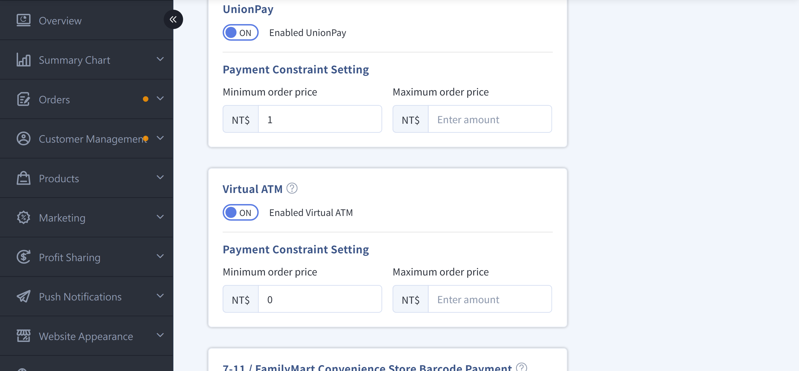
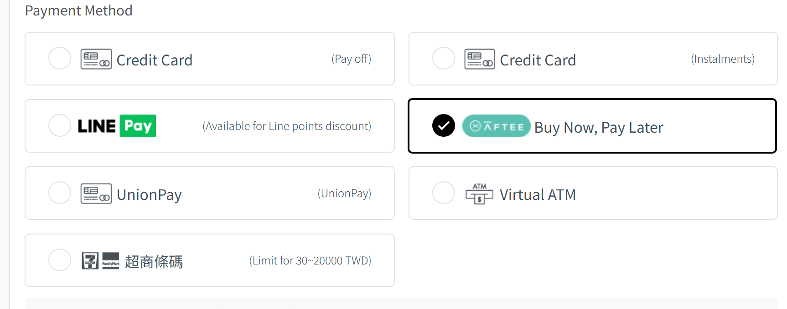

{ title="AFTEE Pay Later" .hero-page }

## AFTEE Pay Later Overview

AFTEE Pay Later gives customers a fast, convenient, and secure payment method. Customers can complete checkout without a credit card.

- Customers can verify their mobile number and then pay with AFTEE Pay Later.
- Improve checkout efficiency and payment convenience, and increase order completion rates.
- If customers have payment or billing issues, they can contact the [AFTEE official website](https://aftee.tw/) for support.

### Transactions and Fees

- **Processing fee**: Charged at the rate set in the back office. The rate does not include 5% business tax, which is added separately on the statement.
- **Preferential rate**: 2.5% (excluding tax). Rate recognition is based on the shipment date.
- **Refunds**: The process is the same as for credit card payments.

---

### Device and Browser Restrictions

- Customers must verify with a mobile phone that can receive SMS.
- The system has no additional browser restrictions, but we recommend using a mainstream mobile browser for a smooth process.

---

### Automatic Cancellation Rules

- Orders paid with AFTEE are automatically canceled if not shipped within 90 days (pre-order items excluded).
- The system sends reminder notifications 30, 15, 7, 3, and 1 days before cancellation, so merchants can track shipment progress.

---

### Installment Payment Support

- After downloading the AFTEE app, customers can choose an installment payment option.
- No additional activation is required. Installment features are controlled by the AFTEE app. Learn [How to Use AFTEE Installment Payments :lucide-external-link:](https://netprotections.freshdesk.com/support/solutions/articles/70000197869-%E5%8F%AA%E6%9C%89app%E6%9C%83%E5%93%A1%E8%83%BD%E5%88%86%E6%9C%9F%E5%97%8E-)

## Setup Steps

### Step 1: Apply to Activate AFTEE

1. Log in to the CYBERBIZ back office and go to **Payment and Logistics > Payment Settings**.
2. In the CYBERBIZ PAYMENTS section, click **Edit** to open the edit page.
3. In the AFTEE settings section, click **Apply**, fill in the "AFTEE Activation Request" dialog, and click **Submit Application** for AFTEE review.
4. After AFTEE approves the application, the system sends a notification email to the site administrator.

{ title="AFTEE activation request" }

### Step 2: Enable the Payment Method

1. Log in to the CYBERBIZ back office and go to **Payment and Logistics > Payment Settings**.
2. In the CYBERBIZ PAYMENTS section, click **Edit** to open the edit page.
3. In the AFTEE section, turn on AFTEE.
4. The AFTEE payment option appears on the storefront.

{ title="AFTEE on storefront" }

### Step 3: Customer Payment Process

1. On the checkout page, the customer selects AFTEE Pay Later.
2. Click **Pay with AFTEE Pay Later**.  
3. Enter the registered AFTEE mobile number. After receiving the verification code, the customer completes the payment.
4. The system shows the order as "Payment Received", and the order is ready to ship.  
5. If the payment fails, the customer can retry as instructed or contact AFTEE directly.

{ title="AFTEE checkout flow" }

<!--

## Next Steps

- :lucide-shield-check:{ .lg }  
  [__Set Up Automatic Cancellation Rules__](設定訂單自動取消規則)  
  Control automatic cancellation of AFTEE orders not shipped within 90 days, and send reminder emails.

- :lucide-bar-chart-2:{ .lg }  
  [__View AFTEE Fees and Reconciliation__](View AFTEE Fees and Reconciliation)  
  Verify the fees and taxes for each order to maintain payment accuracy.

-->

## FAQ

??? quote "Does AFTEE Pay Later have order amount limits?"
	Yes. You can set payment thresholds in the back office to limit the minimum and maximum order amounts.

??? quote "What should I do if a customer does not receive the verification code?"
	Make sure the mobile number is correct and can receive SMS. If the customer still does not receive the code, ask them to contact AFTEE.

??? quote "What happens if an order is not shipped within 90 days?"
	The system automatically cancels the order (pre-order items excluded) and sends reminder emails 30, 15, 7, 3, and 1 days before cancellation.

??? quote "Does AFTEE support installment payments?"
	Yes. Customers must download the AFTEE app and select installment payment in the app.

??? quote "How do I confirm that a customer has paid?"
	The order status in the back office shows "Payment Received", and you can proceed with shipping.
