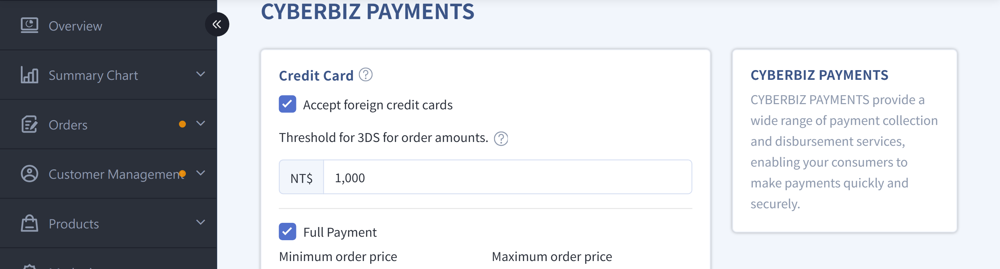

{ title="3D Verification Threshold" .hero-page }

## 3D Verification Threshold Overview { #intro-card-3d }

Set a transaction amount threshold to control **which credit card transactions require 3D verification (SMS / OTP)**, balancing **transaction security** and **checkout conversion rate**.

### System Decision Rules { #specs-card-3d-rules }

- When the order amount is **greater than or equal to** the threshold, the system requires the customer to complete **3D verification**.
- When the order amount is **below** the threshold, the system processes **background authorization** directly without showing a verification screen.

---

### What Is 3D Verification { #intro-card-3d-what }

**3-D Secure (3DS)** is an additional identity verification mechanism for online credit card transactions that effectively reduces the risk of card fraud and unauthorized transactions.

During checkout, the cardholder must complete verification using one of the following methods:

- SMS one-time password (OTP)
- Issuing bank verification page
- Biometric authentication (depending on bank support)

---

### What Is Background Authorization { #intro-card-3d-silent-auth }

**Background authorization** means the system automatically completes the credit card authorization process in the background. Customers do not need to complete 3D verification or enter an SMS verification code.

!!! warning "Warning"
    Background authorization still completes the credit card authorization, but **does not use the 3D verification anti-fraud mechanism**, so **the merchant bears the fraud risk and liability**. Merchants should assess their actual risk to decide whether to adjust the threshold or enable 3D verification.

---

??? note-clean "3D Verification Flow"

    ``` mermaid
    flowchart LR
      A[Customer <br> Checkout] --> B{Order Amount <br> ≥ Threshold?}
      B -->|Yes| C[3D <br> Verification]
      B -->|No| D[Background <br> Authorization]
      C --> E[SMS <br> Verification]
      E --> F{Verification <br> Success?}
      F -->|Yes| G[Payment <br> Complete]
      F -->|No| H[Payment <br> Failed]
      D --> G
    ```

## Prerequisites { #prerequisites-card-3d-req }

- [x] Successfully [activated **CYBERBIZ PAYMENTS**](apply-cyberbiz-payments.md){ title="Apply for CYBERBIZ PAYMENTS" }  
- [x] The storefront can be browsed normally and checkout can be completed

## Usage Notes { #prerequisites-card-3d }

- **Recurring Payment Orders**

    - The first transaction is verified with 3D verification based on the threshold rule.     
    - All subsequent recurring charges use background authorization and no longer require customer verification.

- **Applicable Card Types**

    - Domestic credit cards    
    - International credit cards

### Fraud Liability Allocation { #specs-card-3d-liability }

|Configuration|Fraud Liability|Loss Responsibility|
|---|---|---|
|**3D Verification Enabled**|Cardholder|Once the bank confirms the fraud, the merchant typically does not bear the loss.|
|**3D Verification Not Enabled**|Merchant|The cardholder can request a chargeback from the bank, and the merchant typically must absorb the loss.|

!!! info "Actual liability and payment handling remain subject to the determination of the issuing bank, acquiring bank, and payment service provider."

!!! tip "Recommended Configuration"
	- To reduce fraud risk, we recommend setting the 3D verification threshold to **NT$1** so that all credit card transactions require 3D verification.
	- This is a risk management recommendation and not a mandatory system restriction.

## Configure the 3D Verification Threshold { #operate-card-3d-threshold }

1. Log in to the CYBERBIZ admin and go to **Payment and Logistics > Payment Settings**.
2. In the CYBERBIZ PAYMENTS field, click **:material-file-document-edit-outline: Edit** to open the setup page.
3. In the **3D Verification Amount Threshold** field, enter the trigger value.
4. Save the settings.

{ title="3D Verification Threshold Settings" }


## Customer Checkout Flow { #operate-card-3d-checkout }

### Standard Payment <small>Background Authorization</small> { #operate-card-3d-silent-pay }

When the order amount is below the threshold:

1. Customer enters credit card information
2. System completes authorization directly
3. Payment completed

### 3D Verification Payment { #operate-card-3d-verified-pay }

When the order amount meets or exceeds the threshold:

1. Customer enters credit card information
2. System redirects to the issuing bank verification page
3. Customer completes SMS or bank verification
4. Payment is completed after successful verification

{ title="3D Verification Payment Screen" }

## FAQ { #faq-card-3d }

??? quote "What should I do if 3D verification fails?"  
	Confirm the following with your issuing bank:  

	1. Whether the registered mobile number is correct  
	2. Whether SMS verification service is enabled  
	3. Whether the credit card supports 3D verification

    !!! tip "Recommendation: If verification still cannot be completed, ask the customer to use a different credit card or contact the bank's customer service."

??? quote "Can I turn off 3D verification?"
	Yes. Set the threshold to a very high amount (for example, 9999999), and all orders will use background authorization. However, this is not recommended because it increases fraud risk.

??? quote "Do recurring payment orders require 3D verification every time?"
	No. Only the first order requires 3D verification. Subsequent charges use background authorization and do not require customer verification.

??? quote "Do international credit cards also support 3D verification?"
	Yes. Both domestic and international credit cards support 3D verification.

??? quote "How soon does a threshold change take effect?"
	It takes effect immediately. The next order will use the new threshold.

??? quote "Will the customer be charged if 3D verification fails?"
	No. A failed verification means the transaction was not completed, so no charge is made.
