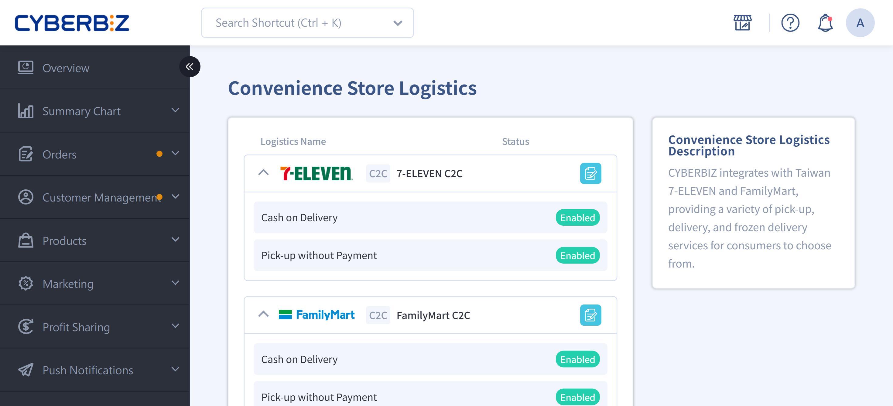
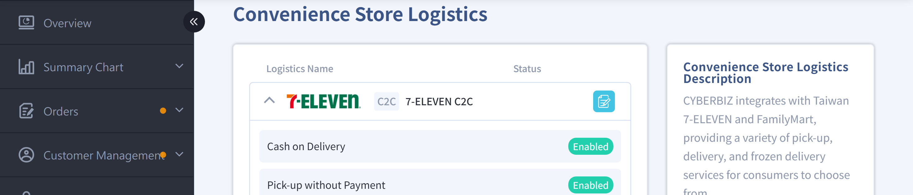

{ title="CVS Bulk B2C Shipping" .hero-page }

## CVS Bulk Shipping B2C Overview { #intro-cvs-b2c-setup }

**CVS Bulk Shipping B2C** suits merchants with high daily shipment volumes. Merchants pack goods in bulk and ship them to convenience store logistics centers (such as Ta-Chi, Jih-Yih, or Hi-Life) on their own. The logistics center then distributes the parcels to the store the consumer selected.

!!! info "CVS Bulk Shipping B2C Setup Process"

    Before enabling B2C bulk shipping, merchants must complete the following steps in the back office:

    1. Go to the "B2C CVS Bulk" settings page and select the channel you want to apply for
    2. Agree to the cooperation agreement for that channel
    3. Enter your basic merchant information and submit the application
    4. Print the test labels and send them by registered mail to each convenience store logistics center
    5. After the convenience store approves the application, set the shipping fees and enable the service in the back office

    After setup, merchants can bulk-download shipping labels from the order list using "[Ship with CVS Bulk B2C](../orders/cvs-shipping/cvs-b2c-bulk-shipping.md){ title="Ship with CVS Bulk (B2C)" }".

## Prerequisites and Limitations { #prerequisites-cvs-b2c-setup }

- [x] **Plan Support**: Only specific plans can apply for B2C bulk shipping.
- [x] **Real Shipping Environment**: The application includes a "label test" step. Print the label with a laser printer and the sticker paper used for actual shipments, then send it to each convenience store for review.
- [x] **Return Method**: Merchants must choose one fixed return method in advance (such as self-pickup or designated freight). Do not mix return methods, or the application will be rejected.
- [x] **Merchants Integrated with ECPay**: Apply through the ECPay B2C bulk shipping service instead. The related settings cannot be completed on this page.

## Procedure { #operate-cvs-b2c-setup }

### Go to the B2C Settings Page { #operate-cvs-b2c-setup-enter }

1. Log in to the back office. The path is "**Payment and Logistics**」>「**CVS Logistics**".
2. In the channel list, find the item labeled "**B2C CVS Bulk**".
3. Available channels include "**7-ELEVEN CVS Pickup**", "**FamilyMart CVS Pickup**", "**FamilyMart Frozen CVS Pickup**", and "**Hi-Life CVS Pickup**".

{ title="Go to B2C settings page" }

---

### Apply for Each Convenience Store Channel { #operate-cvs-b2c-setup-apply }

For each convenience store you want to enable, complete the following steps. For differences in required fields by channel, see [Required Fields Comparison](references/cvs-b2c-channel-spec-reference.md#reference-cvs-b2c-channels-fields){ title="CVS bulk B2C channel specs" data-preview }.

1. Click the channel name you want to apply for to open the agreement page.
2. Read the agreement, select the consent checkbox, and click **Submit Application**[^1].
3. The system automatically opens the **Merchant Information** page. Enter the following details based on the field prompts:
    * Company name, Tax ID number, and company website (depending on the channel)
    * Contact name, contact email, and company phone number
    * Return address, return method, and return frequency
    * FamilyMart Frozen also requires the warehouse store name, business hours, and closing days
4. After you confirm the information is correct, click **Submit Application**. The system syncs the merchant information to the convenience store review queue.

[^1]: If you have not finished reading the agreement, the submit button stays disabled.

---

### Send the Test Label { #operate-cvs-b2c-setup-testing }

!!! note "About the Label Test"
	When merchants apply to enable the **CVS Bulk Shipping (B2C)** logistics service, they must pass a barcode readability test. Its main purpose is to make sure the shipping label barcodes can be read correctly by convenience store logistics center equipment, which prevents scanning problems during actual shipments.

After you submit the application, a "Download Label" entry appears in the back office so merchants can get the test PDF.

1. Click **Download Label** to get the test label PDF for the channel.
2. Print the label using a **laser printer and 2x3 sticker paper used for actual shipments**[^2].
3. Attach the printed label to the outside of an actual-size carton, and send it by **registered mail** to the corresponding logistics center. For the full address, recipient, and envelope notes, see
[Test Label Shipping Information](references/cvs-b2c-logistics-center-reference.md#reference-cvs-b2c-centers-testing){ title="logistics center receiving info" data-preview }.
4. Keep the registered mail receipt for tracking inquiries.
5. Wait for the convenience store to review. Approximate review times by channel:
    * 7-ELEVEN: **2 to 3 weeks (business days)**
    * FamilyMart and Hi-Life: **7 to 10 business days**

[^2]: Using plain paper or a non-laser printer causes barcode reading failures. The label is rejected and the application must be resubmitted.

---

### Set Shipping Fees and Enable { #operate-cvs-b2c-setup-fee }

After label verification passes, the back office shows "Shipping Fee Settings" and "Enable" buttons for the channel[^3].

1. Go to the settings page for the channel.
2. In the "**Shipping Fee**" field, enter the shipping fee per order.
3. In the "**Free Shipping Threshold**" field, enter the order amount that qualifies for free shipping (leave blank for no threshold).
4. Turn on "**Cash on Delivery**" or "**Pickup without Payment**" under payment and logistics options (**at least one must be turned on** to appear on the storefront).
5. Click **Save**, and change the channel's status to "**Enabled**".

[^3]: After the 7-ELEVEN channel passes the label test, CYBERBIZ customer service must enable it before the shipping fee settings appear. For FamilyMart and Hi-Life, merchants can enable the channel themselves in the back office.

{ title="Set shipping fee and enable" }

## Important Rules and Limitations { #specs-cvs-b2c-setup }

* **Weight and Volume Limits**: Limits vary by channel. See [CVS Bulk B2C Channel Specifications](references/cvs-b2c-channel-spec-reference.md#reference-cvs-b2c-channels-specs){ title="CVS bulk B2C channel specs" data-preview }. If a product exceeds the limit when it is created, the storefront automatically blocks consumers from selecting this channel.
* **Return methods cannot be mixed**: The return method entered during application (such as "self-pickup" or "designated freight") is fixed once approved. To change it, submit a new application.
* **Plan Differences**: Available channels depend on your plan. If you are unsure, contact CYBERBIZ customer service to confirm.
* **Shipping Operations**: Merchants must arrange with a logistics provider (such as Tcat or Hsinchu Logistics) to deliver parcels to the convenience store logistics hub. Goods must be packed in **cardboard boxes, not loose**; otherwise, the merchant is responsible for any damage or loss.
* **Receiving Hours**:
	* **7-11 (Ta-Chi)**: Monday to Saturday, 08:00 - 14:00.
	* **FamilyMart (Jih-Yih)**: Monday to Sunday, 08:00 - 14:00 (same-day shipping), and 14:00 - 16:30 (next-day shipping).
	* **Hi-Life**: Monday to Sunday, 08:30 - 14:00.

    !!! info "The receiving hours above are for reference only. Actual receiving hours follow the official information."

---

## Next Steps { #next-steps-cvs-b2c-setup }

- :lucide-truck:{ .lg }  
  [__Ship with CVS Bulk B2C__](../orders/cvs-shipping/cvs-b2c-bulk-shipping.md){ title="Ship with CVS Bulk (B2C)" }  
  After setup, bulk-download shipping labels from the order list and send the parcels to the logistics center.

- :lucide-coins:{ .lg }  
  [__Top Up CYBER Coins__](../website-management/points-deposits.md#operate-cyber-coin-deposit){ title="CYBER coin top-up center user guide" }  
  Standard plan merchants must top up CYBER coins before downloading shipping labels to avoid being blocked by an insufficient balance.

- :lucide-package:{ .lg }  
  [__Set Product Weight and Volume__](../products/shipping/cvs-shipping-restrictions-exclusions.md){ title="Set CVS delivery restrictions and logistics exclusions" }  
  Ensure product data meets each channel's limits so the storefront can still offer this delivery method.

---

## Frequently Asked Questions { #faq-cvs-b2c-setup }

??? quote "Can I apply for multiple convenience stores at once?"
    { #faq-cvs-b2c-setup-multi-apply }
    Yes, but each convenience store requires its own "Agreement > Merchant Information > Label Test > Review" process, and review times are calculated separately for each channel. Before submitting, confirm that the return method and required fields can be filled in consistently for all channels, then submit all applications at once.

??? quote "Do I need to ship real products for the label test?"
    { #faq-cvs-b2c-setup-testing-real }
    Only the printed test label needs to be sent. Real products are not required. However, the **label itself must be printed with the laser printer and sticker paper used for actual shipments**; otherwise, it will fail the barcode readability test.

??? quote "How long after applying can I use the service?"
    { #faq-cvs-b2c-setup-timeline }
    It depends on the channel:

    - 7-ELEVEN: about 2 to 3 weeks (business days). After the label test passes, CYBERBIZ customer service must enable it.
    - FamilyMart and Hi-Life: about 7 to 10 business days. After the label test passes, merchants can enable the service themselves.

??? quote "I integrate with ECPay. How do I apply?"
    { #faq-cvs-b2c-setup-ecpay }
    Merchants that integrate with ECPay payment and logistics cannot apply through the "B2C CVS Bulk" page in the back office. Contact ECPay directly to apply. ECPay handles the shipping fee calculation and shipping label downloads.

??? quote "Does my plan support B2C?"
    { #faq-cvs-b2c-setup-plan-support }Contact CYBERBIZ customer service to confirm whether your plan supports it.

??? quote "Is the label test (label verification) required? Can I skip it?"
    { #faq-cvs-b2c-setup-mandatory-testing }
    No. The **label test is a mandatory convenience store logistics step**. Until the label passes verification, the logistics center will not accept actual shipments. The purpose of the label test is to:

    - Confirm that the barcode can be scanned correctly by logistics equipment.
    - Avoid batch rejections or inbound failures during official shipments.

??? quote "What happens if the label test fails? Can I retest?"
    { #faq-cvs-b2c-setup-retest }
    Yes, you can retest. Common causes of failure include:

    - Using an inkjet printer, which causes blurry barcodes.
    - Label paper is reflective or not waterproof.
    - Scaled printing causes an abnormal barcode ratio.

    After fixing the issue, download the label again and send it again to restart verification.

??? quote "Must I use a laser printer? Is thermal printing acceptable?"
    { #faq-cvs-b2c-setup-printer-type }
    Thermal printing is not recommended. B2C labels are handled and scanned for long periods at the logistics center, and thermal paper can fade from friction or heat. The official verification standard recommends **a laser printer with waterproof label stickers**.

??? quote "Why can't I use the service in the back office after label verification passes?"
    { #faq-cvs-b2c-setup-not-active }
    There are two common reasons:

    1. **7-11 requires manual activation**: Even if verification passes, CYBERBIZ customer service must enable it manually.
    2. Shipping fees have not been set, or no payment method has been turned on.

    Check the following:

    - Confirm that "Cash on Delivery / Pickup without Payment" is turned on.
    - Confirm that the shipping fee is entered and saved.

??? quote "How long after a parcel reaches the logistics center does it appear at the store?"
    { #faq-cvs-b2c-setup-delivery-time }
    Under normal circumstances:

    - If the logistics center completes inspection on the same day, the parcel reaches the store the next day (N+1).
    - During peak periods (such as Double 11 or holidays), this may extend to N+2.

    Actual timing still depends on each logistics center's workload that day.

??? quote "What happens if the logistics center rejects a parcel?"
    { #faq-cvs-b2c-setup-rejected }
    The logistics center may reject parcels for the following reasons:

    - Packaging is incomplete (not in a carton, or loose).
    - The size or weight exceeds the limit.
    - The barcode cannot be scanned.

    After a rejection, usually:

    - The parcel is returned to the merchant along the same route.
    - The order must be shipped again and the label reprinted.

??? quote "What happens to a B2C parcel if the consumer does not pick it up on time?"
    { #faq-cvs-b2c-setup-overdue }
    The parcel is returned to the return address specified by the merchant.

    The process usually works as follows:

    1. The store's holding period expires.
    2. The logistics center returns the parcel in bulk.
    3. The merchant bears the round-trip shipping costs.

---

## References { #reference-cvs-b2c-setup-ref }

- [CVS Bulk B2C Channel Specifications](references/cvs-b2c-channel-spec-reference.md){ title="CVS bulk B2C channel specs" }
- [Logistics Center Receiving Information](references/cvs-b2c-logistics-center-reference.md){ title="Logistics center receiving info" }

<!---->
<!-- ## CVS Bulk Shipping B2C Overview -->
<!---->
<!-- **CVS Bulk Shipping (B2C)** means the merchant packs goods and **ships them to the convenience store logistics center on their own**. The logistics center then delivers them to the store chosen by the consumer. Compared with store-to-store (C2C), B2C delivers faster and usually achieves **N+1 day arrival at the store**. -->
<!---->
<!-- ## Prerequisites and Eligibility -->
<!---->
<!-- - **Logistics providers**: 7-11 (Ta-Chi), FamilyMart (Jih-Yih), and Hi-Life logistics. -->
<!---->
<!-- - **Plan restrictions**: Only merchants on the following plans can apply for the **CVS Bulk Shipping (B2C)** service: -->
<!---->
<!-- 	- **Advanced** (requires CYBERBIZ PAYMENTS) -->
<!-- 	- **Expert** (requires CYBERBIZ PAYMENTS) -->
<!-- 	- **Professional PLUS** -->
<!-- 	- **Advanced PLUS** -->
<!-- 	- **Expert PLUS** -->
<!-- 	- **Enterprise Plan** -->
<!---->
<!-- - **Hardware requirements**: To make sure shipping label barcodes can be read correctly, merchants must use a **laser printer** to print labels on waterproof material, or send parcels by registered mail in plastic bags. -->
<!---->
<!-- ## Application Steps -->
<!---->
<!-- ### Step 1: Submit the Application -->
<!---->
<!-- 1. Log in to the CYBERBIZ back office, go to **Payment and Logistics > Convenience Store Logistics**, and select the convenience store you want to apply for (such as 7-ELEVEN Pickup). -->
<!-- 2. Fill in all required fields on the application form and select one **return method**. After saving, the system starts the application process the next day. -->
<!---->
<!-- --- -->
<!---->
<!-- ### Step 2: Label Test (Label Verification) -->
<!---->
<!-- !!! note "Label test details" -->
<!-- 	When merchants apply for the **CVS Bulk Shipping (B2C)** logistics service, they must pass a barcode readability test. Its main purpose is to make sure the shipping label barcodes can be read correctly by convenience store logistics center equipment, which prevents scanning problems during actual shipments. -->
<!---->
<!-- 1. **Download the label**: After the application is created, click **Download Label** to get the test label PDF. -->
<!-- 2. **Print and send**: Print using the sticker paper used for actual shipments (such as A4 label stickers), then **send by registered mail** to the [designated logistics center](#各超商物流中心寄送資訊) for manual verification. -->
<!-- 3. **Review timelines by provider**: -->
<!---->
<!-- 	- **7-11 (Ta-Chi)**: The process takes about **2 to 3 weeks**, and after the test passes, CYBERBIZ customer service must enable it. -->
<!-- 	- **FamilyMart (Jih-Yih)**: The process takes about **7 to 10 business days**. -->
<!-- 	- **Hi-Life**: The process takes about **7 to 10 business days**. -->
<!---->
<!-- --- -->
<!---->
<!-- ### Step 3: Enable the Feature and Set Shipping Fees -->
<!---->
<!-- After label verification passes, setting options appear in the back office. Merchants must manually turn on the **Cash on Delivery** or **Pickup without Payment** button. -->
<!---->
<!-- 1. Log in to the CYBERBIZ back office, go to **Payment and Logistics > Convenience Store Logistics**, select the convenience store you want to configure, and click the Edit :material-file-document-edit-outline: button to open the settings page. -->
<!-- 2. Turn on **Cash on Delivery** or **Pickup without Payment** as needed. -->
<!-- 3. **Set shipping fees**: Enter the amount in the **Shipping Fee** field and save. You can refer to the [Shipping Fee Overview :lucide-external-link:](https://docs.google.com/spreadsheets/d/1YBWaHV9WSIX4ttETU8NPFQQhTl4h_C49/edit?gid=515311718#gid=515311718) when filling it in. -->
<!---->
<!--  -->
<!---->
<!-- ## B2C Shipping and Packaging Rules -->
<!---->
<!-- ### Parcel Limits -->
<!---->
<!-- - **Size limit**: The sum of the three sides must be ≤ 105 cm, and the longest side ≤ 45 cm. **FamilyMart B2C** allows larger sizes: the sum of the three sides can be ≤ 120 cm, and the longest side ≤ 50 cm. -->
<!---->
<!-- - **Weight limit**: The limit for 7-11 B2C is **10 kg**, and the limit for FamilyMart and Hi-Life B2C is also **10 kg**. If a product exceeds the weight limit, the system automatically hides the convenience store option at checkout. -->
<!---->
<!-- ### Shipping Operation Notes -->
<!---->
<!-- - **Handover**: Merchants must arrange with a logistics provider (such as Tcat or Hsinchu Logistics) to deliver parcels to the convenience store logistics hub. -->
<!---->
<!-- - **Logistics center inspection**: Goods must be packed in **cardboard boxes, not loose**; otherwise, the merchant is responsible for any damage or loss. -->
<!---->
<!-- - **Receiving hours**: -->
<!---->
<!-- 	- **7-11 (Ta-Chi)**: Monday to Saturday, 08:00 - 14:00. -->
<!-- 	- **FamilyMart (Jih-Yih)**: Monday to Sunday, 08:00 - 14:00 (same-day shipping), and 14:00 - 16:30 (next-day shipping). -->
<!-- 	- **Hi-Life**: Monday to Sunday, 08:30 - 14:00. -->
<!---->
<!-- > The receiving hours above are for reference only. Actual receiving hours follow the official information. -->
<!---->
<!-- ## Shipping Information for Each Convenience Store Logistics Center -->
<!---->
<!-- |Convenience Store Channel|Address|Recipient|Notes| -->
<!-- |---|---|---|---| -->
<!-- |**7-11**|238037, No. 70-1, Section 2, Jiayuan Road, Shulin District, New Taipei City|Ta-Chi Culture Marketing EC Inspection Team (receiver)|Test label; subcontractor of Shunli Smart (829) (vendor code + vendor name)| -->
<!-- |**FamilyMart**|33543, No. 22-2, Lane 76, Xinguang East Road, Renshan Village, Neighborhood 15, Daxi District, Taoyuan City|Jih-Yih Culture Marketing Co., Ltd., E-Commerce Department (receiver)|Test label; subcontractor of Shunli Smart (692) (vendor code + vendor name)| -->
<!-- |**Hi-Life**|238, No. 1-25, Weiwang Street, Shulin District, New Taipei City|Hi-Life Logistics Center EC Service Section|Test label; subcontractor of Shunli Smart (025) (vendor code + vendor name)| -->
<!---->
<!-- ## Exception Handling and Reprinting -->
<!---->
<!-- - **Store reassignment**: -->
<!---->
<!-- 	- **7-11**: Merchants must contact the consumer within 2 days and select a new store in the back office. -->
<!-- 	- **FamilyMart/Hi-Life**: Usually converted to a return process and returned to the merchant's designated return address. -->
<!---->
<!-- ## Next Steps -->
<!---->
<!-- 
 -->
<!---->
<!-- - :lucide-package:{ .lg }    -->
<!--   [__Ship with CVS Store-to-Store C2C__](../orders/cvs-c2c-shipping)      -->
<!--   After creating an order, go to the order back office to generate a shipping slip and complete the convenience store shipping process. -->
<!---->
<!-- - :lucide-ban:{ .lg }      -->
<!--   [__Set CVS Delivery Restrictions__](../products/設定超商配送限制與物流排除)   -->
<!--   Set product volume, weight, or type so the system automatically excludes products that are not eligible for convenience store delivery. -->
<!---->
<!-- 
 -->
<!---->
<!-- ## Frequently Asked Questions -->
<!---->
<!-- ??? quote "When is B2C better than C2C?" -->
<!-- 	B2C suits the following scenarios: -->
<!---->
<!-- 	- High shipping volume with fixed daily batch shipments. -->
<!-- 	- Faster delivery is needed (for example, N+1 day arrival at the store). -->
<!-- 	- Stable product specifications that can be shipped to the logistics center in bulk. -->
<!---->
<!-- 	For occasional or one-off shipments, **store-to-store C2C** is more flexible. -->
<!---->
<!-- ??? quote "Is the label test (label verification) required? Can I skip it?" -->
<!---->
<!-- 	No. **The label test is a mandatory convenience store logistics step**. Until the label passes verification, the logistics center will not accept actual shipments. The purpose of the label test is to: -->
<!---->
<!-- 	- Confirm that the barcode can be scanned correctly by logistics equipment. -->
<!-- 	- Avoid batch rejections or inbound failures during official shipments. -->
<!---->
<!-- ??? quote "What happens if the label test fails? Can I retest?" -->
<!---->
<!-- 	Yes, you can retest. Common causes of failure include: -->
<!---->
<!-- 	- Using an inkjet printer, which causes blurry barcodes. -->
<!-- 	- Label paper is reflective or not waterproof. -->
<!-- 	- Scaled printing causes an abnormal barcode ratio. -->
<!---->
<!-- 	After fixing the issue, download the label again and send it again to restart verification. -->
<!---->
<!-- ??? quote "Must I use a laser printer? Is thermal printing acceptable?" -->
<!-- 	Thermal printing is not recommended. B2C labels are handled and scanned for long periods at the logistics center, and thermal paper can fade from friction or heat. The official verification standard recommends **a laser printer with waterproof label stickers**. -->
<!---->
<!-- ??? quote "Can I apply for multiple convenience stores for B2C at once?" -->
<!-- 	Yes, but **each store requires its own label test and verification**. That means: -->
<!---->
<!-- 	- 7-11, FamilyMart, and Hi-Life each have their own label test process. -->
<!-- 	- Verification timelines are independent, so activation times may differ. -->
<!---->
<!-- ??? quote "Why can't I use the service in the back office after label verification passes?" -->
<!-- 	There are two common reasons: -->
<!---->
<!-- 	1. **7-11 requires manual activation**: Even if verification passes, CYBERBIZ customer service must enable it manually. -->
<!-- 	2. Shipping fees have not been set, or no payment method has been turned on. -->
<!---->
<!-- 	Check the following: -->
<!---->
<!-- 	- Confirm "Cash on Delivery / Pickup without Payment" is turned on. -->
<!-- 	- Confirm the shipping fee is entered and saved. -->
<!---->
<!-- ??? quote "How long after a parcel reaches the logistics center does it appear at the store?" -->
<!-- 	Under normal circumstances: -->
<!---->
<!-- 	- If the logistics center passes inspection on the same day, the parcel reaches the store the next day (N+1). -->
<!-- 	- During peak periods (such as Double 11 or holidays), this may extend to N+2. -->
<!---->
<!-- 	Actual timing still depends on each logistics center's workload that day. -->
<!---->
<!---->
<!-- ??? quote "What happens if the logistics center rejects a parcel?" -->
<!---->
<!-- 	The logistics center may reject parcels for the following reasons: -->
<!---->
<!-- 	- Packaging is incomplete (not in a carton, or loose). -->
<!-- 	- The size or weight exceeds the limit. -->
<!-- 	- The barcode cannot be scanned. -->
<!---->
<!-- 	After a rejection, usually: -->
<!---->
<!-- 	- The parcel is returned to the merchant along the same route. -->
<!-- 	- The order must be shipped again and the label reprinted. -->
<!---->
<!---->
<!-- ??? quote "Can B2C do partial shipments or split orders?" -->
<!---->
<!-- 	Not recommended. B2C is designed around **one order, one box, one label**. Splitting orders or shipping partially can easily cause: -->
<!---->
<!-- 	- Reconciliation difficulties. -->
<!-- 	- Complaints such as "only part of the items was received". -->
<!-- 	- Inaccurate logistics tracking. -->
<!---->
<!-- 	If you need a split-order process, consider home delivery or C2C instead. -->
<!---->
<!---->
<!-- ??? quote "What happens to a B2C parcel if the consumer does not pick it up on time?" -->
<!---->
<!-- 	The parcel is returned to the return address specified by the merchant. -->
<!---->
<!-- 	The process usually works as follows: -->
<!---->
<!-- 	1. The store's holding period expires. -->
<!-- 	2. The logistics center returns the parcel in bulk. -->
<!-- 	3. The merchant bears the round-trip shipping costs. -->
<!---->
<!---->
