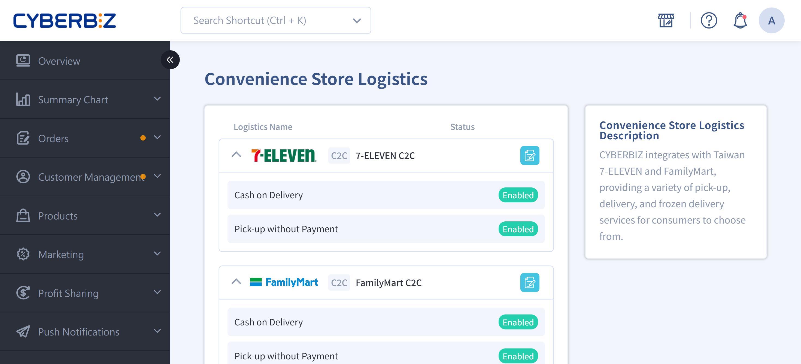
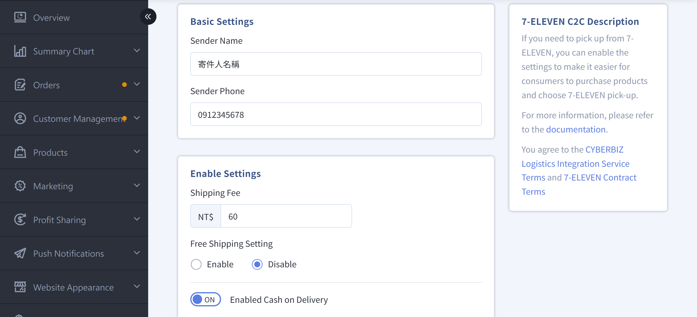
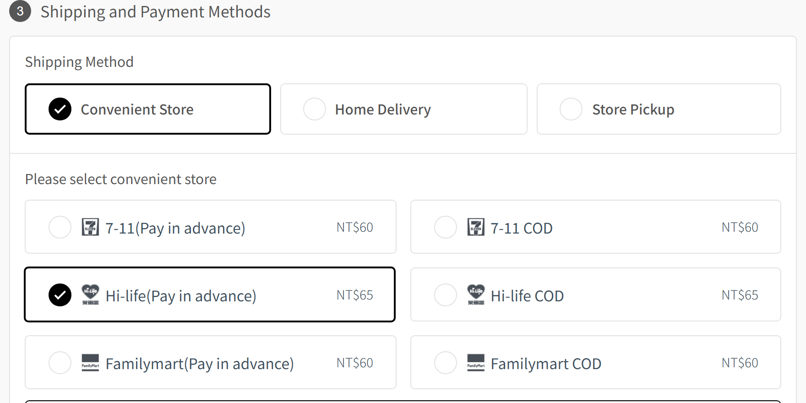

{ title="CVS Shipping C2C" .hero-page }

## Convenience Store Store-to-Store Shipping (C2C) Overview { #intro-cvs-c2c }

**CVS store-to-store (C2C)** is a shipping method in which the merchant packs the product and drops it off at a nearby convenience store. The package is then delivered to the store the customer selects for pickup.

!!! example "Use Cases"

    - Small or lightweight products
    - Merchants drop off shipments at a convenience store themselves.
    - Shipping scenarios that do not require a logistics provider to pick up from the merchant's location

!!! info "This service applies to the shipping model in which merchants drop off shipments at a convenience store themselves. If you use a logistics provider for home pickup, use a different shipping option."

### Supported Logistics Services { #intro-cvs-c2c-services }

CYBERBIZ currently supports the following convenience store store-to-store logistics services:

- [x] **7-ELEVEN 交貨便**
- [x] **FamilyMart Store-to-Store**
- [x] **Hi-Life Store Pickup**
- [x] **Black Cat Quick Store Pickup** (provides convenience store pickup, not traditional home delivery)

## Setup Steps { #operate-cvs-c2c }

### Step 1: Select a Logistics Service { #operate-cvs-c2c-select }

1. Log in to the **CYBERBIZ Admin Panel** and go to **Payment and Logistics > Convenience Store Logistics**.
2. Find the logistics service you want to enable, and click the edit button :material-file-document-edit-outline: to open its setup page.

---

### Step 2: Fill In Basic Information { #operate-cvs-c2c-basic }

1. **Agree to the terms of service**: Select **I have read the logistics integration provider terms** before you can use the service.

2. **Company sender information**: Fill in the **sender name** and **mobile number**. Make sure they are accurate.

    !!! warning "If a customer requests a return, store staff will use the sender's **ID card information** to verify identity. Make sure it is entered correctly."

1. **Additional settings (enable as needed)**

    - **Free shipping settings**: Choose whether to offer free convenience store shipping.
    -  **No payment at pickup***: Customers do not need to pay when they pick up the order (online payment must be completed first).

	!!! info "CYBERBIZ PAYMENTS exclusive feature: COD (cash on delivery)"
	    - Only merchants who have activated **CYBERBIZ PAYMENTS** can use the cash on delivery feature.
	    - If not activated, the storefront only shows the "No payment at pickup" option.
	    - [Activate CYBERBIZ PAYMENTS](apply-cyberbiz-payments.md){ title="Apply for CYBERBIZ PAYMENTS" } to use this feature.

{ title="CVS Logistics Settings" }

## How the Storefront Displays Convenience Store Pickup Options { #specs-cvs-c2c-storefront }

The following example uses **Hi-Life Store Pickup** to show what customers see when they select convenience store pickup at checkout:

{ title="Storefront CVS Pickup Display" }

## Next Steps { #next-steps-cvs-c2c }

- :lucide-package:{ .lg }   
  [__Ship Convenience Store Store-to-Store C2C Orders__](../orders/cvs-shipping/cvs-c2c-shipping.md){ title="Ship CVS Store-to-Store C2C Orders" }     
  After you create an order, go to the order management page to generate a shipping label and complete the convenience store shipping process.

- :lucide-ban:{ .lg }     
  [__Set Convenience Store Delivery Restrictions__](../products/shipping/cvs-shipping-restrictions-exclusions.md){ title="Set CVS Delivery Restrictions and Exclusions" }  
  Set product volume, weight, or type so the system automatically excludes products that are not eligible for convenience store delivery.

