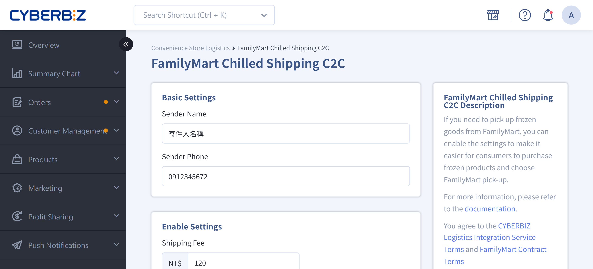
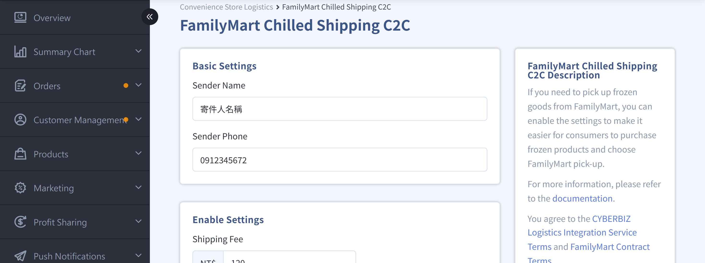

{ title="FamilyMart Frozen Logistics B2C" .hero-page }

## FamilyMart Frozen Logistics B2C Overview

**FamilyMart Frozen B2C (Bulk Consignment)** is a service in which Taiwan Logistics (a logistics partner of FamilyMart) picks up goods from the merchant's designated location (pickup service) and delivers them to the FamilyMart store chosen by the consumer.

## Eligible Plans and Application Requirements

- **Eligible plans**: Available only to merchants on the **Expert plan (requires CYBERBIZ PAYMENTS)**, the **Expert PLUS plan**, and **Enterprise Plan** plans.  
- **Payment restriction**: If the merchant does not use CYBERBIZ PAYMENTS, only the "Pickup Without Payment" service is available. Cash on delivery is not supported.  
- **Compensation limit**: The compensation limit for lost or damaged goods follows the Taiwan Logistics announcement.

## Application Steps

1. **Contact customer service**: To use this feature, first contact customer service to request that the logistics feature be enabled.

2. **Open the application page**: After customer service confirms, the system opens the application entry in the back office and notifies the merchant by email.

3. **Submit the application form**:

	- **Back-office path**: **Payment and Logistics > Convenience Store Logistics**, click **FamilyMart Frozen**.
	- Fill in the information and submit it. FamilyMart will then run a **site survey**, which takes about **3 to 4 weeks** (excluding holidays).
	- **Note**: Errors in the form can lengthen later adjustments and may affect the application progress or later shipping. Be sure to confirm that the information is correct before submitting.

4. **Review and activation**:

	- After the site survey succeeds, the system automatically starts the activation process.
	- If the site survey fails, the system emails the reason. The merchant can correct the issue and apply again.

!!! note "Site Survey Details"
	When a merchant applies for **FamilyMart Frozen B2C Logistics** or **Hsinchu Logistics** pickup services, the logistics provider sends staff to the merchant's warehouse or shipping location to perform an on-site assessment.

## Post-Activation Setup

After you receive the activation success notification email, follow these steps to enable the service:

1. **Go to the settings page**:

	- Log in to the CYBERBIZ back office and go to **Payment and Logistics > Convenience Store Logistics**.
	- Click the Edit :material-file-document-edit-outline: button for **FamilyMart Frozen** to open the edit page.

    

2. **Enter operating information**:

	- Enter the **shipping fee, free shipping threshold** in order.
	- As needed, turn on the **Non-custom cash on delivery** or **Cash on Delivery** feature.
	- Click **Save** to apply the changes.

    

## Shipping Operations and Delivery Rules

1. **Shipping operations**:

	- In the back-office order list, select the orders to ship, click "Select Action", and download the waybill for the matching package size (s60 or s105).
	- After you download the waybill, Taiwan Logistics receives the order and **automatically picks up** the goods from your location. No separate contact is needed.

2. **Fill out the forms**:

	- Download the [pickup detail form](https://www.cyberbiz.co/support/wp-content/uploads/2021/01/%E5%86%B7%E5%87%8DEC%E5%8F%96%E8%B2%A8%E6%98%8E%E7%B4%B0%E8%A1%A8S105.xlsx) and fill in the relevant information. (Be sure to complete it before pickup.)
	- The driver checks and confirms the list on site. Fill in the shipping temperature and pickup temperature records.

!!! tip "We recommend keeping the detail forms for at least two months for verification."

!!! info "Minimum Volume Threshold"
    FamilyMart normally charges a processing fee for each pickup of fewer than 10 pieces, but starting **2024/02/01, the processing fee for pickups of fewer than 10 pieces is waived** (subject to change; the official announcement prevails).

## Package Specifications and Restrictions

- **Package size**:

	- **s60**: Sum of the three sides ≤ 60 cm (longest side ≤ 45 cm), weight ≤ 5 kg.
	- **s105**: Sum of the three sides ≤ 105 cm (longest side ≤ 45 cm), weight ≤ 10 kg.

- **Packaging requirements**: Use an intact, undamaged carton that is not exposed. **Do not use straps, foam boxes, or tear-away bags.**

- **Temperature control**: Only **frozen food** is supported. The temperature must be below **-12°C** (or -18°C, depending on the specifications), and goods must be **pre-chilled for at least 12 hours** before shipping and fully frozen.

- **Label placement**: Print the waybill, place it in a **waterproof clear bag**, and attach it flat to the wide side of the carton. Do not fold or bend the label, or resize the barcode.

## Taiwan Logistics Pickup and Delivery Times

!!! warning "If **force majeure events such as Lunar New Year holidays, natural disasters, or peak logistics periods** occur, the actual pickup and delivery schedules will be agreed separately by both parties."

### Pickup Service Hours <small>Taiwan Logistics to Merchant Pickup</small>

- **Pickup days**: Monday to Saturday (**no pickup on Sunday**)

- **How the pickup schedule is determined**:  
    During the site survey, the logistics provider determines whether the pickup day is **D or D+1**. Once confirmed, it **cannot be changed**.  
    For the determination logic, see the [pickup date estimation examples](#收貨日估算範例) below{ data-preview }.

---

### Delivery Service Hours <small>Taiwan Logistics to Store</small>

- **Delivery days**: Monday to Sunday (**including holidays**)

- **Delivery schedule**:  
    Packages are delivered to the designated store **within about 5 to 7 business days** after pickup is completed.

!!! info "Actual timing follows the logistics provider's announcement."

---

### Pickup Date Estimation Examples

=== "D"

	The table below uses **9/1 (Thu)**, the date the merchant clicks "Download Waybill", as the baseline and shows the estimated pickup and delivery times:

	|**Order Ready for Pickup**|**Taiwan Logistics Pickup Time**|**Delivery to Store (about pickup date + 5 days)**|
	|---|---|---|
	|**9/1 (Thu) before 09:30**|9/1 (Thu) afternoon|About 9/6 (Tue)|
	|**9/1 (Thu) after 09:30**|9/2 (Fri) afternoon|About 9/7 (Wed)|
	|**9/2 (Fri) before 09:30**|9/2 (Fri) afternoon|About 9/7 (Wed)|

	!!! note "**D pickup:** Use **09:00** as the cutoff time."

=== "D + 1"

	The table below uses **9/1 (Thu)**, the date the merchant clicks "Download Waybill", as the baseline and shows the estimated pickup and delivery times under D+1 mode:

	|**Order Ready for Pickup**|**Taiwan Logistics Pickup Time**|**Delivery to Store (pickup date + 5 days)**|
	|---|---|---|
	|**9/1 (Thu) before 17:00**|9/2 (Fri) afternoon|About 9/7 (Wed)|
	|**9/1 (Thu) after 17:00**|9/3 (Sat) afternoon|About 9/8 (Thu)|

	!!! note "**D+1 pickup:** Use **17:00** as the cutoff time."

## Exception Handling

- **Uncollected by customer**: If a package is not picked up within 4 days of arriving at the store, Taiwan Logistics retrieves it and holds it at the logistics center. It is returned to the merchant on the driver's next pickup. **No extra fee applies to this reverse logistics leg.**

- **Store closure or transfer**: If the pickup store closes, the system notifies the merchant. The merchant must contact the customer within **6 days** and reselect a store in the back office.

- **Shipping exception**: If a package does not reach the store by D+3 (shipment date + 3 days), a search process begins. If the package is confirmed lost or the goods have lost their required temperature, an investigation and compensation process starts.

### Reprint Waybills { #operate-cvs-b2c-shipping-reprint }

If a label is lost or damaged, you can reprint it in the back office before the deadline.

1. In the order list, select the orders to reprint.
2. Click the **More Actions** dropdown, then select **Reprint Waybill**.
3. The system downloads the PDF of the same waybill number again. **No shipping fee is charged again**, and the order status does not change again.

- :lucide-calendar-search:{ .lg }
  [__Check Waybill Expiry Dates by Convenience Store__](../orders/references/cvs-waybill-expiration-reference.md#reference-cvs-waybill-expiration){ data-preview }
  View the reprint deadlines and expiry determination times for each convenience store logistics provider.

- :lucide-refresh-cw:{ .lg }
  [__Renumber Overdue Waybills__](../orders/renew-waybill-after-expiration.md#operate-renew-waybill-after-expiration){ data-preview }
  If the original waybill expires or the reprint deadline passes, obtain a new waybill number and download a new waybill.

## Frequently Asked Questions

??? quote "Items not delivered to the store more than shipment date + 7 days?"
	FamilyMart automatically cancels the logistics space reserved for the order. The CYBERBIZ back office then shows "Shipping Exception", and the customer must follow the **return process** to handle the follow-up.

??? quote "Customers cannot select the FamilyMart Frozen map on the checkout page?"
	FamilyMart Frozen logistics has a package size limit. If the package size of items in the customer's cart exceeds **s105**, the system cannot display the FamilyMart Frozen map, or the package may be rejected for exceeding the limit.

??? quote "Customers cannot select the specific store they want?"
	When the customer opens the frozen map, the FamilyMart system automatically checks the merchant's shipping time (default: within 8 days starting the next day) and shows only stores with remaining frozen storage space. If the originally selected store has insufficient space, the map automatically shows other stores **within 1.5 km**.
