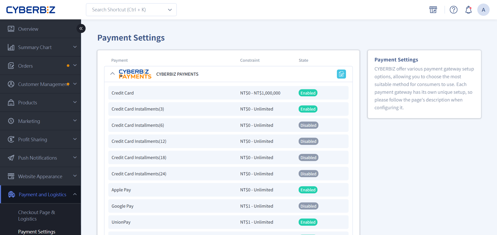
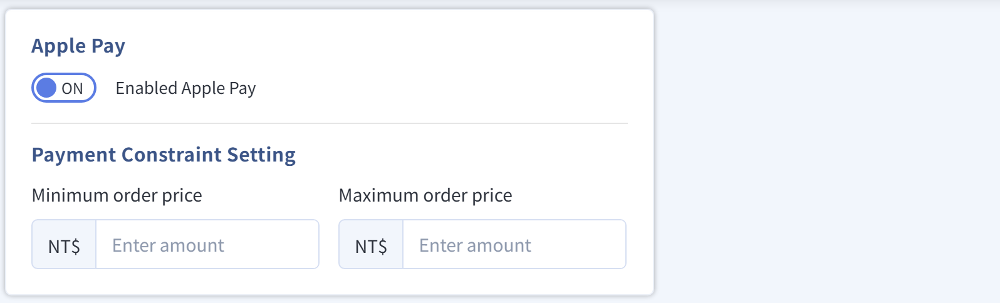
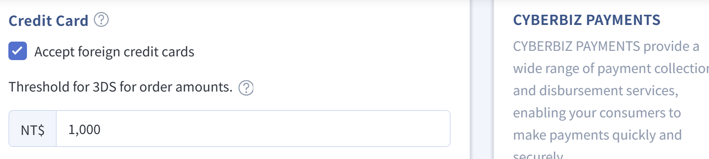

# Set up Google Pay™
Guides merchants on enabling and managing Google Pay™ payment options on their storefront, including fee details, admin setup steps, and payment threshold restrictions.
{ .subtitle }

[:lucide-toggle-right:{ title="Applicable Features" }](../../resources/conventions#適用功能) | CYBERBIZ PAYMENTS
{ .doc-badge }

## Core Benefits of Google Pay™ { #intro-google-pay }

- **No application or waiting required**: When CYBERBIZ PAYMENTS is activated, the system automatically enables the Google Pay option. No separate application to Google is needed.
- **Fast checkout**: Customers use the card information in Google Wallet directly, completing payment in seconds.
- **Enhanced security**: Supports Google's virtual account technology. Real card numbers are not transmitted during transactions, which reduces the risk of card fraud.

### Fees and Policy Details { #specs-google-pay-fees }

- **Processing fees**: Same as the **Credit Card One-Time Payment** rate in your merchant agreement with CYBERBIZ.
- **Additional fees**: **No charge** for annual fees, developer account application fees, or additional system maintenance fees.
- **Payment restriction**: Only one-time payment is supported. **Credit card installment payments are not available.**
- **Refund process**: Returns and refunds follow the same process as standard credit card payments.

## Activation Settings { #operate-google-pay }

1. Go to **Payment and Logistics > Payment Settings**.
2. Find the **CYBERBIZ PAYMENTS** field, then click :lucide-square-pen: **Edit** on the right.
    { .screenshot }
3. Scroll down to the **Google Pay** section.
    { .screenshot }
4. **Feature toggle**: Switch to **ON** or **OFF**.
5. **Payment Threshold Settings** (optional): Enter a **Minimum Order Amount** or **Maximum Order Amount** to limit Google Pay to a specific amount range.

    > :lucide-lock: **Payment Threshold Settings** are available only on **Expert, PLUS, and Enterprise** plans. On Professional or Advanced plans, this threshold field does not appear in the admin.

## Payment Security and 3D Verification { #specs-google-pay-security }

### Payment Security Logic Settings { #operate-google-pay-security }

Google Pay transaction security inherits the credit card settings in your admin:

- **3D verification trigger**: If a customer pays with an **actual credit card** stored in Google Wallet, the system decides whether to require verification based on the [order amount threshold for 3D verification](setup-credit-card-3d-verification.md) configured in your **Credit Card Settings**.
- **Foreign card restriction**: If the merchant does not select **Accept foreign credit cards**, customers cannot pay with foreign credit cards linked to Google Pay.
    { .screenshot }
- **Virtual card priority**: When a customer's wallet contains both **actual cards** and **virtual cards**, Google prioritizes the more secure virtual card (a tokenized card number generated by Google).

    >  **Virtual credit cards** are a security service provided by Google. After a **real credit card** is linked in Google Wallet, Google generates a **virtual credit card** for payments, which helps prevent real card details from being leaked and used for fraud. For details, see [Google Pay help](https://support.google.com/googlepay/answer/7644068).

### Transaction Verification and Compliance Statements { #specs-google-pay-compliance }

- [Google Pay APIs Acceptable Use Policy](https://payments.developers.google.com/terms/aup)
- [Google Pay API Terms of Service defines](https://payments.developers.google.com/terms/sellertos)
- Google Pay and Google Wallet are trademarks of Google LLC

## Next Steps { #next-steps-google-pay }

- :lucide-badge-dollar-sign:{ .lg }   
  [__North America Payment Settings__](north-america-payment-services.md)     
  If you operate **GLOBAL North America**, the Google Pay settings and fee logic differ. See the related dedicated guide.

