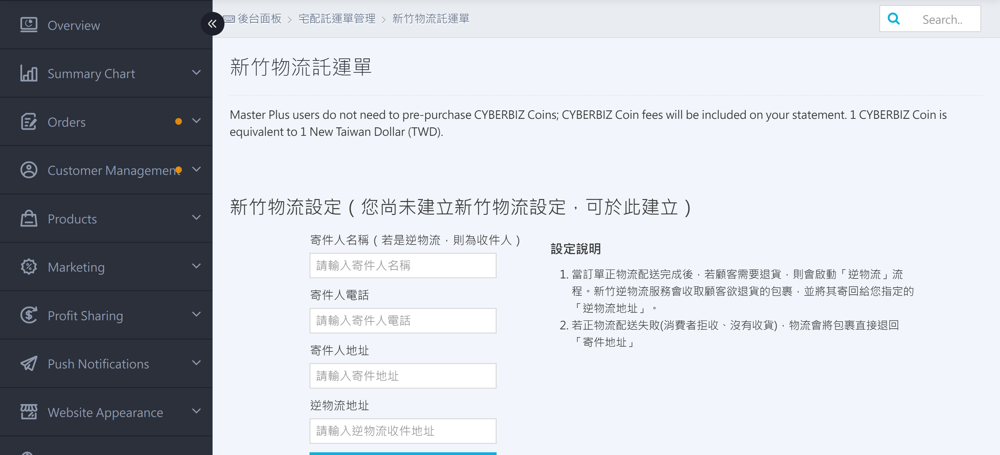
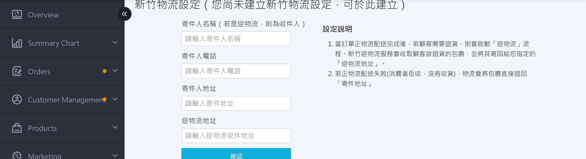
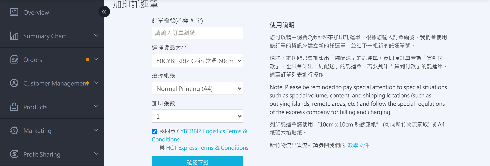

{ title="HCT Waybill Settings Page" .hero-page }

## HCT Waybill Guide { #intro-hct-waybill }

The "HCT Waybill" page is your control center after you integrate with HCT Logistics. It includes sender information settings, printing additional waybills, HCT reverse logistics, and waybill number usage records. Before you ship, complete the sender settings so the order list can download waybills.

## Page Feature Overview { #overview-hct-setup }

The "Payment and Logistics" > "HCT Waybill" page includes four sections:

| Section | Purpose | Related Section |
| :-- | :-- | :-- |
| HCT Logistics Settings | Set the sender name, phone number, sender address, and reverse logistics address | [Set Up Sender Information](#operate-hct-setup-sender) |
| Print Additional Waybills | Generate additional waybill numbers and waybills for the same order (for split-box shipments) | [Print Additional Waybills](#operate-hct-waybill-reprint) |
| HCT Reverse Logistics | An HCT Logistics driver picks up the package from the customer and returns it to your designated address | [Create HCT Reverse Logistics](#operate-hct-setup-reverse) |
| Waybill Number Usage Records | Look up past forward and reverse logistics waybill numbers, charge records, and waybill number statuses | [Look Up Waybill Number Usage Records](#operate-hct-setup-records) |

## Prerequisites and Restrictions { #prerequisites-hct-setup }

### Apply to Enable HCT Logistics { #prerequisites-hct-setup-enroll }

Before you use HCT Logistics, you must first apply to CYBERBIZ to enable it:

- [x] **Fill out the application**: Go to "Payment and Logistics / Home Delivery Logistics" > "Logistics Integration" and find "HCT Cash on Delivery", then [fill out the application form](home-delivery-cash-on-delivery.md#operate-home-cod-hct){ title="home delivery cash-on-delivery logistics (Tcat / Ecan / HCT)" }.

After activation, the "HCT Waybill" page appears in the admin menu, where you can configure the following settings.

---

### Get Waybill Stickers { #prerequisites-hct-waybill-stickers }

HCT Logistics provides two types of printing paper. Merchants must request them from their local branch:

| Paper Specification | Applicable Print Mode |
| :-- | :-- |
| 10cm x 10cm thermal paper | Order list [Download](../orders/home-delivery/hct-shipping-v2.md#operate-hct-shipping-modal){ title="Ship with HCT Logistics" }: select "Thermal Print", and select the matching paper when printing additional waybills |
| A4 six-up waybill stickers | Order list [Download](../orders/home-delivery/hct-shipping-v2.md#operate-hct-shipping-modal){ title="Ship with HCT Logistics" }: select "Standard Print (A4)", and select the matching paper when printing additional waybills |

When you contact your local branch, provide **Sender customer code: `0577349`** and let them know you have integrated with the CYBERBIZ system and need printing paper.

---

### CYBER Coins vs. Statements { #prerequisites-hct-setup-billing }

The billing method for HCT waybills depends on the plan:

- **Standard**: When you create a waybill, **CYBER Coins are deducted immediately**. If the balance is insufficient, additional printing or reverse logistics is blocked. The balance is shown as "Current CYBER Coins" at the top of the page. Go to "Management Center" > "Top-Up Center" to add CYBER Coins.
- **PLUS / Enterprise**: No top-up is required. Fees are added to the **statement for each period**. The CYBER Coin balance does not appear at the top of the page.

---

## Steps { #operate-hct-setup }

### Set up Sender Information { #operate-hct-setup-sender }

Before you use the service for the first time, enter the sender information in the "HCT Logistics Settings" section at the top of the page:

1. **Sender Name** (for reverse logistics, the recipient): Enter the sender's company name or contact person.
2. **Sender Phone**: Enter a contact phone number.
3. **Sender Address**: Enter the full sender address.
4. **Reverse logistics address**: Enter the address for receiving customer return packages. If left blank, the system uses the "Sender Address".
5. Click **Confirm**. The system validates the address with HCT Logistics in real time. When complete, "Settings updated successfully" appears.

{ title="HCT Logistics Settings" }

!!! warning "Address Validation Failed"
    If HCT Logistics reports that an address cannot be validated, check whether the sender address is complete (including city/county, district, and street number), whether there are any typos, and whether the address is within the HCT Logistics delivery area.

---

### Print Additional Waybills { #operate-hct-waybill-reprint }

If an order needs to be **split into multiple boxes** for shipping, use this feature to generate additional waybill numbers:

1. **Enter the order number**: Enter the order number without its English prefix.
2. **Select item size**: Choose the matching size from the dropdown. The dropdown shows the corresponding CYBER Coin fee in real time.
3. **Select paper**: Choose "A4 paper" or "10cm x 10cm thermal paper".
4. **Number of additional sheets**: Select how many new waybill numbers to generate (1 to 8).
5. **Agree to terms**: Select the checkbox to agree to the CYBERBIZ and HCT Logistics logistics service terms.
6. Click **Confirm Download**. A confirmation window appears showing "Order number XXX, N CYBER Coins." Click **Confirm** and the system will[^reprint-deduct]:
    - Deduct CYBER Coins (or add to the statement)
    - Call HCT Logistics to get new waybill numbers
    - Automatically download the waybill PDF
    - Record the order and new waybill numbers in the "Waybill Number Usage Records" below.

{ title="HCT Waybill - Additional Print" }

!!! warning "Additional Waybills Print Standard Delivery Only"
    This feature prints only **Standard Delivery** waybills. If the original order is **Cash on Delivery**, the additional waybills also **do not** include COD collection information. To print a COD waybill, go to the order list and use "Download HCT Waybill."

[^reprint-deduct]: If the CYBER Coin balance is insufficient on the Standard plan, the request is blocked and the message "Insufficient CYBER Coins. Go to the Top-Up Center to add funds." appears.

---

### Create HCT Reverse Logistics { #operate-hct-setup-reverse }

When a customer needs to return an item and you want an HCT Logistics driver to pick it up from the customer:

1. **Enter the order number**: Enter the order number for the return, without the English prefix.
2. **Pickup address**:
    - Select the city/county and district from the dropdown.
    - Add the street number, floor, and other detailed address information.
    - **If left blank**, the system automatically uses the original order's delivery address.
3. **Return reason**: Optional. Enter the return reason to make reconciliation easier.
4. **Agree to terms**: Select the checkbox to agree to the CYBERBIZ and HCT Logistics logistics service terms.
5. Click **Submit**. A confirmation window appears. After you click **Confirm**:
    - The return information is sent to HCT Logistics, and **HCT Logistics prints the waybill for the customer**
    - The order displays the return information.

!!! note "Reverse Logistics Billing Rules"
    - **Actual shipping fees are calculated based on the actual package size**, and are adjusted during reconciliation after the package is received.
    - If the **package is not successfully collected**, reverse logistics fees **are not charged**.

---

### Look up Waybill Number Usage Records { #operate-hct-setup-records }

At the bottom of the page, two tables are available: "Forward Logistics" and "Reverse Logistics." You can look up[^records-query] past waybill numbers, charge records, and waybill statuses:

{ title="HCT Waybill - Number Usage Records" }

??? info-clean "Field Descriptions"

    | Field | Description |
    | :-- | :-- |
    | Time | Waybill creation time |
    | Order number | Corresponding order number |
    | HCT waybill number | Waybill number returned by HCT Logistics (use it to check shipping status with HCT Logistics) |
    | Delivery plan |  |
    | Selected CYBER Coin amount | Amount pre-deducted at creation |
    | Confirmed CYBER Coin deduction | Amount actually deducted after reconciliation (may differ from the pre-deducted amount) |
    | Reconciliation note | Additional notes from system reconciliation (for example, "Not shipped in time, CYBER Coins refunded") |
    | Waybill status | Awaiting logistics pickup / Picked up / Shipment Canceled, etc. |

[^records-query]: Use the search box above to quickly filter records by order number or waybill number.

## Important Rules and Restrictions { #specs-hct-setup }

### Additional Waybills Can Only Print Standard Delivery { #specs-hct-setup-reprint-only }

The "Print Additional Waybills" feature **does not** print COD collection information. Even if the original order is COD, the additional waybill numbers are for standard delivery only. If you need to split a COD order into multiple packages that each collect payment separately, contact CYBERBIZ customer service for help.

---

### Waybills Expire After 14 Days { #specs-hct-setup-expiry }

Waybills generated by additional printing or order download **that are not shipped within 14 days** automatically expire:

- The waybill status changes to "Shipment Canceled"
- CYBER Coins pre-deducted on the Standard plan are **fully refunded** (you can check the reconciliation note in "Waybill Number Usage Records")
- If you still need to ship after expiration, reprint the additional waybills or download them again from the order.

## Next Steps { #next-steps-hct-setup }

- :lucide-truck:{ .lg }  
  [__Ship with HCT Logistics__](../orders/home-delivery/hct-shipping-v2.md){ title="Ship with HCT Logistics" }  
  Batch download waybills from the order list and update the order shipping status.

- :lucide-map-pin:{ .lg }  
  [__General Settings__](../website-management/setup-store-basic-info.md#operate-general-preferences-return-address){ title="Configure basic website settings" }  
  Sync the company logistics address settings.

## Frequently Asked Questions { #faq-hct-setup }

??? quote "Why does address validation fail?"
    { #faq-hct-setup-address-invalid }

    Check the following in order:

    - Does the address include the **full city/county, district, and street number**?
    - Is there a typo (for example, "臺" vs "台", or an extra space)?
    - Is the sender address within the **HCT Logistics delivery area**? Remote areas may not be eligible for shipping.
    - If the issue persists, contact your HCT Logistics branch or CYBERBIZ customer service.

??? quote "Do additional waybills incur charges?"
    { #faq-hct-setup-reprint-fee }

    Yes. **Each** additional waybill is **charged separately**. The fee is based on the CYBER Coin amount for the "Item Size" you select in the dropdown. Standard plans deduct the fee immediately, and PLUS / Enterprise plans are added to the statement.

??? quote "How do I print additional waybills for a COD order?"
    { #faq-hct-setup-cod-reprint }

    "Print Additional Waybills" **does not** print COD information. If you need to split a COD order into boxes and collect payment separately for each box, contact CYBERBIZ customer service to help allocate the COD payments. If you do not need to allocate COD payments (you only want to split the shipment), use "Print Additional Waybills" to generate standard-delivery waybill numbers to pair with the original COD waybill.

??? quote "What happens if the pickup address is left blank for a reverse logistics order?"
    { #faq-hct-setup-reverse-address-blank }

    The system automatically uses the **original order's delivery address** (the customer's shipping address) as the HCT Logistics pickup location. If you want the package picked up from a different location (for example, if the customer has moved), manually enter the new pickup address.

??? quote "Can I cancel a waybill number that has already been created?"
    { #faq-hct-setup-cancel-tracking }

    You **cannot cancel** a created waybill number from the merchant dashboard. If you have not shipped the package, the system automatically changes the waybill status to "Shipment Canceled" after **14 days** and refunds the CYBER Coins (Standard plan only). To cancel sooner, contact CYBERBIZ customer service.

??? quote "What should I do if I have insufficient CYBER Coins?"
    { #faq-hct-setup-insufficient-balance }

    Go to "Management Center" > "Top-Up Center" to add CYBER Coins. Standard plan merchants must add CYBER Coins before printing additional waybills or creating reverse logistics. If you are on a PLUS / Enterprise plan, you do not need to top up, and fees are added to the statement.

??? quote "What is the "Reconciliation Note" in the Waybill Number Usage Records?"
    { #faq-hct-setup-reconcile-note }

     The reconciliation note shows the results of reconciling the system with HCT Logistics, such as "Not shipped in time, CYBER Coins refunded" or additional charges when the actual size differs from the estimate. If the field is empty, this waybill number has not yet entered the reconciliation process.
