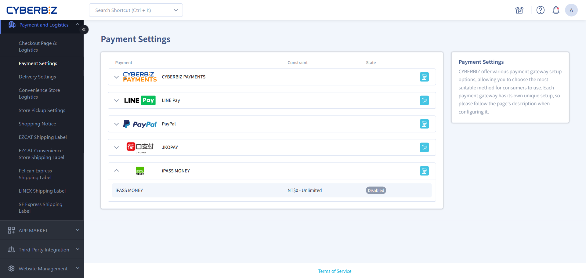
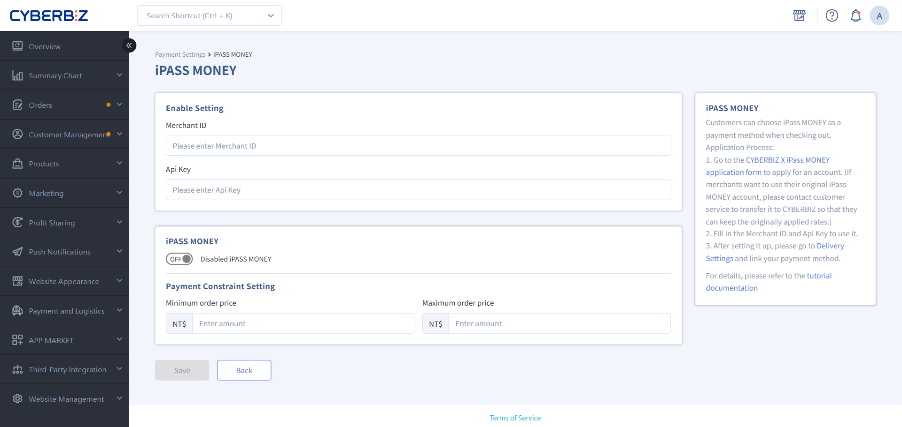
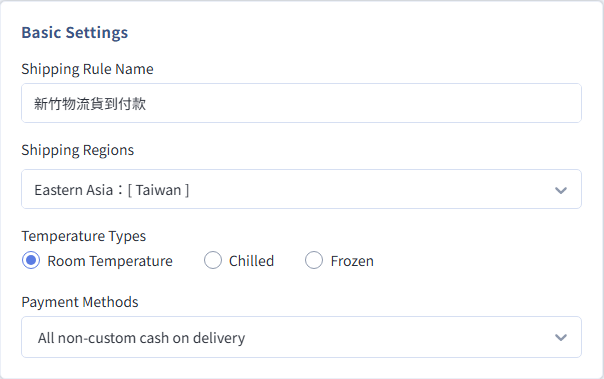

# Set up iPASS MONEY Payments
Guide merchants through applying for and integrating iPASS MONEY payment services. Covers application requirements, required documents, the 2-4 week review timeline, and back-office key setup.
{ .subtitle }

!!! warning "Important Notice: Changes to LINE Pay Features"
    Effective **January 1, 2026**, the iPASS MONEY feature has been fully removed from the LINE Pay wallet. If your storefront needs to offer iPASS MONEY, merchants must **apply separately and reconnect**. Legacy LINE Pay keys cannot be reused.

## Step 1: Prepare Application Documents { #operate-ipass-docs }

Prepare electronic copies (PDF or image format) of the following four documents:

1.  **Company registration documents** (choose one; all pages required)
    - The latest complete company incorporation or change registration form
    - Business registration transcript (not the legacy business registration certificate)
    - Tax registration certificate issued by the National Taxation Bureau
    - Commercial registration certificate issued by the Department of Commerce, Ministry of Economic Affairs
2.  **Owner's national ID card**: Front and back copies.
3.  **Bank passbook copy**: The account name for the payout account must exactly match the registered company name.
4.  **Homepage screenshot**: A screenshot of the storefront homepage after it goes officially live.

!!! tip "Data Security Recommendations"
    If the documents need to be marked for this application only, add the watermark `僅供申請 iPASS MONEY 一卡通使用` to the document.

## Step 2: Submit the Application and Await Review { #operate-ipass-apply }

1.  **Submit the form**: Once your documents are ready, complete the [CYBERBIZ x iPASS MONEY Integration Application Form](https://forms.gle/vHe3DdHZChcS43CUA).
2.  **Await review**: CYBERBIZ forwards your information to iPASS MONEY for review. This takes about **2 to 4 weeks**.
3.  **Create an account**: After registration is complete, the system sends a notification email containing your iPASS MONEY back-office login credentials.

    !!! info "Important Notes"
        If you receive an **account activation email** from iPASS MONEY, it only means your system account has been created. It **does not mean your application has been approved**. Be sure to wait for the CYBERBIZ key notification email before you integrate.

## Step 3: Configure the Back-Office Integration { #operate-ipass-bind }

After you receive the key notification email from CYBERBIZ, follow these steps to enable the service:

1.  Go to **Payment and Logistics > Payment Settings > iPASS MONEY**.
    { .screenshot }
2.  Fill in the key information: Use the keys provided in the notification email.
    -   **Channel ID**
    -   **Api Key**
    { .screenshot }
3. Set the **Payment Threshold Limit**.

    > :lucide-lock: **Payment Threshold Settings** is available only on the **Expert**, **PLUS Plan**, and Enterprise Plan plans. The Professional and Advanced plans are not supported.

4.  Click **Save**.

!!! warning "Entry Guidelines"
    When you enter the keys, make sure there are **no spaces** before or after them, including hidden spaces created when copying, to prevent validation failures.

## Step 4: Link Logistics Payment Methods { #operate-ipass-bind-logistics }

If your site uses **Custom Logistics** or **Home Delivery Cash on Delivery**, you must manually select the box to support iPASS MONEY:

1.  Go to **Payment and Logistics > Custom Logistics**.
2.  Click the logistics option you want to change.
3.  In **Payment Methods**, select **iPASS MONEY**.
4.  Click **Save**.

{ .screenshot }
