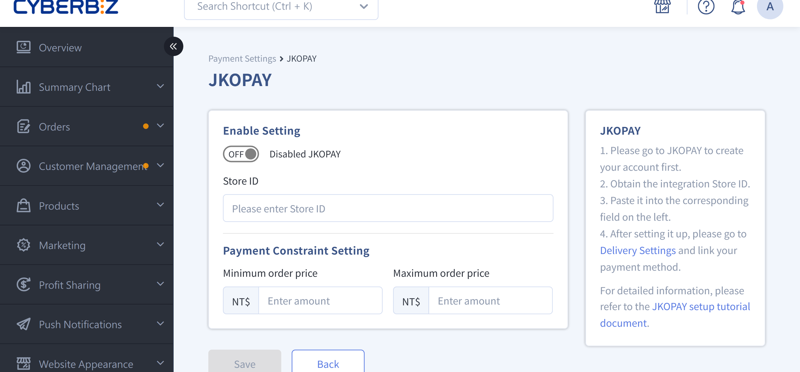
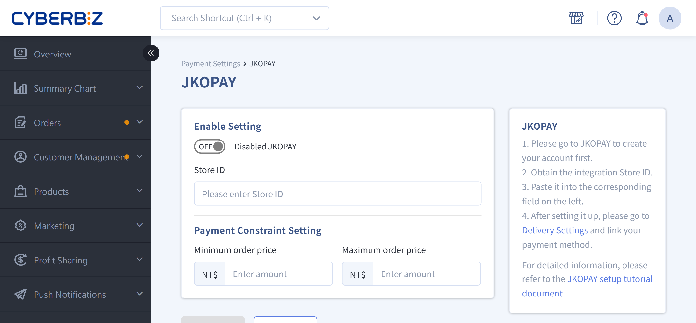

{ title="JKOPAY Settings" .hero-page }

## About JKOPAY { #intro-jkopay }

JKOPAY is a third-party payment service that offers e-payment, JKOPAY Coins, and credit card payments. It supports multiple transaction methods and can be integrated with e-commerce platforms to manage payment processing.

### Supported Payment Methods { #intro-jkopay-methods }

| Payment Method | Description |
|----------|------|
| JKOPAY Coins Payment | Consumers can use JKOPAY Coins to offset the order amount. JKOPAY covers the offset amount. |
| Direct Bank Transfer | Supports instant online bank transfer (`/account_link`) with fast and secure transactions. |
| E-Payment Account | Supports consumers linking e-payment accounts to pay, such as LINE Pay and JKOPAY e-Account. |
| Credit Card Payment | Supports major credit card brands. |

!!! info "For details on JKOPAY rewards, see [JKOPAY Rewards Overview :lucide-external-link:](https://www.cyberbiz.io/helpcenter/wp-content/uploads/2021/03/%E3%80%90%E8%A1%97%E5%8F%A3%E6%94%AF%E4%BB%98%E3%80%91%E8%A1%97%E5%8F%A3%E5%9B%9E%E9%A5%8B%E6%96%B9%E5%BC%8F%E7%B0%A1%E4%BB%8B.pdf)."

---

### Application Restrictions and Notes { #prerequisites-jkopay }

- **Personal Account** cannot apply for JKOPAY.
- When JKOPAY Coins are used to offset the order amount, JKOPAY bears the offset amount.
- The application process takes about **1–2 weeks**, subject to JKOPAY's official timeline.

## Setup Steps { #operate-jkopay }

### Step 1: Fill out the Application Form { #operate-jkopay-form }

Go to [CYBERBIZ x JKOPAY Integration Application Form](https://docs.google.com/forms/d/e/1FAIpQLSeu-OHx8njpaQtC61vZRIpoj529BmkdRtt74490Io3u16AJ_g/viewform) and fill out the complete information.

---

### Step 2: Complete Your JKOPAY Account Application { #operate-jkopay-account }

1. After you submit the form, JKOPAY sends follow-up application instructions by email.

2. If you have questions, contact JKOPAY customer service:

	- Phone: 02-87717000
	- Email: am@jkos.com

---

### Step 3: Complete the CYBERBIZ Back-Office Integration Setup { #operate-jkopay-bind }

1. After you receive the **Store Code (Store ID)** from JKOPAY.
2. Log in to the CYBERBIZ back office, go to **Payment and Logistics > Payment Settings**, and in the **JKOPAY** section, click the edit button :material-file-document-edit-outline: to open the edit page.
3. Enter the **Store ID** and complete the integration to go live.
4. Turn on the JKOPAY feature.

{ title="JKOPAY Store ID" }

## Next Steps { #next-steps-jkopay }

- :lucide-badge-percent:{ .lg }   
  [__JKOPAY Rewards__](https://www.cyberbiz.io/helpcenter/wp-content/uploads/2021/03/%E3%80%90%E8%A1%97%E5%8F%A3%E6%94%AF%E4%BB%98%E3%80%91%E8%A1%97%E5%8F%A3%E5%9B%9E%E9%A5%8B%E6%96%B9%E5%BC%8F%E7%B0%A1%E4%BB%8B.pdf)     
  Introduction to JKOPAY rewards.

- :lucide-book-text:{ .lg }     
  [__JKOPAY Operation Manual__](https://www.cyberbiz.io/support/wp-content/uploads/%E8%A1%97%E5%8F%A3%E6%94%AF%E4%BB%98%E5%BA%97%E5%AE%B6%E5%BE%8C%E5%8F%B0%E6%93%8D%E4%BD%9C%E6%89%8B%E5%86%8A.pdf)  
  JKOPAY merchant back-office operation manual.

- :lucide-circle-question-mark:{ .lg }   
  [__JKOPAY Official FAQ__](https://www.jkopay.com/application/faq)  
  Frequently asked questions compiled by JKOPAY.

