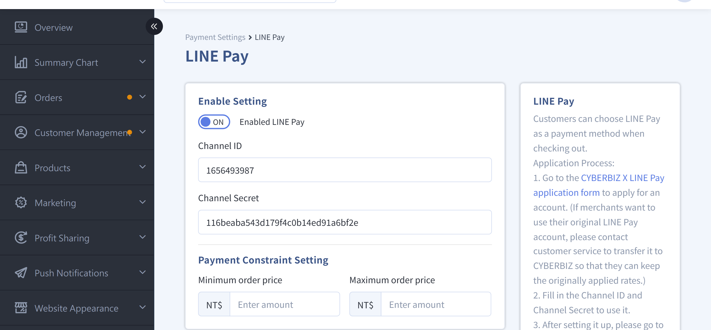
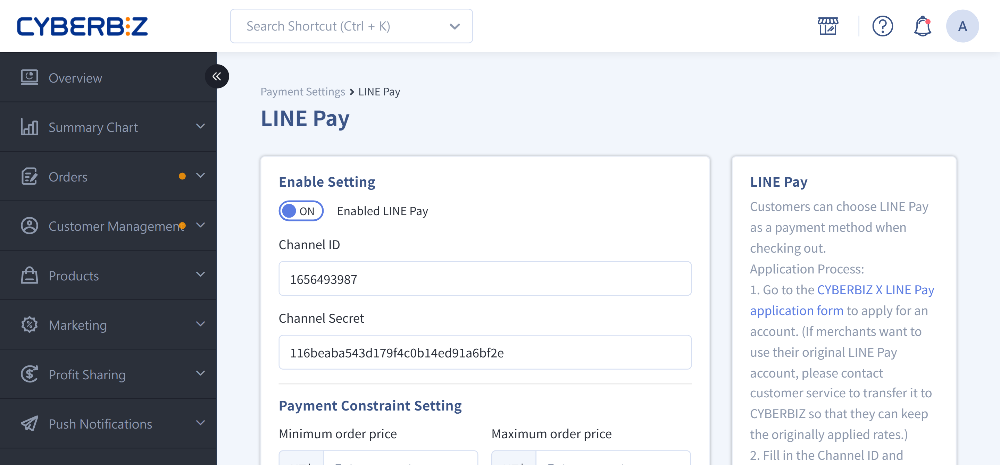
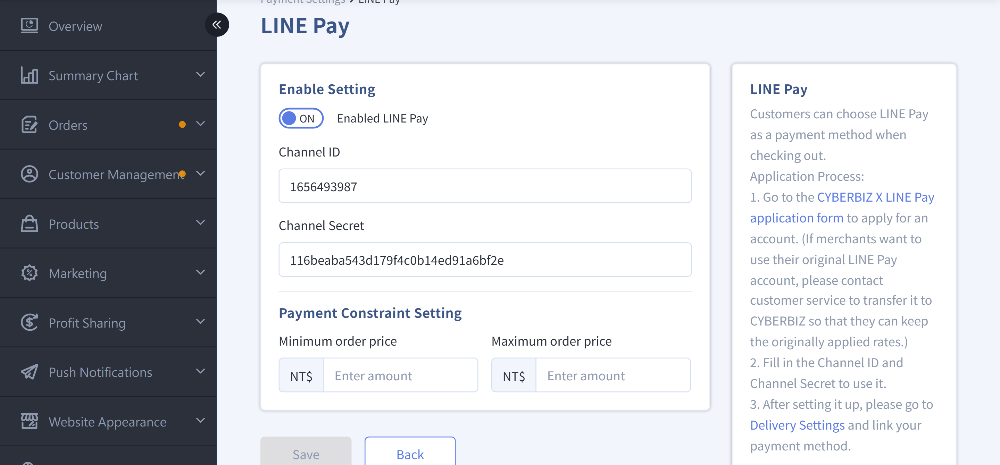
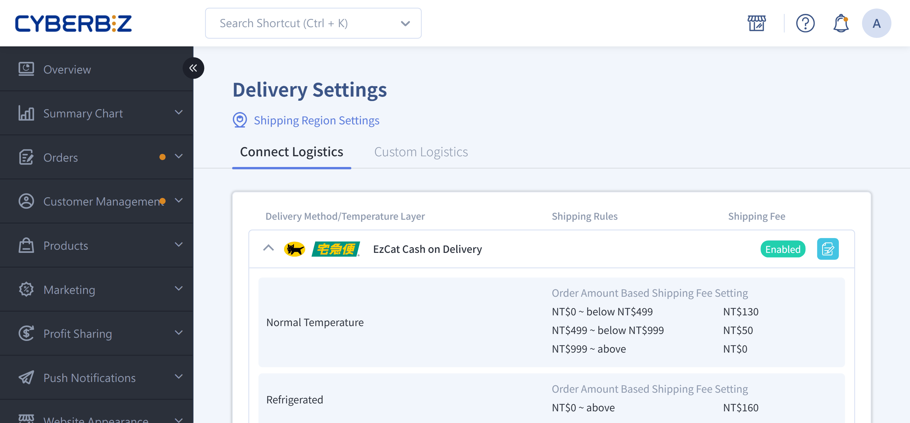

{ title="LINE Pay Guide" .hero-page }

## LINE Pay Guide

- Customers can select LINE Pay at checkout.
- Improves checkout efficiency and increases order completion rates.
- Refunds and order inquiries for LINE Pay are handled through the official LINE Pay admin site.

## Important Notes

- **Eligibility**: You must apply in the name of a company. Individual accounts cannot apply.
- **Existing accounts**: If you already have a LINE Pay merchant account, you must still transfer it and connect it through CYBERBIZ.
- **Transaction fees**: Fees are charged according to the application form or admin settings. For limited-time offers, see the application form.
- **Application process**: If all documents are complete and accurate, no supplementary documents are required. Standard review takes about 1 month.
- **Supplementary documents**: If LINE Pay requests additional documents, the application is reviewed again after you submit them. The review takes about 6–8 weeks.

## Setup Steps

### Step 1: Fill out the Application Form and Upload Documents

Prepare and upload the following **4 required documents**. Each document must be a **separate PDF or image file** (a scan or a clear screenshot is acceptable).

!!! warning "Notes"
	- Missing documents, incomplete pages, or mismatched information can delay the review and may prevent the application from being accepted. Double-check all information before you submit.
	- If a document must be marked for application use, add a watermark to indicate this:`僅供申請 LINE Pay / 一卡通 Money 使用`

#### Required Application Documents

1. **Company registration documents** (provide one of the following. Submit complete versions with no missing pages.)

	- Latest company incorporation or change registration form
	- Commercial registration extract (old-format business registration certificates are not accepted)
	- Tax registration certificate issued by the National Taxation Bureau  

2. **Front and back copies of the company representative's ID card**
3. **Copy of the bank passbook cover page for the payout account**
	- Bank accounts only (**farmers' association, fishermen's association, and cooperative accounts are not supported**)
	- The account name must exactly match the registered company name

4. **Website homepage screenshot** (the brand name and website content must be clearly visible)

After you prepare the documents, fill out the [CYBERBIZ × LINE Pay Integration Preparation Form :lucide-external-link:](https://docs.google.com/forms/d/e/1FAIpQLSeefpmgOBHtkYiwvaz11DuV99v8p2DtX0dwkipexVdFEOsPjA/viewform?usp=sharing) application form.

<!--
(Applies to merchants activated after **Dec 15, 2022**)
-->

---

### Step 2: Wait for Review and Supplementary Documents

#### Review Process

- CYBERBIZ forwards the documents you provide to LINE Pay for review.
- LINE Pay admin account information is sent to your contact email address.
- **Note**: Receiving a notification email does not mean the review is complete. The formal review still takes 2–4 weeks.
- After the review is approved, CYBERBIZ provides the **Channel ID** and **Channel Secret** for the integration.

---

#### Notification Types and Descriptions

- **Review notification email**
	- Indicates that LINE Pay has received the application documents, but the review is still in progress.
	- LINE Pay determines the review result. You will receive another email when the application is approved.  

	{ title="LINE Pay Review Notification" }

- **Document request notification (only when needed)**

    - If LINE Pay needs additional documents, it sends this email, and CYBERBIZ sends a matching notification.
    - Provide the complete information as instructed. After you submit it, the application is reviewed again (the review takes about 6–8 weeks).

    { title="LINE Pay Document Request" }

- **Account activated**

    - Indicates that the LINE Pay account has been approved. You can proceed with the integration setup.        
    - CYBERBIZ sends a key notification email with the **Channel ID** and **Channel Secret** for the integration.  

    { title="LINE Pay Account Activation" }

### Step 3: Enter the Keys in the CYBERBIZ Admin Panel

1. **Receive the CYBERBIZ key notification email**

    - The email contains the **Channel ID** and **Channel Secret** for the integration.
    - Receiving the email means the LINE Pay application is complete. Go to the CYBERBIZ admin panel and enter the keys to finish the integration.  

	{ title="LINE Pay Key Notification" }

2. **Enter the keys in the admin panel and enable LINE Pay**

    - Log in to the CYBERBIZ admin panel and go to **Payment and Logistics > Payment Settings**.
    - Click the edit button :material-file-document-edit-outline: in the LINE Pay section to open the edit page.
    - Enter the **Channel ID** and **Channel Secret** from the notification email in the corresponding fields.
    - Enable the LINE Pay feature.

	!!! warning "Notes"

        - Do not include spaces when you enter the keys. Otherwise, the feature cannot be enabled.  
        - If you apply for both EC and POS LINE Pay, the keys cannot be shared. Enter each set of keys in its corresponding system.  

	{ title="LINE Pay Key Entry" }

2. **Set payment thresholds**: Set the maximum and minimum order amounts.

	{ title="LINE Pay Payment Threshold" }

    !!! info  "The Professional PLUS and Advanced PLUS plans do not support LINE Pay payment threshold settings."  

2. **Select the payment method in the admin panel**

    - After you add the payment option, go to the related logistics edit page at **Payment and Logistics > Delivery Settings** and select the new payment method. This ensures the option appears and works on the storefront.  

	{ title="LINE Pay Payment Method Selection" }

## LINE Pay Order Number Reference

When you view orders in the LINE Pay admin panel, check the format of the "Order Number" field. For example:

- `21678N`, `R1` are randomly generated numbers.
- The middle numeric part corresponds to the **CYBERBIZ admin order number**, which makes it easy to search and compare.

{ title="LINE Pay Order Number" }

## Next Steps

- :lucide-banknote-arrow-down:{ .lg }   
  [__LINE Pay Refunds__](../orders/manual-refund-for-third-party-payment-orders.md){ title="Manual refunds for third-party payment orders" }     
  Process refunds in the LINEPAY admin panel.

- :lucide-book-text:{ .lg }     
  [__LINE Pay Operation Manual__](https://www.cyberbiz.io/support/wp-content/uploads/LINE_Pay_%E5%95%86%E5%BA%97%E6%93%8D%E4%BD%9C%E6%89%8B%E5%86%8A_v5.pdf)  
  Web-based store admin operation manual.

- :lucide-circle-question-mark:{ .lg }   
  [__LINE Pay Official FAQ__](https://pay.line.me/portal/tw/customer/faq?categoryId=account)  
  Frequently asked questions compiled by LINE Pay.

- :lucide-log-in:{ .lg }   
  [__LINE Quick Login__](../integrations/line/account-integration/setup-line-quick-login.md){ title="Set Up LINE Quick Login" }  
  Enable LINE Quick Login.

