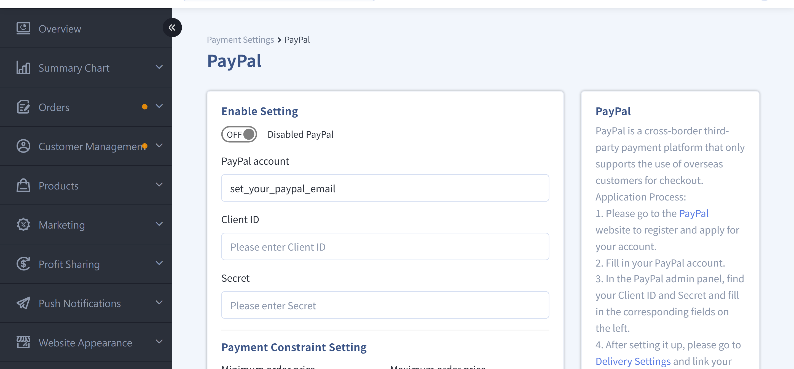
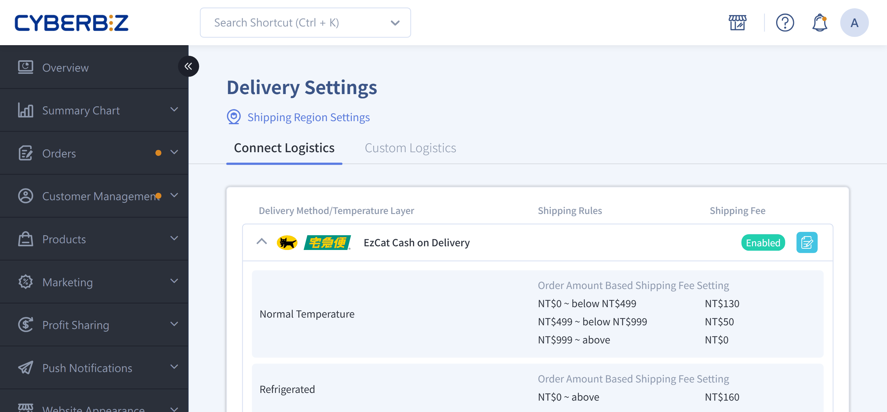

{ title="PayPal Settings" .hero-page }

## About PayPal

PayPal is a globally recognized online payment platform that lets consumers pay with credit cards, debit cards, or their PayPal balance. With PayPal, merchants can receive payments securely and quickly, and accept transactions in multiple currencies.

!!! example "Use Cases"

    - Merchants who serve cross-border or overseas customers
    - Merchants who want a secure payment method integrated with CYBERBIZ order management

### Important Notes

- **Regulatory restrictions**: Taiwan merchants can only process cross-border transactions. Domestic transactions within Taiwan are not supported. Customers with foreign credit cards can pay with PayPal.
- **Automatic refunds**: The system supports automatic refunds within **180 days** of payment. After this period, merchants must process refunds manually.
- **Transaction fees**: Fees vary by the consumer's card-issuing country (domestic or international transactions). For exact amounts, see your PayPal statement.
- **Threshold**: Set minimum and maximum PayPal transaction amounts to avoid high fees on small orders.

## Setup Steps

### Step 1: Apply for a PayPal Account

!!! warning "Use an email address that you can receive messages at to register. This email will serve as the PayPal account linked to the CYBERBIZ admin."

1. Go to the [PayPal official website :lucide-external-link:](https://www.paypal.com/tw/webapps/mpp/home?locale.x=zh_TW) and apply for a **Business account**.
2. Follow PayPal's instructions to complete account registration and identity verification.
3. Confirm that you can log in to the PayPal dashboard, and complete the basic account settings.

---

### Step 2: Get Your PayPal Client ID and Secret

!!! tip "Tip"
    Merchants who have activated CYBERBIZ PAYMENTS can use the Client ID and Secret to enable **automatic refunds**.

1. After you log in to your PayPal Business account, go to the [PayPal Developer Dashboard :lucide-external-link:](https://developer.paypal.com/home/).  
2. In the Developer Dashboard, go to the **Apps & Credentials** page.
3. Confirm that the environment is set to **Live** (production), not Sandbox (test environment).
4. Create or select an existing app to get the following:

    - **Client ID**
    - **Secret**

{ title="PayPal Client ID and Secret" }

!!! note "The screens above are for illustration only. For actual screens, refer to the PayPal dashboard."

---

### Step 3: Configure CYBERBIZ Admin Settings

1. **Go to the settings page**

	- Log in to the CYBERBIZ admin panel and go to **Payment and Logistics > Payment Settings**.
	- In the PayPal section, click the Edit button :material-file-document-edit-outline: to open the edit page.

2. **Enter PayPal Connection Details**

    - **PayPal account**: Enter the registered email address of your PayPal Business account
    - **Client ID**: Paste the Client ID from the PayPal Developer Dashboard    
    - **Secret**: Paste the Secret from the PayPal Developer Dashboard

    !!! warning "Make sure the pasted content **does not contain any spaces or line breaks**. Otherwise, the connection may fail."

2. **Enable the payment service**: Switch the PayPal payment option to **Enabled (ON)**, and click **Confirm Save**.

3. **Link Shipping Methods**  
	- Go to **Payment and Logistics > Delivery Settings**
	- Edit the related shipping methods, check the newly added PayPal payment option, and make sure it is available on the storefront

	!!! warning "If the new payment option is not linked to a shipping method, the storefront will not display this payment method."

	{ title="PayPal shipping method link" }

## Next Steps

- :lucide-banknote-arrow-down:{ .lg }   
  [__Manual Refunds for Third-Party Payment Orders__](../orders/manual-refund-for-third-party-payment-orders.md){ title="Manual Refunds for Third-Party Payment Orders" }     
  Return and refund procedures.

- :lucide-circle-question-mark:{ .lg }   
  [__PayPal Official FAQ__](https://www.paypal.com/tw/cshelp/personal)  
  Frequently asked questions compiled by PayPal.

