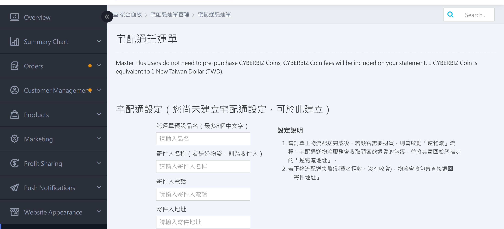
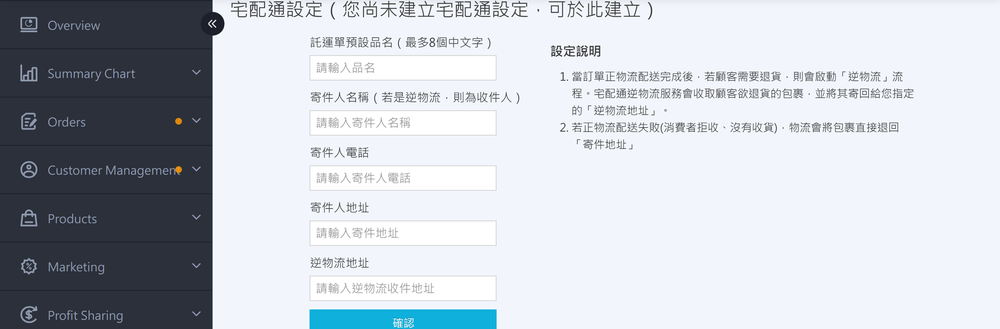
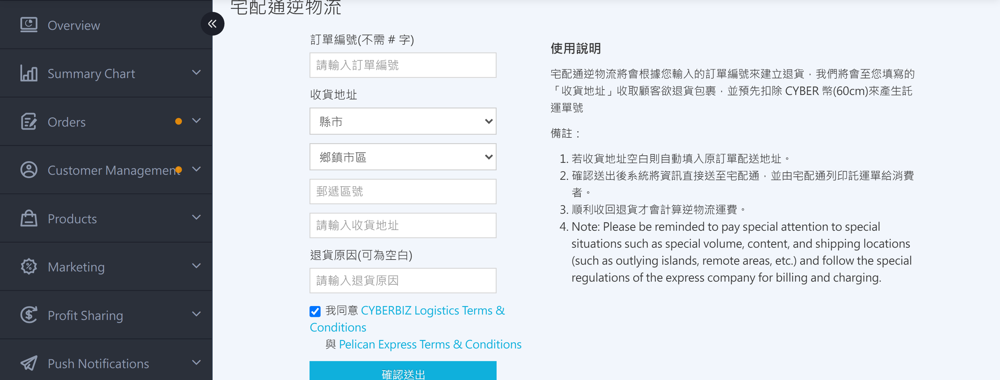
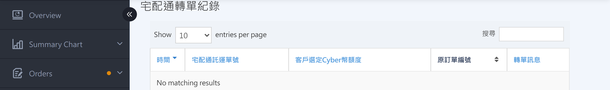

{ title="Pelican waybill page" .hero-page }

## Pelican Waybill Setup Guide { #intro-pelican-shipping-note }

The Pelican Waybill page is located at **the left menu **Payment and Logistics > Pelican Express Shipping Label****. This page handles Pelican operations **outside of the daily shipping workflow**:

* **Pelican Settings**: Sender name, phone number, address, and other details used when printing additional waybills and creating reverse logistics.
* **Print Additional Waybills**: Generates **new waybill numbers** for the same order, suited to splitting one order into multiple boxes.
* **Pelican Reverse Logistics**: Creates a return waybill so Pelican can pick up the item from the customer and deliver it to your reverse logistics address.
* **Transfer Records and Waybill Number Usage Records**: Review the charges, status, and reconciliation information for all waybill numbers.

For the standard shipping workflow (batch downloads, single shipments, partial shipments, and waybill reprints), see [How to Ship with Pelican](../orders/home-delivery/pelican-shipping-v2.md).

!!! info "Tip"
    At the top of the page, billing information is displayed. Standard merchants see "Current CYBER Coin Balance." PLUS and Enterprise merchants see reconciliation statement text instead.

## Steps { #operate-pelican }

### Set up Sender Information { #operate-pelican-sender-settings }

Before you first use "Print Additional Waybills" or "Pelican Reverse Logistics," set up your sender information. If your company address or contact person changes later, return here to update it.

1. **Go to the page: ** Go to **Payment and Logistics > Pelican Express Shipping Label**, scroll to the top ** "Pelican Settings"** section.
2. **Enter the default item name:** Enter the text to print in the item name field on the waybill, up to **8 Chinese characters**.
3. **Enter sender information:** Enter the sender Name, **Phone**, and **Address** in order. For reverse logistics (returns), the name entered here appears as the **recipient** of the returned item.
4. **Enter the reverse logistics address:** Returned parcels are sent to this address. If left blank, reverse logistics uses the "Sender Address" entered above.
5. **Save settings:** Click **Confirm**. The system displays "Settings updated successfully."

{ title="Pelican Settings" }

---

### Print Additional Waybills <small>Multi-Box Shipments for the Same Order</small> { #operate-pelican-shipping-note-add-print }

If an order needs to be split into multiple parcels (for example, when the items do not fit in one box), use "Print Additional Waybills" to create **additional waybill numbers for the same order**, and attach one waybill to each box.

1. **Go to the page: ** Go to **Payment and Logistics > Pelican Express Shipping Label**, scroll to ** "Print Additional Waybills"** section.
2. **Enter the order number:** In the "Order No." field, enter the order number to print additional waybills for. **No order prefix needed**; the system fills in the prefix automatically.
3. **Select the item size:** Choose the size that matches this new waybill from the drop-down menu. The CYBER coin amount for each size is shown next to the option.
4. **Select the number of additional waybills:** From the "Additional Waybill Quantity" drop-down, select how many to print.[^1] Each waybill is **charged separately** and generates a **unique waybill number**.
5. **Agree to the terms:** Select **"I agree to the CYBERBIZ Logistics Integration Service Terms and the Pelican Contract Terms"**. The **Confirm Download** button is enabled only after you select this option.
6. **Confirm download:** Click **Confirm Download**. The system displays a confirmation window showing the total CYBER coins to be deducted.
7. **Submit the additional waybill request:** Click **Confirm** in the confirmation window. The system creates the waybill numbers and automatically downloads the PDF.

!!! info "Tip"
    * Additional waybills only print **"delivery-only"** waybills. Even if the original order is cash on delivery, the additional waybills do not include a collection amount.
    * To split a cash-on-delivery order into multiple boxes with collection, contact CYBERBIZ customer support for help.
    * Printing additional waybills **always** creates a new waybill number and incurs a charge. If you only need to reprint the same waybill because the print was damaged, use [Reprint Waybill](../orders/home-delivery/pelican-shipping-v2.md#operate-pelican-reprint){ title="Ship with Pelican" } (performed from the order list, no charge).

[^1]: For example, select 3 for a 3-box shipment.

---

### Create Pelican Reverse Logistics <small>Returns</small> { #operate-pelican-shipping-reverse }

When a customer needs to return an item and you want Pelican to pick it up at the customer's home, create a reverse logistics waybill here.

1. **Go to the page: ** Go to **Payment and Logistics > Pelican Express Shipping Label**, scroll to ** "Pelican Reverse Logistics"** section.
2. **Enter the order number:** In the "Order No." field, enter the order number for the return (no order prefix needed).
3. **Enter the pickup address:** Use the drop-down menus to select the county/city, district, and postal code, then enter the full address in the address field.[^2]
4. **Enter the return reason (optional):** Enter a note in the "Return Reason" field. Leave it blank if you do not need one.
5. **Agree to the terms:** Select **"I agree to the CYBERBIZ Logistics Integration Service Terms and the Pelican Contract Terms"**.
6. **Submit the create request:** Click **Confirm Submission**. The system displays a confirmation window showing the CYBER coins to be **pre-deducted** at the lowest rate for "Ambient 60cm."
7. **Confirm creation:** Click **Confirm** in the window. The information is sent directly to Pelican, and **Pelican prints the waybill** and hands it to the customer.
8. **Wait for the return to be collected:** After the return is collected, the reverse logistics fee is calculated based on the actual parcel size, and the final charge is applied.

{ title="Pelican Reverse Logistics" }

!!! note "Note"
    * Pelican prints the waybill and hands it to the customer. The merchant back office **does not** receive the PDF directly.
    * Returned parcels are sent to the "Reverse Logistics Address" entered in [Pelican Settings](#operate-pelican-sender-settings) (if left blank, they are sent to the sender address).

[^2]: If left blank, the system automatically uses the original order's delivery address.

---

### Review Records and Reconciliation { #operate-pelican-shipping-records }

The bottom of the page provides three historical record tables. All data can be filtered by keyword using the search box in the upper-right corner.

#### Pelican Transfer Records { #reference-pelican-transfer-records }

Shows waybill numbers that have used the transfer mechanism, for reconciliation lookups.

{ title="Pelican Transfer Records" }

??? info-clean "Field Descriptions"

    | Field | Description |
    | :-- | :-- |
    | Time | Date and time when the transfer occurred |
    | Original Order No. | Order originally linked to this waybill number |
    | Pelican Waybill No. | Pelican waybill number that was transferred |
    | Customer-Selected CYBER Coin Amount | Deduction amount selected when the waybill was downloaded |
    | Transfer Message | System note from the transfer process |

---

#### Waybill Number Usage Records <small>Forward / Reverse Logistics</small> { #reference-pelican-usage-records }

"Forward logistics" records waybill numbers used for shipments, and "reverse logistics" records waybill numbers used for returns. Both have the same field structure.

{ title="Pelican Forward Logistics Waybill Records" }

??? info-clean "Field Descriptions"

    | Field | Description |
    | :-- | :-- |
    | Time | Waybill creation time |
    | Order No. | Corresponding order number. Click to open the order details page |
    | Pelican Waybill No. | Waybill number assigned by Pelican |
    | Delivery Plan | Package dimensions of the waybill |
    | Customer-Selected CYBER Coin Amount | Deduction amount selected at the time of download |
    | Confirmed CYBER Coin Deduction | Final CYBER coin amount deducted after settlement |
    | Waybill Status | Current waybill status (such as In Use or Shipment Canceled). "Shipment Canceled" means the waybill was unused for 14 days and automatically refunded |
    | Transfer Status | Shows whether this waybill number has used the transfer mechanism |

!!! tip "Tip"
    When reconciling, compare the **Confirmed CYBER Coin Deduction** field first, since it shows the amount after settlement. The "Customer-Selected CYBER Coin Amount" is only the pre-deducted amount at download time and may differ from the final charge due to refunds or adjustments.

## Next Steps { #next-steps-pelican }

- :lucide-package:{ .lg }  
  [__Ship with Pelican__](../orders/home-delivery/pelican-shipping-v2.md)  
  Daily shipping workflows, including batch waybill downloads, single and partial shipments, and waybill reprints.

- :lucide-undo-2:{ .lg }  
  [__Pelican Reverse Logistics__](#operate-pelican-shipping-reverse)  
  The complete return workflow for Pelican reverse logistics, used to pick up returns for shipped orders.

- :lucide-wallet:{ .lg }  
  [__Top Up CYBER Coins__](../website-management/points-deposits.md#operate-cyber-coin-deposit){ title="CYBER Coin Top-Up Center Guide" }  
  Additional waybills deduct CYBER coins immediately. If your balance is insufficient, top up in the top-up center first.

## Frequently Asked Questions { #faq-pelican-management }

??? quote "Why doesn't the **Confirm Download** button respond?"
    { #faq-pelican-management-disabled-button }

    Check whether you have selected **"I agree to the CYBERBIZ Logistics Integration Service Terms and the Pelican Contract Terms"** below. If the terms are not selected, the confirm button stays disabled.

??? quote "What should I do if the "Insufficient CYBER Coins" message appears when printing additional waybills?"
    { #faq-pelican-management-insufficient }

    Standard merchants must first top up CYBER coins in the **Top-Up Center**. PLUS and Enterprise merchants should not see this message. If it appears, contact CYBERBIZ customer support to verify your plan settings.

??? quote "When will the customer receive the waybill after a reverse logistics request is submitted?"
    { #faq-pelican-management-reverse-timing }

    After submission, the system sends the data to Pelican, and **Pelican prints the waybill and hands it to the customer**. The actual delivery time depends on Pelican's delivery schedule. We recommend agreeing on a pickup time window with the customer in advance.

??? quote "Will downloaded waybills change if I update the sender information?"
    { #faq-pelican-management-sender-update }

    No. Sender information only affects waybills **created after the change** (additional or reverse logistics). **Downloaded** waybills keep the sender information from the time of download and cannot be changed afterward.

??? quote "Can the new waybill still collect payment after additional waybills are printed for a cash-on-delivery order?"

    { #faq-pelican-management-cod-print }

    No. The additional waybill feature **only prints "delivery-only" waybills**. Even if the original order is cash on delivery, the new waybill does not include a collection amount. If you need to split a cash-on-delivery order into multiple boxes and keep the collection feature, contact CYBERBIZ customer support for help.

