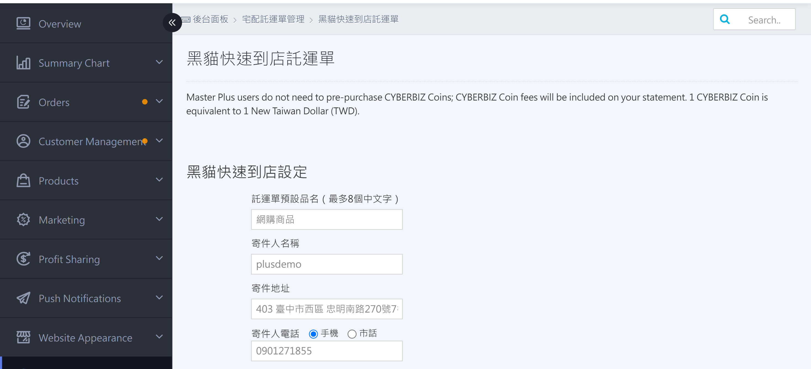
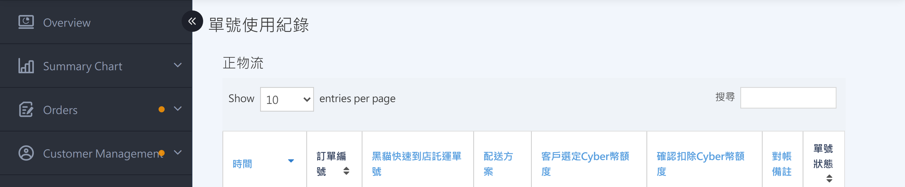

{ title="Quick Store Waybill Settings Page" .hero-page }

## Quick Store Shipping Label Guide{ #intro-ezcat-cvs-shipping-note }

!!! path "Admin path: Payment and Logistics > Black Cat Quick Store Waybill"

The T-CAT Rapid-to-Store Shipping Label page is your single entry point for managing sender details, reprinting shipping labels, and reviewing deduction records for **Black Cat Express Quick Store (CVS pickup)** shipping labels.

The page brings together the most common merchant actions and provides a history log so you can verify CYBER Coin deductions:

* **Quick Store settings**: Set the sender name, sender address, contact phone number, and default shipping label item name. All later shipping labels use these values automatically.
* **Reprint shipping labels**: Use CYBER Coins to print one or more delivery-only shipping labels for a single order.
* **Waybill number usage log**: List all T-CAT Rapid-to-Store shipping labels for your store and the CYBER Coin amounts deducted, for reconciliation.

!!! info "Tip"
    This page applies only to **Black Cat Quick Store (CVS pickup)** shipping labels. To work with **Black Cat Express (home delivery)** shipping labels, go to [Set Up and Print T-CAT Shipping Labels](setup-print-tcat-waybill-v2.md){ title="Set Up and Print Black Cat Waybills" } page instead.

## Page Section Overview { #overview-ezcat-cvs }

| Section | Purpose | When to use |
| :-- | :-- | :-- |
| [Quick Store Settings](#operate-ezcat-cvs-sender-settings) | Set the sender name, address, contact phone number, and default shipping label item name | First use, or when sender information changes |
| [Reprint Shipping Labels](#operate-ezcat-cvs-create) | Reprint 1 to 8 delivery-only shipping labels for a single order | Split shipments into multiple boxes, or reprint a damaged shipping label |
| [Waybill Number Usage Log](#reference-ezcat-cvs-usage) | List all T-CAT Rapid-to-Store shipping labels and deduction amounts for your store | Reconcile, or check the status of a waybill number |

## Requirements and Limitations { #prerequisites-ezcat-cvs }

### Shipping Label Sticker Requirements { #specs-ezcat-cvs-sticker }

Always print shipping labels on **Black Cat three-part blank waybill stickers**. If you do not have them, call T-CAT customer support to request them first. Using other paper sizes may prevent the T-CAT system from scanning the shipping label.

## Steps { #operate-ezcat-cvs }

### Set up Sender Information { #operate-ezcat-cvs-sender-settings }

Before you use the T-CAT Rapid-to-Store shipping label feature for the first time, you **must** complete the **Quick Store Settings** section. The sender name, address, and phone number are used on all later shipping labels.

1. **Go to the page**: Log in to the admin and go to **Payment and Logistics > EZCAT Convenience Store Shipping Label** .
2. **Enter the default shipping label item name**: In the **Default waybill item name (up to 8 Chinese characters)** field, enter the item name to print on the shipping label (for example, Online Purchase).
3. **Enter the sender name**: In the **Sender name** field, enter the sender's name.[^1]
4. **Enter the sender address**: In the **Sender address** field, enter the full sender address. **Parcels that fail delivery (customer refuses, or is not picked up at the store) are automatically returned to this address**.
5. **Select the sender phone type**: Click **Mobile** or **Landline**.
    * Mobile: Enter the mobile number directly in the `0988111222` format field.
    * Landline: Enter the **Area Code** (for example `02` ), the **phone number** (for example `23112244` ), and the **Extension** (can be left blank).
6. **Enter the reverse logistics address**: In the **Reverse logistics address** field, enter the recipient address for returned parcels. This field is used only for future return processing and does not affect reprinting or shipping on this page. If you also use other Black Cat logistics features,
please fill it in as well.
7. **Save the settings**: Click **Confirm**. A message saying "Settings changed successfully" means the setup is complete.

{ title="Quick Store Settings" }

[^1]: The sender name cannot contain special characters. If an error message appears when you save, remove the invalid characters as prompted and try again.

---

### Reprint Shipping Labels { #operate-ezcat-cvs-create }

Reprinting applies to an **order that already exists in the system**. It generates additional waybill numbers. Typical cases include an order that must be split into multiple boxes, or a damaged shipping label that needs to be printed again.

#### Eligibility Requirements { #prerequisites-ezcat-cvs-shipping-note-create }

Each reprinted shipping label deducts CYBER Coins immediately. Before submission, the system checks the following items. If any item fails, the process stops:

| Condition | System Requirement |
| :-- | :-- |
| Order exists | Enter the correct order number (without the store number prefix) |
| Order delivery method | Must be **EZCAT CVS - Room Temperature**, **EZCAT CVS - Frozen**, or **EZCAT CVS - Refrigerated** (includes prepaid and cash-on-delivery variants). Other logistics methods cannot be reprinted. |
| Order payment status | Must be **Paid** or **Cash on Delivery** |
| CYBER Coin balance | Must be greater than the fee per waybill × number of waybills to reprint |
| Number of waybills to reprint | Up to **8 waybills** |
| Specification temperature zone match | The selected temperature zone must match the original order's temperature zone (room-temperature orders can only reprint room-temperature, frozen orders only frozen, and refrigerated orders only refrigerated). |

!!! note "Note"
    If the original order is **cash on delivery**, reprinting produces only a **delivery-only** shipping label. To print a cash-on-delivery shipping label (to collect payment from the recipient), go to the order detail page. This page does not support it.

---

#### Steps { #operate-ezcat-cvs-shipping-note-create }

1. **Go to the page**: Log in to the admin, go to **Payment and Logistics > EZCAT Convenience Store Shipping Label** , and scroll to the **Reprint Waybills** section.
2. **Enter the order number**: In the **Order number** field, enter the order number to reprint (you do not need to enter the order number prefix).
3. **Select the item size**: In the dropdown, select the matching **Ambient / Frozen / Chilled + size** specification. The CYBER
Coin amount to be deducted appears next to each option. The dropdown options are shown based on the temperature zone included in your plan, and must match the original order's temperature zone.
4. **Select the number of waybills to reprint**: In the dropdown, choose how many waybills to print (1 to 8).
5. **Agree to the terms**: Select the checkbox for "I agree to the CYBERBIZ Logistics Integration Service Terms and the Black Cat Quick Store Contract Terms". The **Confirm download** button is enabled only after you select the checkbox.
6. **Click Confirm download**: Click **Confirm download**. The system shows a confirmation window that asks "Confirm using CYBER Coins to print the Black Cat Quick Store waybill?" and lists the deduction amount for this request.
7. **Confirm again**: In the confirmation window, click **Confirm**. The system requests waybill numbers from T-CAT and generates the PDF.
8. **Get the shipping label PDF**: The system automatically downloads the shipping label PDF and requests a new waybill number from T-CAT for each reprinted shipping label (each reprinted shipping label has its own new number[^2]).
9. **Print**: Print the PDF on **Black Cat three-part blank waybill stickers**, then hand the parcel to a T-CAT driver or take it to a T-CAT branch yourself.

!!! tip "The system pre-selects the dropdowns based on the specification you **last reprinted**. If your store often prints the same specification, this saves repeated steps."

[^2]: The system requests a new waybill number from T-CAT for each reprinted waybill. For one order, N reprinted waybills = N separate new waybill numbers.

---

### View Records and Reconciliation { #reference-ezcat-cvs-records }

The page provides a **Waybill Number Usage Log** table at the bottom. Use the search box in the upper right to filter by keyword. Click a column header to change the sort order.

#### Waybill Number Usage Log { #reference-ezcat-cvs-usage }

This log shows the deduction details and status of all T-CAT Rapid-to-Store shipping labels for your store.

{ title="Quick Store Waybill Number Usage Log" }

??? info-clean "Field Descriptions"

    | Field | Description |
    | :-- | :-- |
    | Time | Time the shipping label was created |
    | Order number | The related order number. Click it to go to the order detail page. If the order has been deleted, the system shows "Order deleted". |
    | T-CAT Rapid-to-Store waybill number | Waybill number assigned by T-CAT |
    | Delivery plan | Shipping label specification |
    | Selected CYBER Coin amount | Amount selected when the waybill was downloaded |
    | Confirmed CYBER Coin deduction | Final CYBER Coin amount deducted after reconciliation |
    | Reconciliation note | System or customer support note, usually an internal explanation added when support helps resolve an issue |
    | Shipping label status | Current shipping label status (for example, Used or Pending shipment) |

!!! note "Note"
    * The difference between the **Selected CYBER Coin amount** and the **Confirmed CYBER Coin deduction** occurs in special situations such as temperature zone mislabeling or peak season.
    * T-CAT Rapid-to-Store shipping labels are **always non-transferable**. Each reprint or shipment requests a new waybill number from T-CAT.

## Next Steps { #next-steps-ezcat-cvs }

- :lucide-wallet:{ .lg }  
[__Top Up CYBER Coins__](../website-management/points-deposits.md#operate-cyber-coin-deposit){ title="How to top up CYBER Coins" }  
Reprinting shipping labels deducts CYBER Coins immediately. If your balance is insufficient, the system blocks the action. Top up in the CYBER Coins Topup Center first.

- :lucide-truck:{ .lg }  
[__Set Up and Print T-CAT Waybills__](setup-print-tcat-waybill-v2.md){ title="Set Up and Print Black Cat Waybills" }  
If you also use T-CAT **home delivery**, go to the T-CAT shipping label page to set up sender information and reprint home delivery shipping labels.

## FAQ { #faq-ezcat-cvs-shipping-note }

??? quote "The Reprint Waybills button is greyed out"
    { #faq-ezcat-cvs-shipping-note-button-disabled }

    First, select the checkbox below for **I agree to the CYBERBIZ Logistics Integration Service Terms and the Black Cat Quick Store Contract Terms**. The **Confirm download** button is enabled only after you agree to the terms.

??? quote "The message says the order is unpaid or the order number is incorrect"
    { #faq-ezcat-cvs-shipping-note-order-status }

    Possible causes:

    * The order number was entered incorrectly, or the store number prefix was included by mistake. The prefix appears as hint text next to the field, and **you do not need to enter it manually**.
    * The order is unpaid. Reprinting supports only **Paid** or **Cash on Delivery** orders.
    * The order's delivery method is not T-CAT Rapid-to-Store. This page supports only T-CAT Rapid-to-Store orders.

??? quote "The message says this order's shipping method is not Black Cat Quick Store, so it cannot be reprinted"
    { #faq-ezcat-cvs-shipping-note-shipping-type-not-match }

    The order's delivery method is not **Black Cat Quick Store - Ambient / Frozen / Chilled** (includes prepaid and cash-on-delivery variants). For example, the order was originally home delivery or another convenience store. Go to the [Set Up and Print T-CAT Shipping Labels](setup-print-tcat-waybill-v2.md){ title="Set Up and Print Black Cat Waybills" } page instead.

??? quote "The message says Black Cat Quick Store XX orders can only select XX temperature zone"
    { #faq-ezcat-cvs-shipping-note-rate-mismatch }

    The selected temperature zone must match the original order's temperature zone:

    * **Ambient** orders can only reprint **Ambient** specifications.
    * **Frozen** orders can only reprint **Frozen** specifications.
    * **Chilled** orders can only reprint **Chilled** specifications.

??? quote "The message says insufficient balance, please top up in the Topup Center"
    { #faq-ezcat-cvs-shipping-note-points-insufficient }

    Your CYBER Coin balance is less than the fee per waybill × number of waybills to reprint. Go to **Website Management > Topup Center** and complete [top-up](../website-management/points-deposits.md#operate-cyber-coin-deposit){ title="How to top up CYBER Coins" data-preview }, then return to this page. The blue number at the top of the page shows your current balance.

??? quote "Why does a cash-on-delivery order become delivery-only after reprinting?"
    { #faq-ezcat-cvs-shipping-note-cod-not-supported }

    **The reprint waybill feature prints only delivery-only waybill numbers**. It does not attach the cash-on-delivery amount to the new shipping label. If you need to split the shipment into multiple boxes and still have T-CAT collect payment, ship from the order detail page and contact customer support for help.

??? quote "The waybill PDF does not open after download"
    { #faq-ezcat-cvs-shipping-note-pdf-missing }

    Possible causes:

    * The browser blocked automatic downloads. Allow multiple automatic downloads for this site, then try again.
    * The shipping label is still being generated in the background. Wait patiently, and do not close the page in the meantime.
    * If there is still no response after a few minutes, check whether the waybill number was generated in the **Waybill Number Usage Log**, and then contact CYBERBIZ customer support for help reissuing it.

??? quote "Can I change the specification or address after downloading the waybill?"
    { #faq-ezcat-cvs-shipping-note-edit-after-download }

    No. Downloaded shipping labels cannot be changed in the system. Make a **handwritten correction** on the shipping label, and tell the T-CAT driver at drop-off. If the specification or address is completely wrong, check the status of the waybill number in the **Waybill Number Usage Log**, then contact CYBERBIZ customer support to void it and apply again.

??? quote "The message says the network is unstable, please try again later"
    { #faq-ezcat-cvs-shipping-note-bad-reception }

    The connection to the T-CAT system failed temporarily. Try again later. If retries still fail, check whether the waybill number was generated in the **Waybill Number Usage Log** (to avoid deducting CYBER Coins twice) before you decide whether to retry.

