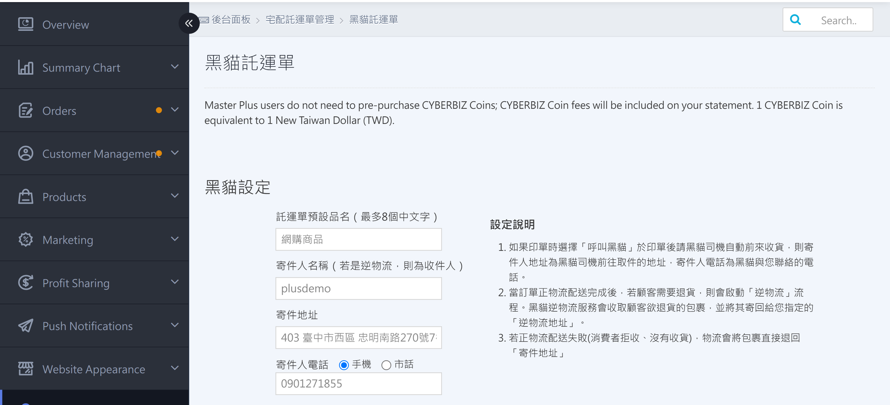
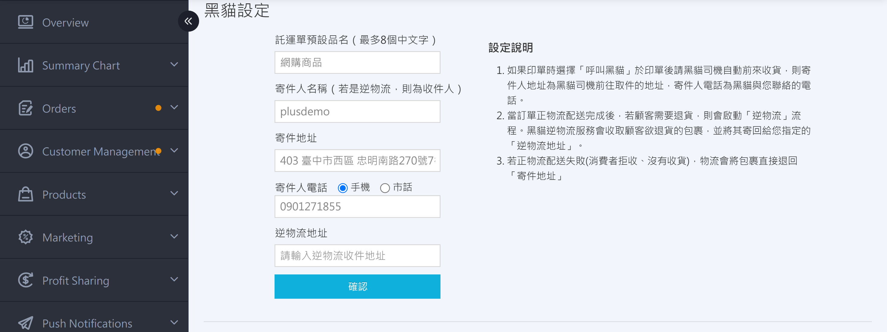
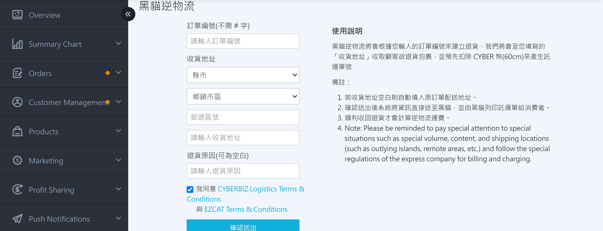
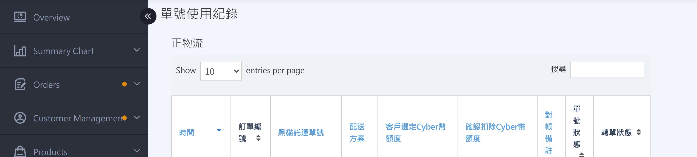

{ title="Black Cat waybill settings page" .hero-page }

## T-CAT Shipping Label Overview { #intro-ezcat-shipping-note }

!!! path "Admin path: Payment and Logistics > Black Cat Waybill."

The T-CAT Shipping Label page is your single entry point for managing **EzCat Express** sender information, reprinting shipping labels, creating reverse logistics, and reviewing deduction records.

This page brings together the three most common merchant actions and provides two history records to help you verify CYBER Coin deductions:

* **Set up sender information**: Applied to forward shipping and reverse pickup waybills.
* **Reprint Shipping Labels**: Print one or more delivery-only shipping labels for a single order, paid with CYBER Coin.
* **Create T-CAT reverse logistics**: T-CAT collects the parcel from the customer's address and returns it to the reverse-logistics address you specify.

!!! info "Tip"
    This page applies only to **Black Cat Express (home delivery)** shipping labels. To manage **Black Cat Quick Store (ambient / chilled / frozen)** shipping labels, go to the [T-CAT Rapid-to-Store Shipping Label](setup-print-tcat-quick-store-waybill-v2.md){ title="Set Up and Reprint Black Cat Quick Store Waybills" data-preview } page instead.

## Page Section Overview { #overview-ezcat-shipping }

| Section | Purpose | When to Use |
| :-- | :-- | :-- |
| [T-CAT Settings](#operate-ezcat-sender-settings) | Set the sender's name, address, contact phone number, and reverse-logistics return address | First-time setup or changes to sender information |
| [Reprint Shipping Labels](#operate-ezcat-shipping-create) | Print 1 to 8 delivery-only shipping labels for a single order | Split shipments or reprinting damaged shipping labels |
| [T-CAT Reverse Logistics](#operate-ezcat-shipping-reverse) | T-CAT collects the parcel from the customer and returns it to your reverse-logistics address | Customer returns an order that has already shipped |
| [T-CAT Reassignment Log](#reference-ezcat-shipping-transfer) | History of unused waybill numbers that the system automatically reassigns from the original order to a new order | For reconciliation lookups |
| [Waybill Number Log (Forward Logistics)](#reference-ezcat-shipping-usage) | Lists all T-CAT forward-logistics shipping labels for your store and their deduction amounts | Reconciliation and reassignment status lookup |
| [Waybill Number Log (Reverse Logistics)](#reference-ezcat-shipping-usage) | Lists all T-CAT reverse-logistics shipping labels for your store and their deduction amounts | Reconciliation and reassignment status lookup |

## Billing Rules { #specs-ezcat-shipping-billing }

T-CAT shipping labels use the **CYBER Coin pre-deduction** model, with CYBER Coin deducted in real time when you print a shipping label or create a reverse-logistics order.

!!! info "Billing Information at the Top of the Page"
    The top of the page displays billing information based on your plan:

    * **General Plan**: You see the Current CYBER Coin Balance and the balance in blue numbers.
    * **PLUS Plan / Enterprise Plan**: Displays statement instructions. Settle payments according to your statement cycle.

## Set up Sender Information{ #operate-ezcat-sender-settings }

Before you use the T-CAT shipping label feature for the first time, you **must** complete the T-CAT Settings section. The sender's name, address, and phone number are applied to all subsequent forward-logistics and reverse-logistics shipping labels.

1. **Open the page**: Log in to the admin dashboard and go to **Payment and Logistics > EZCAT Shipping Label** .
2. **Enter the default shipping label item name**: In the "Default Waybill Item Name (Up to 8 Chinese Characters)" field, enter the item name you want printed on the shipping label[^5].
3. **Enter the sender name**: In the "Sender Name" field, enter the sender's name[^1]. For **reverse logistics**, this name is used as the **recipient**.
4. **Enter the sender address**: In the "Sender Address" field, enter the full sender address. **Forward-logistics parcels that fail delivery (customer refused or did not receive them) are automatically returned to this address** .
5. Select the sender phone type: Click **Mobile** or **Landline** .
    - Mobile: In the `0988111222` format field, enter the mobile number directly.
    - Landline: Enter the **Area Code** (for example `02` ), **phone number** (for example `23112244` ), and **Extension** (optional).
6. **Enter the reverse-logistics address**: In the "Reverse Logistics Address" field, enter the address where returned parcels should be delivered. It can be the same as the sender address, or you can set it separately.
7. **Save settings**: Click **Confirm**. When the message "Settings updated successfully" appears, the setup is complete.

{ title="Sender information" }

!!! note "Note"
    When the [Call T-CAT](../orders/home-delivery/tcat-auto-call-driver-v2.md){ title="Automatic Black Cat Driver Pickup" } feature is enabled, the sender address is used as the **address for Black Cat driver pickup**, and the sender phone number is used as the **phone number Black Cat uses to contact you** .

[^1]: The sender name cannot contain special characters. If saving shows an error message that starts with "Recipient name...", remove the invalid characters as instructed and try again.
[^5]: For example, "Online shopping item".

## Reprint Shipping Labels { #operate-ezcat-shipping-create }

Reprinting generates additional waybill numbers for **orders that already exist in the system**. Typical scenarios include an order that must be shipped in multiple boxes, or an original shipping label that was damaged and needs to be reprinted.

### Requirements { #prerequisites-ezcat-shipping-note-create }

Each reprinted shipping label deducts CYBER Coin in real time. Before submission, the system checks the following items. If any item fails, the process stops:

| Condition | System requirement |
| :-- | :-- |
| Order exists | Enter a valid order number (without the store number prefix) |
| Order shipping method | Must be **EzCat Express** or **EzCat Cash on Delivery** ; other shipping methods (convenience store, custom, quick delivery, etc.) cannot be reprinted |
| Order payment status | Must be **Paid** or **Cash on Delivery** |
| CYBER Coin balance | Must be greater than "fee per waybill × number of reprints" |
| Number of reprints | Up to **8 waybills** |

!!! note "Note"
    If the original order is cash on delivery (COD), reprinting produces only **delivery-only** shipping labels. If you need a COD shipping label (so the courier can collect payment from the recipient), go to the order detail page to do this. This page does not support it.

---

### Steps { #operate-ezcat-shipping-note-create }

1. **Open the page**: Log in to the admin dashboard, go to **Payment and Logistics > EZCAT Shipping Label**, and scroll to the Reprint Shipping Labels section.
2. **Enter the order number**: In the "Order Number" field, enter the order number you want to reprint. (The prompt in the field shows your store's order number prefix. **You do not need to enter it again** .)
3. **Select item size**: In the dropdown, select the matching **ambient / low-temperature + size** specification. The CYBER Coin deduction amount appears next to each option in real time.
4. **Select the number of reprints**: In the dropdown, select how many waybills to print (1 to 8).
5. **Check the agreement box**: Check the box for "I agree to the CYBERBIZ and Black Cat logistics terms." The **Confirm Download** button becomes enabled only after you check the box.
6. **Click Confirm Download**: Click the **Confirm Download** button. The system displays a confirmation dialog that reads "Confirm to use CYBER Coin to print Black Cat waybills?" and lists the deduction amount for this request.
7. **(Low-temperature items) Select temperature zone and fragile label**: If you selected a low-temperature size in step 3, the confirmation dialog shows three more checkboxes: **Is it refrigerated?**, **Is it frozen?**, and **Is it fragile?**. Check the boxes that match the actual package.
    * Refrigerated and frozen cannot be selected at the same time. The system automatically unchecks the other option.
    * Your selections print on the shipping label: refrigerated or frozen status in the upper-right corner, and fragile status in the lower-right corner.
8. **Confirm again**: In the confirmation dialog, click **Confirm** . The system requests waybill numbers from T-CAT and generates a PDF.
9. **Get the shipping label PDF**: The system automatically downloads the shipping label PDF and requests a new set of waybill numbers from T-CAT (each reprinted shipping label receives its own new number[^6]).
10. **Print**: Print the PDF on **Black Cat three-part blank waybill stickers**, then hand the parcel to a T-CAT driver or drop it off at a T-CAT branch yourself.

!!! tip "The system preselects the dropdown based on the specification you used for your **last reprint**. If your store often prints the same specification, this saves repeated steps."

[^6]: The system requests a new waybill number from T-CAT for each reprinted waybill (for an order with N reprints, there are N separate new waybill numbers).

---

## Create T-CAT Reverse Logistics { #operate-ezcat-shipping-reverse }

Reverse logistics means T-CAT visits the **customer's designated address** to collect the returned parcel and sends it to the reverse-logistics address you entered in T-CAT Settings. After submission, **Black Cat prints the waybill and gives it to the consumer** . You do not need to print a shipping label.

### Requirements { #prerequisites-ezcat-shipping-reverse }

| Condition | System requirement |
| :-- | :-- |
| T-CAT Settings completed | The sender's postal code must be on file (from the sender address in [Set Up Sender Information](#operate-ezcat-sender-settings)) |
| Order exists | Order number is correct |
| Not a POS order | Store POS orders cannot have reverse logistics created on this page |
| Order shipping status | Must be **Shipped** or later; orders that have not shipped or are preparing to ship are not allowed |
| Recipient address is valid | The recipient address must return a postal code; if no postal code is found, the process stops and prompts you to correct the address |

---

### Steps { #operate-ezcat-shipping-reverse-steps }

1. **Open the page**: Log in to the admin dashboard, go to **Payment and Logistics > EZCAT Shipping Label**, and scroll to the T-CAT Reverse Logistics section.
2. **Enter the order number**: In the "Order Number" field, enter the order number for the return (without the prefix).
3. **Fill in the recipient address**:
    * **If the recipient address is the same as the original order's shipping address**: You can leave the field **blank** . The system automatically fills in the original shipping address.
    * **If different**: Use the dropdowns to select **City > District > Zip Code** , then enter the detailed address (street, lane, and floor) in the input field.
4. **Enter the return reason (optional)**: In the "Return Reason" field, enter a text description for internal records.
5. **Select the agreement box**: Select the box for "I agree to the CYBERBIZ and Black Cat logistics terms."
6. **Click Confirm Submit**: Click the **Confirm Submit** button. The system displays a confirmation dialog.
7. **Confirm again**: In the confirmation dialog, click **Confirm** . The system sends the information to T-CAT and waits for a response.
8. **Done**: After success, the page shows the CYBER Coin deduction amount and remaining balance. The record appears in the [Waybill Number Log (Reverse Logistics)](#reference-ezcat-shipping-usage) table below.

{ title="Black Cat Reverse Logistics" }

!!! info "Tip"
    After submission, **Black Cat prints the waybill directly for the consumer**. Neither you nor the customer needs to print anything.

## View Records and Reconciliation { #reference-ezcat-shipping-records }

The bottom of the page has three history tables. You can filter all data by keyword with the search box in the upper-right corner, and click a column header to change the sort order.

### T-CAT Reassignment Log { #reference-ezcat-shipping-transfer }

!!! warning "Warning"
      T-CAT home delivery no longer supports the shipping label reassignment mechanism. All new reprint and shipping operations request new waybill numbers from T-CAT. This table lists only the history accumulated before the change, and new operations will not add new records.

This table shows historical records of unused T-CAT waybill numbers that the system automatically reused for new orders, for reconciliation lookups.

{ title="Black Cat Reassignment Log" }

??? info-clean "Field Descriptions"
    | Field | Description |
    | :-- | :-- |
    | Time | Date and time the reassignment occurred |
    | T-CAT waybill number | The T-CAT waybill number that was reassigned |
    | CYBER Coin amount selected by the customer | The deduction amount the customer selected when downloading the shipping label |
    | Original order number | The order originally linked to this waybill number. Click to go to the order detail page. |
    | Reassignment message | System note from the reassignment process |

---

### Waybill Number Log <small>Forward / Reverse Logistics</small> { #reference-ezcat-shipping-usage }

Forward logistics records waybill numbers used for shipping, and reverse logistics records waybill numbers used for returns. Both use the same fields.

{ title="Black Cat Waybill Number Log - Forward Logistics" }

??? info-clean "Field Descriptions"
    | Field | Description |
    | :-- | :-- |
    | Time | Shipping label creation time |
    | Order number | The corresponding order number. Click to go to the order detail page. If the order has been deleted, the system displays "Order deleted". |
    | T-CAT waybill number | Waybill number assigned by T-CAT |
    | Delivery option | Shipping label specification |
    | CYBER Coin amount selected by the customer | The deduction amount selected at the time of download |
    | Confirmed CYBER Coin deduction amount | The final CYBER Coin amount deducted after reconciliation |
    | Reconciliation note | System or customer support note, usually an internal explanation when customer support assists with the case. |
    | Shipping label status | Current status of the shipping label (used, reassigned, pending reconciliation, etc.) |
    | Reassignment status | **Reassignable** or **Not reassignable** , showing whether this waybill number can still be automatically reassigned to the next order |

!!! note "Note"
    The difference between "CYBER Coin amount selected by the customer" and "Confirmed CYBER Coin deduction amount" occurs in special situations such as temperature zone or peak season.

## Next Steps { #next-steps-ezcat-shipping }

- :lucide-bell:{ .lg }  
  [__Automatic T-CAT Driver Pickup__](../orders/home-delivery/tcat-auto-call-driver-v2.md){ title="Automatic Black Cat Driver Pickup" data-preview }  
  After you enable this feature, you can choose to have a T-CAT driver pick up reprinted shipping label parcels at your location, so you do not need to hand them in yourself.

- :lucide-wallet:{ .lg }  
  [__Top Up CYBER Coin__](../website-management/points-deposits.md#operate-cyber-coin-deposit){ title="How to Top Up CYBER Coin" }  
  Reprinting shipping labels deducts CYBER Coin in real time. If your balance is insufficient, the system blocks the action, so top up in the top-up center first.

- :lucide-package:{ .lg }  
  [__Order Return Process__](../orders/order-return-process.md){ title="Order Return Process" }  
  The complete return process for T-CAT reverse logistics, used to collect returns for shipped orders.

## FAQ { #faq-ezcat-shipping }

??? quote "The Reprint Waybills button cannot be clicked or appears gray"
    { #faq-ezcat-button-disabled }

    Select the checkbox below labeled **I agree to the CYBERBIZ and Black Cat logistics terms** ; the **Confirm Download** button is enabled only after you agree.

??? quote "Shows 'This order has not been paid' or 'Enter the correct order number'"
    { #faq-ezcat-order-status }

    Possible causes:

    * The order number was entered incorrectly, or the store number prefix was included by mistake (the hint text next to the field shows the prefix. **Do not enter it manually** ).
    * The order has not been paid. Reprinting supports only **Paid** or **Cash on Delivery** orders.
    * The order's shipping method is not T-CAT or T-CAT COD. This page supports only T-CAT home delivery.

??? quote "Shows 'This order cannot be reprinted with a Black Cat waybill'"
    { #faq-ezcat-shipping-type-not-match }

    The order's shipping method is not **EzCat Express** or **EzCat Cash on Delivery** . For example, orders originally shipped via convenience store, custom shipping, or quick delivery cannot be reprinted with T-CAT waybills on this page.

??? quote "Shows 'Insufficient CYBER Coin balance. Please top up in the top-up center'"
    { #faq-ezcat-points-insufficient }

     Your CYBER Coin balance is less than the fee per waybill × number of reprints. Go to **Admin Panel > Topup Center** and complete [top-up](../website-management/points-deposits.md#operate-cyber-coin-deposit){ title="How to Top Up CYBER Coin" data-preview }, then return to this page. The blue number at the top of the page is your current balance.

??? quote "Shows 'Missing sender postal code' when creating reverse logistics"
    { #faq-ezcat-reverse-no-suda5 }

    You have not filled in a sender address in the **Black Cat Settings** section, or the address you filled in cannot be parsed into a postal code. Return to the T-CAT Settings section at the top of the page, confirm the sender address is correct, and save again.

??? quote "Shows 'Failed to create reverse logistics. This order has not shipped'"
    { #faq-ezcat-reverse-unshipped }

    Reverse logistics applies only to **Shipped** orders. For orders with a shipping status of Not Shipped or Preparing to Ship, go to the order detail page to cancel or refund directly. **You do not need** to use the reverse logistics process.

??? quote "Shows 'POS orders do not support online returns'"
    { #faq-ezcat-reverse-pos }

    Orders from the store POS system cannot have T-CAT reverse logistics created on this page. Process the return on the store POS following the return process.

??? quote "Waybill PDF does not appear after downloading"
    { #faq-ezcat-pdf-missing }

    Possible causes:

    * The browser blocked automatic downloads. Allow this site to download multiple files, then try again.
    * The shipping label is still being generated in the background (the system checks every 10 seconds). Wait patiently, and do not close the page in the meantime.
    * If there is still no response after a few minutes, check whether the waybill number was generated in the Waybill Number Log, and contact CYBERBIZ customer support to help reissue it.

??? quote "Can I change the address after downloading the waybill?"
    { #faq-ezcat-edit-address }

    No. The address on a downloaded shipping label cannot be changed in the system. Make a **handwritten correction** on the shipping label, and tell the T-CAT driver when you hand over the parcel. If the address is completely wrong, check the status of the waybill number in the Waybill Number Log, then contact CYBERBIZ customer support to void it and apply again.

??? quote "How does the Black Cat driver pick up reprinted waybills?"
    { #faq-ezcat-reprint-pickup }

    The Reprint Shipping Labels page does not include an automatic driver call option. If you want a T-CAT driver to pick up these parcels at your location, choose one of the following:

    * On the same day, in the Order List, enable [Automatic T-CAT Driver Pickup](../orders/home-delivery/tcat-auto-call-driver-v2.md){ title="Automatic Black Cat Driver Pickup" } for any order that ships that day. When the driver arrives, they collect all parcels scheduled for that day, including reprinted ones, so you do not need to link each shipping label individually.
    * Call T-CAT customer support yourself to arrange a pickup, or take the parcels to a T-CAT branch.

