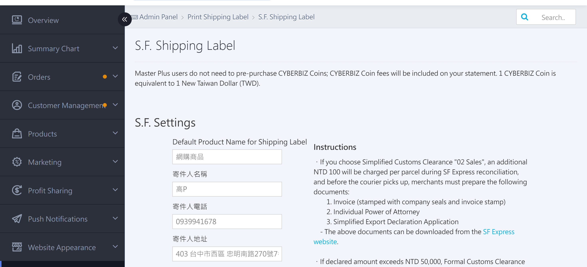
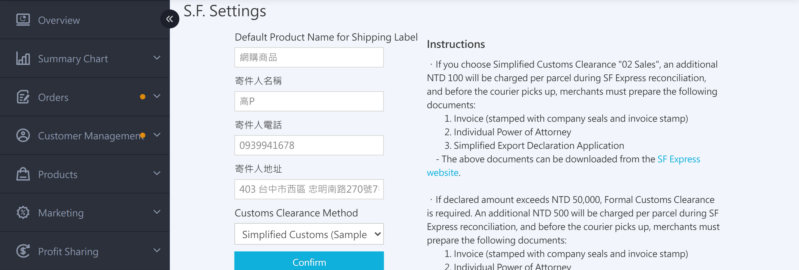
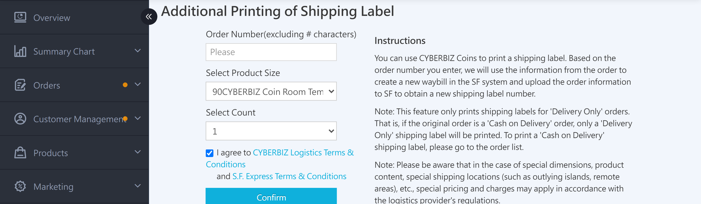

{ title="SF Express Waybill Management Page" .hero-page }

## SF Express Waybill Overview { #intro-sf-waybill }

In the back office, go to "Payment and Logistics" > "S.F. Shipping Label." This is the **single management page for SF Express features**, which brings together three sections:

1. **SF Express Settings**: Create sender information before first use. If you have enabled SF Overseas Delivery, you can also specify the customs clearance method.
2. **Print Additional Waybills**: Generate an extra waybill number for a **single order** (for example, when one order ships in multiple packages, or when a waybill number was lost and needs to be reprinted).
3. **Waybill Number Usage Log**: Lists all SF Express waybill numbers that have ever been generated. You can check charges, status, and whether each number can be reassigned.

A notice at the top of the page shows the **Current CYBERBIZ Coin** balance[^1] or **No top-up required**[^2].

[^1]: Standard plan.
[^2]: PLUS / Enterprise plans.

## Prerequisites and Restrictions { #prerequisites-sf-waybill }

- [x] Enable **S.F. Express shipping label** first (available on the Standard plan and above).
- [x] To ship overseas packages, also enable [SF Overseas Delivery](sf-express-overseas-logistics.md){ title="SF Overseas Logistics" }. The "Default Waybill Item Name (Overseas)" and "Customs Clearance Method" fields appear only after you do.
- [x] Printing additional waybills uses a **CYBER Coin pre-deduction** mechanism. **Standard plan merchants cannot print if their CYBER Coin balance is insufficient.** Top up first in the "[Top-up Center](../website-management/points-deposits.md#operate-cyber-coin-deposit){ title="CYBER Coin Top-up Guide" }."
- [x] Printing additional waybills **only produces delivery-only (non-COD) waybills**.

## Steps { #operate-sf-waybill }

### SF Express Settings { #operate-sf-sender-settings }

Complete this section before first use. The sender information is printed on every SF Express waybill.

1. Go to the back office ****Payment and Logistics > S.F. Shipping Label****.
2. Find the **SF Express Settings** section at the top of the page. Merchants who have **not yet created** settings will see a note after the heading[^3].
3. Enter the following:
    * **Default Waybill Item Name**: Up to **8 Chinese characters[^4]**, for example "Clothing" or "Food".
    * **Sender Name**: Up to 30 characters.
    * **Sender Phone**: Up to 30 characters.
    * **Sender Address**: Up to 30 characters, single-line text.
    * **Customs Clearance Method** (shown only when SF Overseas Delivery is enabled): Defaults to **Simplified Customs Clearance (Sample 04)**, for samples, low-value items, and non-sales purposes. For details, see [Overseas Customs Clearance Methods](#specs-sf-waybill-customs){ title="Overseas Customs Clearance Methods" }.
4. Click **Confirm**. When the system shows "Settings updated successfully," the setup is complete.

{ title="SF Express Settings" }

!!! info "Tip"
     The sender name, phone, and address fields **cannot be left blank**. If any of them is empty, the system displays "Sender name and sender phone, sender address must not be blank." Make sure all three fields are complete.

[^3]: (You have not set up SF Express settings yet. You can create them here.)
[^4]: **Blank or over 8 characters** is blocked, and the system displays "Item name cannot be blank" or "Item name cannot exceed 8 Chinese characters."

---

### Print Additional Waybills { #operate-sf-waybill-reprint }

Use this feature when you need to generate an additional waybill for a **single order**, for example, when an order is split into multiple packages, or when a waybill file is lost and needs to be regenerated.

1. Go to ****Payment and Logistics > S.F. Shipping Label****, and scroll to the **Print Additional Waybills** section.
2. Enter the following:
    * **Order Number**: Enter the order number directly (without the order number prefix set in your store settings).
    * **Select Item Size**: Choose the matching SF Express size from the dropdown. Options are shown in the format "(spec) CYBER Coin XX points." Merchants with SF Overseas Delivery enabled also see an "Overseas 80cm" option.
    * **Number of Copies**: Defaults to **1**, up to **8**.
3. Check **"I agree to the [CYBERBIZ Logistics Integration Service Terms] and the [SF Express Contract Terms]"** (checked by default). Otherwise, the **"Confirm Download"** button cannot be clicked.
4. Click **"Confirm Download"**. The system displays a second confirmation dialog, **"Confirm using CYBER Coin to print the SF Express waybill?"** Click **"Confirm"** to:
    * Immediately deduct "CYBER Coin unit price × number of copies" (Standard plan), or add it to the statement for that billing period (PLUS / Enterprise plans).
    * Call SF Express[^5] to obtain a new waybill number.
    * Automatically download the waybill PDF or image file.
    * Record the order and waybill number in the "Waybill Number Usage Log" table below.

{ title="Print Additional SF Express Waybill" }

!!! note "Note"
     Printing additional waybills **only produces delivery-only waybills**. Even if the original order is cash on delivery (COD), this feature can only generate waybill numbers without a COD amount. To print COD waybills, go to "Orders" > "All Orders," select the order, and then [Download SF Express Waybill](../orders/home-delivery/sf-express-shipping-v2.md#operate-sf-bulk-shipping){ title="Ship with SF Express" }.

[^5]: SF Express OpenAPI

---

### Waybill Number Usage Log { #reference-sf-waybill-history }

The "Waybill Number Usage Log" table at the bottom of the page lists all SF Express waybills generated for this store. Records are sorted by **creation time, newest first**.

{ title="SF Express Waybill Number Log" }

??? info-clean "Field Descriptions"

    | Field | Description |
    | :-- | :-- |
    | **Waybill Type** | "Shipment" (generated from an order), "Return" (reverse logistics), "Order Deleted" (the original order was deleted; only the waybill record is kept) |
    | **Time** | Exact time the waybill was created (year/month/day hour:minute:second) |
    | **Order Number** | The corresponding CYBERBIZ order number. **Click to go to the order details page** (deleted orders display "Order Deleted") |
    | **SF Express Waybill Number** | Waybill number returned by SF Express |
    | **Delivery Plan** | Delivery size for the waybill, for example "Ambient 110cm" |
    | **Customer-Selected CYBER Coin Amount** | CYBER Coin deduction amount set at creation (list price) |
    | **Confirmed CYBER Coin Deduction** | Actual CYBER Coin amount deducted; **shows 0 for returned or expired-and-refunded waybills** (this column displays "No CYBER Coin deducted") |
    | **Reconciliation Note** | Internal system note, such as an expired-refund annotation |
    | **Waybill Status** | Status returned by SF Express, for example "Printed," "Shipped," "Shipment canceled," or "Customer canceled shipment" |
    | **Reassignment Status** | Shows "Reassignable" or "Not reassignable," indicating whether this waybill number can be reassigned to another order when it expires |

## Important Rules and Restrictions { #specs-sf-waybill }

### Overseas Customs Clearance Methods { #specs-sf-waybill-customs }

Only after you enable **SF Overseas Delivery** does the "SF Express Settings" section show a customs clearance dropdown. The default is **Simplified Customs Clearance (Sample 04)**, for samples, low-value items, and non-sales purposes.

---

### Billing Rules for Printing Additional Waybills { #specs-sf-waybill-charge }

* **Charged on download**: Clicking "Confirm Download" immediately deducts CYBER Coin or adds the charge to the statement. This cannot be undone.
* **Expiration rule**: If a waybill has **not been shipped for more than 14 days (about 2 weeks)** after download, the system marks it as expired based on the status returned by SF Express. The waybill status changes to "Shipment canceled," and the CYBER Coin is automatically refunded. For statement-based plans, the charge is not included in that period's statement.
* **Packages over 170 cm: Splitting Recommendation**: Keep each package under 170 cm. SF Express drivers may not accept oversized packages, in which case you must print additional waybills again.

## Next Steps { #next-steps-sf-waybill }

- :lucide-package:{ .lg }  
  [__Ship with SF Express Home Delivery__](../orders/home-delivery/sf-express-shipping-v2.md){ title="Ship with SF Express" }  
  Download SF Express waybills in bulk or one at a time to complete the full shipping process.

## Frequently Asked Questions { #faq-sf-waybill }

??? quote "Does changing the sender information in SF Express Settings update waybill numbers that were already generated?"
    { #faq-sf-waybill-sender-change }

    **No.** Sender information is fixed when the waybill is created. Later changes only affect **newly generated waybill numbers**. Waybills that were already downloaded and shipped keep their original sender information.

??? quote "Why can't I find overseas size options in the dropdown when I print additional waybills? "
    { #faq-sf-waybill-oversea-missing }

    Check the following:

    * The store has enabled **SF Overseas Delivery** (available only on Enterprise and Global series plans).
    * The order's **recipient address** is in a supported overseas country. If the recipient address is in Taiwan, the system does not display overseas sizes.

??? quote "Can I print first and top up CYBER Coin later if my balance is insufficient? "
    { #faq-sf-waybill-points-insufficient }

    **No.** Printing additional waybills uses a **pre-deduction mechanism**. The balance is verified as soon as you click "Confirm Download." If the balance is insufficient, the request is blocked and the system displays "Insufficient CYBER Coin. Go to the Top-up Center to top up." First top up at **「Website Management」>「Topup Center」**, then return to print additional waybills. PLUS and Enterprise merchants are not subject to this restriction (charges are added to the statement).

??? quote "Why does Print Additional Waybills only produce delivery-only waybills for cash on delivery (COD) orders? "
    { #faq-sf-waybill-cod-pure-shipping }

    By design, this feature **only generates delivery-only waybills**. COD waybills are tied to the COD amount. If they were printed freely, the COD amount could be split across multiple waybills, causing reconciliation errors. To print COD waybills, go to "Orders" > "All Orders," select the order, and then proceed.

??? quote "What does "Reassignment Status" mean in the "Waybill Number Usage Log"? "
    { #faq-sf-waybill-transfer-status }

    "Reassignable" means this waybill number **can be reassigned to another order after it expires**. When you print additional waybills later, the system gives priority to reassignable numbers that have not expired. "Not reassignable" means the number can only be used for the original order. In most cases, you do not need to adjust this setting. The system handles it automatically.

??? quote "I accidentally closed the waybill file. Can I download it again? "
    { #faq-sf-waybill-redownload }

    Yes, but it depends on the situation:

    * **Reprint the same waybill number**: The page currently has **no reprint button at the waybill level**. Go to the shipment records on the order details page to trigger the download again.
    * **Generate a new waybill number**: On this page, enter the order number in Print Additional Waybills. This **charges CYBER Coin one more time** to generate a new waybill number. The original waybill number remains in the log.

??? quote "What are the character limits for the item name and sender information in SF Express Settings?"
    { #faq-sf-waybill-field-limits }

    The limits are as follows:

    - **Default Waybill Item Name**: Up to **8 Chinese characters**. The system blocks blank entries or entries over 8 characters.
    - **Sender Name**: Up to 30 characters.
    - **Sender Phone**: Up to 30 characters.
    - **Sender Address**: Up to 30 characters, single-line text.
    - The name, phone, and address fields **cannot be blank**. If any of them is blank, the system displays a "must not be blank" message.

??? quote "How should I choose the customs clearance method for SF Overseas Delivery?"
    { #faq-sf-waybill-customs-choice }

    The customs clearance dropdown appears only after you enable SF Overseas Delivery. The default is **Simplified Customs Clearance (Sample 04)**, for samples or non-sales purposes.

    For details, see [Overseas Customs Clearance Methods](#specs-sf-waybill-customs){ title="Overseas Customs Clearance Methods" }.

