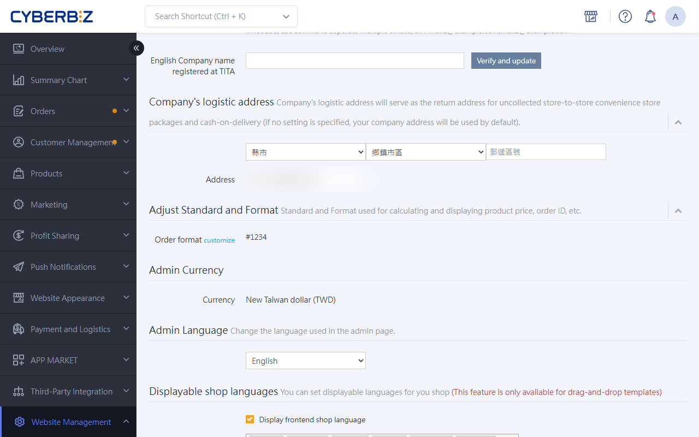

# SF Express Overseas Logistics

Integrate SF Express overseas logistics through the CYBERBIZ backend to create cross-border waybills directly. The format automatically switches between Chinese and English based on the recipient address.
{ .subtitle }

[:lucide-layers:{ title="Applicable products" }](../../resources/conventions#適用產品) | EC Website
[:lucide-tag:{ title="Applicable plans" }](../../resources/conventions#適用方案) | PLUS / Enterprise 
[:lucide-layers:{ title="Applicable products" }](../../resources/conventions#適用產品) | Cross-border e-commerce (North America / Japan / Southeast Asia)
[:lucide-tag:{ title="Applicable plans" }](../../resources/conventions#適用方案) | Pro / Business
{ .doc-badge }

## Usage Notes

- **Supported regions**: Mainly ships from Taiwan to China, Hong Kong, Macau, and international regions. The countries we can ship to may change with international conditions. For any changes, see [Shipping Information Lookup](https://htm.sf-express.com/tw/tc/dynamic_function/range/).
- **Prerequisite**: To ship to regions **outside China, Hong Kong, and Macau**, you need the **Multi-Country** feature. If you need it, contact CYBERBIZ customer service.
- **Shipping rules and documents**: For each country's shipping standards and required documents, see the [SF Express website](https://htm.sf-express.com/tw/tc/dynamic_function/accept/) or contact SF Express customer service at 412-8830 (add 02 when calling from a mobile phone).
    - **Special document review**: If export items require documents such as a **product classification table** and an **MSDS**, email them to the SF Express customer service mailbox at twsf@sf-express.com 1 to 2 days before shipping. After SF Express staff complete their review, if the reply email approves the shipment, give the documents to the driver together with the package when you ship.
    - **Special rules for Macau**: Goods shipped to Macau that are not listed on the import permit, or that exceed the quantity listed on the permit, require the merchant to first obtain a [product classification table](https://www.gov.mo/zh-hant/services/ps-1574/ps-1574a/) from the Macau Health Bureau proving the goods are **not drugs**. Only then can the merchant entrust a logistics provider to import them.
- **Delivery time**: Approximately D+1 to 3 (excluding holidays), varies by region. For details, see [International standard express delivery time lookup](https://htm.sf-express.com/tw/en/dynamic_function/price/time_internal.html).
- **Latest information**: For the latest rules, refer to the SF Express website announcements.

## Prerequisites

### Step 1: Verify Company English Name

1. Log in to the CYBERBIZ backend and go to **Website Management > General**.
2. Enter your company's **Unified Business Number**.
3. Find the **English Company name registered at TITA** field and enter your company's official English name as registered on [Business Registration](https://findbiz.nat.gov.tw/fts/query/QueryBar/queryInit.do).
4. Once saved, this field is locked, and the system automatically uses this name on customs documents.

### Step 2: Set up English Product Names

1. Go to **Products > All Products**.
2. Click the :lucide-globe: **Multi-Language** button and switch the display language of the fields to `English`.
3. Check all products you plan to sell cross-border, and make sure the English content is fully filled in for fields tagged with `English` (such as product name and description).

## Shipping Operations

### Shipping Method

- The shipping method is the same as for standard home-delivery waybills. See [Download SF Express Waybill](../orders/home-delivery/sf-express-shipping-v2.md#operate-sf-bulk-shipping).
- The system automatically checks the recipient address. For Taiwan addresses, it prints a Chinese waybill. For overseas addresses, it prints an English waybill.

### Deduction Mechanism

- **Pre-deducted fee**: When you print an SF Express overseas waybill, the system first deducts **150 CYBER coins** from your account.
- **Final settlement**: The actual fee may be adjusted. Adjustments are based on the freight amount SF Express actually charges and are listed on the statement for that billing period.

### Shipping Fee Structure and Rate Lookup

SF Express overseas shipping fees are not a fixed amount. They consist of the following three parts:

1. **Shipping fee**: Log in to the EC backend, go to **Payment and Logistics > SF Express Shipping Label >S.F. Shipping Label Guide**, and click **SF Express Overseas Shipping Fee Description**.
2. **Fuel surcharge**: Varies with international oil prices. See [SF Express website announcement](https://www.sf-express.com/tw/tc/Customer_Zone/download_center/fuel_additional/).
3. **Peak resource adjustment fee**: A variable fee charged additionally during extraordinary periods of extremely high demand or tight capacity (for example, during the COVID-19 pandemic, SF Express charged a higher peak resource adjustment fee; the final amount is based on the fee SF Express ultimately charges). See [SF Express website announcement](https://htm.sf-express.com/tw/tc/news/detail/S.F.-Express-Taiwan-2025-Taiwan-Export-Express-Shipment-Peak-Surcharge-Adjustment-Notice/).

## Return and Exception Handling Process

### 1. Customer Refusal Handling

- If an overseas package is refused by the customer, SF Express contacts the sender to confirm whether to **forward it to a new address** or **return it to Taiwan**.
- If forwarding fees apply, the merchant must confirm payment before processing.
- If the merchant does not provide instructions within **3 months**, the package will be **destroyed and voided** by the branch warehouse.

### 2. Delivery Failure

- SF Express customer service will try to contact the recipient.
- If contact still cannot be made, SF Express will contact the merchant to confirm whether to process a return.
