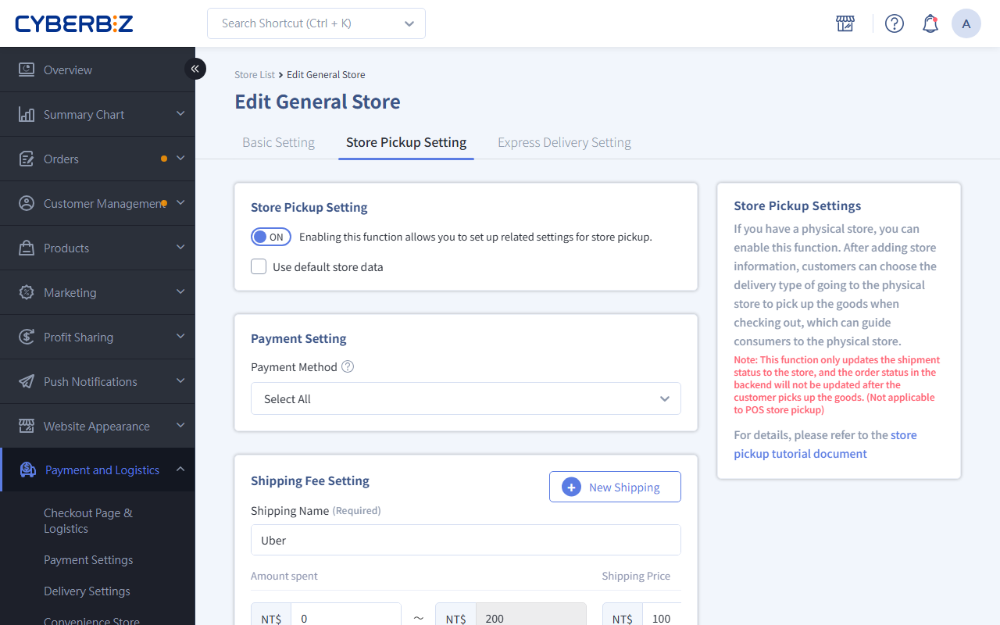

# Enable Store Pickup Service

Complete setup guide for store pickup, including enabling the feature, configuring payment methods, shipping rules, pickup date options, and store notes management.
{ .subtitle }

[:lucide-tag:{ title="Applicable Plans" }](../../resources/conventions#適用方案) |Expert / All PLUS / Enterprise
{ .doc-badge }

{ .hero-page }

## Store Pickup Overview { #intro-store-pickup }

Store pickup provides an O2O experience that combines online shopping with offline pickup. After a customer places and pays for an order on the storefront, the customer can choose to collect the items at a designated physical store. This feature not only reduces home delivery costs but also increases store visits and drives additional in-store sales.

!!! tip "Use Cases"
    - **Reduce shipping costs**: Offer free or low-cost store pickup options to attract customers to pick up in store.
    - **Increase in-store traffic**: Use store pickup to bring customers into physical stores, creating more opportunities for on-site add-on purchases.
    - **Flexible pickup times**: Let customers collect orders at any time during store business hours, based on their own schedules.

## Usage Notes { #prerequisites-store-pickup }

- **Payment restriction**: Only "pay first, then pick up" is supported. At checkout, the system automatically hides offline payment methods and shows only online payment options.

## Operating Procedure { #operate-store-pickup }

### Step 1: Enable Store Pickup { #operate-store-pickup-enable }

1. Log in to the CYBERBIZ admin dashboard and go to **Payment and Logistics > All Stores**.
2. Find the store you want to configure, then click **Edit** on the right.
3. Switch to the **Store Pickup Setting** tab.
4. Set the **Store Pickup Setting** toggle to `ON`.

!!! info "Efficiency Tip: Apply Default Data"
    You can set one store as the default store. For the other stores, click **Use default store data**, and the system automatically fills in the same payment methods and shipping rules to speed up setup.

### Step 2: Configure Payment Methods and Shipping Rules { #operate-store-pickup-pay-fee }

1. **Payment Setting**: In the list, select the payment methods to allow (for example, credit card or LINE Pay).

    > Note: Select at least one payment method. Cash on delivery is not supported.

2. **Shipping Fee Setting**: Click **Add Rule** and fill in the following fields:
    - **Courier/Logistics Name**: The name shown on the storefront (for example, Store Pickup).
    - **Amount spent**: Set tiered shipping thresholds.
    - **Shipping Price**: The shipping fee for this amount tier.

### Step 3: Configure Pickup Date Options { #operate-store-pickup-dates }

If you want to limit when customers can pick up their orders, complete the following settings:

1. Set **Pickup Date** to `ON`.
2. **Days to Prepare for Delivery**: Enter the number of days needed to prepare orders (for example, `2` days). The system uses this value to calculate the earliest date customers can select.
3. **Selectable Range**: Enter the number of days customers can choose from (for example, `14` days).

    !!! info "Applicable Plans"
        This field is not supported on the Expert plan.

4. **Exclusion Options**:
    - **Exclude Specific Weekdays**

        !!! info "Applicable Plans"
            This field is not supported on the Expert plan.

    - **Exclude Specific Dates**: Click the calendar to select public holidays or store closure dates.

        !!! info "Applicable Plans"
            This field is not supported on the Professional PLUS plan.

### Step 4: Enter Store Pickup Notes { #operate-store-pickup-notes }

In the notes field of the **Other Settings** section, enter pickup instructions:

- **Location tip**: For example, "The store is on the 2nd floor of the department store. Take the west-side elevator up."
- **Pickup requirements**: For example, "Bring your order number and ID when picking up."
- **Holding period**: For example, "Items are held for up to 7 days. Orders are canceled after this period."

### Step 5: Save and Verify on the Storefront { #operate-store-pickup-verify }

1. Click **Save** in the lower-right corner to complete setup.
2. Go to the storefront, add a product to the cart, and open the checkout page.
3. Confirm that the Store Pickup option displays correctly and that the shipping fee calculation, date picker, and notes match your settings.

## Store Product Management { #operate-store-pickup-products }

By default, the system enables store pickup for all products. If a specific product (for example, one that is oversized or requires special temperature zone) is not suitable for store pickup, turn it off manually by following these steps:

1. Log in to the CYBERBIZ admin dashboard and go to **Products > All Products**.
2. Select the product you want to configure to open its edit page.
3. Select the **Settings** tab, then find the **temperature zone and Logistics Delivery Settings** section.
4. Set the **Store Pickup** toggle to `OFF`.

{ .screenshot }

## Frequently Asked Questions { #faq-store-pickup }

??? quote "Why doesn't the checkout page show the Store Pickup option?"
    Check the following: 1. Confirm that Store Pickup is turned on in this store's settings. 2. Confirm that the product edit page has not turned off store pickup. 3. Confirm that at least one available payment method is selected.

??? quote "Can I set different free shipping thresholds for different stores?"
    Yes. Each store's order amount shipping settings are independent. You can set a lower free shipping threshold for urban stores, or set promotional shipping fees for specific stores.

## Next Steps { #next-steps-store-pickup }

- :lucide-clipboard-list:{ .lg }   
  [__Process Store Pickup Orders__](../../orders/store-pickup-orders.md)       
  Learn how to manage and verify orders for customers who pick up in store.

- :lucide-package-search:{ .lg }     
  [__Manage Store Pickup Products__](../../products/copy-products-to-quick-delivery-stores.md)  
  Learn how to enable or disable store pickup permissions for products in bulk.

