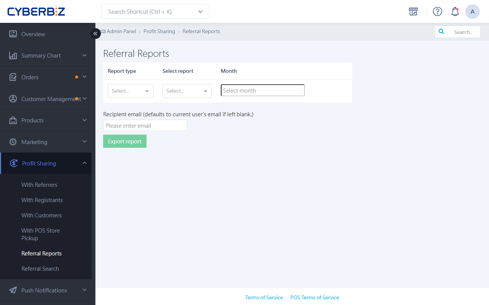
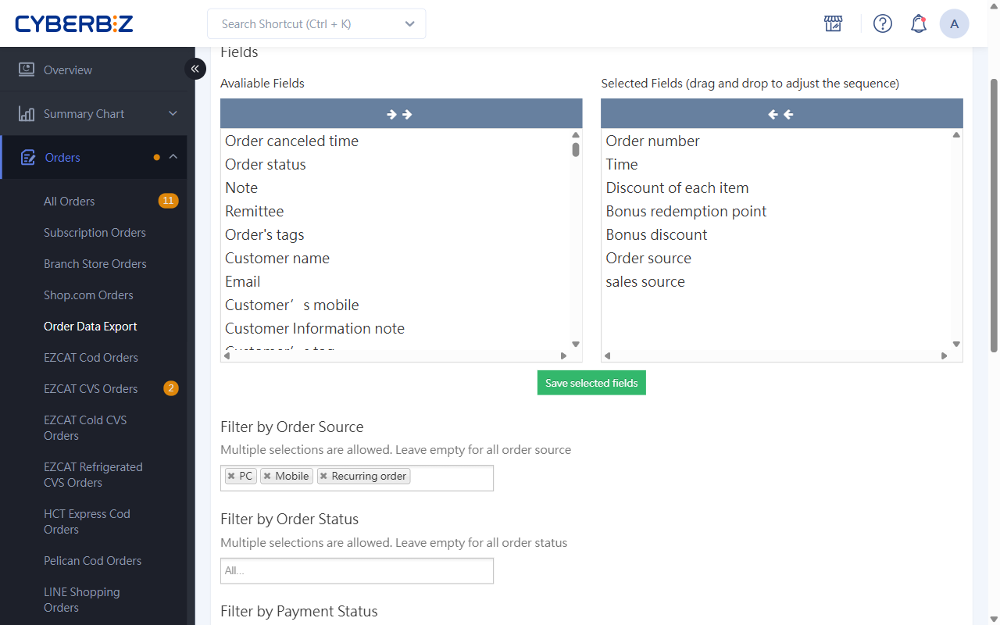

# Export Referral Reports

With Referral Reports, you can accurately track the sales performance of each type of promoter and the referral amounts owed to them. The system provides official reports for orders "after completion" and a real-time order overview for orders "before completion".
{ .subtitle }

[:lucide-layers:{ title="適用產品" }](../../resources/conventions#適用產品) | Brand Website / Smart POS
[:lucide-tag:{ title="適用方案" }](../../resources/conventions#適用方案) | Advanced / Expert / All PLUS / Enterprise
{ .doc-badge }

!!! tip "Use cases"
	- **Monthly reconciliation**: At the start of each month, export the profit-sharing summary for last month's orders that are **Completed**, then pay out the bonuses.
	- **Third-party performance tracking**: Give influencers or group-buy organizers a dedicated link so they can check their referral order details in real time.
	- **Real-time sales monitoring**: Before orders are completed, use the Order Report to estimate upcoming profit-sharing costs.

## Before You Start

- **Permission differences**:
    - **Website owner**: Can view profit-sharing data for everyone on the site.
    - **Co-admins (staff)**: Can only view their own profit-sharing results.

## Steps

### Task 1: Export Official Referral Reports

Use this to settle every profit-sharing program: referral, registration, checkout, and pickup.

1. Log in to the CYBERBIZ admin and go to **Profit Sharing > Referral Reports**.
2. In the **Report type** drop-down menu, select the type you want to view.
3. Select the report name:
    - **Referral profit sharing**: Choose **推薦分潤總表** (referral summary) or **個人別推薦分潤** (referral by person).
    - **Registration profit sharing**: Choose **註冊分潤總表** (registration summary) or **員工別註冊分潤** (registration by staff member).

    !!! note "What the reports show"
        - **Summary report**: Shows the referral profit-sharing totals for **all partners** within a given month. Use it for monthly financial settlement and bulk reconciliation.
        - **Referral by person / registration by staff member**: Shows all referral orders and the order list for **one partner** within a given month. Share it with partners so they can check what they earned on each order.

    - **Checkout / pickup profit sharing**: Select the matching summary or individual report.

4. Select the **Month** to export.
5. Enter the **recipient email**, then click **Export report**.

    > The system processes the report in the background and emails you a download link.

!!! note "Settlement and export rules"
    - **Settlement rule**: Official Referral Reports only include orders that are **Completed**. If an order is placed at the end of December but completed in January, it appears in the January report.
    - **Data range**: Each export covers **one month** only. You can't export across months.

{ .screenshot }

### Task 2: Export Real-time Profit-sharing Data

To preview **Referral Program** before orders are completed, use the Order Report feature.

1. Go to **Orders > Order Data Export**.
2. Under **Avaliable Fields**, select these profit-sharing fields:
    - **Referral bonus**
    - **Referrer's name**
    - **Referral ratio**
    - **Profit Sharing Value**
    - **Referral code**
3. Filter by the Order status you want to view.
4. Set the Time range and email, then click **Export**.

{ .screenshot }

## FAQ

??? quote "A referrer says an order is missing. What should I check?"
    1. Confirm that the customer entered the referral code or clicked the referral link when ordering.
    2. Check that the order was placed within the program's **effective period**.
    3. For third-party lookup links, confirm that the order appears in **Referral Search** in the admin.

