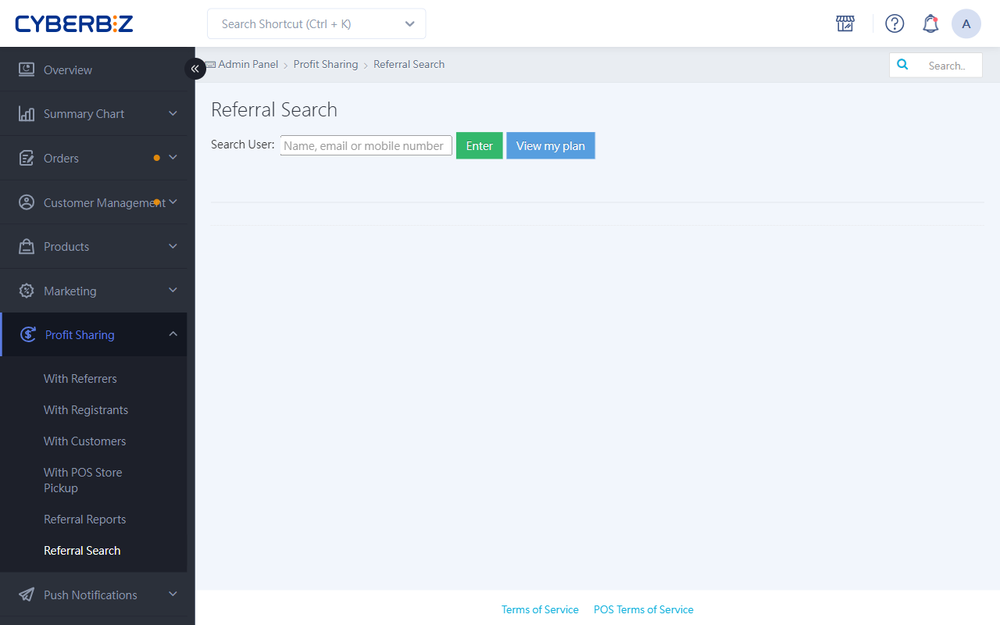
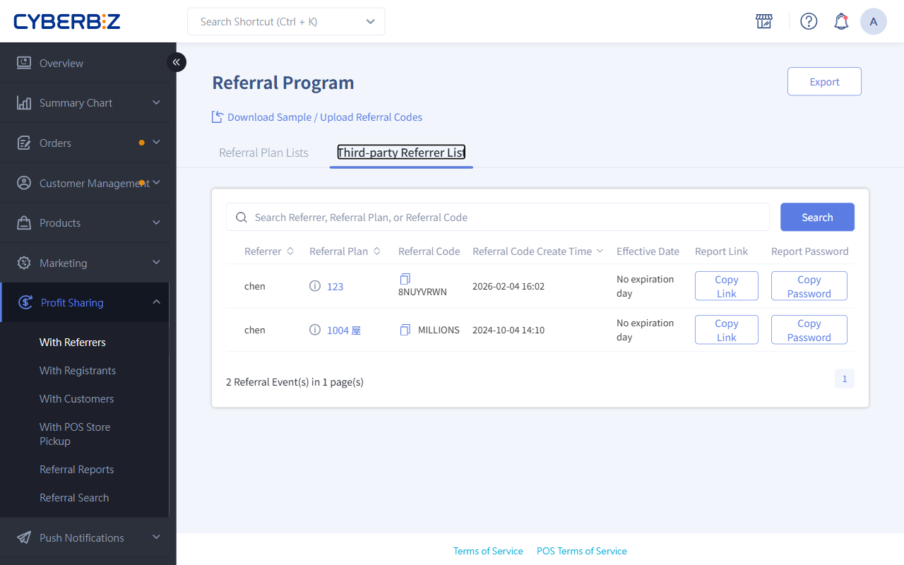

# Look Up Profit-Sharing Partners And Codes

In the admin, you can look up the plans and dedicated codes of every profit-sharing partner at any time, including external influencers, members, and staff, so you can always give partners their promotion details.
{ .subtitle }

[:lucide-layers:{ title="適用產品" }](../../resources/conventions#適用產品) | Brand Website / Smart POS
[:lucide-tag:{ title="適用方案" }](../../resources/conventions#適用方案) | Advanced / Expert / All PLUS / Enterprise
{ .doc-badge }

!!! tip "Use cases"
	- **Help partners find their codes**: When an influencer forgets their Referral Code, an admin can look it up quickly and send it to them.
	- **Check plan assignments**: Confirm that a staff member has been added to the right Referral Plan.
	- **Verify referrals**: When a customer says a referral didn't work, first check that the Referrer's code is correct.

## Before You Start

- **Search permissions**:
    - **Website owner**: Has full permissions and can view profit-sharing data for **themselves** and **all other users**.
    - **Co-admins**: Can only click **View my plan** to view their own data.

## Steps

### Task 1: Look Up A Partner's Profit-sharing Details

Use this to look up anyone who has joined a Referral Plan.

1. Log in to the CYBERBIZ admin and go to **Profit Sharing > Referral Search**.
2. If you're the **website owner**, you'll see a Search field:
    - In the Search box, enter the partner's **name, email**, or **mobile number**.
    - The system shows a list of matches. Click the person you want.
3. The system lists every Referral Plan that person belongs to, including:
    - **Profit-sharing type**: referral, registration, and so on.
    - **Plan name**: The plan they're currently assigned to.
    - **Profit-sharing code**: Their Referral Code or registrant code for that plan.
    - **Profit-sharing rate**: The matching online/offline commission percentage.

{ .screenshot }

### Task 2: Staff Look Up Their Own Profit-sharing Details

Use this when store staff or website editors want to find their own promotion codes.

1. After logging in to the admin, staff go to **Profit Sharing > Referral Search**.
2. Click **View my plan** on the page.
3. The page shows every plan the staff member belongs to and the matching code links.

    > Staff can click the link icon to copy the link, or create a QR code for promotion.

### Task 3: Give Third-party Referrers An External Lookup Link

=== "Merchants"

    For external partners (such as group-buy organizers or influencers), you can provide a dedicated link so they can check their results in real time without logging in to the admin.

    1. Go to **Profit Sharing > With Referrers** and click the **Third-party Referrer List** tab.
    2. Find the partner, then copy the **Report Link** and **password** and send them to the Referrer.

    { .screenshot }

=== "External partners (such as group-buy organizers or influencers)"

    After you receive the lookup details from the merchant, follow these steps to check your results:

    1. Open the **Report Link** from the merchant and enter the **Report Password**.
    2. On the report page, you can see the orders placed with your Referral Code and their status.

    { .screenshot }

!!! info "Note"
    This report lists every order placed with the Referral Code (**including unpaid and not-yet-completed orders**), so the Referrer can follow their promotion in real time.

    This report is for "sales tracking" only. **The final profit-sharing amount is based on settlement data after the order is "Completed"**.

### Task 4: Copy Referral Codes In One Click

In **Third-party Referrer List**, you can view all third-party profit-sharing Referrers at once.

1. Go to **Report Link** and click the **Third-party Referrer List** tab.
2. Click the copy icon to copy that Referrer's Referral Code in one click.

{ .screenshot }

## Next Steps

- :lucide-cable:{ .lg }
  [__Using Referral Code links__](referral-link-applications.md) 
  Learn how to use referral links in your marketing channels, including QR codes, short URLs, and UTM tracking.

