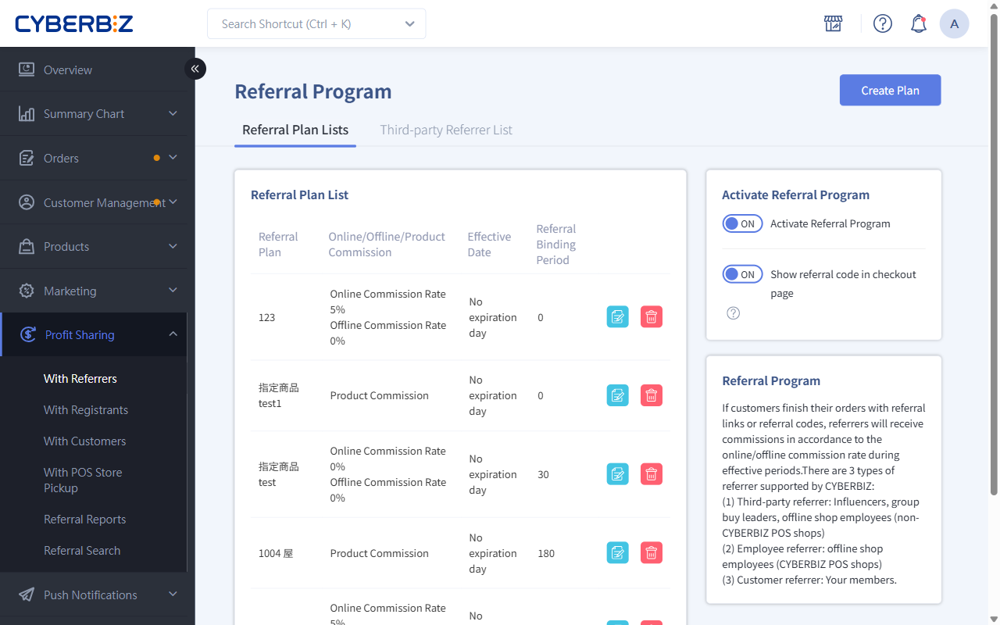
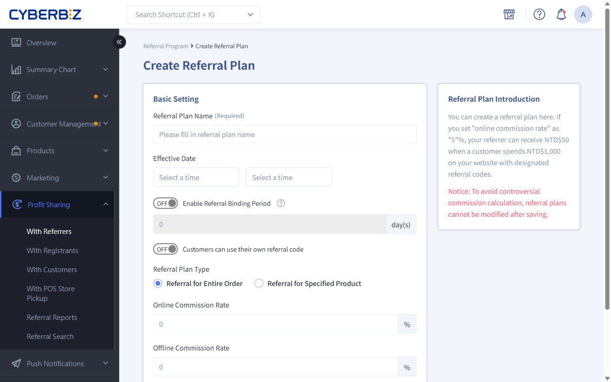
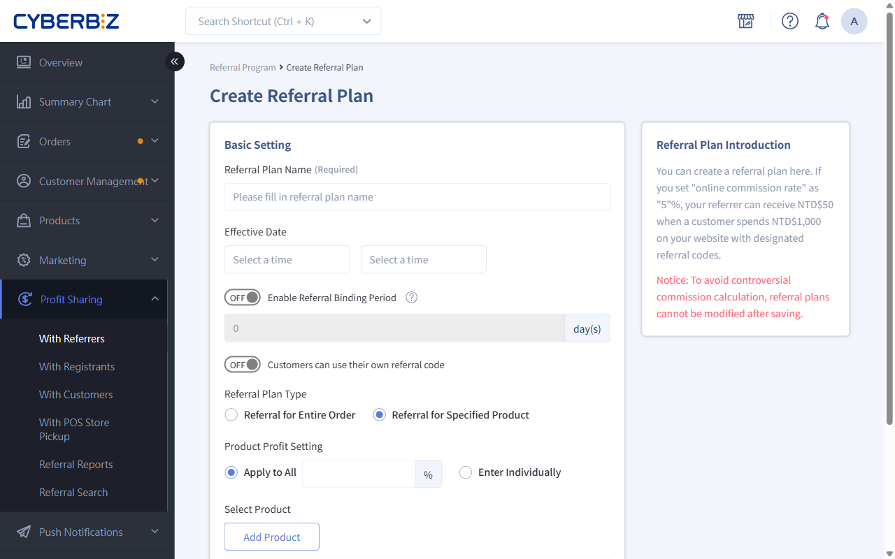

# Referral Program

By creating referrer profit-sharing plans, you can set dedicated commission rates and customer rewards for different partners, such as influencers, members, or staff.
{ .subtitle }

[:lucide-layers:{ title="適用產品" }](../../resources/conventions#適用產品) | Brand Website / Smart POS
[:lucide-tag:{ title="適用方案" }](../../resources/conventions#適用方案) | Advanced / Expert / All PLUS / Enterprise
{ .doc-badge }

{ .hero-page }

!!! tip "Use cases"
	- **Brand partnerships**: Work with bloggers or KOLs, give them dedicated profit-sharing links, and track the orders they bring in.
	- **Customer referrals**: Encourage existing members to share their Referral Code with friends and earn bonus rewards for bringing in new customers.
	- **Internal promotion**: Give store staff their own Referral Code so online sales they drive are credited to them.

## Before You Start

- **Can't edit after saving**: Once a Referral Plan is created and saved, **its "profit-sharing rate" and "Online/Offline/Product Commission" can't be changed**. To change the rate, create a new plan.
- **Referral Binding Period**: Referrer profit sharing supports a "Referral Binding Period" setting. Within the set number of days, if the customer buys again on the same device and browser, the system automatically applies the same Referral Code.

## Steps

### Step 1: Create A Referral Plan And Set Up The Basics

1. Log in to the CYBERBIZ admin and go to **Profit Sharing > With Referrers**.
2. Make sure **Enable profit sharing** is set to `ON`.
3. Turn on **Show referral code in checkout page**.
4. Click **Create Plan** in the upper-right corner.
5. In the **Basic Settings** section, fill in the following:
    - **Referral Plan name**: A name for internal use (for example, 2026 Influencer Spring Campaign).
    - **Effective Date**: The plan's start and end dates. Leave blank to start immediately with no end date.
    - **Enable Referral Binding Period**: The number of days the referral is kept in the customer's browser.
      > ON – Links the customer, so the owner of this Referral Code also earns profit sharing on the customer's later orders. 
        OFF – This Referral Code is a one-time link that's cleared after the order is placed. Profit sharing only applies again if the customer re-enters the Referral Code or clicks the Referral Code link again.
    - **Customer Referrers can use their own Referral Code**: Turn on or off as needed.

        - If you **turn it off**: The system checks whether the member in the cart is the same person as the Referrer, to stop people from claiming their own discount. If the customer checks out without logging in, the system can't identify them and won't apply the referral offer.
        - If you **turn it on**: The system doesn't verify identity and applies the referral offer whether or not the customer is logged in.

        !!! note "Login requirement and how offers appear"
            This setting controls whether customers must **log in** to get the referral offer:

            - **On**: Customers can see and use the referral offer on the storefront **without logging in**. Use this for campaigns where you want to make ordering easier and get the offer seen more.
            - **Off**: The system checks login status. Customers **must log in** to see the referral offer. If they aren't logged in, profit sharing is still credited to the Referrer at checkout, but the customer doesn't get the referral discount.

            If you want every customer to get the referral offer at checkout, turn this **on**, or set your store to **require registration** before checkout in [customer registration settings](../website-management/customer-registration-flow-and-fields/#步驟-1選擇顧客註冊結帳模式).

!!! tip "Naming and managing plans"
    Enter a **plan name** here, not a specific **referrer's name**. You can group rules with the same profit-sharing rate into one plan, then assign the plan to the matching staff, third-party partners, or customers.

### Step 2: Choose The Commission Type

=== "Whole-order profit sharing"

    Calculated as a percentage of the order total (excluding shipping).

    1. **Online/offline profit-sharing rate**: Enter the commission percentage the Referrer earns.

        !!! info "POS compatibility"
            **Offline profit sharing** requires the CYBERBIZ POS system.

    { .screenshot }

=== "Product-specific profit sharing"

    Set separate profit-sharing rates for specific products only.

    1. **Product profit-sharing settings**:
          - **Apply to all**: Use the same profit-sharing percentage for every product.
          - **Enter individually**: Set a separate percentage for each product.
    2. **Select Product**: Click **Add product**.
          - If you chose **Enter individually**, enter the profit-sharing percentage for each product.

    !!! info "Availability"
        **Product-specific profit sharing only applies to EC orders and is only available on PLUS and Enterprise editions.**

    { .screenshot }

### Step 3: Set Rewards For Customers And Referrers

After you save the basic settings, go to the **Reward Setting** tab, where you can set rewards for both sides:

1. **Checkout discount (member)**: The discount a customer gets on this order when using the Referral Code.
    - **Discount type**: Choose an "amount" or "percentage" discount.
    - **Minimum spend**: Set a minimum amount or no minimum.
    - **Combine with storewide and mix-and-match discounts**: Choose whether it can be used together with [storewide discounts](../marketing/discounts/storewide-discounts.md) and [mix-and-match discounts](../marketing/discounts/mix-and-match-discounts.md).

        !!! warning "Scope limits"
            This setting only controls whether the offer combines with **storewide discounts** and **mix-and-match discounts**. It **doesn't apply to every promotion on your site**, and you can't exclude or include other promotions that aren't listed.

    { .screenshot }

2. **Issue coupons(for members)**: When the customer reaches the minimum spend, the system automatically sends a coupon for their next purchase.
    - **Discount type**: Choose an "amount" or "percentage" discount.
    - **Minimum spend**: Set a minimum amount or no minimum.
    - **Validity period**: How long the coupon can be used.
    - **Coupon Restrictions**: No limits / partial limits / can't be combined with promotions.

    { .screenshot }

3. **Reward with points(for members)**: When the customer reaches the minimum spend, they receive the set bonus points.
    - **Minimum spend**: How much the customer must spend to receive bonus points.
    - **Reward Points**: How many bonus points to give when the conditions are met.
    - **Validity period**: How long the bonus points can be used.

    { .screenshot }

4. **Give bonus points (customer Referrer)**: When the customer reaches the minimum spend, the Referrer receives bonus points based on a percentage of the order amount.
    - **Validity period**: How long the bonus points can be used.

    { .screenshot }

    !!! info "Rules for giving bonus points to Referrers"
        - **Calculation**: The bonus points given are based on the plan's profit-sharing rate. For example, with a 5% rate and an order of :lucide-dollar-sign:800, the referrer gets 40 points (:lucide-dollar-sign:800 × 5%).
        - **Decimals**: Any decimals are always rounded down.
        - **Where to check**: Referrers can check their points in the storefront Member Center. The points are labeled `【訂單編號】分潤紅利`.
        - **Returns**: Bonus points are only issued the first time an order is completed. If the order is returned (including partial returns), the system takes back all the bonus points for that order. If the order is completed or returned again later, no points are added or taken back.

### Step 4: Assign Referrers And Get Codes

Switch to the tab for the type of partner you're working with. One plan can include several types of partners.

=== "Third-party list (influencers / group-buy organizers)"

    For external partners.

    === "Add one at a time"

        1. Switch to the **Third-party Referrer List** tab and click **Create Referrer**.
        2. Enter the **Referrer name**. You can also set a custom **Referral Code** (leave blank to have the system generate one).
        3. Click **Save**.
        4. Click the **copy share link** icon next to the list to get a short URL or QR code with the Referral Code.

    === "Bulk import"

        1. Go to **Profit Sharing > With Referrers** and click the **Third-party Referrer List** tab.
        2. Click **Download Sample / Upload Referral Codes** to get the Excel template.
        3. Fill in the details, then upload the file.

=== "Customer list (members)"

    Use this to encourage existing members to spread the word.

    1. Switch to the **Customer list** tab and set **Enable customer Referral Codes** to `ON`.
    2. Click **Assign customer Referral Codes**, Search for and select the members to add.
    3. Click **Add to plan**.
    4. Members can see their own Referral Code on the storefront **會員中心 > 我的帳戶** page.
    5. You can also apply a plan to all new members.

=== "Staff list (store staff)"
    For staff or POS store staff who already have accounts in the system.

    1. Switch to the **Employee List** tab.
    2. Click **Add plan users** and filter people by name, role, or store.
    3. Select them, then click **Add to plan**.

!!! info "Referral Code and name rules"
    - **Referral Code format**: Up to 20 letters and numbers (including `-` and `_`). Letters must be **uppercase**. If left blank, the system generates one at random.
    - **Plan assignment**: One third-party Referrer can join several plans with a different Referral Code in each, but within one plan that Referrer can only have one Referral Code.
    - **Managing names**:
        - The system allows duplicate Referrer names (for example, several "Influencer A" entries). Label them clearly (for example, "Influencer A-FB" and "Influencer A-IG") so they're easy to tell apart.
        - Referrer names **can't be deleted** once saved, so double-check them when you set them up.

## FAQ

??? quote "A customer clicked a referral link, so why doesn't the Referral Code appear on the checkout page?"
    Check these two things:

    1. Whether **Show referral code in checkout page** is turned on in the plan settings.
    2. If the customer clicked someone else's link earlier and it's still within the **Referral Binding Period**, the first referrer is kept.

??? quote "Can a Referrer earn profit sharing with their own Referral Code?"
    It depends on your settings. In the plan's **Basic Settings**, use the **Customer Referrers can use their own Referral Code** toggle to control this.

??? quote "Does **product-specific profit sharing** support offline POS orders?"
    Not at the moment. **Product-specific profit sharing only applies to online store (EC) orders**. Offline POS orders can only use **whole-order profit sharing**.

