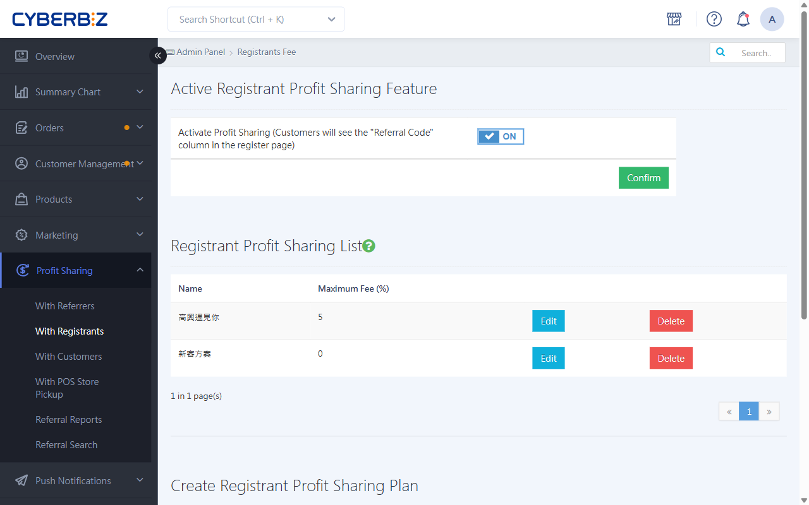
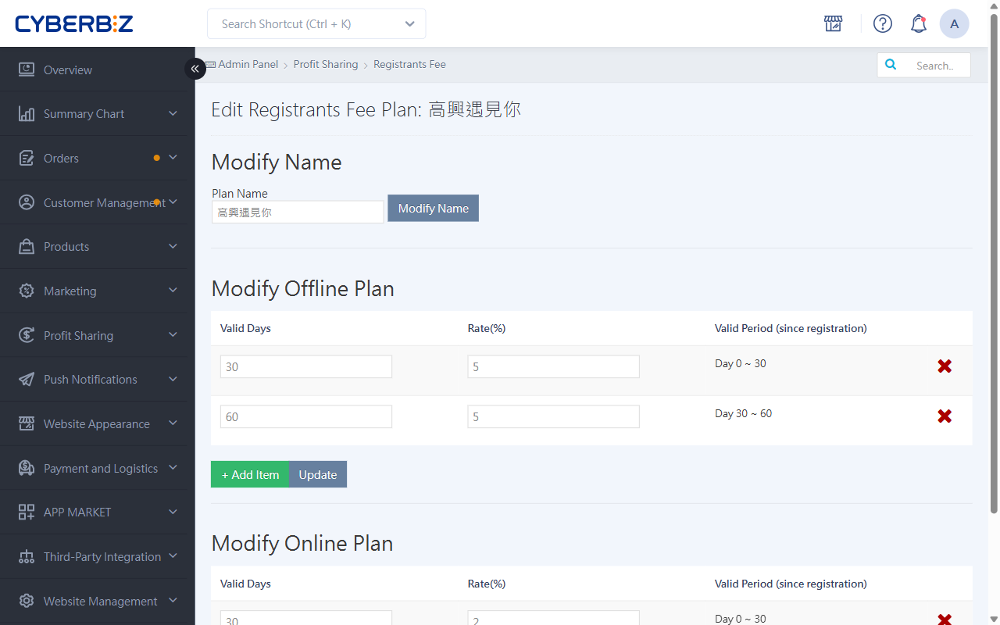
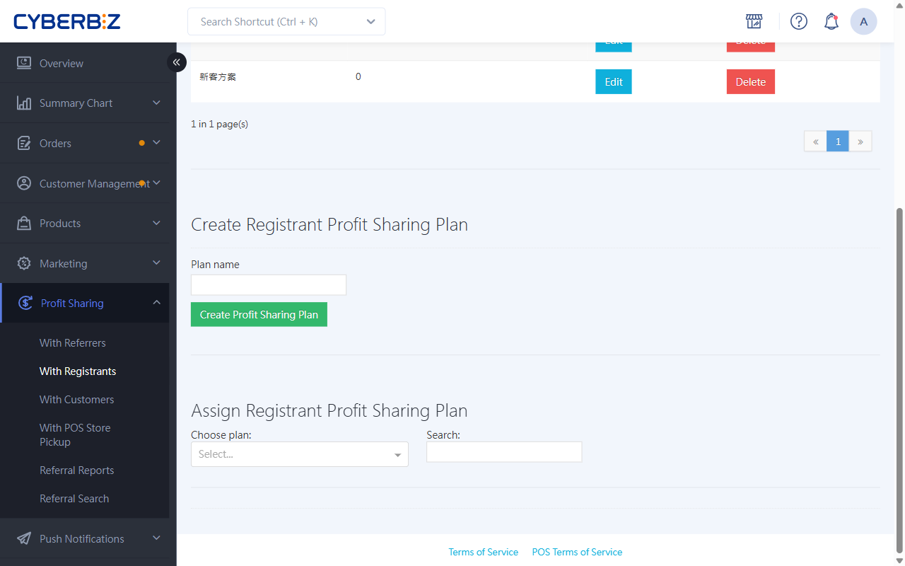

# Registrant Profit Sharing

Registrant profit sharing uses a "permanent link". When a customer enters a registrant code at sign-up, the system automatically calculates profit sharing for the code's owner whenever that customer buys, online or in store.
{ .subtitle }

[:lucide-layers:{ title="適用產品" }](../../resources/conventions#適用產品) | Brand Website / Smart POS
[:lucide-tag:{ title="適用方案" }](../../resources/conventions#適用方案) | Expert / All PLUS / Enterprise
{ .doc-badge }

{ .hero-page }

!!! tip "Use cases"
	- **In-store member sign-ups**: Store staff help walk-in customers sign up as website members and link the staff member's code, so future repeat purchases are credited to that staff member.
	- **Long-term distribution partners**: New members brought in by a distribution partner stay linked to that partner, so the partner keeps earning rewards for them.
	- **Tiered incentives**: Set a high rate for the first month after sign-up and lower rates after that, to motivate promoters to drive purchases early on.

## Before You Start

- **Permanent link**: Once a registrant code is linked, it **can't be changed**. All of the customer's future online and offline orders are tied to that registrant.
- **POS limitation**: The POS **quick sign-up** feature doesn't support entering a registrant code yet.
- **Role requirement**: To be a registrant, a person must be a **website admin** or **store staff**.

## Steps

### Step 1: Turn On The Feature And Create A Plan

1. Log in to the CYBERBIZ admin and go to **Profit Sharing > With Registrants**.
2. Set **Active Registrant Profit Sharing Feature** to `ON`.
3. Below, enter the profit-sharing Plan name and click **Create plan**.
4. In the **Registrant Profit Sharing List**, click **Edit** next to the plan you want to edit.

{ .screenshot }

### Step 2: Set Tiered Profit-sharing Rates

You can set separate tiered rates for your **online store** and **physical stores**.

1. On the plan editing page, click **Add item**.
2. Fill in the following:
    - **Valid days**: The number of days after sign-up that this rate applies.
    - **Profit-sharing rate**: The matching commission percentage.
3. To add more tiers, click **Add item** again.

    !!! example "Example"
        - Tier 1: Valid days `30`, profit-sharing rate `5`%.
        - Tier 2: Valid days `60`, profit-sharing rate `2`%.
        **Result**: For purchases 0–30 days after the customer signs up, the registrant gets 5%. For purchases 31–60 days after sign-up, the registrant gets 2%.

4. When you're done, click **Save** at the bottom of the page.

!!! info "POS compatibility"
    **Offline profit sharing** requires the CYBERBIZ POS system.

{ .screenshot }

### Step 3: Assign Registrants And Codes

Assign the profit-sharing plan to specific staff or stores to create their registrant codes.

1. Go to **Profit Sharing > With Registrants** and click the **Assign Registrant Profit Sharing Plan** section at the bottom of the page.
2. Select the **Plan(s)** to assign.
3. Filter by **role** (such as store manager or store staff) or **store** as needed.
4. Select the people to add, then click **Add to plan**.
    > If you don't use POS, a person must be set as a **website admin** before they can be selected.

{ .screenshot }

## FAQ

??? quote "If a customer adds a code after signing up, can they still be linked?"
    No. The registrant code must be entered **at sign-up** to take effect. Once the account is created, the system doesn't support adding or changing the registrant.

??? quote "How is registrant profit sharing calculated for in-store purchases?"
    Two conditions must be met:

    1. The customer is linked to a registrant.
    2. The merchant uses CYBERBIZ POS and has set an **offline plan** rate in the plan.

    When the customer gives their phone number at in-store checkout (to identify the member), the system automatically finds their linked registrant and calculates profit sharing.

??? quote "If a staff member is in several registrant plans, is their code the same?"
    A staff member may have a different code in each plan, but we recommend giving each person one clear plan to keep sales tracking simple.

---

