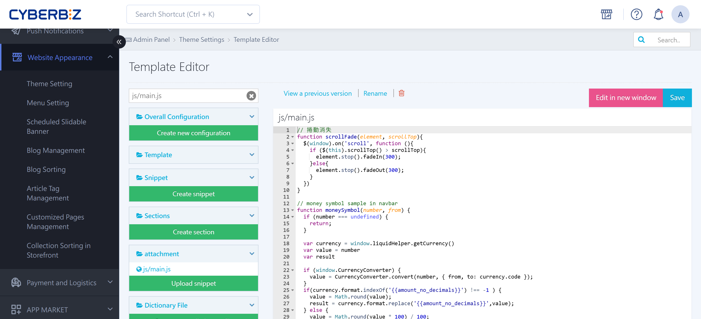

{ title="Recipient-First Checkout Setting" .hero-page }

## About Filling in the Recipient First on the Checkout Page { #intro-priority-recipient }

The **recipient-first** setting is designed mainly for overseas orders. When shoppers "order domestically for delivery overseas," changing this setting makes checkout more intuitive for them.

## Purpose and Use Cases { #intro-priority-recipient-purpose }

- **Standard checkout flow**: By default, shoppers fill in the "buyer" information first, and the recipient is the same as the buyer. To ship overseas, shoppers must also select the recipient option before they can enter an overseas address. This is not intuitive for shoppers who "order domestically on behalf of someone overseas."
- **After the change**: A code change reorders the checkout steps so that shoppers **fill in the "recipient" information first** and then the "buyer" information, which fits how cross-border shoppers buy.

## Steps in the Template Editor { #operate-priority-recipient }

You make this setting by editing the code file `js/main.js`:

1. **Go to**: In the admin, go to **Website Appearance > Theme Setting > CSS/HTML Editor**.
2. **Find the file**: In the search box on the left of the editor, enter **js/main** to search quickly, and click to open the **`js/main.js`** file.
3. **Locate the code**: Scroll to the end of the file and find the section marked "**結帳頁 v3**" (checkout page v3).
4. **Paste the code**: At the right spot in that section (see the code below), press Enter to start a new line and paste the following code:

	``` liquid
	config.exchangeShippingAndPurchaserLocation=true;
	```
	
1. **Save**: Check that the code is correct, and then click **Save**.

	``` liquid title="js/main.js" hl_lines="3"
	// 結帳頁v3
	$(document).on('checkout_cart:ready', function(event, config) {
	  config.exchangeShippingAndPurchaserLocation=true;
	  store.remove('cart')
	  pullNavCart()
	})
	$(document).on('checkout_cart:added', function(event, items) {
	  store.remove('cart')
	  pullNavCart()
	})
	$(docu
	```

## Check the Result { #operate-priority-recipient-check }

When you finish, refresh the checkout page on your website and confirm that it now asks for the recipient information first.

{ title="Recipient-First Checkout on the Storefront" }

## Important Notes { #prerequisites-priority-recipient }

- **Responsibility**: CYBERBIZ makes its code available for merchants to edit. However, CYBERBIZ **does not provide editing guidance, coding tutorials, or code-writing services beyond the existing documentation**. Have a professional engineer make these changes.
- **Recovery**: Before you edit, note that the template editor has a "**View Previous Versions**" feature to [roll back to an earlier version](../code-customization/restore-code-theme-editor.md#operate-restore-theme){ title="Restore Web Page Code with the Template Editor" }.

## FAQ { #faq-priority-recipient }

??? quote "Why doesn't the checkout page change after I edit `js/main.js`?"
	This is usually related to **caching**. Try the following:
	
	1. **Clear the browser cache**: Use a private (incognito) window, or press `Ctrl + F5` (Windows) / `Cmd + Shift + R` (Mac) to force a page refresh.
	2. **Check where the code is**: Make sure the code `config.exchangeShippingAndPurchaserLocation=true;` is inside the `checkout_cart:ready` event listener.
	3. **Confirm it saved**: Check that the top right of the editor shows "Saved successfully." An unstable connection can cause the save to fail.

??? quote "How do I go back to the default "buyer first" flow?"
	You can restore it in two ways:
	
	1. **Edit the code**: Change that line to `false`, or delete the line and save.
	2. **Roll back a version**: Use "View Previous Versions" at the top right of the editor and restore a point in time before your change.

??? quote "Does this change affect checkout on mobile?"
	**Yes.** Because the RWD responsive site shares the same `js/main.js` logic, the change applies to both desktop and mobile, so the shopping experience is consistent across devices.

??? quote "What does `store.remove('cart')` in the code do? Does it affect the cart?"
	This code **refreshes the cart cache**. After the checkout logic changes, the system clears the old temporary cart data and fetches it again (`pullNavCart`) so the recipient and buyer fields appear in the correct order. It does not delete any products from the shopper's cart.
