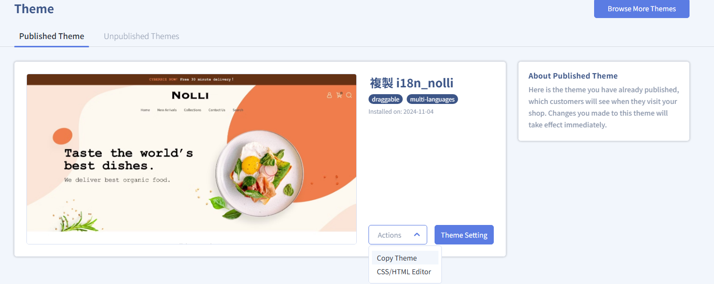
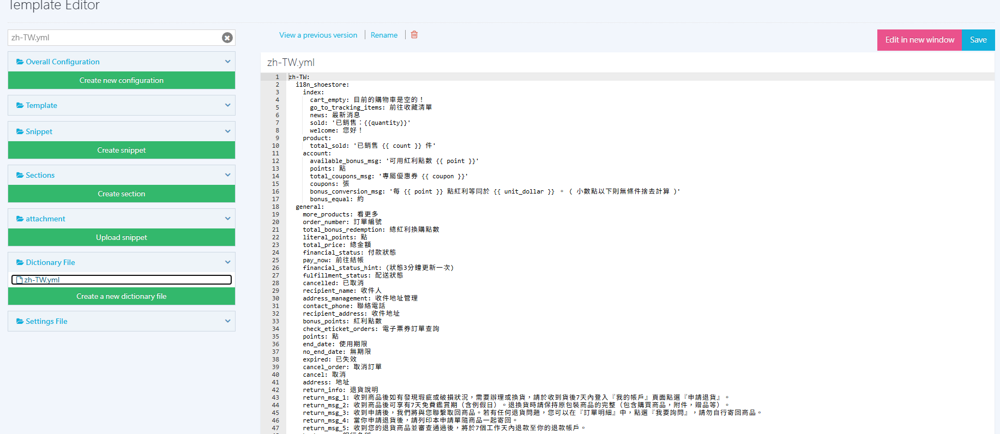
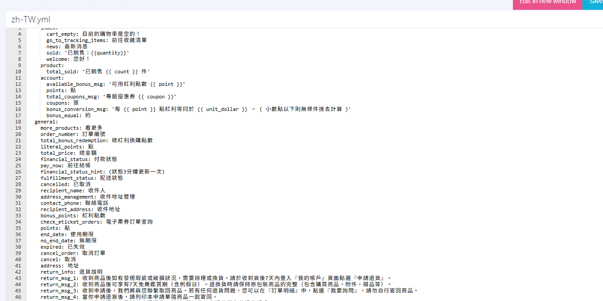
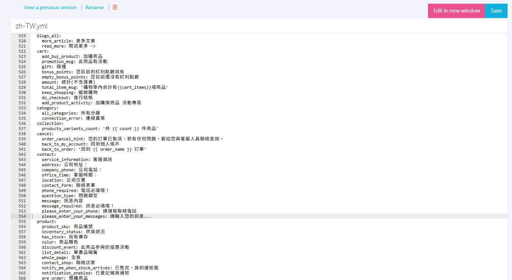

# Change the Storefront Display Name for "Valid Orders from Other Channels"

Add a key to the dictionary file to customize the storefront display name of "Valid Orders from Other Channels," so the wording better fits your brand or channel.
{ .subtitle }

[:lucide-tag:{ title="Available Plans" }](../../../resources/conventions.md#適用方案) | Enterprise
{ .doc-badge }

{ .hero-page }

!!! tip "Use Cases"
    - **Consistent customer-facing wording**: Change the default "Valid Orders from Other Channels" to a name you normally use, such as "Store Purchase History" or "Offline Purchases."
    - **Fewer member questions**: Storefront copy matches what your customer service says, so members are less confused about where orders came from.


## Before You Start { #prerequisites-channel-label }

- **What changes**: Only the name members see on the storefront changes. How the admin member page works and how amounts are accumulated stay the same. To add or manage orders from other channels, see [Manage Member Profiles: Orders from Other Channels](../../members/manage-member-profiles.md#operate-member-profiles-other-orders).
- **Editing risk**: Editing `.yml` is an advanced task. Back up first, or make sure you can [restore a template version](restore-code-theme-editor.md), before you save.


## Steps { #operate-channel-label }

1. Sign in to the CYBERBIZ admin and go to **Website Appearance > Theme Setting**.
2. On your current theme, click **Actions > CSS/HTML Editor**.

    { .screenshot }

3. In the template editor search box, enter **zh-TW.yml** to open the dictionary file.

    { .screenshot }

4. Find the **`general`** section.

    { .screenshot }

5. Add the following key to the section, and change the text on the right to the name you want to show:

    ```yaml
    customize_other_valid_order: Display name
    ```

    !!! warning "Format"
        The structure is: `customize_other_valid_order` (do not change) `:` (half-width colon) ` ` (half-width space) `Display name` (customizable).

        - Correct: `customize_other_valid_order: 門市消費紀錄`
        - Incorrect: `customize_other_valid_order:門市消費紀錄` (missing space)

    { .screenshot }

6. Click **Save**. When members view orders from other channels on the storefront, they see your custom name.

    { .screenshot }

!!! info "Multilingual Stores"
    If your store has dictionary files for other languages (such as `en.yml`), in the `general` section of each matching language file, add `customize_other_valid_order` as well and enter the display text in that language.


## FAQ { #faq-channel-label }

??? quote "I added the key and saved, but the storefront name did not change."
    Check the following:

    1. Your store's version supports the **Valid Orders from Other Channels** feature.
    2. The key name is spelled `customize_other_valid_order` (do not change the English key).
    3. The key is in the `general` section, and the YAML indentation and the space after the colon are correct.
    4. You saved the dictionary file. If needed, refresh the storefront or clear the cache and check again.

??? quote "Can I delete the key to restore the default name?"
    Yes. Remove the `customize_other_valid_order` line from the dictionary file and save. The storefront then goes back to the system default name, "Valid Orders from Other Channels." If the theme breaks after you save, [restore a template version](restore-code-theme-editor.md).


## Related Articles { #reference-channel-label }

<div class="grid cards" markdown>

- :lucide-languages:{ .lg }  
  [__Set Up Storefront Language and Text Customization__](../site-settings/setup-storefront-language-text-customization.md)  
  Use dictionary files and the template editor to adjust the storefront language and system default text.

- :lucide-code:{ .lg }  
  [__Template Editor Complete Guide__](theme-editor-complete-guide.md)  
  Learn the basics of the template editor, how to use special syntax, and what to watch out for.

</div>