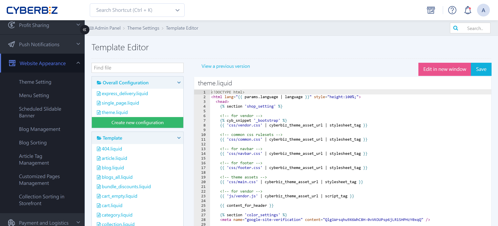
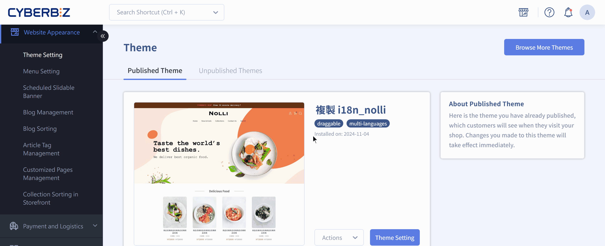

{ title="Template Editor Version Restore" .hero-page }

## About Restoring Template Versions in the Template Editor { #intro-restore-theme }

The **View Previous Versions** feature in the template editor lets you roll files back to an earlier version at any time if the page breaks or the layout shifts after you edit HTML, CSS, or JavaScript code yourself.

## Steps { #operate-restore-theme }

1. **Go to**: Sign in to the CYBERBIZ admin and go to **Website Appearance > Theme Setting**.
2. **Open the editor**: Click "**Actions**" (or click the theme directly) to open the "**CSS/HTML Editor**."
3. **View versions**: In the editor, click the "**View Previous Versions**" button.
4. **Choose a record**: The system lists previously saved records. Each record shows only its "**update time**" for reference.
5. **Restore**: Select the point in time you want to roll back to.

{ title="View Previous Versions" }

## Important Notes { #prerequisites-restore-theme }

- **Responsibility**: CYBERBIZ makes theme code available for merchants to customize. Merchants must hire their own engineers or an outside design agency for this work. **CYBERBIZ does not provide editing, coding tutorials, or code-writing services beyond the existing documentation**.
- **Fix it yourself**: If your own settings break a page, use the restore feature to roll the file back yourself.
- **Theme limitation**: Some features (such as [adding a LINE friend link to the order confirmation page](../../integrations/line/marketing/line-friend-link-order-payment-pages.md){ title="Show a LINE Add Friend Link on the Order Confirmation and Payment Complete Pages" }  ) apply only to the "currently published" theme. If you switch themes and the code is lost, you may need to apply again or keep your own copy of the code.
- **Drag-and-drop theme limitation**: Drag-and-drop themes support some code editing (such as right-click protection and SEO settings), but not every kind of code change. Stick mainly to the features the admin makes available.

## Common Use Cases { #overview-restore-theme }

Use this restore feature when something goes wrong during advanced customizations such as these:

- **Homepage settings**: Such as changing the homepage carousel duration or transition time.
- **Product page improvements**: Such as disabling image zoom preview, changing how product tagline text is displayed, or embedding a video that autoplays.
- **Checkout page changes**: Such as having overseas orders fill in the recipient first, or changing the display name for price changes made by the store owner.
- **Plugin embeds**: Such as conflicts when you embed a Google Form or Instagram feed code on a custom page.

## FAQ { #faq-restore-theme }

??? quote "Will restoring a version affect product images or assets I have already uploaded?"
	**No.** The template editor's restore feature applies only to code files such as `.html`, `.css`, and `.js`. Images stored in your media library and product data set in the admin are stored at the database level and are not deleted when you roll back code.

??? quote "Why can't I find the record I just saved in "View Previous Versions"?"
	The system usually creates a version record when you click "Save." If you save many times in a row, the system may merge changes made within a very short time. Save after each major change once you have tested it, so you get clear version checkpoints.
