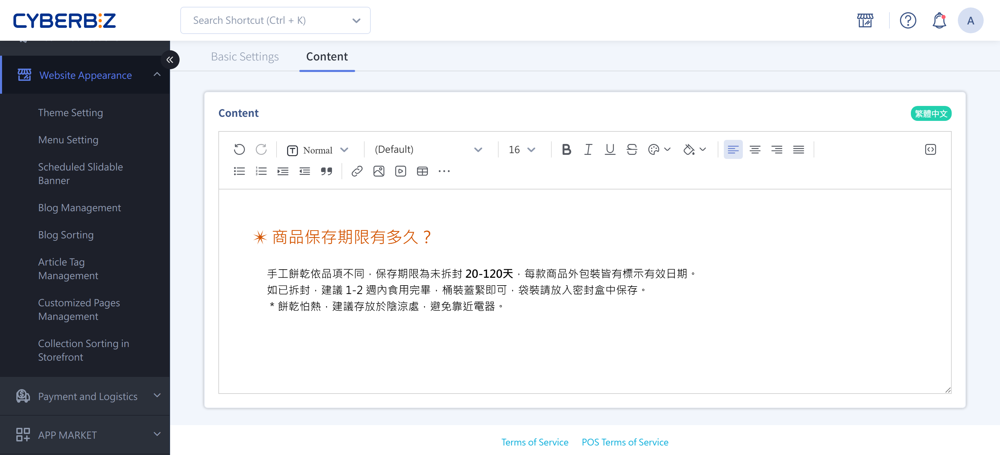
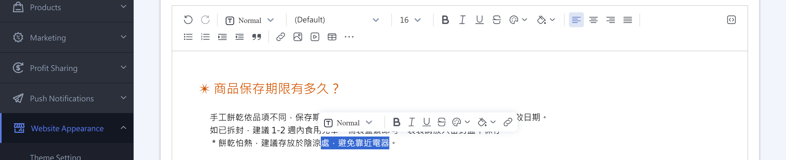
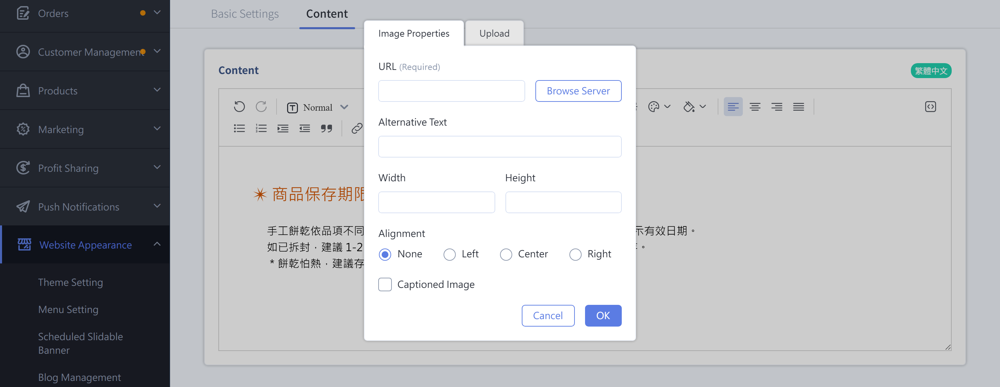
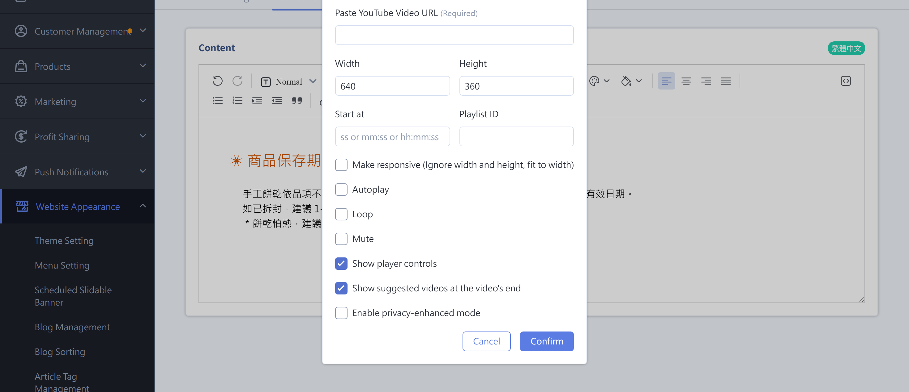
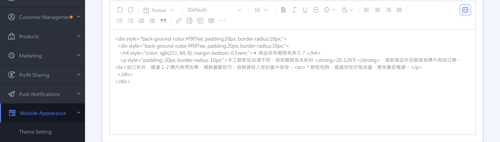
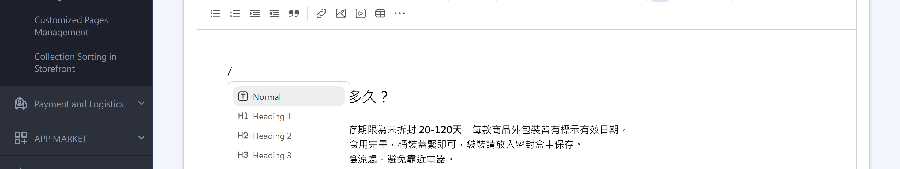

{ title="Text Editor" .hero-page }

## Text Editor { #intro-text-editor }

The text editor helps you quickly build structured, easy-to-read layouts with text and images when you edit content such as "product descriptions," "custom pages," "blog posts," and "collection descriptions."
{ .subtitle }

CYBERBIZ currently has two interfaces: the **new text editor** and the **legacy text editor**. Both let you edit text, insert images and YouTube videos, and switch to source code view. The main difference is how you use them: the new editor supports a "/" shortcut menu and Markdown syntax, while the legacy editor has a fixed toolbar. Your admin automatically shows one of them depending on what is turned on for your store. This article covers both.

## Prerequisites and Limitations { #prerequisites-text-editor }

- [x] **Where it applies**: The text editor is a shared component. Every page with a "content description" field (product descriptions, custom pages, blogs, collection and tag descriptions, bundle descriptions, and more) uses the same editor.
- [x] **Version availability**: The new text editor is being rolled out gradually. Stores that don't have it yet see the legacy editor. This does not affect existing content. Both versions produce the same web page content.

!!! info "How to Tell Which Version You Use"
    In the new editor, typing "/" in the body opens a shortcut menu, and a toolbar floats up when you select text. The legacy editor has a fixed row of toolbar buttons above the content area. To switch versions, contact CYBERBIZ customer service.

---

## Steps { #operate-text-editor }

### Enter and Format Text { #operate-text-editor-format-text }

=== "New Text Editor"
    1. **Type directly:** Click in the editing area and start typing.
    2. **Change the paragraph style:** Use the paragraph menu in the toolbar to set the paragraph to "Normal text," "Heading 1" through "Heading 6," "Bulleted list," "Numbered list," or "Quote."
    3. **Format selected text quickly:** When you select text, a toolbar floats up so you can apply **bold**, **italic**, **underline**, **strikethrough**, text color, background color, and **links** right away.
    4. **Adjust alignment and indentation:** The toolbar offers "Align left," "Align center," "Align right," "Justify," "Increase indent," and "Decrease indent."

    

=== "Legacy Text Editor"
    1. **Type directly:** Click in the editing area and start typing.
    2. **Apply paragraph formats:** Use the "Format" drop-down menu in the toolbar to apply heading or paragraph styles, and adjust the font and font size.
    3. **Apply text styles:** Select text, and then click the toolbar's **bold**, **italic**, **strikethrough**, text color, or background color button.
    4. **Adjust alignment, lists, and indentation:** The toolbar has buttons for left, center, right, and justified alignment, numbered lists, bulleted lists, and indentation.

    

---

### Insert Images { #operate-text-editor-insert-image }

=== "New Text Editor"
    1. **Place the cursor:** Move the cursor to where you want the image.
    2. **Open the image window:** Click the **Image** button in the toolbar, or type "/" and choose "Image."
    3. **Choose a source:** In the "Image Properties" window, switch to the **Upload** tab to upload a local file, paste an online image link in the **URL** field, or click **Browse Server** to pick an image you uploaded before.
    4. **Fill in image details:** As needed, enter "Alternative text"[^alt-new], set the alignment, and select "Add caption."
    5. **Insert it:** Click **OK** to insert the image into the content.

    [^alt-new]: "Alternative text" (ALT) is the text description shown when an image can't be displayed. It also helps search engines understand the image, which is good for SEO.

    

=== "Legacy Text Editor"
    1. **Place the cursor:** Move the cursor to where you want the image.
    2. **Open the image window:** Click the image button in the toolbar. To edit an image you already inserted, right-click it and choose image properties.
    3. **Choose a source:** In the image window, use the upload tab to upload a local file, paste an image link in the URL field, or click browse server to pick an existing image.
    4. **Enter alternative text:** Enter an image description in the "Alternative text" (ALT) field[^alt-old].
    5. **Insert it:** Confirm to insert the image into the content.

    [^alt-old]: "Alternative text" (ALT) is the text description shown when an image can't be displayed. It also helps search engines understand the image, which is good for SEO.

    

!!! tip "Image Layout Tips"
    * Finish arranging your text first, and then insert images or videos last for a more stable layout.
    * For long product images, a single long image (1000px wide recommended, any length) avoids seams between pieces. If you combine several images, make each one 1000px × 1000px.
    * For detailed image size and file size specs, see the [Image Specifications Reference](../references/text-editor-toolbar.md#reference-text-editor-image-specs){ data-preview }.

---

### Insert YouTube Videos { #operate-text-editor-insert-video }

=== "New Text Editor"
    1. **Place the cursor:** Move the cursor to where you want the video.
    2. **Open the video window:** Click the **YouTube Video** button in the toolbar, or type "/" and choose "YouTube Video."
    3. **Paste the video URL:** Paste the YouTube link in the "Paste YouTube video URL" field[^yturl-new].
    4. **Set playback options:** As needed, select options such as responsive sizing, autoplay, loop, and mute[^ytopts].
    5. **Insert it:** Click **OK** to embed the video in the content.

    [^yturl-new]: Only YouTube URLs are supported. If you have the original video file, upload it to YouTube first, and then paste the link here.
    [^ytopts]: Under YouTube's rules, a video must also be set to "Mute" for "Autoplay" to work. For a description of each option, see the [YouTube Video Settings Reference](../references/text-editor-toolbar.md#reference-text-editor-youtube-options){ data-preview }.

    

=== "Legacy Text Editor"
    1. **Place the cursor:** Move the cursor to where you want the video.
    2. **Open the video window:** Click the YouTube button in the toolbar.
    3. **Paste the video URL:** Paste the YouTube link in the field[^yturl-old], and set the width, height, and related playback options.
    4. **Insert it:** Confirm to embed the video in the content.

    [^yturl-old]: Only YouTube URLs are supported. If you have the original video file, upload it to YouTube first, and then paste the link here.

    

---

### Switch to Source Code (HTML) View { #operate-text-editor-source-code }

When you need advanced formatting, or need to fix layout problems caused by pasting from elsewhere, switch to source mode and edit the HTML directly.

=== "New Text Editor"
    1. Click the **Source** button in the toolbar to enter HTML editing mode.
    2. Edit the HTML directly.
    3. Click the **Source** button again to switch back to normal editing mode.

    

=== "Legacy Text Editor"
    1. Click the **Source** button at the far left of the toolbar to enter HTML editing mode.
    2. Edit the HTML directly. You can also click **Preview** to check how it looks.
    3. Click the **Source** button again to switch back to normal editing mode.

    

!!! warning "HTML Is Optimized Automatically"
    When you save or switch back to normal mode, the editor automatically checks and tidies the HTML to meet formatting rules. This may change or remove some custom code, so check the final result after you make changes.

---

### Edit Faster <small>New Editor Only</small> { #operate-text-editor-shortcuts }

These features are available only in the new text editor:

- **Slash commands (/):** Type "/" in the body to open a shortcut menu and quickly insert headings, lists, tables, horizontal lines, images, YouTube videos, special characters, or emojis. For the full list, see the [Slash Commands Reference](../references/text-editor-toolbar.md#reference-text-editor-slash-commands){ data-preview }.

    

- **Markdown syntax:** Type `#` plus a space to create a heading, `-` plus a space to create a bulleted list, and `---` to insert a horizontal line.
- **Floating toolbar:** When you select text, a toolbar floats up so you can quickly adjust bold, italic, underline, color, and links.
- **Create anchors:** Create an anchor on a paragraph or image and copy the anchor link. Paste it onto other text or images to jump within the page.

---

## Important Rules and Limitations { #specs-text-editor }

- **Pasting outside content can break the layout:** Don't copy from other web pages or Word and paste directly (++ctrl+v++), because this brings in extra code from the original site. Paste as plain text instead (++ctrl+shift+v++), and then set styles and insert images yourself.
- **Image formats:** JPG, JPEG, PNG, GIF, TIFF, and WebP are supported.
- **Image size:** Each image can be at most 5000px wide and 7000px tall. Larger images can't be uploaded[^imgsize]. After upload, the system automatically creates a version up to 1280px wide to speed up storefront loading (GIFs keep their original and are not compressed).
- **Storage:** When your plan's storage is full, you can't upload more images. Free up space or upgrade your plan first.
- **Video source:** Videos are always embedded with YouTube links. You can't upload video files directly to the editor.

[^imgsize]: When an image is too large, the system shows "The maximum image width is 5000px, and the maximum height is 7000px." For detailed specs, see the [Image Specifications Reference](../references/text-editor-toolbar.md#reference-text-editor-image-specs){ data-preview }.

## Next Steps { #next-steps-text-editor }

<div class="grid cards" markdown>

- :lucide-package:{ .lg }  
  [__Create and Edit Products__](../../products/create-and-manage/create-update-products.md){ title="Add and Update Products" }  
  Use the text editor in a product's description section to complete its text and image introduction.

- :lucide-palette:{ .lg }  
  [__Apply and Switch Themes__](../theme-and-layout/apply-and-switch-theme.md){ title="Apply and Switch Website Themes" }  
  Adjust your overall storefront look to present your edited content as a complete store.

</div>

## FAQ { #faq-text-editor }

??? quote "Extra blank space appears between images"
    [](){ #faq-text-editor-image-blank-gap }
    This usually happens when ++enter++ was pressed during upload, creating extra paragraph tags. Switch to **Source** mode and delete the extra `&nbsp;` or `<p>` tags between images to remove the space.

    ``` html title="Source Code Example"
    <p style="text-align:center"></p>
    <p></p>
    ```

??? quote "Images or content disappeared after I embedded a video"
    [](){ #faq-text-editor-video-hides-content }
    The content may be wrapped in the video's container code (such as `<div>`). Switch to **Source** mode, delete the extra code before and after the video, and make sure the text is wrapped in `<p>` tags.

??? quote "The embedded video doesn't resize with the screen and overflows or looks too small on mobile"
    [](){ #faq-text-editor-video-not-responsive }
    When you insert the video, select the "Responsive sizing" option. The video then scales automatically based on width and keeps its proportions on phones and other devices. For a description of each option, see the [YouTube Video Settings Reference](../references/text-editor-toolbar.md#reference-text-editor-youtube-options){ data-preview }.

??? quote "The page layout breaks or the editor content doesn't preview"
    [](){ #faq-text-editor-preview-broken }
    If you copied content from another website, it may have brought in CSS code such as `white-space: pre-wrap;`. Switch to **Source** mode, find and delete that code, and the page returns to normal.

## References { #reference-text-editor }

- [Slash Commands Reference](../references/text-editor-toolbar.md#reference-text-editor-slash-commands)
- [YouTube Video Settings Reference](../references/text-editor-toolbar.md#reference-text-editor-youtube-options)
- [Image Specifications Reference](../references/text-editor-toolbar.md#reference-text-editor-image-specs)
