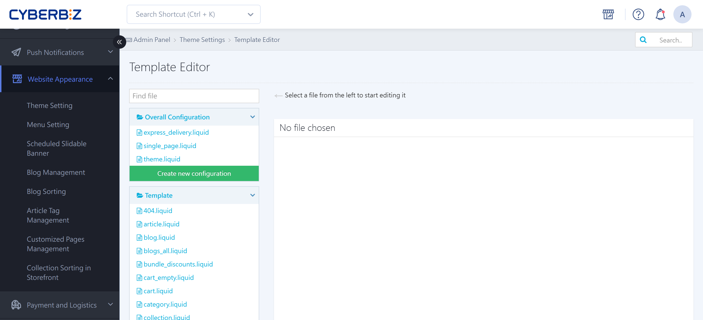
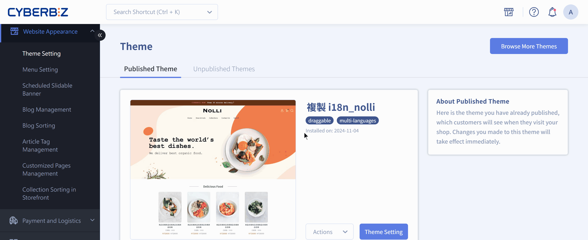

{ title="Template Editor Complete Guide" .hero-page }

## About the Template Editor { #intro-theme-code }

The **template editor** (also called the code editor or CSS/HTML editor) lets you change HTML, CSS, and JavaScript yourself to build highly customized visuals and features.

Here is how to use the template editor, along with common special syntax and important notes:

## Template Editor Basics { #operate-theme-code-basics }

1. **Path**: In the admin, go to **Website Appearance > Theme Setting > Actions > CSS/HTML Editor**.
2. **File search**: In the editor, enter a keyword in the search box (such as `theme`, `product`, or `index`) to quickly find the matching `.liquid`, `.css`, or `.js` file.
3. **Recovery**: The editor has a built-in **View Previous Versions** feature that lets you roll back to an earlier version.
    - Before each major change, note the current time so you can compare later.

{ title="Template Editor Demo" }

## General and Homepage Special Syntax { #operate-theme-code-syntax }

Use simple code snippets to adjust your website's protection and interactive behavior.

- :lucide-shield-check:{ .lg }  
  [__Disable Right-Click__](../site-settings/setup-right-click-protection.md){ title="Disable Right-Click to Protect Images and Text" }  
  Add `onContextMenu` code to disable right-click and protect your images and text.

- :lucide-search:{ .lg }  
  [__Change the Website Title__](../site-settings/setup-site-title-seo.md){ title="Set Up the Website Title and SEO" }  
  Change the `{{ page_title }}` logic to precisely define what appears in search results (SERP).

- :lucide-timer:{ .lg }  
  [__Homepage Carousel Transition Speed__](../theme-and-layout/adjust-carousel-transition-duration.md){ title="Adjust the Homepage Carousel Transition Duration" }  
  In `_main_slider.liquid`, change the `delay` value to customize the carousel transition speed.

- :lucide-mouse-pointer-2:{ .lg }  
  [__Auto-Expanding Menus__](../navigation/setup-nav-menu-hover-expand.md){ title="Expand Navigation Menus on Hover" }  
  Embed CSS in `main_nav.liquid` so submenus expand automatically on hover.

- :lucide-filter-x:{ .lg }  
  [__Exclude Keywords from Search__](../../products/discoverability/exclude-keyword-products-search.md){ title="Exclude Products with Specific Keywords from Search Results" }  
  Use the Liquid `without` filter to exclude products with specific keywords.

- :lucide-globe:{ .lg }  
  [__Storefront Language and Text__](../site-settings/setup-storefront-language-text-customization.md){ title="Set Up Storefront Language and Text Customization" }  
  Customize site-wide display text and multilingual dictionary files (i18n).

- :lucide-text-cursor-input:{ .lg }  
  [__Change Other Channel Order Labels__](customize-other-channel-order-label.md){ title="Change the Storefront Label for Valid Orders from Other Channels" }  
  In the `general` section of the dictionary file, add `customize_other_valid_order` to customize the storefront label.

- :lucide-message-square:{ .lg }  
  [__Connect Customer Service Channels__](../customer-interaction/setup-customer-service-widget.md){ title="Set Up a Customer Service Widget" }  
  Add GetButton code or turn on FBE 2.0 to create a live chat entry point.

- :lucide-map-pin:{ .lg }  
  [__Adjust Customer Service Center Information__](../customer-interaction/setup-edit-customer-service-info.md){ title="Set Up and Edit Customer Service Center Information" }  
  Change the heading text in `contact.liquid` and update the address, phone, and map embed code.

## Advanced Product Page Changes { #operate-theme-code-product }

Fine-tune how products and media are shown to better guide shoppers.

- :lucide-image-off:{ .lg }  
  [__Turn Off Image Zoom__](../theme-and-layout/disable-product-image-zoom.md){ title="Disable Product Image Zoom Preview" }  
  Comment out the JS script in `product.liquid` to turn off image zoom.
    
- :lucide-play-circle:{ .lg }  
  [__Video Autoplay Settings__](../../marketing/one-page-store/one-page-store-youtube-autoplay.md){ title="Set YouTube Video Autoplay and Start Time for One-Page Stores" }  
  Set the YouTube `autoplay` and `mute` parameters for muted autoplay.
    
- :lucide-type:{ .lg }  
  [__Product Tagline and Summary Styles__](../../products/create-and-manage/edit-product-slogan-and-description.md){ title="Edit Product Summaries and Taglines" }  
  Define custom classes with `theme_main.css` to customize the layout of taglines and summaries.
    
- :lucide-shuffle:{ .lg }  
  [__Recipient Information First__](../checkout-and-shopping-flow/priority-recipient-info-checkout.md){ title="Change Checkout to Collect Recipient Information First" }  
  In `js/main.js`, turn on `exchangeShippingAndPurchaserLocation` to show recipient fields first.

- :lucide-component:{ .lg }  
  [__Customize Order Confirmation / Payment Complete Pages__](../../integrations/line/marketing/line-friend-link-order-payment-pages.md){ title="Show a LINE Add Friend Link on the Order Confirmation and Payment Complete Pages" }  
  Use `order_done_extra_content.liquid` to insert a LINE link or ad on the order complete page.

<!-- - :lucide-variable:{ .lg }  
  [__Hide the "Manager Price Change" Text__](../../pos/frontend/pos-manager-price-override.md){ title="Use Manager Price Change to Adjust Item Prices at the POS" }  
  Replace "Manager Price Change" with "Product Price Change" in `customers/order.liquid`.
-->

## Important Notes { #prerequisites-theme-code }

- **Theme limitations**:
    - **Default Themes**: Full HTML/CSS/JS customization is available.
    - **Drag-and-drop themes**: Support only **a few** admin CSS/HTML editor features. Some code changes may not take effect.
- **Responsibility**: CYBERBIZ gives you open code editing access, but **does not provide editing guidance, syntax tutorials, or coding services beyond the existing docs**.
- **At your own risk**: If code you change yourself breaks your layout or features, you are responsible for the outcome. If something goes wrong, use the recovery feature to restore the file first.
- **Protect variables**: When editing email or SMS templates, never change system parameters inside `{{ }}` or `%{ }}` (such as `{{shop_name}}`). Otherwise, the system can't fetch the data and messages fail to send.

## FAQ { #faq-theme-code }

??? quote "I changed the CSS, but the storefront style didn't change. How do I troubleshoot?"
	This is usually caused by **CSS specificity** or the **browser cache**:
	
	1. **Check the cache**: Open the page in a private (incognito) window, or press `Ctrl + F5` (Windows) / `Cmd + Shift + R` (Mac) to force a reload.
	2. **Raise specificity**: Check whether another global style overrides your setting. Temporarily add `!important` to your code to test whether it takes effect, or use developer tools (F12) to check where the element's style comes from.
	3. **File location**: Make sure you changed `theme_main.css` or the CSS file the current theme actually uses.

??? quote "Why can't I find the page file I want to change in the search box?"
	CYBERBIZ templates are made up of multiple files:
	
	1. **Snippets**: Specific blocks on the homepage and product pages are usually split into "snippets" (such as `_product_item.liquid`), and their file names usually start with an underscore `_`.
	2. **Layout files**: To change site-wide content (such as `<head>` information), go straight to `theme.liquid`.
	3. **Find by keyword**: If you're not sure of the file name, use "View page source" on the storefront in your browser, search for the block's specific `class` name, and then search for that string in the editor.

??? quote "A Liquid syntax error shows code text on the storefront instead of the expected feature?"
	This means a Liquid tag isn't closed correctly or the logic conflicts:
	
	- **Check closing tags**: Make sure every `` has a matching ``, and no `{{ }}` double curly braces are missing.
	- **Context**: Check whether the variable is available on the current page. For example, in `index.liquid` (the homepage), calling `{{ product.price }}` directly doesn't work. You must use a `for` loop to fetch product data.

??? quote "Can I recover a file I accidentally deleted or overwrote?"
	Yes. The editor has a built-in **"View Previous Versions"** feature.
	
	- Open the file's editing screen and click the version history at the top right.
	- The system lists each time the file was saved.
	- Click the point in time you want to restore and click "Restore This Version."
	
	!!! warning "If a file is completely deleted (Delete File), you can't restore it with this feature. Always make a local backup before you delete a file."
