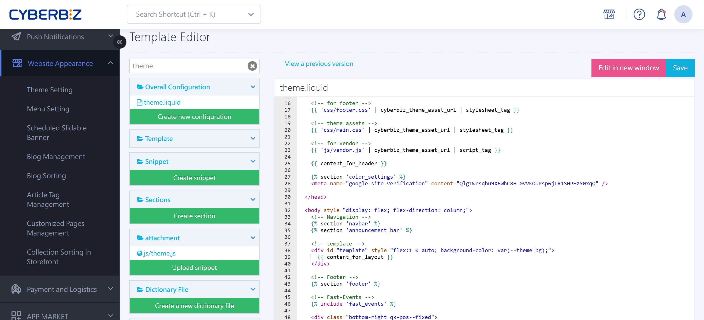

{ title="Customer Service Widget Settings" .hero-page }

## About the Customer Service Widget { #intro-cs-widget }

A customer service widget **creates a communication channel between your brand and your customers**, which helps increase sales and reduce customer service costs. Today, this is done mainly with plugins (such as GetButton) or the Facebook live chat feature. Here are the detailed steps:

## Set Up the GetButton Customer Service Plugin { #operate-cs-widget-getbutton }

!!! warning "GetButton is not entirely free. Evaluate its costs yourself."

GetButton is a third-party customer service plugin that brings together multiple messaging apps, such as Messenger and LINE.

1. **Create the GetButton code:**
    
    - Search for and open the GetButton website, and click **"Get Your Button."**
    - **Choose a messaging channel:** Select Messenger or LINE. Enter your Facebook Page URL (to get the Page ID), or paste the [add-friend link copied from the LINE OA Manager](../../integrations/line/marketing/add-line-friend-entry-storefront.md){ title="Add a LINE Add Friend Entry to Your Website" }  into the matching field.
    - **Set the chatbot appearance:** Customize the widget color, position (left or right), and **Call to action** (prompt text).
    - **Get the code:** When you finish, copy the entire **GetButton Code** that it generates.
    - For the full setup process, see the [official GetButton tutorial video :lucide-external-link:](https://youtu.be/dBY17EJkgWM).

2. **Connect it to the CYBERBIZ admin:**
    
    - **Admin path:** Go to **Website Appearance > Theme Setting**.
    - **Open the editor:** On the theme you are using, click "Actions" > "CSS/HTML Editor."
    - **Add the code:** Search for and open the **`theme.liquid`** file, paste the code you copied from GetButton into the file (usually just before the `</body>` tag), and save.
    - **See the result:** After you save, the customer service widget appears at the bottom right of your storefront.

	``` liquid title="theme.liquid" hl_lines="2-11"
	...
	        <script type="text/javascript">
	            (function () {
	                var options = {
	                    line: "//line.me/ti/p/@YourID", 
	                    facebook: "YourPageID",
	                    // ... other settings ...
	                };
	                // ... system initialization code ...
	            })();
	        </script>
	    </body>
	</html>
	```
	
## Facebook Live Chat <small>FBE 2.0</small> { #operate-cs-widget-fb }

Merchants on **Advanced or higher** plans can turn on live chat directly through Facebook Business Extension.

- **Feature toggle:** Complete the FBE 2.0 connection process in the admin, and then find the "Facebook Live Chat" toggle in the settings to turn it on or off.
- **Benefit:** The system automatically links Facebook accounts to your CYBERBIZ customer list, making it easy to filter members who sign in with Facebook.

## Advanced Third-Party Customer Service Integration <small>Omnichat</small> { #operate-cs-widget-omnichat }

If you need more advanced multichannel integration, CYBERBIZ also supports installing the **Omnichat customer service app**.

For detailed setup instructions, see [Omnichat's official tutorial :lucide-external-link:](https://docs.omnichat.ai/features/tong-xun-qu-dao/wang-zhan-dui-hua-cha-jian/install/cyberbiz-an-zhuang-omnichat#bu-zhou-2).

## Important Notes { #prerequisites-cs-widget }

- **Choose one:** CYBERBIZ recommends **using either Facebook live chat or the GetButton plugin, not both**, to avoid a cluttered layout or code conflicts.
- **Code risk:** If your own code changes break the layout, you bear the risk. Note the time before you make changes. If something goes wrong, use **"View Previous Versions"** in the editor to [roll back to an earlier version](../code-customization/restore-code-theme-editor.md#operate-restore-theme){ title="Restore Web Page Code with the Template Editor" }.
- **Theme limitation:** Drag-and-drop themes support only some code editing. What you can do depends on the features available in your admin.


## FAQ { #faq-cs-widget }

??? quote "Why doesn't the customer service icon appear on my storefront after I paste the GetButton code?"
	This usually has one of these causes:
	
	- **Cache delay:** Open your website in a private (incognito) window, or clear your browser cache and refresh.
	- **Wrong position:** Check that the code is pasted in the `theme.liquid` file **before** the `</body>` tag.
	- **Code conflict:** If you also turned on FBE 2.0 or another third-party customer service plugin, they may conflict. Pause the other plugins first and test again.

??? quote "Can I customize when the customer service button shows, or show it only on certain pages?"
	- **GetButton free version:** It usually shows site-wide. You cannot limit it to certain pages or times.
	- **Omnichat:** Supports advanced display rules (for example, show only on product pages, or pop up only after a customer stays 30 seconds). If you need this, consider Omnichat first.

??? quote "What if the customer service button covers my website's existing "Back to Top" button?"
	Adjust the **Position** on the GetButton settings page: **Try changing the position from `Right` to `Left`.** Or adjust the vertical/horizontal offsets in the `Pro` option (paid) to avoid your website's existing layout elements.

??? quote "Will GetButton slow down my website?"
	GetButton is a lightweight, externally loaded script, so its effect on loading speed is minimal. For the best performance, though, **do not install several customer service plugins of the same kind at once**.
