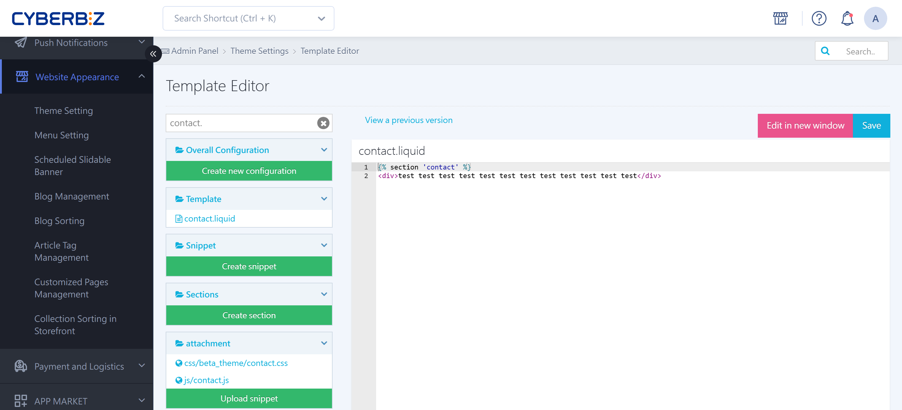

{ title="Customer Service Center Information Settings" .hero-page }

## About Editing Customer Service Center Information { #intro-cs-info }

**Editing customer service center information** lets you change or add customer service details, and customize the page to show extra information or a Google Map.

Here are the detailed steps for editing customer service center information:

!!! warning "This guide applies only to "Default Themes / Standard Themes (legacy).""

## Edit Customer Service Details and Headings { #operate-cs-info-title }

If you use **Default Themes** (standard themes), you can edit the heading text in the code editor (for example, change "Company Address" to "Store Location").

1. **Go to**: Sign in to the CYBERBIZ admin and go to **Website Appearance > Theme Setting > CSS/HTML Editor**.
2. **Edit the file**: Search for and open the **`contact.liquid`** file.
3. **Change the text**: Find the default text you want to replace (such as "Company Address"), change it to the text you want to show, and save.

``` liquid title="contact.liquid" hl_lines="4 9 14"
<ul class="contact_list">
  
    <li>
      <span>公司地址：{{ settings.contact_address }}</span>
    </li>
  
  
    <li>
      <span>公司電話：{{ settings.phone_number }}</span>
    </li>
  
  
    <li>
      <span>客服時間：{{ settings.shop_office_time }}</span>
    </li>
  
</ul>
```

## Edit Customer Service Contact Details <small>Address, Phone, Business Hours</small> { #operate-cs-info-contact }

You can change most contact details directly in the admin "Site Settings":

1. **Change the contact address**: Sign in to the CYBERBIZ admin and go to **Website Appearance > Theme Setting > Theme Setting > Customer Service Center** to edit it.

	{ title="Customer Service Center Settings Page" }

2. **Change the phone number and business hours**: Go to **Website Appearance > Theme Setting > Theme Setting > Footer** to adjust them.

	{ title="Footer Contact Information Settings" }

## Add Extra Customer Service Information <small>Such as Fax</small> { #operate-cs-info-extra }

If the default fields are not enough, copy a block in the code to add information manually:

1. **Copy the code**: In the `contact.liquid` file, copy one section from `<li>` to `</li>`.
2. **Paste and edit**: Paste the copied section above `</ul>`, delete the system code in it (such as `{{ settings.shop_office_time }}`), replace it with the plain text you want to show (for example, a fax number), and save.

``` liquid title="contact.liquid" hl_lines="7 10"
<li>
  <span>公司電話：{{ settings.phone_number }}</span>
</li>


<li>
    <span>客服時間：{{ settings.shop_office_time }}</span>
</li>
<li>
	<span> 傳真時間 </span>
</li>

```

## Google Map Settings { #operate-cs-info-map }

1. **Get the map code**: Search for the address in Google Maps and click "Share" > "Embed a map" > "**Copy HTML**."

	{ title="Getting the Google Maps Embed Code" }

2. **Add the link**: Go back to the admin and go to "**Website Appearance**" > "**Theme Setting**" > "**Theme Setting**" > "**Customer Service Center**" > "**Map Link**."

	{ title="Map Link Settings" }

3. **Apply the code**: Paste the HTML code you copied and save. The map then appears on the storefront.

	{ title="Map on the Storefront" }

4. **Change the map heading**: To change the heading text above the map, open `contact.liquid`, find the lines for the map, and change the text inside the quotes (such as "Company Location") to a name of your choice.

	``` liquid title="contact.liquid" hl_lines="3"
	<div class="row">
	  <div class="col">
		<h5 class="title mt-3 mb-4 section-heading">公司位置</h5>
		<div id="map-wrapper" class="map-wrap">
		  <div class="map-responsive">
			  {{ settings.show_google_map_iframe }}
		  </div>
		</div>
	  </div>
	```

## Important Notes { #prerequisites-cs-info }

- **Responsibility**: CYBERBIZ gives you access to edit the code, but **CYBERBIZ does not provide coding tutorials or code-writing services**. Hire your own engineers or a professional design agency for this work.
- **Recovery**: Before you edit code, note that if something goes wrong, you can use "**View Previous Versions**" in the editor to [roll back to an earlier version](../code-customization/restore-code-theme-editor.md#operate-restore-theme){ title="Restore Web Page Code with the Template Editor" }.


## FAQ { #faq-cs-info }

??? quote "Why didn't the customer service page update after I changed the address in "Site Settings"?"

	This usually happens because the original system code in your `contact.liquid` file (such as `{{ settings.contact_address }}`) was manually changed to "fixed text."

	*Solution:** Check the `contact.liquid` code and confirm that the field still uses system code in the `{{ ... }}` format. If it was changed to fixed text, update the address manually in the code editor.

??? quote "What if the embedded Google Map is blank or has the wrong proportions?"

	This is usually related to whether the copied HTML code is complete, or to theme CSS limits.

	**Solution:**
	
	1. Make sure the pasted content is the complete code, starting with `<iframe>` and ending with `</iframe>`.
    2. If the map does not fill the width, check whether the code is wrapped with `map-responsive` in an outer `div`. This keeps the map scaling correctly on mobile too.

??? quote "How do I restore the page if I accidentally deleted code and the page now shows garbled text?"
	The CYBERBIZ code editor has version management.

	- **Steps:** At the top right (or bottom) of the `contact.liquid` editing page, click "**View Previous Versions**." The system lists past saves. Choose a point in time before your change to roll back to.

??? quote "Can I show maps for multiple stores at once?"
	The default field supports only one map link.

	**Solution:** To show multiple maps, open `contact.liquid`, manually copy multiple `<div class="map-responsive">` blocks, and hard-code each store's Google Maps embed code into them.
