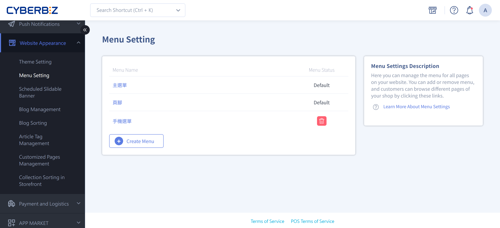{ title="Menu and navigation bar settings" .hero-page }

## About Menus and the Navigation Bar { #intro-menus-nav }

**Menu and navigation bar settings** have two main parts:

1. [**Menu content settings**](#operate-menus-nav-links): Manage your website's menu items and their hierarchy.
2. [**Menu appearance**](#operate-menus-nav-navbar): Control how and in what style the menu appears on your storefront.
    
These settings help you build clear, intuitive site navigation and improve the shopping experience.

!!! tip "Tip"
    We recommend finishing **menu content settings** first and then adjusting the **appearance**, so the navigation structure and display stay consistent.
	
## Menu Content Settings <small>Link List</small> { #operate-menus-nav-links }

First set which items and levels the menu contains in the admin. After that, you can apply it to your website appearance.

1. **Path:** Go to **Website Appearance > Menu Setting > Menu Settings**.
2. **Edit a menu:** The system has two default menus, "Main Menu" and "Footer." Click a name to edit it.

    !!! info "For multilingual stores, see [Multilingual Menu Settings](#operate-menus-nav-i18n) to edit menu item names for each language."
	
3. **Add items:** On the menu edit page, click "Add Link" to add different types of navigation items, including:

	- **Product categories:** Includes custom categories, conditional categories, and multi-level categories.
	- **Marketing campaigns:** Such as Mix & Match bundle deals, pick-any discounts, and Bonus Mall.
	- **Content pages:** A specific product, custom page, blog topic, or post.
	- **Function links:** Order lookup page, contact the store, homepage, or external links.

	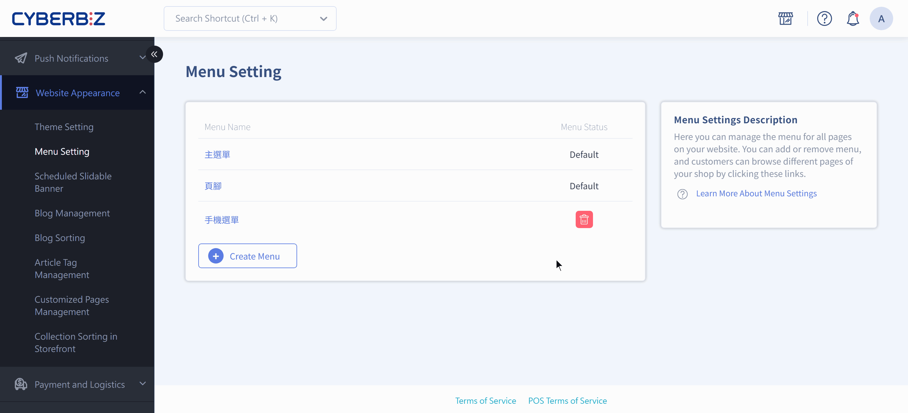{ title="Add menu items" }

4. **Levels and order:** After you create items, **drag them with your mouse** to change their order. Indent an item to the right to make it a submenu. **Up to three levels are supported**.

	{ title="Menu order and levels" }
	
5. **Storefront view:** Click the **Go to store page** icon at the top right to see the result on your storefront.

	{ title="Menu on the storefront" }

## Navigation Bar Appearance Settings <small>Navbar</small> { #operate-menus-nav-navbar }

The appearance settings path and features differ slightly depending on your theme ([drag-and-drop theme](#operate-menus-nav-drag) or [default theme](#operate-menus-nav-default)).

{ title="Navigation bar - storefront" }

### Drag-and-Drop Theme Settings { #operate-menus-nav-drag }

!!! path "**Path:** **Website Appearance/Theme Setting/Theme Setting > Navigation Bar**."

The drag-and-drop theme's navigation bar editor has 8 settings sections, from top to bottom:

#### Website Logo { #operate-menus-nav-logo }

- **Desktop / tablet / mobile images:** Upload a separate logo for each of the three devices. We recommend **no more than 1 MB, any width, and 100px high**. JPG, PNG, JPEG, and GIF are supported.

    !!! tip "If you upload only the desktop version, the system uses it for tablet and mobile too."

- **Desktop logo height:** Enter a value from **20px to 300px** to set the logo's display height on desktop.
- **Tablet and mobile menu logo position:** Choose **Left** (default) or **Center**.
- **Image alt text:** Enter a description of the logo to improve SEO.

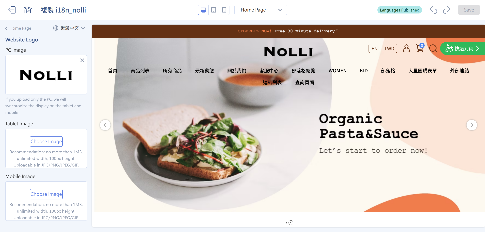{ title="Navigation bar - website logo" }

---

#### Navigation Bar Style { #operate-menus-nav-style }

- **Desktop navigation bar style:** Choose one of three
    - **Default:** The website logo and menu are on separate rows and centered (logo above, menu below).
    - **Display left:** The logo and menu are side by side, aligned left.
    - **Display centered:** The logo and menu are side by side, centered.
- **Transparent background:** Select this to make the navigation bar background transparent (often used with a full-width hero image).

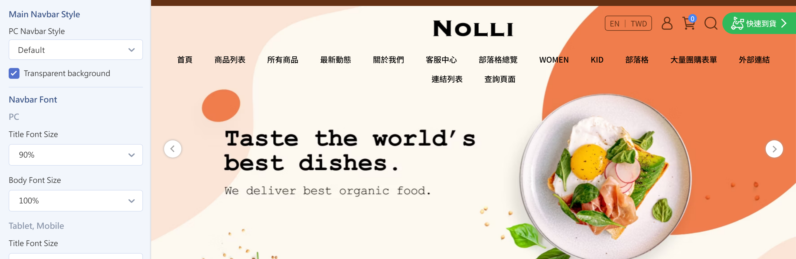{ title="Navigation bar - style" }

---

#### Navigation Bar Font { #operate-menus-nav-font }

Set the font scale separately for **desktop** and **tablet/mobile**. Titles and body text are set independently:

- **Title font size / body font size:** Choose **80% / 90% / 100% (default) / 110% / 120%**.

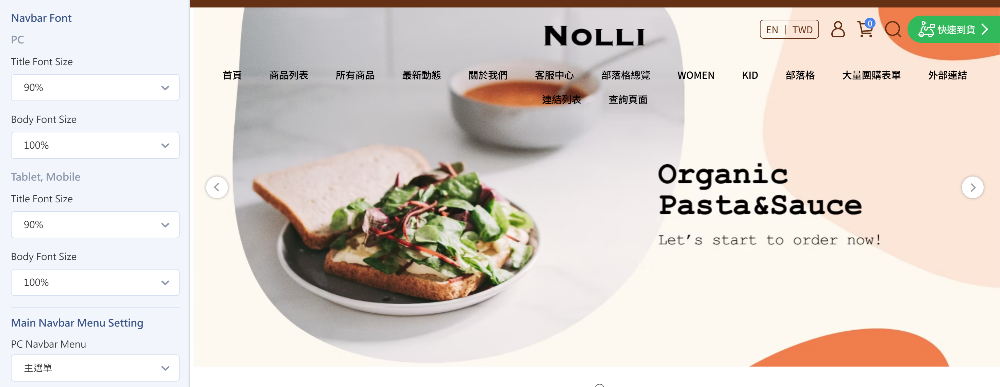{ title="Navigation bar - font" }

---

#### Main Navigation Bar Menu Settings { #operate-menus-nav-main }

- **Desktop menu:** Choose the menu to show in the desktop navigation bar. Create the menu items in [menu content settings](#operate-menus-nav-links) first.
- **Desktop menu style:**
    - **Submenus don't expand together (three-tier menu, default):** Second- and third-level menus are shown separately.
    - **Submenus expand together (two-tier menu):** Second- and third-level menus expand at the same time.

- **Tablet and mobile menu:** Choose the menu to show in the side menu on mobile devices.
- **Expand non-desktop menu by default:** Select this to have the tablet/mobile side menu expanded by default.

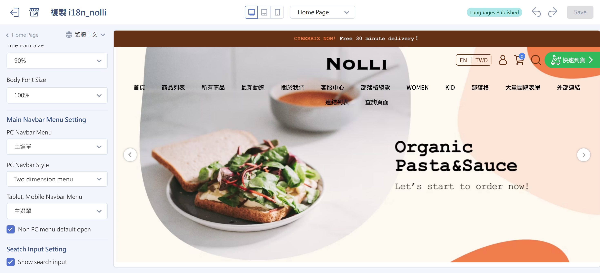{ title="Navigation bar - main menu settings" }

---

#### Search Bar Settings { #operate-menus-nav-search }

- **Show search bar:** Controls whether a search bar appears in the navigation bar (on by default).

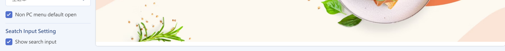{ title="Navigation bar - show search bar" }

---

#### Pinned Post { #operate-menus-nav-announce }

!!! tip "Feature Update Transition"
    The **pinned post** now has its own settings page and is no longer inside the navigation bar settings. The new version is rolling out gradually. Choose the guide that matches your admin:

    - **You still see pinned post settings in the navigation bar**: You're on the original version. Follow the steps on this page.
    - **The setting is no longer in the navigation bar**: Your store has been updated. See the [new pinned post setup guide](setup-pinned-post.md) instead.

An announcement banner shown at the very top of your website. It can be an image or text, and supports publish/unpublish times and a countdown.

- **Show on homepage only:** Select this to show the announcement only on the homepage.
- **Announcement type:** Choose **image announcement** or **text announcement**.
    - **Image announcement:** Upload desktop (recommended width 1920px), tablet (960px), and mobile (480px) images, and optionally enter image alt text.
    - **Text announcement:** Enter the announcement text and set the **font size, text color, and background color**.

    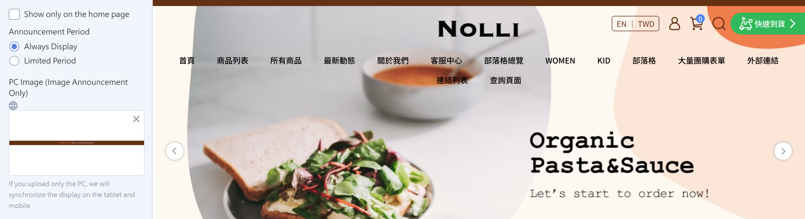{ title="Navigation bar - pinned post - type" }

- **Announcement link / open in new tab:** Add a link to the announcement and choose whether it opens in a new tab.
- **Publish time / unpublish time:** Set when the announcement shows and hides automatically.
- **Show countdown:** Turn this on to show a countdown on the announcement, and customize the **countdown text color** and **countdown background color**.

    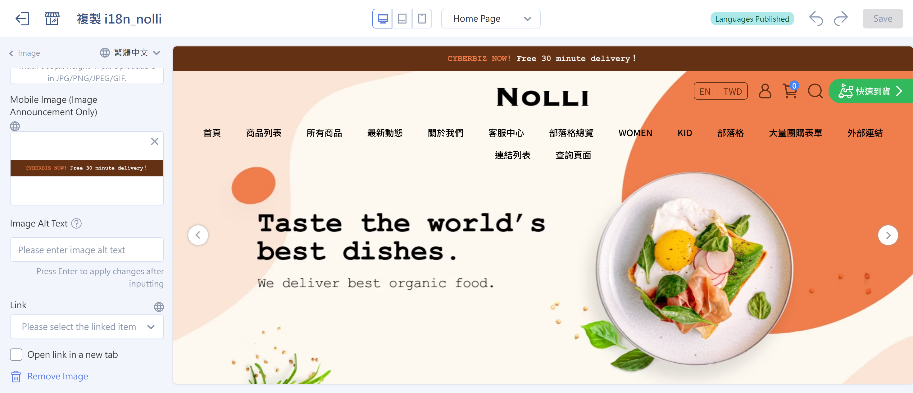{ title="Navigation bar - pinned post - details" }

---

### Default Theme Settings { #operate-menus-nav-default }

- **Path:** **Website Appearance > Theme Setting > Theme Setting > Navigation Bar**.

- **Logo settings:** Upload a standard logo and a separate logo for the mobile side menu.

- **Menu mode:** Choose **"two-tier menu" or "three-tier menu"** mode as needed.

- **Other settings:** Control whether the search bar appears and the product list style on the "All Products" `collections/all` page.

{ title="Navigation bar menu - default theme" }

## Footer Menu and Appearance Settings <small>Footer</small> { #operate-menus-nav-footer }

Footer settings determine what appears at the bottom of your website and how it's arranged, including menus, contact information, custom text, and social media icons. These settings apply to **drag-and-drop themes** and are found in **Theme Management**.

{ title="Footer on the storefront" }

### Footer Content { #operate-menus-nav-footer-content }

You can add up to **4 content blocks** to the footer, and set each one independently. To add and edit them:

1. **Open footer settings:** Sign in to the admin, go to **Website Appearance > Theme Setting > Theme Setting**, and click **Footer** on the left to open the edit page.
2. **Add Block:** Click **Add Block** to add one of three content types: "Menu," "Contact Information," or "Custom Text."
3. **Edit block content:** Click a block name to open its settings page and make changes (see below for each block type's settings).

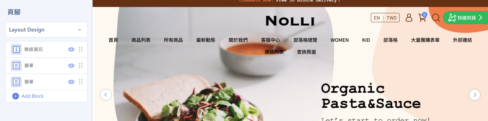{ title="Add a footer block" }

---

### Footer Menu <small>Navigation Bar</small> { #operate-menus-nav-footer-menu }

!!! info "Before you set up the footer's "Menu" block, finish [**menu content settings**](#operate-menus-nav-links). Otherwise, the footer menu has nothing to choose from."

The footer's "Menu" block only **chooses which menu to show**. The menu's items and levels are created in **menu content settings**. Here's how they work together:

1. **Create the menu content:** First create the menu and its items and levels in **Website Appearance > Menu Setting > Menu Settings**.
2. **Add a menu block:** On the footer settings page, click **Add Block > Menu**, and then click the block to open its settings page.
3. **Set the block title:** In the **Title** field, enter the name this block shows on the storefront (default: "About Us").
4. **Choose the menu to show:** In the **Select Menu** drop-down, choose the menu you created in step 1. Its items then appear in the footer.

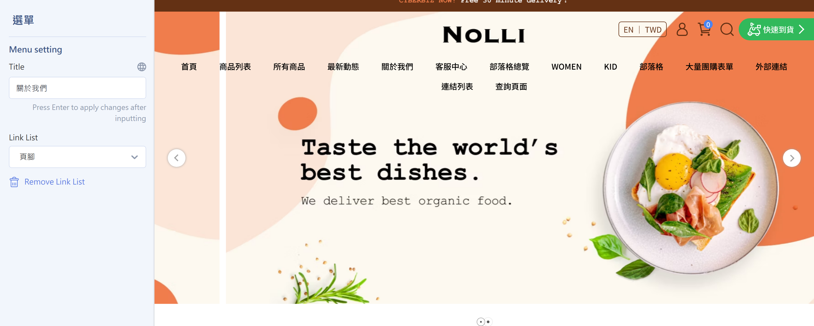{ title="Footer - menu" }

!!! info "Edit Menu Items in "Menu Settings""
    You can't edit the footer menu's items (link names and levels) directly in this block. To add or change menu items, go back to **Website Appearance > Menu Setting > Menu Settings**. The footer updates automatically to match.

---

### Contact Information and Custom Text { #operate-menus-nav-footer-contact }

Besides menus, footer blocks can also include contact information and custom text:

- **Contact information:** Shows your store's contact details. You can customize the title (default: "Contact Information") and choose whether to show each
**phone number, fax number, business hours, email, address, and tax ID number** field. Each field has its own display toggle and input box.

- **Custom text:** Enter your own description or copyright information. You can set a title and body, and the body supports text formatting.

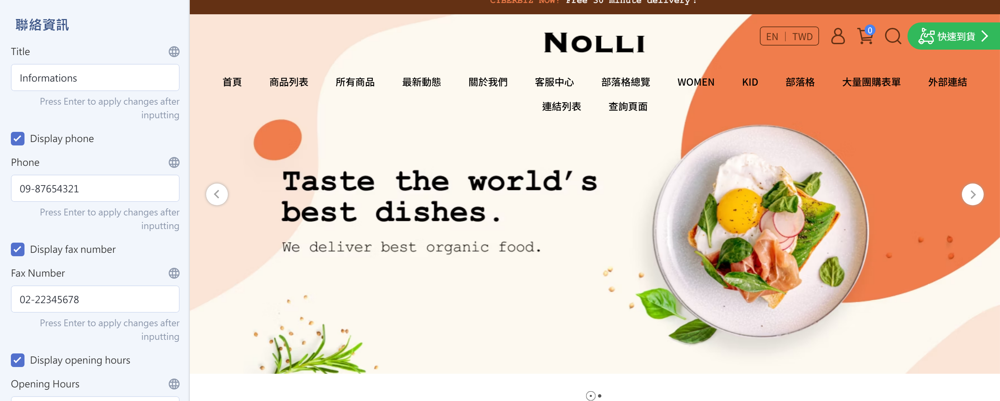{ title="Footer - contact information" }

---

### Adjust the Menu Layout { #operate-menus-nav-footer-layout }

Click to expand **Other Layout Settings**. In the **Menu Settings** section, you can set the direction of the menu blocks:

- **Vertival Alignment:** The menu lists are arranged from top to bottom (default).

- **Horizontal Alignment:** The menu lists are arranged from left to right.

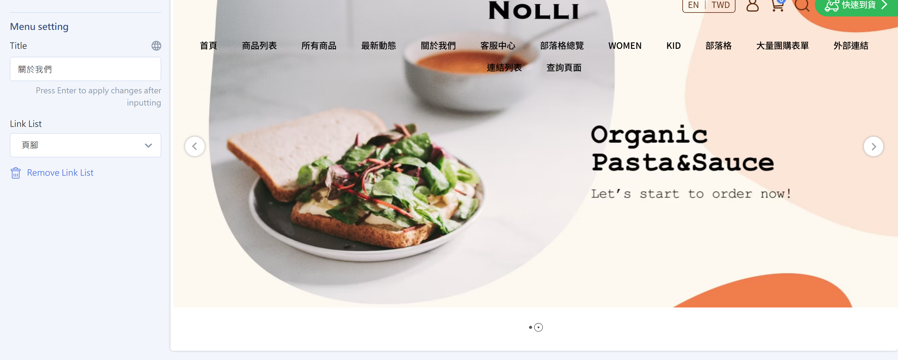{ title="Footer - menu layout" }

---

### Social Media { #operate-menus-nav-social }

Click to expand **Other Layout Settings**. In the **Social Media Settings** section, you can set up the Facebook Page block and social icon links:

- **Show Facebook Page block:** Turn this on to embed the Facebook Page plugin in the footer (on by default).

    !!! warning "Requirements and Limitations"
        * Prerequisite: Finish setting up [Facebook Business Extension (FBE)](../../integrations/fb/mbe/setup-fbe-authorization.md){ title="Set Up FBE Account Authorization and Asset Connections" } for the block to display correctly.
        * Device limitation: This block shows only on **desktop**. Tablet and mobile aren't supported.
        * Turning this off only hides the embedded Page content. It doesn't affect your Facebook connection or pixel tracking.

- **Show icons:** Select each social icon to show in the footer and enter its URL in the matching field. Facebook, Instagram, LINE, and YouTube are available.

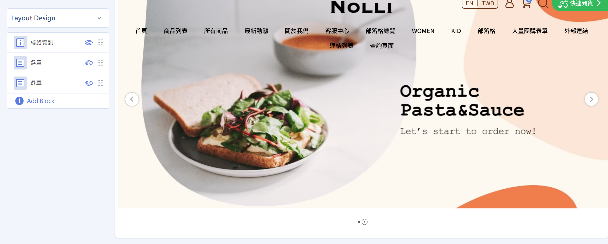{ title="Footer - social media" }

## Multilingual Menu Settings { #operate-menus-nav-i18n }

If you have multiple languages turned on, you edit the item names of both the **main menu** and the **footer menu** here, one language at a time. The steps are the same for both. The only difference is which menu you choose. The system doesn't translate automatically, so you need to fill in each language separately.

### Steps { #operate-menus-nav-i18n-steps }

1. Go to **Website Appearance > Menu Setting** and click the menu you want to edit (main menu or footer).
2. Click :lucide-globe: to switch to the target language.

    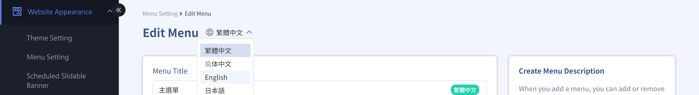{ title="Switch languages" }

3. Click "Edit" for each item, change the menu item name, and confirm.

    { title="Enter language content" }

4. When you finish, **save the menu**. The storefront then shows the matching text based on the browsing language.

=== "Main Menu Example"

    | Traditional Chinese | English |
    |------|------|
    | 首頁 | Home |
    | 關於我們 | About Us |
    | 商品列表 | Products |
    | 客服中心 | Contact Us |

    { title="Navigation bar menu - multilingual - storefront" }

=== "Footer Menu Example"

    | Traditional Chinese | English |
    |------|------|
    | 查詢 | Search |
    | 關於我們 | About Us |
    | 服務條例 | Terms & Conditions |

    { title="Footer menu - multilingual - storefront" }

    !!! info ""Footer Menu" ≠ the Footer Block in Theme Management"
        The "Footer" here is a **list of menu links**. To control how it appears on the storefront, go to the [footer's menu block](#operate-menus-nav-footer-menu) and choose it in the "Menu" block. This section covers only **the multilingual wording of menu items**.

### Important Notes { #prerequisites-menus-nav-i18n }

- **Multilingual schedule settings**: You can't set a separate schedule for each language. A schedule saved in any language applies to all languages.

<!---->
<!-- ## Footer Menu and Appearance Settings <small>Footer</small> -->
<!---->
<!-- Set what your website footer shows and how it's laid out, including menus, contact information, custom text, and social media icons. -->
<!---->
<!--  -->
<!---->
<!-- > Before you set up the footer, finish [**menu content settings**](#operate-menus-nav-links). Otherwise, the menu in the footer won't display correctly. -->
<!---->
<!-- ### Set Footer Content -->
<!---->
<!---->
<!-- 1. Sign in to the admin and go to **Website Appearance > Theme Setting > Theme Setting**. -->
<!-- 2. In the left menu, click **Footer** to open the edit page. -->
<!---->
<!-- 3. Set the footer content: In the footer settings section, you can add (click **Add Block**) the following content types: -->
<!---->
<!-- 	- **Menu**: Shows a navigation menu you created -->
<!---->
<!-- 	- **Contact information**: Shows your phone number, address, email, and other details -->
<!---->
<!-- 	- **Custom text**: Enter your own description or copyright information -->
<!---->
<!-- 4. Click a block name to open its edit page. -->
<!---->
<!-- 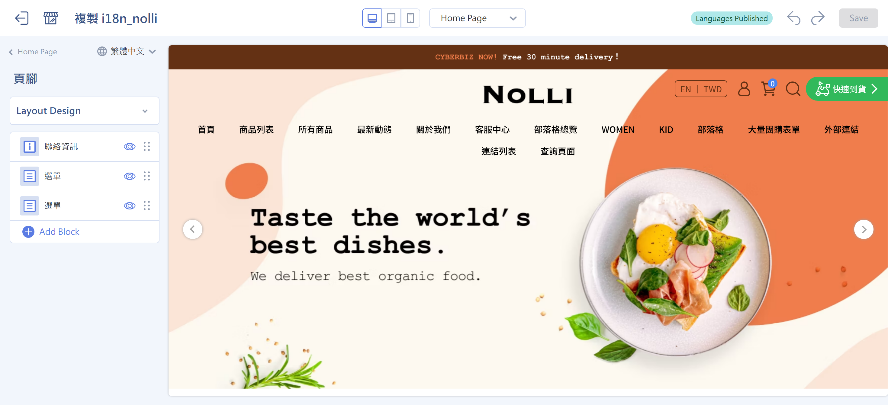 -->
<!---->
<!-- ### Adjust the Footer Layout -->
<!---->
<!-- Click to expand **Other Layout Settings** to set the menu layout and social media icon links. -->
<!---->
<!-- - **Set the layout:** Choose whether the footer content uses **Vertival Alignment** or **Horizontal Alignment**. -->
<!---->
<!-- - **Set social media icons:** Add social media link icons to the footer. Enter a link in the matching field to show it. -->
<!---->
<!--     - Show Facebook Page block: Select this to embed the Facebook Page plugin in the footer. -->
<!---->
<!--         !!! warning "Requirements and Limitations" -->
<!--             * Prerequisite: Finish setting up [Facebook Business Extension (FBE)]() for the block to display correctly. -->
<!--             * Device limitation: This block shows only on desktop. Tablet and mobile aren't supported. -->
<!---->
<!--     - Facebook -->
<!--     - Instagram -->
<!--     - LINE -->
<!--     - YouTube -->
<!---->
<!-- 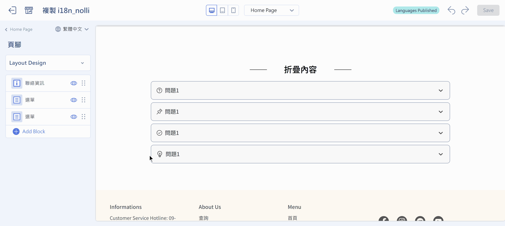 -->
<!---->
<!-- ## Next Steps -->
<!---->
<!-- 
 -->
<!---->
<!-- - :lucide-chevron-down:{ .lg }      -->
<!--   [__Expand Menus on Hover__](setup-nav-menu-hover-expand.md){ title="Expand Navigation Menus on Hover" }   -->
<!--   Set navigation menus to expand submenus automatically on hover. -->
<!---->
<!-- - :lucide-list-ordered:{ .lg }   -->
<!--   [__Product Collection List Order__](../theme-and-layout/設定首頁商品群組排序.md)   -->
<!--   The "site-wide product list collection order" setting affects the order of collections on the homepage and in the sidebar of all product pages. -->
<!---->
<!-- - :lucide-shopping-bag:{ .lg }   -->
<!--   [__One-Page Stores__](#)   -->
<!--   A new one-page store uses the language and menu settings in effect when it's created. If your website menu changes later, you may need to update existing one-page stores. -->
<!---->
<!-- 
 -->
<!---->

## FAQ { #faq-menus-nav }

??? quote "Why don't the menu items I added appear on the storefront?"
    Usually the menu hasn't been applied to your website appearance yet, or the settings weren't saved. Check that:
    
    - You saved your changes in "Menu Settings"  
    - The menu is selected in the "Navigation Bar" or "Footer" appearance settings  
    - You cleared your browser cache or refreshed the storefront page  

??? quote "How many menu levels can I create?"
    The system currently supports up to **three menu levels** (main menu > submenu > third-level menu). Items below the third level won't display correctly on the storefront.

??? quote "Can I set different menu content for different languages?"
    Yes. If you have multiple languages turned on, click the language switch icon and edit the menu names and links for each language separately. The system doesn't sync translations automatically. See [Multilingual Menu Settings](#operate-menus-nav-i18n)

??? quote "Why does my mobile logo look out of proportion?"
    Usually the uploaded images have inconsistent aspect ratios. We recommend:
    
    - Uploading separate images with the right ratio for desktop, tablet, and mobile  
    - Using PNG with a transparent background or SVG to avoid cropping  

??? quote "Why is my footer menu empty?"
    The "Menu block" in the footer has no content of its own. Create a menu in "Menu Settings" first, and then choose which menu to show in the footer block.

??? quote "Can I add external links or social buttons to the footer?"
    Yes. You can set this up in **Website Appearance > Theme Setting > Theme Setting > Footer > Other Layout Settings > Social Media Settings**.

??? quote "Does changing the menu order affect SEO?"
    Indirectly, yes. Menu structure affects:
    
    - Internal linking  
    - How search engines understand your site structure  
    - User navigation paths (click depth)  
    
    We recommend putting high-value pages (main categories, campaign pages) in the first menu level.

??? quote "Do one-page stores update automatically after I change the menu?"
    No. A one-page store uses the menu as it was when the store was created. If your website menu changes later, go back to that one-page store and update it manually.

??? quote "I don't want my products to expand under the default "All Products" menu. I want to set up my own categories with levels, without the products expanding"
    The system default "All Products" `collections/all` shows every product collection in the admin, displays products in the menu by default, and can't be customized. If you don't want this display, we recommend deleting this item. Then create your own [custom product categories](../../products/categories-and-tags/custom-collections.md){ title="Set Up Custom Product Category Collections" }/[conditional product categories](../../products/categories-and-tags/smart-collections.md){ title="Set Up Conditional Product Category Collections" }, and add them to the navigation bar with levels.
