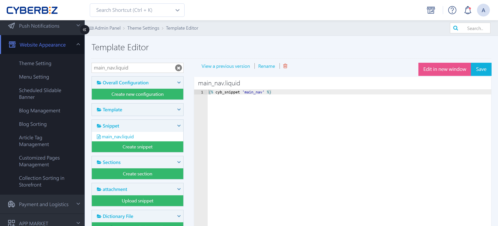

{ title="Navigation Menu Auto-Expand" .hero-page }

## About Navigation Menu Auto-Expand { #intro-nav-hover }

If you want a link list (menu) to **expand its second-level items automatically** when shoppers hover over it, without clicking, you can edit the code in the template editor.

## Steps <small>Using a Drag-and-Drop Theme as an Example</small> { #operate-nav-hover }

!!! warning  "Editing template files is an advanced task. Back up a version before you make changes."

1. **Go to:** Sign in to the CYBERBIZ admin and go to **Website Appearance > Theme Setting**.
2. **Open the editor:** On the theme you are using, click "Actions" and open the **CSS/HTML Editor**.
3. **Find the file:** In the search box at the top left of the editor, type **`main_nav.liquid`** and click the file to open it.
4. **Paste the code:** Paste the following code on **line 2** of the file:

	``` html title="main_nav.liquid" linenums="2"
	<style>
	  .dropdown:hover .dropdown-menu {
	    display: block;
	  }
	</style>
	```

5. **Save:** Click "**Save**," and then check the result on your storefront.

	{ title="Menu Auto-Expand on the Storefront" }

## Notes and Recovery { #prerequisites-nav-hover }

- **Responsibility:** CYBERBIZ gives merchants open access to edit code for their own customization. However, CYBERBIZ **does not provide coding tutorials, editing guidance, or code-writing services beyond the existing documentation**. Have a professional engineer make these changes.
- **Recovery:** If the layout breaks or shifts after your changes, use the **View Previous Versions** button in the template editor to [roll back to an earlier version](../code-customization/restore-code-theme-editor.md#operate-restore-theme){ title="Restore a Template Editor Version" }.

## FAQ { #faq-nav-hover }

??? quote "Why does nothing happen after I set it up?"
	Check that the code is correctly wrapped in the `<style> ... </style>` tag. Also, if your theme uses custom CSS class names (not the standard `.dropdown`), ask an engineer to confirm the correct selector name.

??? quote "Will the expanded menu cover the banner below it?"
	Yes. When the drop-down menu expands, it overlays the content below. Keep your second-level menus at a moderate length so they do not cover a large area when shoppers hover over them, which can make the page hard to read.

??? quote "How do I adjust how fast the drop-down menu appears?"
	To make the expand motion smoother, add the `transition` property to the code, but this requires more advanced CSS knowledge. In general, keep `display: block;` to ensure an instant response.
