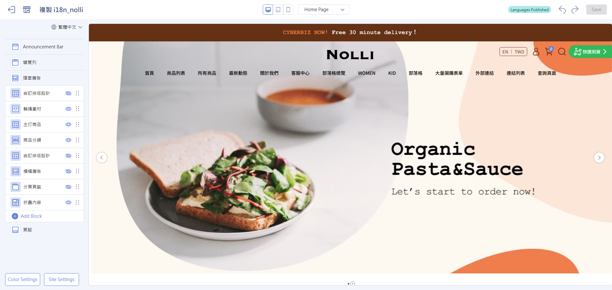
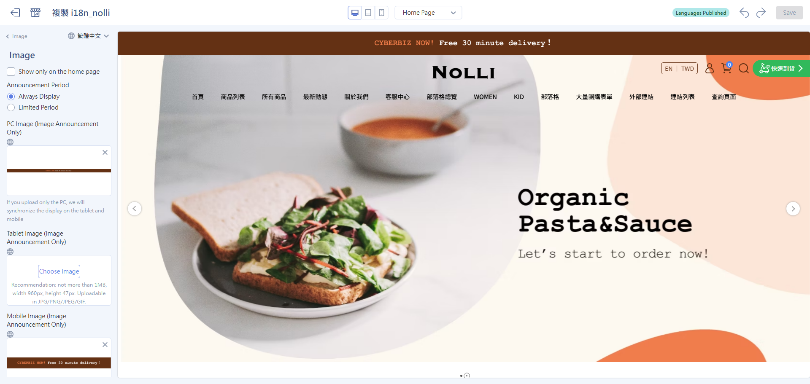
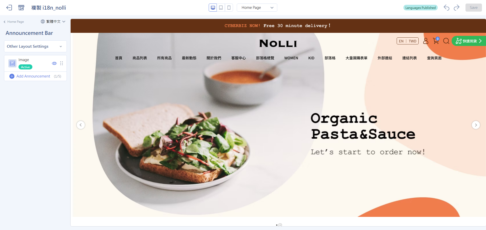
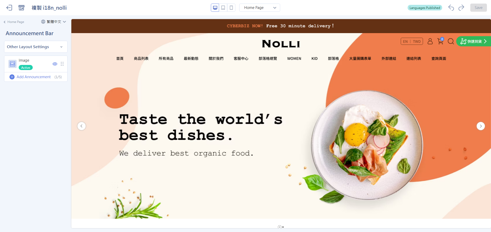
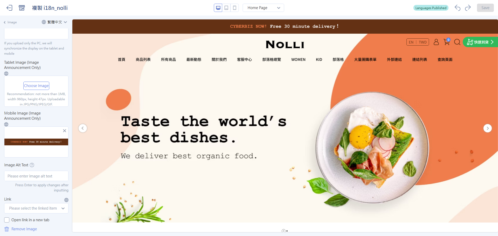

# Set Up a Pinned Post
Show marketing messages at the very top of your store pages. Announcement types include text, image, and countdown, and you can schedule them to go live and come down automatically.
{ .subtitle }

[:lucide-tag:{ title="Available Plans" }](../../../resources/conventions#適用方案) | All Plans
{ .doc-badge }

!!! tip "Feature Update Transition"
    **Pinned Post** now has its own settings page and is no longer built into the navigation bar. **This feature is rolling out gradually**. Choose the guide that matches your admin:

    - If the sidebar already has **Pinned Post**: Follow this guide (new version).
    - If you don't see this menu yet: [Set up the original pinned post](setup-menus-navigation.md#operate-menus-nav-announce) in the navigation bar first, and switch to this guide once the new version is available for your site.

## Before You Start { #prerequisites-pinned-post }

- **Announcement limit**: You can create up to **5** announcements.
- **Display conditions**: Only announcements that are **Public** and **In Progress** appear on the storefront.
- **Expired announcements are kept**: After the end time passes, an announcement is hidden automatically, but its settings stay in the list.

## Announcement Types { #specs-pinned-post-types }

=== "Image Announcement"
    
    { .screenshot }

=== "Text Announcement"

    { .screenshot }

=== "Countdown Announcement"

    { .screenshot }
    

## Add an Announcement { #operate-pinned-post }

### Step 1: Open the Pinned Post List { #operate-pinned-post-enter }

1. Sign in to the CYBERBIZ admin, go to **Website Appearance > Theme Setting**, and click **Site Settings**.
2. In the sidebar, select **Pinned Post**.

    { .screenshot }

3. Click **Add Announcement** and select an announcement type.

    { .screenshot }

### Step 2: Schedule Publishing { #operate-pinned-post-schedule }

Each announcement can have a **start time** and an **end time**. The system sets its status automatically based on the current time.

{ .screenshot }

| Status | Condition | Storefront display |
| :--- | :--- | :--- |
| **Scheduling** | Current time < start time | Not shown yet |
| **In Progress** | Start time ≤ current time ≤ end time | Shown normally |
| **Finished** | Current time > end time | Hidden automatically |

!!! example "Example: Scheduling for the 11.11 Sale"
    Set up two announcements in advance. The system switches between them automatically based on time, with no manual work:

    - **Announcement A, "11.11 Is Coming Soon"**: 11/01 00:00 – 11/10 23:59
    - **Announcement B, "Store-Wide Sale Starts Now"**: 11/11 00:00 – 11/11 23:59

    At midnight on 11/11, the system automatically hides Announcement A and switches to Announcement B.

### Step 3: Edit the Announcement Content { #operate-pinned-post-content }

=== "Image Announcement"

    1. **Image upload**: Upload images in three sizes: **desktop, tablet, and mobile** (see the upload screen for recommended specs).
    2. **Alt text**: Fill in alt text to improve SEO and accessibility.
    3. **Announcement link**: Select a store page from the drop-down menu (homepage, product page, campaign page, and so on), or enter an external URL.

    { .screenshot }

=== "Text Announcement"

    1. **Announcement content**: Enter the text message.
    2. **Font size**: Set the font size (px).
    3. **Color**: Choose the text color and background color.
    4. **Announcement link**: Select a store page from the drop-down menu (homepage, product page, campaign page, and so on), or enter an external URL.

    { .screenshot }

=== "Countdown Announcement"

    1. **Announcement text**: Enter the text to show during the countdown.
    2. **Color**: Choose the text color and background color.

    { .screenshot }

## Choose a Display Mode { #operate-pinned-post-display }

On the list page, set how multiple announcements are shown:

=== "Carousel"

    Shows one announcement at a time and switches automatically after the set number of seconds.

    - Choose a **vertical** or **horizontal** carousel direction
    - Customize the carousel interval in seconds
    

=== "Expand All"

    All active announcements stack from top to bottom and show at the top of the page at the same time.

{ .screenshot }

## Manage the Announcement List { #operate-pinned-post-manage }

In the list, you can do the following:

- **Sort** :lucide-grip-vertical:: Drag to change the order announcements appear on the storefront.
- **Public toggle** :lucide-eye:: Switch each announcement between public and not public.
- **Check the status label**: Each announcement is labeled "In Progress," "Scheduling," or "Finished."

{ .screenshot }

Click an announcement to delete it at the bottom of the sidebar:

- **Delete** :lucide-trash-2:: Remove announcements you no longer need.

{ .screenshot }

## FAQ { #faq-pinned-post }

??? quote "How many announcements can I set up?"
    The limit is **5**.

??? quote "What happens to expired announcements?"
    After the end time passes, they are hidden automatically and no longer appear on the storefront. Their settings stay in the list, so you can adjust the times and turn them on again later.

??? quote "Can I adjust the carousel speed?"
    Yes. After you select the **Carousel** display mode, you can set the carousel interval in seconds.

