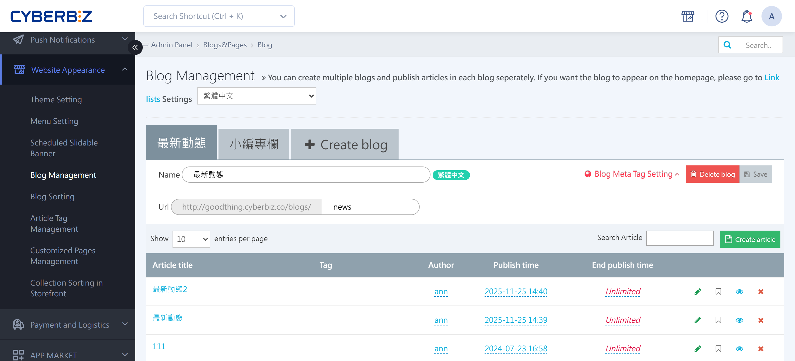
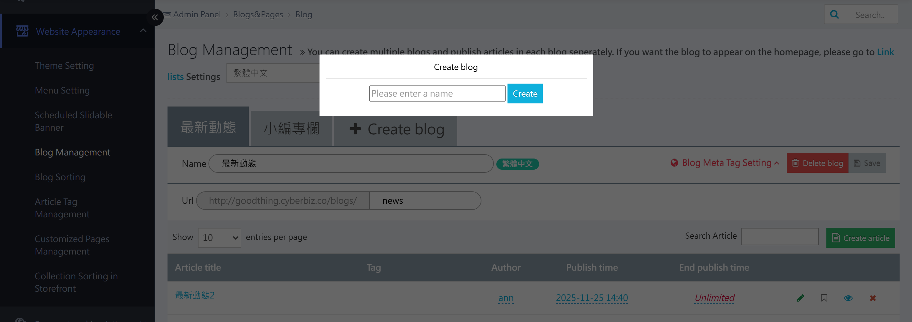
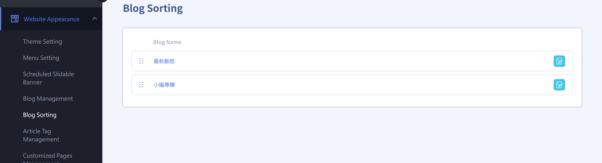
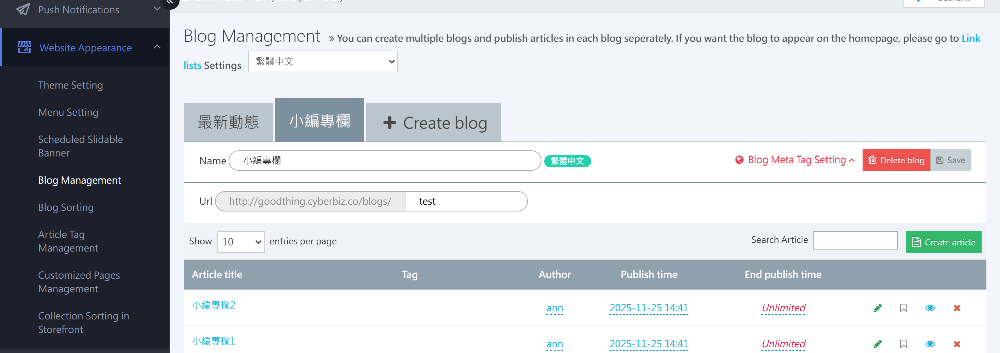
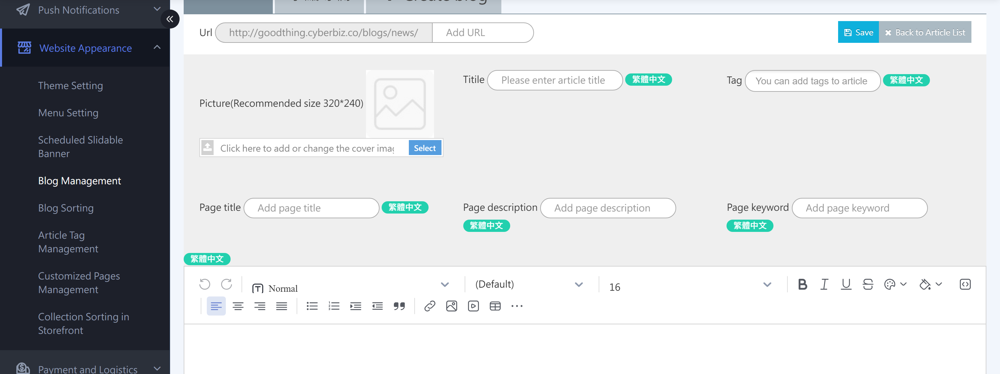
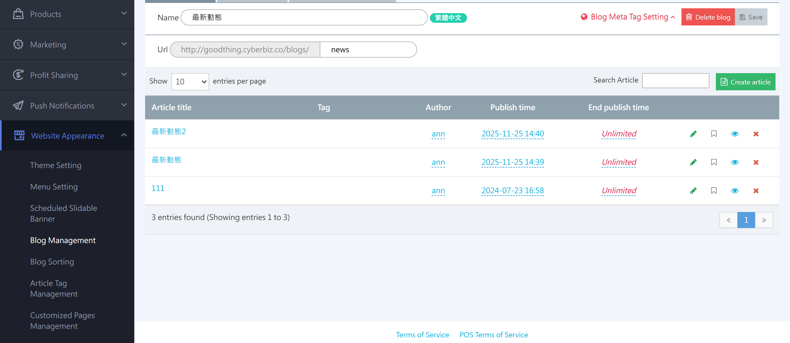
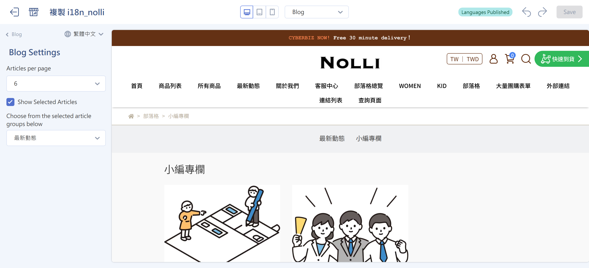
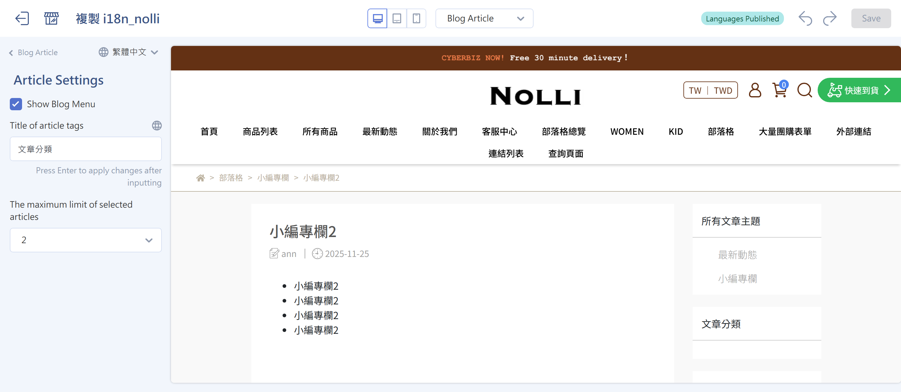
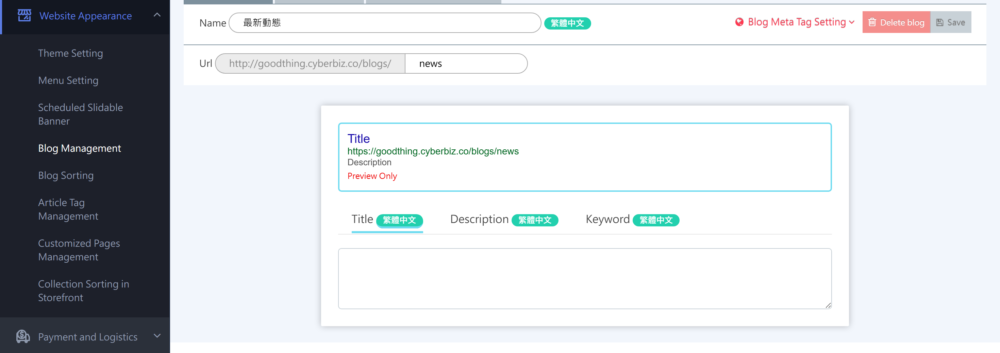
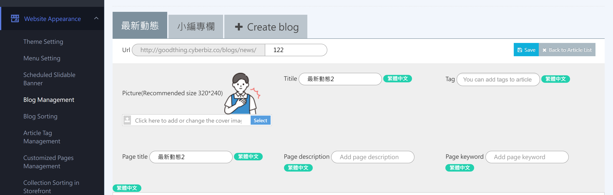

{ title="Blog Management" .hero-page }

## About Blog Management { #intro-blog-mgmt }

**Blog management** helps you write brand articles. With categories, post tags, and complete SEO settings, it also builds a content marketing foundation and increases your website's search visibility.

## Add a Blog <small>Category</small> { #operate-blog-mgmt-topics }

Think of a blog as a broad category for posts (for example, Brand News or Product Unboxing).

*   **Admin path**: Website Appearance > Blog Management (Posts/Categories).
*   **Steps**: Click the "Add Blog" button, enter a blog name (such as Brand News), and click "Add."

{ title="Add a Blog" }

## Blog Order { #operate-blog-mgmt-sort }

With custom sorting, you can flexibly change the order of blogs on your storefront and show popular categories or seasonal features to customers first.

1. **Open the settings**: Sign in to the CYBERBIZ admin and go to "Website Appearance" > "Blog Sorting."
2. **Sort manually**: Find the blog in the list, and then drag the drag icon :lucide-grip-vertical: on the left to move it up or down.
3. **Saved instantly**: When you finish, the system applies the order to your storefront automatically.

!!! tip "Layout Tip"
    Put "Latest News" or "Featured Series" first to increase visitor clicks and improve the reading experience.

{ title="Blog Order" }

## Write and Manage Posts { #operate-blog-mgmt-articles }

1.  **Add a post**: Open a blog, and then click "Add Post" at the top right.

    { title="Add a Post" }

2.  **Basic Setup**:
    *   **Edit content**: Use the [**text editor**](../code-customization/text-editor.md){ title="Edit Content with the Text Editor" }, which supports uploading images and embedding videos, tables, and other media.

        !!! warning "Don't copy content from other web pages or files and paste it directly into the editor. Use the "Paste as plain text" button (Ctrl+Shift+V), and then add images, so you don't bring in code that breaks the layout."

    *   **Storefront fields**: Upload a featured image, enter the post title, and set tags.

        { title="Post Image, Title, and Tags" }

    *   **Length limit**: Each post can have up to **65,535 characters** (counted as shown in "Source" view).
3.  **List actions**: Posts you create appear in the list. Click the icons to "**edit, pin, publish/unpublish, or delete**" them, or click "Author" and "Post Date" to change them.

        - :lucide-pencil:: Click to open the post editing page and edit the post content.
        - :lucide-bookmark:: Click to pin the post (it appears as the first post on the storefront).
        - :lucide-eye:: Publish (shown on the storefront) or unpublish (hidden from the storefront) the post.
        - :lucide-x:: Delete the post.

        !!! tip "Click a post title in the list to go straight to that post's storefront page."

        { title="Post List Actions" }

## Post Tag Management { #operate-blog-mgmt-tags }

[:lucide-tag:{ title="Available Plans" }](../../../resources/conventions#適用方案){ title="Icon Conventions" } | Enterprise

Tags help readers find related topics faster.

*   **Admin path**: Website Appearance > Post Tag Management.
*   **How it works**: Add post tag groups, and use this feature to add posts to specific tags **individually or in bulk**, or remove posts from tag groups.

    { title="Post Tag Management" }

    !!! info "For detailed steps on tag groups, see [Custom Product Category Collections](../../products/categories-and-tags/custom-collections.md){ title="Set Up Custom Product Category Collections" }."

- **Where it appears on the storefront**:

    { title="Where Tags Appear on the Storefront" }

## Storefront Display and Page Settings { #operate-blog-mgmt-storefront }

### Blog Page <small>Summary Page</small> { #operate-blog-mgmt-list }

The blog page shows summaries of multiple posts.

{ title="Blog Page on the Storefront" }

You can adjust how the blog looks depending on your theme (drag-and-drop theme or default theme):

=== ":lucide-layout-dashboard: Drag-and-Drop Theme"

    - **Admin path**: "Website Appearance" > "Theme Management" > "Theme Setting."
    - **Steps**: Choose **Blog Page** > click **Blog Settings** in the left menu.
    - **Display settings**:
        - **Posts per page**: Set how many posts appear on each page so the page length suits your readers.
        - **Show featured posts**: When selected, specific featured posts appear at the bottom of the blog page to highlight popular or important content.
        - **Featured post group**: Choose the group that supplies the featured posts to show.

    { title="Blog Page Settings - Drag-and-Drop Theme" }

=== ":lucide-layout-grid: Default Theme"

    - **Admin path**: "Website Appearance" > "Theme Management" > "Theme Setting."
    - **Steps**: Click to expand the **Blog** settings.
    - **Display settings**:
        - **Show featured posts**: When selected, specific featured posts appear at the bottom of the blog page to highlight popular or important content.
        - **Featured post group**: Choose the group that supplies the featured posts to show.

    { title="Blog Page Settings - Default Theme" }

---

### Blog Post Page <small>Single Post</small> { #operate-blog-mgmt-article }

Set the layout content and choose whether to **show the right sidebar** to create a layout that's easy to read.

{ title="Blog Post Page on the Storefront" }

You can adjust how it looks depending on your theme (drag-and-drop theme or default theme):

=== ":lucide-layout-dashboard: Drag-and-Drop Theme"

    - **Admin path**: "Website Appearance" > "Theme Management" > "Theme Setting."
    - **Steps**: Choose **Blog Post Page** > click **Blog Post Settings** in the left menu.
    - **Display settings**:
        - **Show right sidebar**: When selected, a sidebar appears to the right of the post, including **all post (blog) categories**, the **post tag section**, and **latest posts**.
        - **Post tag section title**: Set the title text shown for the post tag section.
        - **Maximum featured posts**: Click to expand the menu and set the maximum number of featured posts shown.

    { title="Post Page Settings - Drag-and-Drop Theme" }

=== ":lucide-layout-grid: Default Theme"

    - **Admin path**: "Website Appearance" > "Theme Management" > "Theme Setting."
    - **Steps**: Click to expand the **Blog** settings.
    - **Display settings**:
        - **Show right sidebar**: When selected, a sidebar appears to the right of the post, including **all post (blog) categories**, the **post tag section**, and **latest posts**.
        - **Post tag section title**: Set the title text shown for the post tag section.
        - **Maximum featured posts**: Click to expand the menu and set the maximum number of featured posts shown.
        - **Posts per page**: Click to expand the menu and set the number of posts shown per page.

    { title="Post Page Settings - Default Theme" }

## SEO and Shared Image Settings { #operate-blog-mgmt-seo }

### Meta Tags { #operate-blog-mgmt-meta }

You can set the **page title, description, and keywords** separately for a "blog" or a "single post." This helps increase search engine visibility.

!!! warning "Keyword Notes"
    - Separate multiple keywords with half-width commas ( , ). Correct example: `womenswear,summer arrivals,dresses`.
    - Keywords do not appear on the storefront.

- **Blog**: Sign in to the admin and go to **Website Appearance** > **Blog Management** > choose a **Blog** > **Blog Meta Tags Settings**.

    { title="Blog Meta Tags Settings" }

- **Single post**: Sign in to the admin and go to **Website Appearance** > **Blog Management** > choose a **Blog** > **Add Post**, or click the edit button :lucide-pencil: in the post list to open the editing page.

    { title="Post Meta Tags Settings" }

---

### Shared Link Image <small>OG Image</small> { #operate-blog-mgmt-og }

The image you set for a blog or post is used both as the cover on your storefront and as the thumbnail when the link is shared to Facebook or LINE, making shared content look more professional.

For related settings, see [How to Set the Shared Link Thumbnail for Blog Posts](../site-settings/setup-og-image.md#operate-og-image-blog){ title="Set Up the Shared Link Thumbnail (OG Image)" }.

## FAQ { #faq-blog-mgmt }

??? quote "Is there a length limit for each post?"

    Yes. Each post can have up to **65,535 characters** (counted as shown in "Source" view).

??? quote "Do I have to pay for post tag management?"

    Post tag management is available only on the **Enterprise** plan. If your plan doesn't support it, add tag keywords to your post content manually instead.

??? quote "How do I make a post appear at the top of the blog page?"

    In the post list, click the :lucide-bookmark: icon to pin the post to the top of the blog page.
