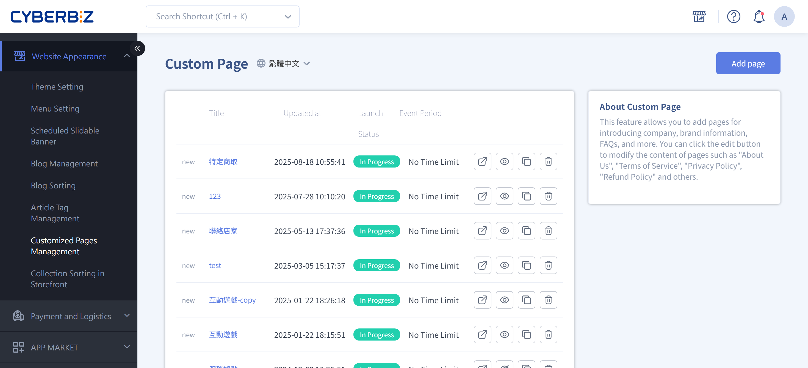{ .hero-page }

## About Custom Pages { #intro-custom-pages }

**Customized Pages Management** lets you create standalone content pages beyond product and collection pages. Use them for company profiles, brand stories, and FAQs, or for informational and legal content such as terms of service, privacy policies, and return and exchange policies.

Each custom page has its own URL (in the format `your-domain/pages/url-suffix`). You decide whether to make it public, and you can add the URL to menus, member pages, or other pages for customers to visit.

## Page Overview { #overview-custom-pages }

Custom pages come in two editing types, depending on the theme your store uses. Both share the same list actions (go to page, public/private, copy, delete). They differ only in how you edit content:

| Page type | Label in list | How you edit content | Scheduling |
| :-- | :-- | :-- | :-- |
| New (drag-and-drop) | Labeled "new" | Opens the theme editor, where you design the layout with drag-and-drop "blocks" | Supported. Set publish/unpublish times in the editor |
| Standard (text) | No label | Opens the edit page, where you write in the text editor on the "Content Description" tab | Not supported. Always shown indefinitely |

!!! info "Tip"
    You don't choose the type yourself. The system sets it based on your current theme. Pages labeled **new** in the list are drag-and-drop pages. When you click a page title, the system takes you to the matching editing screen.

---

## Steps { #operate-custom-pages }

The sections below cover common scenarios. Start every task from "Website Appearance" > "Customized Pages Management" in the admin.

### Add a Custom Page { #operate-custom-pages-create }

1. **Open Customized Pages Management:** In the admin, go to "Website Appearance" > "Customized Pages Management."
2. **Add page:** Click the **Add page** button at the top right of the page.
3. **Name the page:** In the pop-up window, enter a name in the "Page Name" field (this name is mainly for identifying the page in the admin), and then click Create.
4. **Start editing:** After you create the page, click its title to edit it and design the content based on your page type (see [Edit Page Content](#operate-custom-pages-edit)).

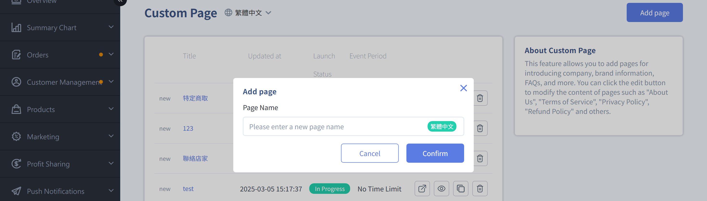

---

### Edit Page Content { #operate-custom-pages-edit }

Click a page title in the list to edit it. See the tab that matches your page type:

=== "New (Drag-and-Drop) Pages"
    For pages labeled **new** in the list, clicking the title opens the **theme editor**, where you build the layout from "blocks."

    1. **Add blocks:** In the editor, click **"Add Block"** and choose a block from the list (such as a carousel, image and text, collapsible content, or custom HTML). For the available blocks, see [Custom Page Blocks Reference](../references/custom-pages-blocks.md#reference-custom-pages-blocks){ data-preview }.
    2. **Edit block content:** Click a block you added, and enter images, text, links, and other content in the settings panel on the right.
    3. **Reorder:** Drag blocks up or down to arrange the layout you want.
    4. **Set a schedule (optional):** In the editor's "Schedule Settings," set the page's publish and unpublish times. If you don't set them, the page shows indefinitely.
    5. **Save and publish:** When you finish, save the content and make sure the page status is "Public" so customers can see it.

    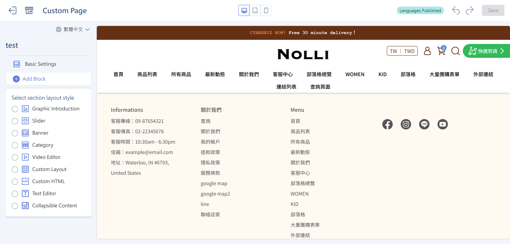

    !!! note "Note"
        For detailed drag-and-drop block steps and examples for each block, see [Drag-and-Drop Theme Site Settings](../theme-and-layout/theme-editor.md){ title="Drag-and-Drop Theme Site Settings" }.

=== "Standard (Text) Pages"
    For pages without the "new" label, clicking the title opens the edit page, which has two tabs at the top: "Basic Settings" and "Content Description."

    **Basic Settings tab**

    1. **Custom page name (required):** Enter the page name.
    2. **Custom page URL (required):** Enter the URL suffix. The system adds the prefix `your-domain/pages/` to form the full URL.
    3. **SEO Setting:** Fill in "Page Title," "Page Description," and "Page Keywords" to help the page show up in search engines.
    4. Click **Save** to finish.

    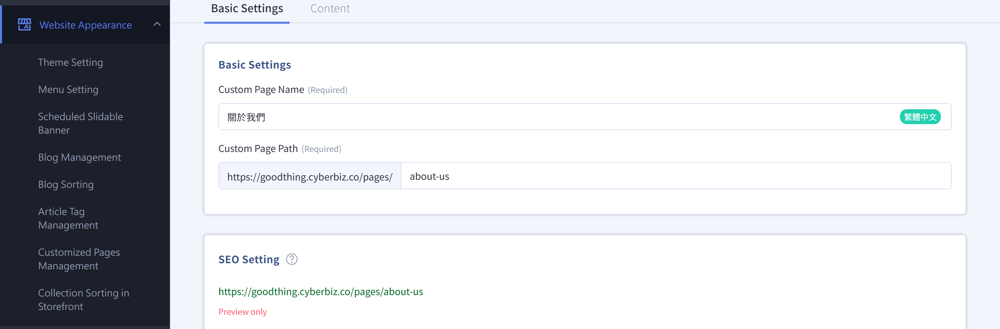

    **Content Description tab**

    1. Switch to the "Content Description" tab and write the page content in the text editor.
    2. The editor supports bold, headings, bulleted lists, links, images, videos, tables, and more. You can also switch to **"Source Code"** to edit the HTML directly.
    3. Click **Save** to finish. To discard unsaved changes, click **Cancel changes** to revert to the last saved content.

    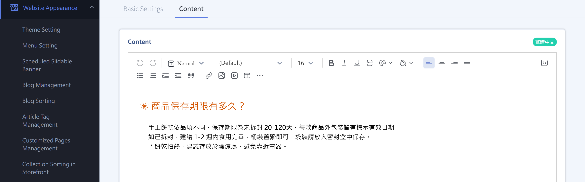

---

### Publish or Unpublish a Page { #operate-custom-pages-publish }

A new page isn't necessarily public by default. You can change its visibility anytime:

1. **From the list:** In the custom page list, click the page's visibility icon to switch between "Public" and "Private."
2. **From the edit page:** After you open the page for editing, you can also click **:lucide-eye: "Public" / "Private"** at the top.
3. **Check the storefront:** Click **:lucide-external-link: "Go to Page"** to open the live storefront page in a new tab and check how it looks.

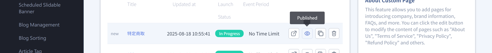

!!! warning "Important"
    Setting a page to "Public" only makes its URL accessible. It doesn't add the link to your website menu automatically. For customers to find the page on your storefront, also add the link to a menu or the navigation bar (see [Next Steps](#next-steps-custom-pages).

---

### Copy a Page { #operate-custom-pages-duplicate }

To make a page with a similar layout, copy an existing page and edit it:

1. Find the page you want to copy in the list and click the **Copy** icon.
2. The system creates a new page with the same content.
3. Click the new page's title, change its name, URL, and content, and then save.

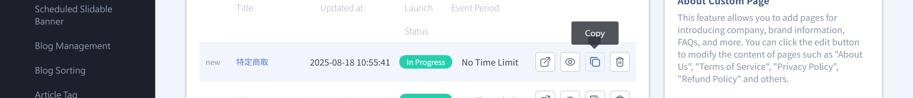

---

### Delete a Page { #operate-custom-pages-delete }

1. Find the page you want to delete in the list and click the **Delete** icon.
2. A confirmation window appears, asking "Are you sure you want to delete "page name"?" with the reminder **Cannot be recovered after deletion.**
3. After you confirm, the page is permanently deleted.

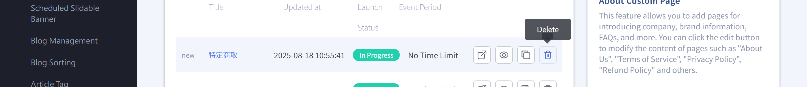

!!! warning "Important"
    Once you delete a custom page, it **can't be recovered**. Before deleting, make sure the page is no longer in use, or copy its content as a backup first.

---

### Edit Multilingual Content { #operate-custom-pages-multilang }

If your store has multiple languages turned on, you can enter content in each language for the same page:

1. **Save your current changes first:** Save the content you're editing before switching languages. Otherwise, the system shows "Please save your changes before editing other languages."
2. **Switch languages:** Click the **:lucide-globe: language** icon on the page and choose the language to edit.
3. **Enter content in that language:** Fill in the page name, URL, and content for that language, and then save. Each language's content is saved separately.

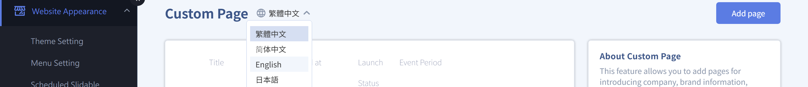

---

## Important Rules and Limitations { #specs-custom-pages }

- **Your theme sets the page type:** New (drag-and-drop) pages are designed with blocks in the theme editor. Standard (text) pages are written in the text editor. You can't switch types yourself.
- **Deletion can't be undone:** After you delete a custom page, its content isn't kept. Delete with care.
- **Only new pages support scheduling:** Publish/unpublish scheduling applies only to new (drag-and-drop) pages. Standard text pages always show indefinitely.
- **The URL prefix is fixed:** Custom page URLs always start with `your-domain/pages/url-suffix`. You can customize only the suffix.
- **Public doesn't mean it's in the menu:** After you make a page public, you still need to add it to a menu or the navigation bar for customers to find it on the storefront.

---

## Next Steps { #next-steps-custom-pages }

- :lucide-menu:{ .lg }  
  [__Set Up Menus and the Navigation Bar__](../navigation/setup-menus-navigation.md)  
  New pages don't appear on the storefront automatically. Go to "Menu Setting" and add the page URL to the header or footer menu.

- :lucide-layout-dashboard:{ .lg }  
  [__Drag-and-Drop Theme Site Settings__](../theme-and-layout/theme-editor.md){ title="Drag-and-Drop Theme Site Settings" }  
  Learn the detailed settings and examples for each block on new drag-and-drop pages.

- :lucide-globe:{ .lg }  
  [__Multilingual Settings__](../../website-management/setup-multi-language-and-multi-currency.md)  
  After you turn on multiple languages, you can enter content in each language for custom pages.

- :lucide-square-code:{ .lg }  
  [__Embed a Google Form__](embed-google-form-custom-page.md)  
  Embed a form with the "Custom HTML" block. Useful for bookings, inquiries, and warranty registration.

---

## FAQ { #faq-custom-pages }

??? quote "Why can't I find the link on my storefront after saving the page?"
    { #faq-custom-pages-not-shown-in-nav }
    After you save a custom page and make it public, its URL becomes accessible, but the page **doesn't appear automatically** in your website menu.

    Go to "Website Appearance" > "Menu Setting" and add the page to your header or footer menu so customers can find it on the storefront.

??? quote "Can the page URL (suffix) use Chinese characters?"
    { #faq-custom-pages-slug-language }
    Technically yes, but we **strongly recommend using English letters or numbers** (for example, `about-us`).

    - English URLs don't turn into long, garbled strings when shared on social media (such as LINE or Facebook).
    - They're friendlier to Google search (SEO).

??? quote "Why do some pages open drag-and-drop blocks while others open the text editor?"
    { #faq-custom-pages-version-difference }
    It depends on the theme your store currently uses.

    - Pages labeled **new** in the list are drag-and-drop pages. Clicking them opens the theme editor, where you design with blocks.
    - Pages without a label are standard text pages. Clicking them opens the edit page, where you write in the text editor on the "Content Description" tab.

??? quote "How do I set a page's publish and unpublish times?"
    { #faq-custom-pages-schedule }
    Scheduling applies only to **new (drag-and-drop)** pages. Click the page to open the theme editor, and set the publish and unpublish times in "Schedule Settings." If you don't set them, the page shows indefinitely. Standard text pages don't have scheduling, and their status is always "Indefinite."

??? quote "Can I recover a page after deleting it?"
    { #faq-custom-pages-delete-irreversible }
    No. After you delete a custom page, its content **can't be recovered**. We recommend copying the page or saving a backup of its content before deleting.

??? quote "I changed colors or styles in the text editor, but the storefront looks different. Why?"
    { #faq-custom-pages-paste-format }
    This usually happens when you paste text directly from Word or another web page, which brings in hidden style code.

    We recommend pasting the text again as plain text to clear the original formatting, and then restyling it with the editor toolbar. If needed, switch to "Source Code" to check for and remove extra code.

??? quote "Why am I asked to save every time I switch languages?"
    { #faq-custom-pages-multilang-save }
    To prevent you from losing unsaved changes, the system requires you to **save changes in the current language first** before switching to edit another language. Click "Save," and then switch languages to keep editing.

??? quote "How do I make a custom page visible only to members?"
    { #faq-custom-pages-member-only }
    Custom pages don't have access restrictions. If you want content to be for members only (such as VIP-exclusive offer details), don't put the link in your website navigation bar. Instead, enter the URL in **Customer Management > Member Level Settings > Member Level Description Link** so only customers signed in to their member accounts see the link.

??? quote "Images on my page load slowly or look blurry. How can I improve them?"
    { #faq-custom-pages-image-optimize }

    - **Resolution**: Make sure the image width meets the block's requirements.
    - **File size**: Keep each image **under 500 KB**. You can compress images with tools such as TinyPNG before uploading so your pages load quickly for customers.

---

## References { #reference-custom-pages }

- [Custom Page Blocks Reference](../references/custom-pages-blocks.md)

<!---->
<!-- --- -->
<!---->
<!-- Create, set up, and manage custom pages, including basic settings, block design, and how they display on the storefront. -->
<!-- { .subtitle } -->
<!---->
<!-- ## About Custom Pages -->
<!---->
<!-- **Custom Pages** lets merchants flexibly adjust page content and block structure. It's often used to create company profiles, brand stories, and Q&A pages, or to edit legal pages such as terms of service, privacy policies, and return and exchange policies. -->
<!---->
<!-- Below are detailed steps and tutorials for custom pages: -->
<!---->
<!-- ## Setup Path and Adding Pages -->
<!---->
<!-- !!! warning "Version Limitations" -->
<!-- 	Merchants who joined before 2023 may have both new and legacy pages. Note that **legacy pages can't be recovered once deleted** (if you still want to use a legacy page, you can only edit it). -->
<!---->
<!-- 1. **Admin path**: Sign in to the CYBERBIZ admin and go to **Website Appearance > Customized Pages Management**. -->
<!-- 2. **Add page**: Click the **Add page** button at the top right of the page and name the page (this name is mainly for identification in the admin). -->
<!-- 3. **Basic settings**: -->
<!--     - **Change the page URL (slug)**: You can customize the page's URL suffix. -->
<!--     - **Set a schedule**: Choose "No scheduled time" or set specific "start/end times." -->
<!--     - **Set page SEO**: Edit the **meta tags** (page title, description, keywords) to help the page rank in search engines. -->
<!---->
<!-- 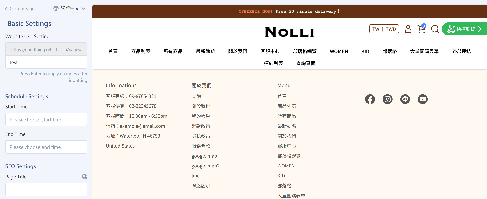 -->
<!---->
<!-- ## Page Block Design -->
<!---->
<!-- After you open the page for editing, use **Add Block** to add different design modules and build a rich layout: -->
<!---->
<!-- - **Media and ads**: Includes **carousels**, **banner ads**, **image and text**, and **video settings**. -->
<!-- - **Product display**: Add a **product collection** showcase or a **featured product** block. -->
<!-- - **Text content**: -->
<!--     - **Text Editor**: Good for writing detailed article content. -->
<!--     - **Collapsible content**: Often used for a website **FAQ** or shopping notes. The text expands when clicked. -->
<!---->
<!-- 	!!! warning "When you copy content from an outside source (such as Word or another web page) into a "Text Editor" block, always use the **Paste as Plain Text** button to avoid bringing in stray code that breaks the page layout." -->
<!---->
<!-- - **Advanced customization**: -->
<!--     - **Custom HTML**: Write your own code or paste external code, such as to [**embed a Google Form**](embed-google-form-custom-page.md){ title="Embed a Google Form in a Custom Page" }  (for bookings, inquiries, and warranty registration) or an **interactive game**. -->
<!--     - **Custom layout design**: Freely adjust the screen share and order of different media. -->
<!---->
<!-- !!! info "Learn [detailed uses and examples for each block](../theme-and-layout/theme-editor.md){ title="Design Website Layouts and Homepage Blocks with Drag-and-Drop Themes" }." -->
<!---->
<!-- 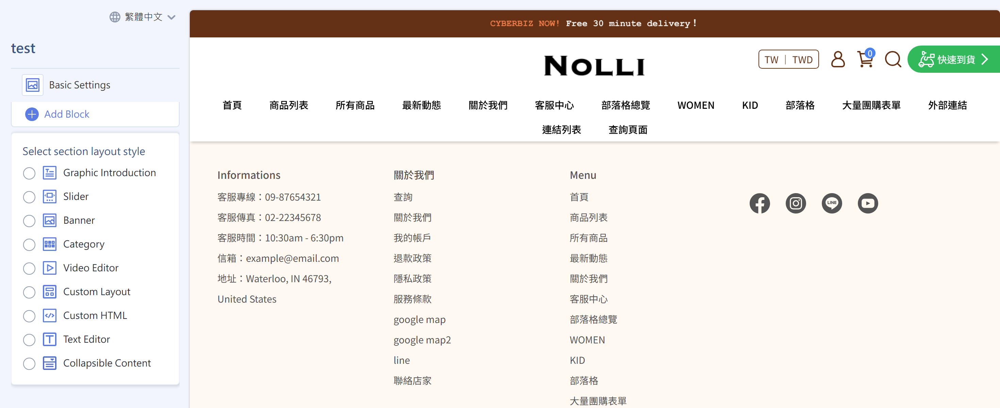 -->
<!---->
<!-- --- -->
<!---->
<!-- ## Next Steps -->
<!---->
<!-- 
 -->
<!---->
<!-- - :lucide-menu:{ .lg }    -->
<!--   [__Navigation Bar/Footer__]()      -->
<!--   After you create a page, go to "**Menu Setting**" to link it so customers can see it on the storefront. -->
<!---->
<!-- - :lucide-crown:{ .lg }      -->
<!--   [__VIP Tier Descriptions__]()   -->
<!--   You can link a custom page to the "**Membership Tier Description Link**" in "VIP Settings" so members can view tier benefits on their account page. -->
<!---->
<!-- - :lucide-globe:{ .lg }   -->
<!--   [__Multilingual Settings__]()   -->
<!--   If your store has multiple languages turned on, find the **:lucide-globe: icon** on the edit page, switch languages, and enter the page content in that language. -->
<!---->
<!-- - :lucide-file-code:{ .lg }   -->
<!-- [__Embed a Google Form in a Custom Page__](embed-google-form-custom-page.md){ title="Embed a Google Form in a Custom Page" }   -->
<!--   Use the "Custom HTML" block to embed a Google Form, and manually change the `width` attribute in the embed code to `100%` so the form fits both mobile and desktop screen widths. -->
<!---->
<!-- 
 -->
<!---->
<!-- ## FAQ -->
<!---->
<!-- ??? quote "Why did I save the page but can't find the link on my storefront?"  -->
<!-- 	Custom pages **don't appear automatically** in your website navigation bar after you save them. Go to **Website Appearance > Menu Setting** and add the page to your "Header Menu" or "Footer Menu." -->
<!---->
<!-- ??? quote "Can a custom page URL (slug) use Chinese characters?"  -->
<!-- 	Technically yes, but we **strongly recommend using English letters or numbers** (for example, `about-us`). English URLs don't turn into long, garbled strings when shared on social media (such as LINE or Facebook), and they're friendlier to Google search (SEO). -->
<!---->
<!-- ??? quote "Why did I change colors in the "Text Editor" block but the storefront looks different?"  -->
<!-- 	This usually happens when you paste text directly from Word or another web page, which brings in hidden style code. -->
<!---->
<!-- 	**Solution**: Click the "Clear Formatting" icon in the editor, or use the "Paste as Plain Text" button to enter the text again, and then recolor it with the toolbar. -->
<!---->
<!-- ??? quote "How do I make a custom page "members only"?"  -->
<!-- 	Custom pages don't have access restrictions. If you want content to be for members only (such as VIP-exclusive offer details), don't put the link in your website navigation bar. Instead, enter the URL in **Customer Management > Member Level Settings > Member Level Description Link** so only customers signed in to their member accounts see the link. -->
<!---->
<!-- ??? quote "Images on my page load slowly or look blurry. How can I improve them?"  -->
<!---->
<!-- 	- **Resolution**: Make sure the image width meets the block's requirements. -->
<!-- 	- **File size**: Keep each image **under 500 KB**. You can compress images with tools such as TinyPNG before uploading so your pages load quickly for customers. -->
