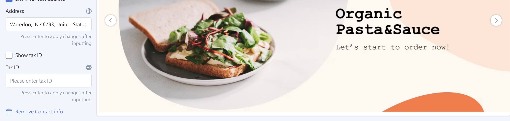
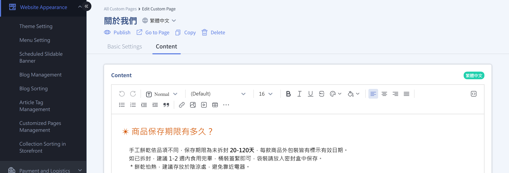
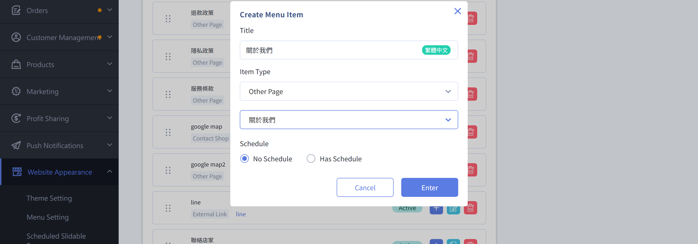

{ .hero-page }

## About Business Information Disclosure { #intro-business-disclosure }

Under Ministry of Finance regulations in effect since January 1, 2023, businesses that sell goods or services online must clearly show their "business name" and "tax ID number" on their web pages so consumers can identify them.

In CYBERBIZ, this disclosure has two parts:

- **Admin company information**: Enter basic information such as your full company name and tax ID number in "General Settings." This is the data source for the system and storefront display.
- **Clear storefront disclosure**: Show your business name and tax ID number prominently on your website so consumers can clearly see them, meeting the "prominent location" requirement.

!!! info "Tip"
    The tax ID number in admin "General Settings" and the one in the footer's "Contact Information" are two separate fields. Fill in both. For details, see [Important Rules and Limitations](#specs-business-disclosure).

## Prerequisites and Limitations { #prerequisites-business-disclosure }

Before you start, check the following:

- [x] **Admin permissions**: You need admin permissions for "General Settings" and "Website Appearance."
- [x] **A theme is applied**: The footer disclosure is set on your website theme, so make sure you have applied and published a website theme.

!!! plan "Plans / Requirements"
    - Entering company information in "General Settings" and setting up the disclosure in the footer's "Contact Information" are **available on all plans**, with no extra activation needed.
    - To adjust the footer with the **drag-and-drop theme** visual editor, your published website theme must be a "drag-and-drop theme" (included in most paid plans). Merchants using the "default theme" can complete the disclosure in "Website Settings."

## Steps { #operate-business-disclosure }

The disclosure covers two scenarios. Complete them in order.

### Fill in Basic Company Information { #operate-business-disclosure-company-info }

First fill in your company information in the admin as the source for the system and storefront display.

1. **Open General Settings:** Go to "Website Feature Settings" > "General Settings" in the admin.
2. **Enter the shop name:** In the "About Your Website" section, enter your brand or company name in "Shop Name." This name appears in the web page title.
3. **Enter company contact information:** In the "Company Contact Information" section, enter "Full Company Name," "Tax ID Number," "Phone," and "Full Address" in order[^a].
4. **Save:** After you confirm the information, click the Save button at the bottom of the page.

[^a]: The "Company Contact Information" section notes that "company address, phone, and other information also appear on your web pages," so the information you enter here is used for the storefront display.

- :lucide-settings:{ .lg }
  [__Set Up Basic Website Information__](../../website-management/setup-store-basic-info.md#operate-general-preferences-company-info){ title="Set Up Basic Website Information" }

---

### Show Your Name and Tax ID Number on Your Website { #operate-business-disclosure-footer }

To meet the "prominent location" requirement, put your business name and tax ID number in your website footer so consumers can see them at the bottom of every page. The footer's "Contact Information" block has a separate "Show Tax ID Number" toggle and a "Tax ID Number" field. Other fields you can show are listed in the [Footer Contact Information Fields Reference](../references/business-disclosure-footer-fields.md#reference-footer-contact){ data-preview }.

=== "Drag-and-Drop Theme"

    1. **Open the theme editor:** Go to "Website Appearance" > "Theme Management," and click the published drag-and-drop theme to edit it.
    2. **Open footer contact information:** In the editor, click "Footer" at the bottom of the page and find the "Contact Information" settings block.
    3. **Turn on and enter the tax ID number:** Select "Show Tax ID Number" and enter your tax ID number in the "Tax ID Number" field.
    4. **Complete other contact details:** Also make sure fields such as "Address" and "Phone" are filled in and set to show.
    5. **Save and publish:** After you save, the information appears in the footer at the bottom of your website.

    

    ??? tip "Show Your Business Name in the Footer Too"

        The footer's "Contact Information" block has only a tax ID number field, not a company name field. To also show your full business name in the footer, add a "Custom Text" block to the footer:

        1. In the footer editing area, click to add a "Custom Text" block.
        2. Enter your business name (full company name) in the "Title" or text content.
        3. After you save, the name appears in the footer alongside the tax ID number for a more complete disclosure.

        

=== "Default Theme"

    The default theme footer has no "Show Tax ID Number" toggle. Instead, create a separate page for the disclosure and add that page to your website navigation bar:

    1. **Create a disclosure page:** Go to "Website Appearance > Customized Pages Management," click "Add Page," enter a page name (for example, "About Us"[^b]), and enter your business name, tax ID number, and contact information in the content.

        

    [^b]: If you already have a related page (such as "About Us"), click it in Customized Pages Management to edit it and add your business name and tax ID number.

    2. **Add it to the navigation bar:** Go to "Website Appearance > Menu Setting > Main Menu" and click "Add Link." Enter a link name, choose "Custom Page" as the link type, and select the page you created. After you add the page to the navigation bar, customers can click it on the storefront.

        

    3. **Check the storefront:** After you save, customers can open the page from the storefront navigation bar (for example, "About Us") and see your business name and tax ID number.

        

---

## Important Rules and Limitations { #specs-business-disclosure }

- **The two tax ID numbers are separate:** The tax ID number in admin "General Settings" is for system operations (such as e-invoices). The tax ID number in the storefront footer's "Contact Information" is disclosure text shown to consumers. Neither fills in the other, so be sure to fill in both.
- **The footer must be set to show it:** Even after you enter the tax ID number, you must select "Show Tax ID Number" in the footer for it to appear on the storefront.
- **Keep information consistent:** If you apply for third-party payment or other services, make the website name or company name in the admin match your application form, and include full contact details (phone, address, email) in the footer to help the review.
- **Disclosure for your own website only:** If you use CYBERBIZ only for your own online store, clearly showing your business name and tax ID number on the website is enough. The extra account information required when selling on third-party platforms does not apply.
- **Japan website requirements:** If you run a Japan website, you must also create a dedicated page under [Japan's Act on Specified Commercial Transactions](jp-legal-compliance-page.md) that shows the seller's name, the person in charge, location, and contact information, and link that page in the footer.

---

## Next Steps { #next-steps-business-disclosure }

- :lucide-palette:{ .lg }  
  [__Apply and Switch Website Themes__](../theme-and-layout/apply-and-switch-theme.md)  
  Change or switch your website theme to adjust its overall visual style.

- :lucide-cookie:{ .lg }  
  [__Set Up a Cookie Consent Banner__](../code-customization/setup-cookie-consent-banner.md){ title="Set Up a Cookie Consent Banner" }  
  Generate a cookie consent banner with a third-party tool to go with your privacy policy page.

---

## FAQ { #faq-business-disclosure }

??? quote "I entered the tax ID number, but it doesn't show in the storefront footer."
    { #faq-business-disclosure-not-shown }
    The tax ID number in the footer must be set to show separately. In your website theme's footer "Contact Information" settings, make sure "Show Tax ID Number" is selected, enter the number in the "Tax ID Number" field, and save.

    - Make sure you edited the currently "published" theme, not an unpublished one.
    - Remember to save after your changes (and publish again for drag-and-drop themes) so the storefront updates.

??? quote "Is the tax ID number in General Settings the same as the one in the footer?"
    { #faq-business-disclosure-two-fields }
    No. They are two separate fields:

    - The tax ID number in "General Settings" is for system operations, such as issuing e-invoices.
    - The tax ID number in the footer's "Contact Information" is disclosure text shown to consumers.

    Neither fills in the other. Fill in both to meet both system and legal disclosure needs.

??? quote "Which field should I use for the business name?"
    { #faq-business-disclosure-merchant-name }
    The "Full Company Name" in admin "General Settings" is your business's (company's) official name. The "Shop Name" is the brand name shown in the web page title. Show the full company name in the footer alongside the tax ID number as your publicly disclosed business name.

---

## References { #reference-business-disclosure }

- [Footer Contact Information Fields Reference](../references/business-disclosure-footer-fields.md)

