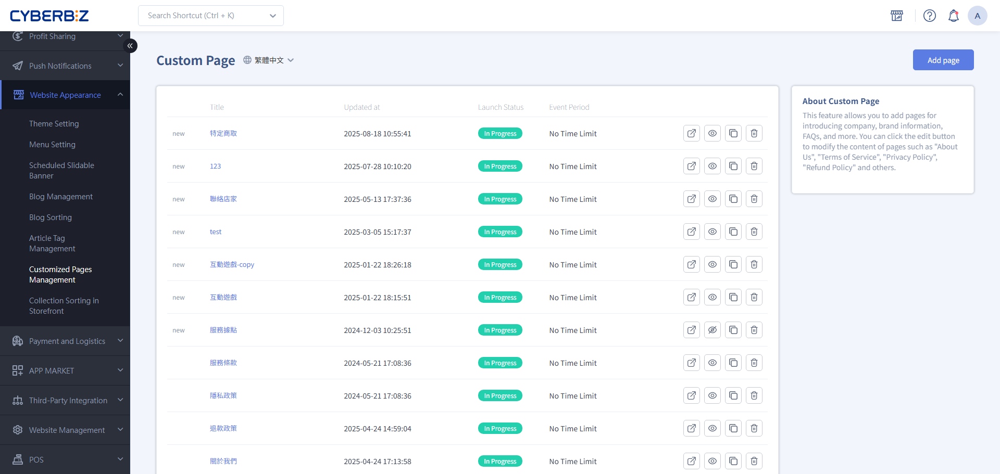
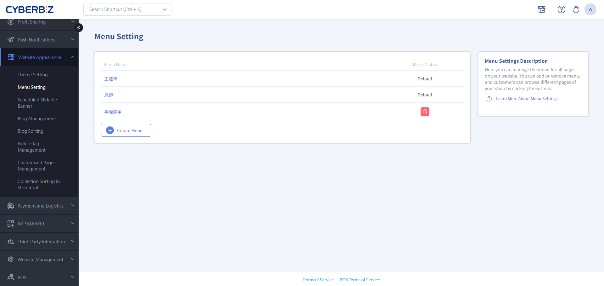
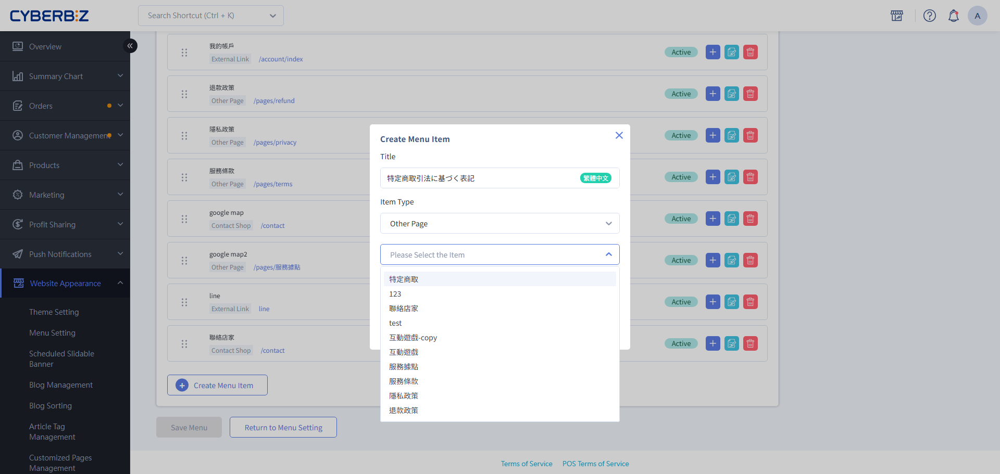

# Create a Specified Commercial Transactions Act Page for Japan Websites

Under Japan's Act on Specified Commercial Transactions, merchants on the Japan site must create a legally required disclosure page with the necessary business information to keep the website operating legally.
{ .subtitle }

[:lucide-layers:{ title="Available Products" }](../../resources/conventions#適用方案) | Cross-Border Ecommerce (Japan Site)
[:lucide-tag:{ title="Available Plans" }](../../resources/conventions#適用方案) | Pro / Business
{ .doc-badge }

## Before You Start { #prerequisites-jp-legal }

### Core Compliance Requirements { #prerequisites-jp-legal-rules }

- **Legally required**: Under Japan's Act on Specified Commercial Transactions (特定商取引に関する法律), **every online store must disclose its business information**. If the page is missing or the information is inaccurate, you may face administrative penalties or have your payment services terminated.
- **Consumer protection**: The page makes transactions transparent, protects shoppers' right to know when buying remotely, and builds a safe shopping environment.

### Maintenance Essentials { #prerequisites-jp-legal-maintain }

- **Single language**: Write the entire page in **Japanese**.
- **Keep it current**: If your company address, customer service phone number, or return rules change, update this page right away.

## Step 1: Prepare the Required Information { #operate-jp-legal-prepare }

Prepare the following information in Japanese in advance. Some fixed items (such as the seller) must use the details of CYBERBIZ JAPAN, the Japan branch of CYBERBIZ.

| Type | Japanese field | Description | What to enter |
| :--- | :--- | :--- | :--- |
| **販売業者 (Seller)** | **会社名** | Seller name | Enter `CYBERBIZ JAPAN株式会社` |
| | **所在地** | Company address | Enter `東京都港区三田1丁目2番18号TTDビル` |
| | **代表者名** | Representative | Enter `Su, Ji-Ming` |
| **サイト運営者 (Website Operator)** | **会社名** | Website operating company | Enter your company name |
| | **所在地** | Operating address | Enter your company address and postal code |
| | **運営責任者** | Person responsible for operations | Enter the name of the person responsible for running your website |
| **サイト運営者の連絡先 (Website Operator Contact Information)** | **メールアドレス** | Email | Enter your official customer service email |
| | **お問い合わせフォーム** | Customer service contact form | Enter the link to your **Contact Us** page |
| | **電話番号** | Phone number | Enter the phone number with the country code (for example, `886-2-8751-8588`) |
| | **サイトURL** | Homepage URL | Enter your website link |
| | **営業時間** | Business hours | Enter your business hours (for example, `10:00–19:00 (Mon–Fri, excluding weekends and Taiwan public holidays)`) |
| **販売価格** | **販売価格** | Selling price | State how prices are shown (tax included or excluded) |
| 代金の支払方法・時期 | **支払方法** | Payment methods | Enter the payment methods you accept (for example, `Credit card`) |
| | **支払時期** | Payment timing | Enter when payment is charged (for example, `Charged when the order is placed`) |
| 商品のお届け時期 | **商品のお届け時期**| Delivery time | Describe the shipping schedule after an order is placed (for example, `◯–◯ business days`) |
| 返品について | **返品について** | Return policy | Detail the return period, restrictions, and who pays return shipping (for example, `Returns accepted within ◯ days of delivery, except opened or specified products; return shipping paid by ◯`) |

## Step 2: Create a Custom Page { #operate-jp-legal-page }

Put the information above together on a dedicated page on your website.

1. Go to **Website Appearance > Customized Pages Management**.
2. Click **Create custom page**.
    { .screenshot }
3. **Page title**: Name it `特定商取引法に基づく表記`.
4. **Add content**:
    - Add a **Text Editor** block.
        { .screenshot }
    - Enter the information you prepared as a table or a structured list.
        { .screenshot }
5. Click **Save** to finish.

## Step 3: Add the Link to the Footer { #operate-jp-legal-footer }

Make sure shoppers can quickly find this legal page from any page on your website.

1. Go to **Website Appearance > Menu Setting**.
2. Click **Footer** to start editing.
    { .screenshot }
3. Click **Create Menu Item**:
    - **Item name**: Enter `特定商取引法に基づく表記`.
    - **Link to**: Select **Other Pages**, and then select the legal page you just created.
    - **Schedule**: Select **No Schedule**.
    { .screenshot }
4. Click **Save Menu**.

