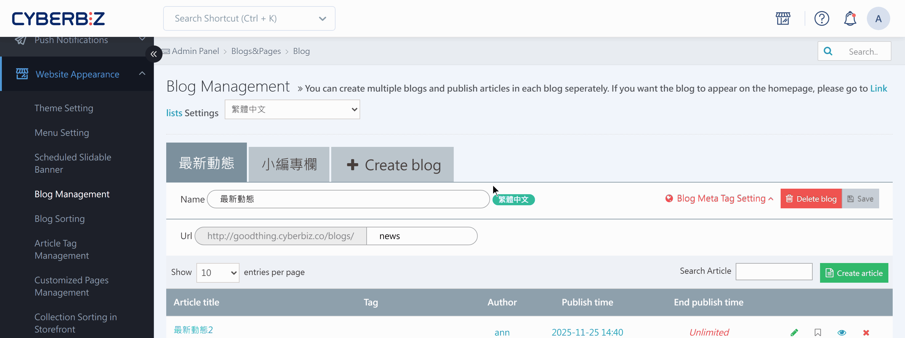

{ title="Shared Link Thumbnail Settings" .hero-page }

## About the Default Shared Link Image { #intro-og-image }

The **default shared link image (OG image)** is the thumbnail that platforms such as Facebook and LINE fetch and show automatically when you paste your website link there. A well-chosen OG image makes your brand look more professional and makes customers more likely to click the link.

Here is how to set it up for each page type:

## Thumbnail Settings by Page Type { #operate-og-image }

### Product Pages { #operate-og-image-product }

- **Path**: Sign in to the CYBERBIZ admin, go to **Products > All Products**, and click the name of the product you want to set up to open its editing page.
- **Steps**: Switch to the **Product Information** tab and upload the default link image in the **Product Image** section.
- **Automatic setting**: The system automatically uses the product's **first product image** as the shared link thumbnail.

{ title="Product Page Thumbnail Settings" }

---

### Product Collection Pages <small>Custom Categories</small> { #operate-og-image-collection }
    
- **Path**: Sign in to the CYBERBIZ admin, go to **Products > Customized Collections >**, and click the **Edit :lucide-square-pen:** button for the collection you want to set up.
- **Steps**:
	- Switch to the **Collection Description** tab and upload the image.
	- Switch to the **Image Info** tab, click **Browse Server**, and select the image you uploaded.
	- Click **Save** to apply the changes. This image serves as both the collection page visual and the shared link thumbnail.

{ title="Product Collection Thumbnail Settings" }

---

### Blog Posts { #operate-og-image-blog }
    
- **Path**: Sign in to the CYBERBIZ admin and go to **Website Appearance > Blog Management > select a post**.
- **Steps**: Select an image in the post settings. This image is used as the blog cover on the storefront and as the thumbnail when the link is shared.

{ title="Blog Post Thumbnail" }

---

### Other Website Pages / Site-Wide Settings { #operate-og-image-global }
    
- **Path**:

	<!--
	- **Standard themes**: "Website Appearance" > "Theme Management" > "Site Settings" > "Detailed Settings (Homepage Settings)" > "Default Shared Link Image (OG image)."
	-->
	
	- **Drag-and-drop themes**: Sign in to the CYBERBIZ admin and go to **Website Appearance > Theme Setting > Theme Setting > Global Settings > "Shared Image (OG Image)" in "Icon Settings"**.

- **What it does**: If a shared page is not one of the products, collections, or posts above (for example, the homepage or other pages), the general thumbnail set here is shown.

{ title="Site-Wide OG Image Settings" }

## Fix Thumbnails That Don't Update When You Share Links { #operate-og-image-cache }

If you updated an image on a page but Facebook or LINE still shows the old information when you share it, it is because the platform keeps an old cached copy.

### Update Facebook Link Information Manually { #operate-og-image-fb }

1. Make sure the new image on your page has finished updating.
2. Open the **[Facebook Sharing Debugger :lucide-external-link:](https://developers.facebook.com/tools/debug/)**, paste the link you want to update, and click "Debug."
3. If it still shows the old information, click **"Scrape Again"** to force Facebook to read the page data again.
4. After the update succeeds, post the link on Facebook again to see the correct thumbnail and information.

{ title="Scrape Again in the Facebook Debugger" }

<!--

### Update LINE Link Information Manually { #operate-og-image-line }

- Use LINE's official **[LINE Page Poker](https://poker.line.biz/)** tool: enter the URL and click "Clear" to clear the cache.

-->

## FAQ { #faq-og-image }

??? quote "Why don't I see a thumbnail when I share on LINE or Facebook even though I uploaded an image?"

	There are usually two reasons:

	1. **Cache issue**: Social platforms keep old data. See [Fix Thumbnails That Don't Update When You Share Links](#operate-og-image-cache) in this article and use the debugging tool to force an update.
	
	2. **Wrong image size**: If the image file is too large (over 8 MB) or the resolution is too low, the platform may fail to fetch it. Use the recommended specs.

??? quote "What is the recommended OG image size?"

	To make sure the image displays well without cropping on every social platform (Facebook, LINE, Instagram), use these specs:

	- **Recommended size**: 300 x 300 pixels (px).
	
	- **Aspect ratio**: 1:1.
	
	- **File format**: JPG, PNG, or GIF.
	
	- **File size**: Keep it under **1 MB** so platforms can fetch it quickly.

??? quote "What does the system show if I don't set an OG image for a product?"

	The system picks an image in this order:
	
	1. The product's **first product image**.
	
	2. If the product has no images, the OG image uploaded in **[Site-Wide Settings](#operate-og-image-global)**.
	
	3. If no site-wide image is set, the social platform picks a random image from the page (this usually looks worse, so at least complete the site-wide setting).

??? quote "Why did the product collection (custom category) image stop working in the editor?"

	If the URL is missing or the image does not display correctly when you edit the "Collection Description," check the following:
	
	* The image was first uploaded to the server successfully through the "Image Info" tab.
	
	* Avoid pasting image links directly from external websites. Always click **Browse Server** and select a file on your site to keep the link stable.

??? quote "I updated the site-wide OG image, but the homepage thumbnail is still the old one. What should I do?"

	The homepage carries the most weight, and its cache is the most stubborn. Besides using the Facebook debugger, try adding a random parameter to the end of the URL (for example, `https://yourstore.com/?v=1`) to test. If the URL with the parameter shows correctly, the cache for the plain URL is still waiting for the platform to update it automatically (usually within 24–48 hours).
