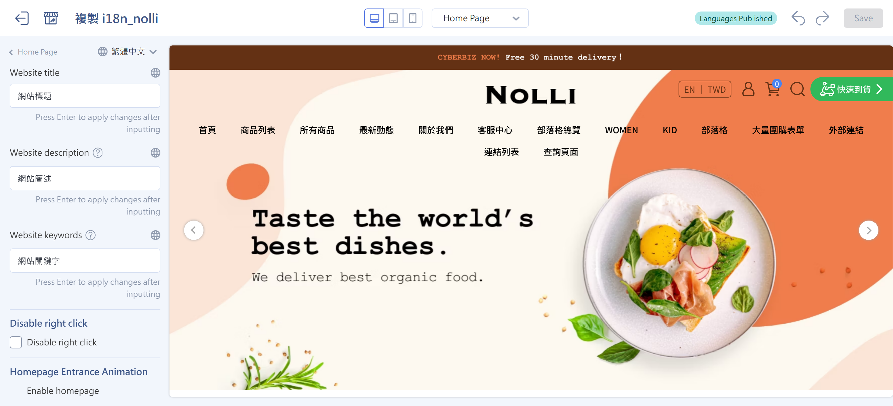

{ title="Website Title and SEO Settings" .hero-page }

## About the Website Title and SEO { #intro-site-title-seo }

What is the difference between the website title and the website description?

- **Website title (Title)**: The core name of a web page. It should include your "brand name" and "core keywords."
- **Website description (Description)**: A summary of the page content. Write copy that invites clicks and includes your main services.

## Where the Website Title Appears { #overview-site-title-placement }

These two settings mainly appear in three places:

### Browser Tabs <small>Browser Tabs</small> { #operate-site-title-browser }
    
- **What shows:** The website title (Title).
- **Purpose:** Helps users quickly recognize your brand when they have many windows open.

{ title="Browser Tab Display" }

---

### Search Engine Results Page <small>SERP</small> { #operate-site-title-serp }
    
- **What shows:** The title (large blue text) and the description (smaller gray text below it).
- **Purpose:** This area directly affects the click-through rate (CTR) of your search results.

{ title="Google Search Result Display" }

---

### Social Media Sharing <small>Social Media Sharing</small> { #operate-site-title-social }
    
- **What shows:** When the link is pasted into LINE or Facebook, the platform fetches the title and description.
- **Note:** It works even better if you set an **OG image (shared link thumbnail)**.

{ title="Social Media Sharing Thumbnail" }

- How you set and change the **website title** (TITLE) depends on your **theme type** (default theme or drag-and-drop theme).

## Steps { #operate-site-title-seo }

Here is a detailed guide to the "website title" and related SEO information in your website settings:

### Set the Basic "Shop Name" { #operate-set-site-name }

Before you change the title text, set your brand's basic name. This name is linked to the website title.

- **Admin path**: Sign in to the CYBERBIZ admin and go to **Website Management > General > Name of website**.
- **Rules**: Use no more than 15 Chinese characters or 30 English characters. By default, this name is the English string in your URL. Change it to your brand or company name so customers can recognize it.

!!! info "For detailed steps, see [How to Set the Shop Name](../../website-management/setup-store-basic-info.md#operate-general-preferences-company-info){ title="Set Up Basic Website Information" }."

---

### Change the "Website Title" <small>By Theme Type</small> { #operate-modify-site-title }

#### Default Theme <small>Standard Theme</small> { #operate-site-title-default }

With the default theme, you can set only the "website title," and you must change it in the code editor.

- **Steps**:
    1. Sign in to the CYBERBIZ admin and go to **Website Appearance > Theme Setting**.
    2. On the theme you want to edit, click **Actions > CSS/HTML Editor**.
    3. Search for and open the **`theme.liquid`** file.
    4. Find this code in the file: `{{ shop.name }} {{ page_title }}`.
- **How to change it**:
    - **Show custom text**: Delete `{{ page_title }}`, and then type the text you want to show right after `{{ shop.name }}`.

``` liquid title="theme.liquid" hl_lines="3"
<title>
  
	{{ shop.name }} Custom text
  
	404 頁面不存在 {{ shop.name }}
  
	{{ page_title }} {{ shop.name }}
  
</title>
```

!!! tip "Update Timing and Recovery"
	- **Google search results don't update right away**: A new title appears only after Google completes its next scheduled crawl and update.
	- **Code recovery**: If a change breaks your layout, use **View Previous Versions** in the editor to [roll back to an earlier version](../code-customization/restore-code-theme-editor.md#operate-restore-theme){ title="Restore Web Page Code with the Template Editor" }.

---

#### Drag-and-Drop Theme { #operate-site-title-theme }

With a drag-and-drop theme, you don't need to edit code. Enter the information directly in the visual interface.

- **Admin path**: Sign in to the CYBERBIZ admin and go to **Website Appearance > Theme Setting > Theme Setting > Global Settings**.
- **Fields**:
    - **Website title**: Enter a custom title. If you don't need an extra title, leave it blank.
    - **Website description**: Write a brand introduction that fits your needs.
    - **Website keywords**: This field does not appear on the page, but it helps search engines find your products.

{ title="Global Settings - Website SEO" }

## Next Steps { #next-steps-site-title-seo }

<div class="grid cards" markdown>

- :lucide-trending-up:{ .lg }  
  [__SEO Tips__](../../website-management/seo/seo-guide.md){ title="SEO Settings and Optimization Guide" }  
  See the SEO optimization docs to set appropriate tags and improve your pages' search engine ranking.

- :lucide-share-2:{ .lg }  
  [__Shared Link Image__](setup-og-image.md){ title="Set Up the Shared Link Thumbnail (OG Image)" }  
  Besides the title, also set an **OG image** in "Global Settings." When your URL is shared to Facebook or LINE, the thumbnail you set is shown.

</div>

## FAQ { #faq-site-title-seo }

??? quote "Why does Google still show the old name after I changed the title?"
	This is normal. Google search results are based on the "index cache" in its database:
	
	- **Update cycle**: Google's crawler (spider) needs time to crawl your website again. It usually takes **1 to 2 weeks** to show in search results.
	- **Speed it up manually**: If you have set up [Google Search Console](https://search.google.com/search-console/about), submit a "URL inspection" and request reindexing to shorten the wait.

??? quote "What is the difference between the "website title" and the "shop name in General Settings"?"
	The two are linked but work at different levels:
	
	- **Shop name (Shop Name)**: Your brand's basic name (for example, CYBERBIZ Official Store).
	- **Website title (Title)**: The full string shown on the browser tab.
	- **How they relate**: In the default theme, the title is usually made up of `{{ shop.name }}` + `{{ page_title }}`. If you change the shop name in General Settings, the brand part of the storefront title updates too.

??? quote "What if I accidentally delete the wrong code while editing `theme.liquid` and my website goes blank?"
	Stay calm. The system lets you fix this quickly:
	
	1. **Don't close the window**: First try undoing with `Ctrl + Z` (Windows) or `Cmd + Z` (Mac).
	2. **Roll back a version**: If you already saved, click **"View Previous Versions"** at the top right of the editor.
	3. **Choose a point in time**: The system lists recent saves. Choose the point before your change (when things worked) and click **"Restore"** to restore your website right away.

??? quote "Is it better to enter as many "website keywords" as possible?"
	No. Modern search engines (such as Google) no longer use the HTML `keywords` tag as a main ranking factor:
	
	- **Recommended**: Enter **3–5** core terms most relevant to your brand.
	- **Avoid penalties**: Stuffing in meaningless keywords (keyword stuffing) may be treated as spam by search engines and hurt your SEO.
