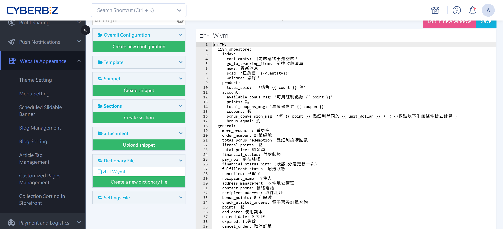
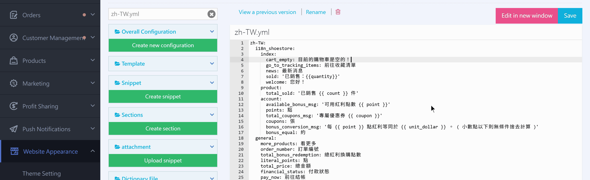
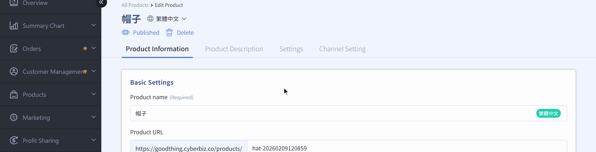
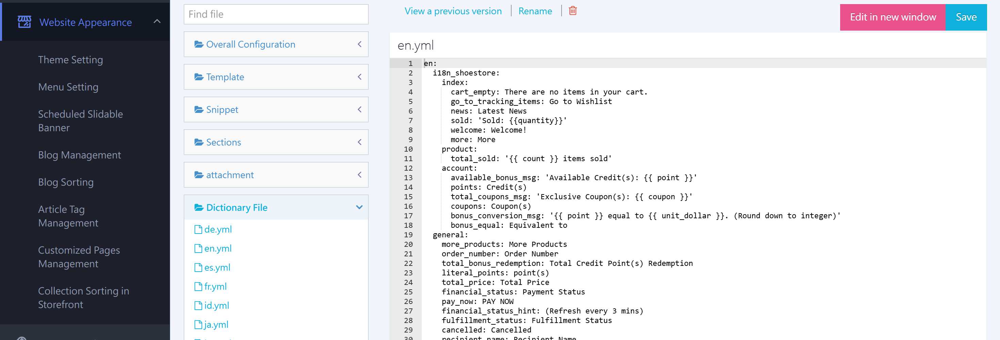

{ title="Storefront Language and Text Customization" .hero-page }

## About the Storefront Display Language { #intro-storefront-lang }

The **storefront display language** setting is mainly used to change the display language and wording of some storefront content.

## Limitations and Notes { #prerequisites-storefront-lang }

!!! warning  "Editing the `.yml` file is an advanced task. Back up a version before you make changes."

- **Theme limitation**: You can set this up only with **drag-and-drop themes**.
- **What you can change**: Only the items shown in the dictionary file (such as **zh-TW.yml**).
- **Language limitation**: Each website can use only **one** language. You cannot use multiple languages in the same set of data.
- **Protect parameters**: When editing, always **keep system default parameters in the `{{...}}` or `%{...}` format**, and never change their English spelling. Otherwise, the system cannot fetch the data.

## Change Storefront Text { #operate-storefront-lang }

To change existing storefront text (for example, change "Sign Out" to "End Session"), follow this path:

1. **Go to**: In the admin, go to **Website Appearance > Theme Setting**.
2. **Open the editor**: On your current theme, click **Actions > CSS/HTML Editor**.
3. **Find the dictionary file**: In the template editor search box, enter "**zh-TW.yml**" and open the file.
4. **Edit the content**: Adjust the text following the [file's format](#specs-storefront-lang){ title="Format Rules and Recovery" data-preview }  — for example, change the text after `account_logout: 會員登出` (Member Sign Out) to what you want to show.
5. **Save**: Click Save when you finish. The storefront text updates right away.

{ title="Editing Dictionary File Text" }

## Advanced Multilingual Settings { #operate-storefront-lang-i18n }

The system reads the `.yml` dictionary file that matches the active language (such as zh-TW.yml or en.yml) and applies the text defined there to storefront pages.

If your store has the multilingual feature turned on, the settings come in two parts:

### Website Content Text <small>Products, Campaigns, Categories, and More</small> { #operate-storefront-lang-content }

- **How**: On product editing, custom category, menu settings, or marketing campaign pages, look for the **:lucide-globe: icon**.
- **Steps**: Click the icon, switch to the language you want (such as English or Japanese), and enter content in that language in the fields marked with a **language label**.

{ title="Multilingual Product Name Settings" }

---

### Default Website Text and Checkout Page Text { #operate-storefront-lang-default }

- **Predefined storefront text**: In the "CSS/HTML Editor," under the "**Dictionary Files**" category, find the `.yml` file for the target language (for example, `es.yml` for Spanish) and edit it.

	{ title="Dictionary File Category" }

- **Predefined checkout page text**: Search the editor for the keyword "**.yml**," and find the `locales/__.yml` file under the "**Assets**" category to edit it.

## Format Rules and Recovery { #specs-storefront-lang }

To keep the storefront displaying correctly, follow these rules when editing dictionary files (.yml):

|**Rule**|**Description and example**|
|---|---|
|**Colons**|If your text contains a **colon `:`**, wrap the text in **half-width double quotes `""`**. Example: `label: "姓名:內容"`.|
|**Protect parameters**|Do not change the English letters inside `{{...}}` or `%{...}`.|
|**Spaces and indentation**|Keep **one space** after the colon (as in `key: value`). Never delete it.|
|**Version rollback**|If the theme breaks after you save, use **View Previous Versions** in the editor to [roll back to an earlier version](../code-customization/restore-code-theme-editor.md#operate-restore-theme){ title="Restore Web Page Code with the Template Editor" }

## FAQ { #faq-storefront-lang }

??? quote "Why did my storefront go blank or show an error after I edited and saved the `.yml` file?"
	This is usually because **the YAML format broke**, so the system could not parse it. Check these three things:
	
	1. **Indentation errors**: YAML depends heavily on space indentation. Make sure you did not accidentally delete spaces at the start of a line.
	2. **Missing space after a colon**: The correct format is `key: value` (there must be one half-width space after the colon).
	3. **Special characters without quotes**: If your custom text contains a colon `:`, a hash `#`, or other special characters, wrap it in double quotes, for example: `title: "優惠 #1: 全館五折"`.
	
	**Solution**: Use "View Previous Versions" at the top of the editor to restore the state before your change.

??? quote "I want to change the "Add to Cart" text, but I can't find it in the `zh-TW.yml` file. What should I do?"
	
	Dictionary files are long, so use the editor's **search feature**:
	
	1. Search for the current text directly (such as `加入購物車` (Add to Cart)).
	2. If you can't find it, try searching for a keyword (such as `add_to_cart`).
	3. Note: Some text may be spread across different `.yml` files (for example, checkout page text may be in `.yml` in the Assets folder).

??? quote "Can I change text inside curly braces like `{{name}}`?"
	
	**Absolutely not.** These are system "dynamic parameters."
	
	- **Example**: `welcome_msg: "您好, {{name}}！"`
	- **Correct approach**: You can change text such as "您好" (Hello) or "！", but you must keep `{{name}}` exactly as is. If you delete or rewrite the English inside the curly braces, the system cannot fill in the member's name automatically, and the storefront displays incorrectly.

??? quote "I already set English for the product name with :lucide-globe: in the admin. Why is the menu still in Chinese after I switch languages?"
	
	Storefront text comes from two sources. Check these settings:
	
	1. **Content translation**: Product names, category names, and menu names must be translated manually by clicking :lucide-globe: on each editing page.
	2. **System dictionary file**: Predefined system text such as "Contact Us" and "Search Results" must be defined in `en.yml` (the English dictionary file).
	3. **Website language settings**: Confirm that your store plan supports switching between languages and that the matching language is turned on.

??? quote "Why hasn't the button text on the checkout page changed after I edited `zh-TW.yml`?"
	
	**The checkout page usually has its own dictionary file.** Don't search only in the main dictionary file. Look in the editor's **"Assets"** or **"Locales"** folder for files whose names include `checkout` or `locales/__.yml`. Most checkout text is defined there.
