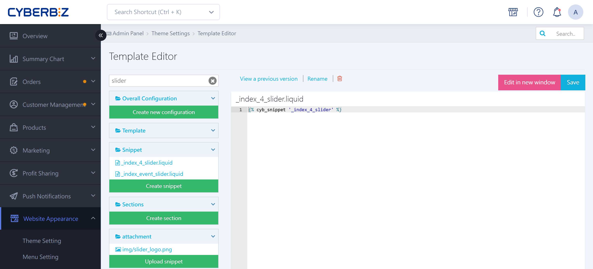

{ title="Homepage Carousel Template Editing" .hero-page }

## About the Carousel Transition Time { #intro-carousel-duration }

You can edit the code to adjust **how long each slide stays on the homepage carousel (slideshow)**. This helps give customers a better reading experience.

Here is a detailed guide to setting the carousel transition time:

## Steps { #operate-carousel-duration }

!!! warning "Scope and Theme Limitations"
	- **Scope:** This setting **applies only to the "Homepage Carousel."** It does not cover an "Advanced Carousel" that you built by pasting in your own Liquid code.
	- **Theme limitation:** This guide applies only to "Default Themes (legacy)."

1. **Go to:** Sign in to the CYBERBIZ admin and go to **Website Appearance > Theme Setting > CSS/HTML Editor**.
2. **Open the file:** Type in the search box and open the file **`_main_slider.liquid`**.
3. **Search for the keyword:** Search the file for "**delay:**".
4. **Change the display time:** Change the number after `delay:` to adjust how long each image stays before switching. The value is in **milliseconds (ms)**.
    - Example: `3000` means 3 seconds.
    - Example: `20000` means 20 seconds.
5. **Save:** Click Save when you finish editing.

``` liquid hl_lines="9" title="_main_slider.liquid"
// Enable lazy loading
lazy: {
enabled: true,
loadPrevNext: true,
loadPrevNextAmount: 1
	},
loop: true,
autoplay: {
  delay: 3000,
},
pagination: {
  el: '.swiper-pagination',
  type: 'bullets',
  clickable: true
},
```

## Important Notes { #prerequisites-carousel-duration }

- **Responsibility:** CYBERBIZ gives you access to edit the code but **does not provide coding tutorials or code-writing services**. Have your own technical staff make these changes.
- **Recovery**: If the page breaks after your changes, click **View Previous Versions** in the editor to [roll back to an earlier version](../code-customization/restore-code-theme-editor.md#operate-restore-theme){ title="Restore Web Page Code with the Template Editor" }.

## FAQ { #faq-carousel-duration }

??? quote "The carousel stopped rotating automatically after my changes. What should I do?"
	This is usually caused by a code syntax error (for example, an accidentally deleted comma `,` or colon `:`).
	
	- **Check the syntax:** Make sure the comma after `delay: 3000` is still there.
	- **Restore right away:** If you cannot fix it yourself, follow **Recovery** under "Important Notes" above to restore the file to the last working version.
