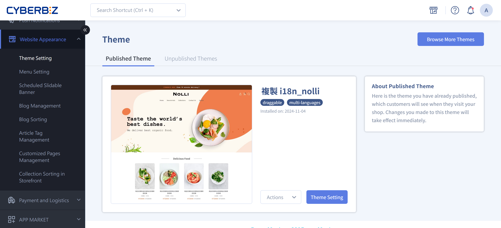
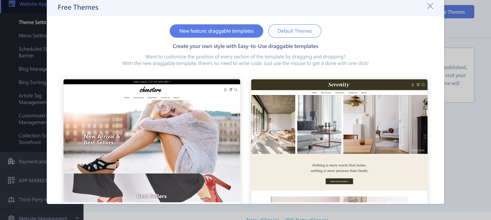
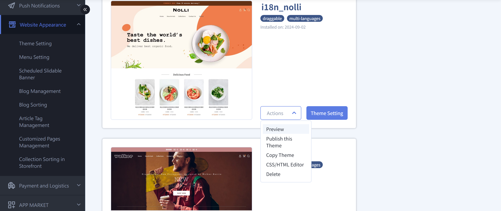
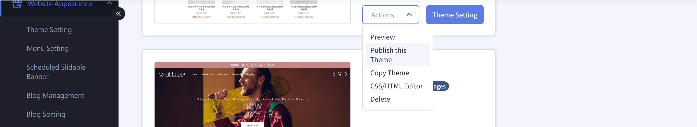
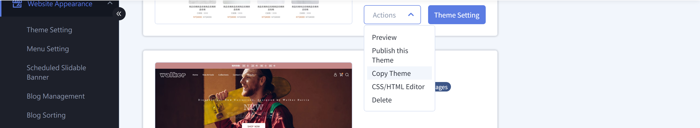
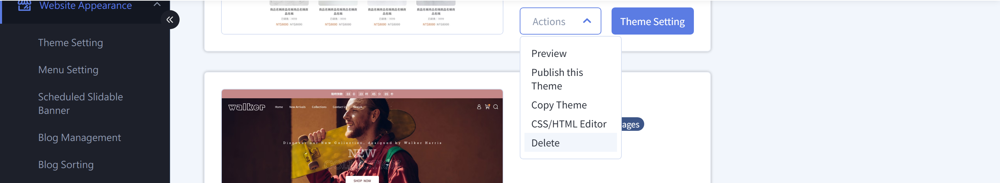

{ .hero-page }

## About Theme Management { #intro-theme }

"Theme Management" is where you manage your website's look. You can have multiple themes and switch the one shown to the public at any time. The page manages themes on two tabs:

- **Published Theme**: The theme that is currently live and seen by customers. Changes to it take effect right away.
- **Unpublished Themes**: Themes you downloaded but haven't published. You can edit and preview them here first, and publish them when they're ready.

The system offers two main types of themes. For a full comparison, see the [Theme Types Reference](../references/theme-types.md){ data-preview }:

- **Drag-and-drop themes**: Customize the position and layout of each block by clicking and dragging, with no coding needed. They support the latest storefront features.
- **Default themes**: Open to in-depth customization with HTML, CSS, and JS, suited to merchants with a technical background who need high customization.

!!! info "Tip"
    "Default themes" are no longer updated. To use the latest storefront features, switch to a "drag-and-drop theme."

---

## Page Overview { #overview-theme }

On the page, you see two tabs at the top and an entry button at the top right:

| Section/entry | Purpose |
| :-- | :-- |
| Published Theme (tab) | Shows the theme that is currently live and seen by customers. Changes here take effect right away |
| Unpublished Themes (tab) | Manages downloaded themes that aren't live yet. You can edit, preview, copy, or delete them |
| Browse More Themes (button) | Opens the theme library, where you can browse and download free themes |

Each theme card shows the theme name, installation time, and theme labels (such as "draggable" or "Multilingual Theme") to help you tell versions apart.

---

## Prerequisites and Limitations { #prerequisites-theme }

Before you download and switch themes, note these two points:

- [x] **Theme limit for your plan**: Each store can install a limited number of themes, depending on your current plan. When you reach the limit, the system shows "Theme limit reached," and you must delete an unused theme before you can download a new one.
- [x] **Multilingual websites**: If you run a multilingual website (such as a North America or Japan website), choose a theme labeled "Multilingual Theme" in the theme library so storefront language switching works correctly.

---

## Steps { #operate-theme }

The steps below are organized by common scenario. Jump to the section you need.

### Download a New Theme { #operate-theme-download }

1. At the top right of the "Theme Management" page, click **Browse More Themes**.
2. The theme library opens. At the top, you can switch between two types: **New feature: draggable templates** and **Default Themes**[^a].
3. Browse the themes, find one you like, and click **Download Theme** on its theme card.
4. When the download finishes, the system shows "Installed successfully" and takes you to the **Unpublished Themes** tab. The new theme is **not live yet**. You need to publish it manually for it to take effect.

[^a]: When you switch to the "Default Themes" category, the system reminds you that these themes are no longer updated and recommends drag-and-drop themes instead. For multilingual stores, the theme library content adjusts automatically to the store's region.

!!! note "Note"
    Downloading a theme only adds it to your "Unpublished Themes." It doesn't affect your live website. You can safely download first, edit at your own pace, and publish when you're ready.

---

### Edit a Theme Before It Goes Live { #operate-theme-edit }

On the "Unpublished Themes" tab, each theme card has an "Actions" drop-down menu and a "Theme Setting" button:

1. **Adjust layout and content**: Click **Theme Setting** to open the theme's settings and adjust its layout, text, and images[^b].
2. **In-depth customization**: In the "Actions" menu, choose **CSS/HTML Editor** to edit the theme's HTML, CSS, and other code.
3. **Preview**: In the "Actions" menu, choose **Preview**. The system opens a new tab that shows your website with that theme.
4. **Rename**: Click the theme name to change it, which helps you tell versions apart.

[^b]: Drag-and-drop themes open the drag-and-drop editor. Default themes open the website settings page.

---

### Publish a Theme { #operate-theme-publish }

1. Switch to the **Unpublished Themes** tab and find the theme you want to make live.
2. In the theme's **Actions** menu, choose **Publish this Theme**.
3. A confirmation window explains that this replaces your current theme and keeps the original theme in "Unpublished Themes." Click **Confirm and Publish** to confirm.
4. When publishing finishes, the system shows "Theme published successfully" and takes you back to the **Published Theme** tab. The new theme is now live.

!!! tip "Tip"
    Use "Preview" to check the layout before you publish. Each theme's settings are independent. The new theme uses its own settings and doesn't carry over the previous theme's settings.

---

### Copy a Theme { #operate-theme-duplicate }

1. In the theme's **Actions** menu, choose **Copy Theme**.
2. The system copies the theme in the background. It shows "Copying theme" during the process and "Theme copied successfully" when finished.
3. The copy appears in "Unpublished Themes" as "Copy + original name." You can edit it independently without affecting the original theme[^c].

[^c]: If you have reached your plan's theme limit or your store's storage is insufficient, the system shows "Theme limit reached" or "Insufficient storage." Delete unused themes first.

---

### Delete a Theme { #operate-theme-delete }

1. Switch to the **Unpublished Themes** tab (you can't delete the published theme).
2. In the **Actions** menu of the theme you want to delete, choose **Delete**.
3. A confirmation window appears. After you confirm, the theme is removed and the system shows "Theme deleted successfully."

---

## Important Rules and Limitations { #specs-theme }

### Each Theme's Settings Are Independent { #specs-theme-independent-settings }

Each theme keeps its own "website settings" and "CSS/HTML Editor" content. When you switch to another theme, the current theme's settings don't carry over. A newly downloaded theme uses its own default look.

---

### Publishing "Replaces" a Theme, It Doesn't "Delete" It { #specs-theme-publish-replace }

When you publish an unpublished theme, the previously published theme moves to the "Unpublished Themes" tab with all its settings kept. You can publish it again later without losing your earlier customizations.

---

### You Can't Delete the Published Theme Directly { #specs-theme-delete-rule }

Themes on the "Published Theme" tab have no delete option. To remove one, first publish another theme. After the target theme moves to "Unpublished Themes," delete it from the "Actions" menu.

---

### Default Themes Are No Longer Updated { #specs-theme-default-deprecated }

Default themes no longer get new features or updates. When you open a new store or redesign, choose a drag-and-drop theme to use the latest storefront features.

---

## Next Steps { #next-steps-theme }

- :lucide-layout-template:{ .lg }  
  [__Use the Drag-and-Drop Editor__](theme-editor.md){ title="Drag-and-Drop Theme Site Settings" }  
  Drag and drop to adjust the layout and content of each block in a drag-and-drop theme.

- :lucide-code:{ .lg }  
  [__CSS/HTML Editor__](../code-customization/theme-editor-complete-guide.md){ title="Template Editor Complete Guide" }  
  Write code to customize your theme's visuals in depth.

- :lucide-languages:{ .lg }  
  [__Multilingual Settings__](../site-settings/setup-storefront-language-text-customization.md){ title="Set Up Storefront Language and Text Customization" }  
  Use with a multilingual theme to set up the storefront for different languages.

- :lucide-cookie:{ .lg }  
  [__Set Up a Cookie Consent Banner__](../code-customization/setup-cookie-consent-banner.md){ title="Set Up a Cookie Consent Banner" }  
  Paste cookie consent banner code with the CSS/HTML Editor to comply with GDPR.

---

## FAQ { #faq-theme }

??? quote "Why didn't my website's look change after I downloaded a theme?"
    { #faq-theme-download-not-live }
    Downloading only adds the theme to "Unpublished Themes." It doesn't go live automatically. On the "Unpublished Themes" tab, choose "Publish this Theme" in the theme's "Actions" menu and confirm. The new theme then takes effect.

??? quote "Are my original settings kept after I switch themes?"
    { #faq-theme-settings-kept }
    Yes. When you publish a new theme, the previously published theme moves to "Unpublished Themes" with all its settings kept, and you can publish it again anytime. Note that each theme's settings are independent. The new theme uses its own default look and doesn't automatically carry over the old theme's customizations.

??? quote "Why can't I find the option to delete a theme?"
    { #faq-theme-cannot-delete }
    You can't delete the published theme. First publish another theme. After the target theme moves to "Unpublished Themes," delete it from the "Actions" menu.

??? quote "I see "Theme limit reached" when I try to download a new theme?"
    { #faq-theme-limit-reached }
    Each store can install a limited number of themes, depending on your plan. Delete themes you no longer use in "Unpublished Themes," and then download again.

??? quote "Which theme should I choose for a multilingual website?"
    { #faq-theme-multi-language }
    Choose a theme whose card has the "Multilingual Theme" label so storefront language switching works correctly.

---

## References { #reference-theme }

- [Theme Types Reference](../references/theme-types.md)
