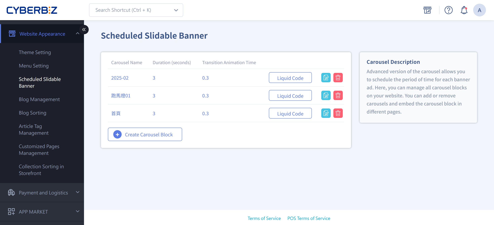
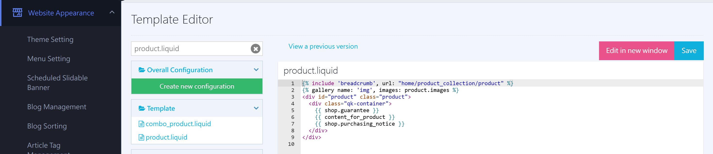

{ .hero-page }

## About Scheduled Carousels  { #intro-scheduled-carousel }

Scheduled carousels use a three-level structure: "block > slot > schedule." First create a carousel block, add multiple carousel slots to it, schedule ads for different time periods in each slot, and then embed the block in the pages where you want it to appear.

!!! info "Tip"
    Scheduled carousels are available on all plans, with no extra activation needed. Unlike the standard built-in homepage carousel, a scheduled carousel lets you set a start and end time for each ad.

## Structure Overview { #overview-scheduled-carousel }

| Level | Name | Description | Limit |
| :-- | :-- | :-- | :-- |
| Level 1 | Carousel block | A set of rotating ads you can embed in a page, with its own name and slide duration. | Up to 10 per store |
| Level 2 | Banner ad slot | A carousel position in the block where you can schedule multiple images for different periods. | Up to 10 per block |
| Level 3 | Ad schedule | A single ad in a slot, with its own image, link, and start and end time. | No limit |


??? info-clean "Structure Diagram"
    ``` mermaid
    graph TD
        B1["Carousel block<br/>(can be embedded in pages)"]

        B1 --> S1>Banner ad slot 1]
        B1 --> S2>Banner ad slot 2]
        B1 --> Sn>…Up to 10 slots]

        S2 --> C1(["Ad schedule: Default image<br/>(permanent, 1 per slot)"])
        S2 --> C2(["Ad schedule: Schedule A<br/>(set publish and unpublish times)"])
        S2 --> C3(["Ad schedule: Schedule B<br/>(can't overlap with A)"])
        S2 --> Cn(["…No limit on ad periods"])
    ```
## Steps { #operate-scheduled-carousel }

### Create a Carousel Block { #operate-scheduled-carousel-create-block }

1. **Open the settings page:** In the admin, click "Website Appearance" > "Scheduled Carousel Settings" to open the carousel management page.
2. **Add a block:** Click **Create Carousel Block**.
3. **Fill in the basic settings and save:** Set the following fields, and then click **Save**.
    * **Carousel Name**: For internal reference only (for example, Homepage Carousel). It doesn't appear on the storefront, and names must be unique.
    * **Duration (seconds)**: How many seconds each image stays (for example, 3 seconds).
    * **Transition Animation Time**: How long the animation lasts when images change (for example, 1.5 seconds).


---

### Add Banner Ad Slots { #operate-scheduled-carousel-add-slot }

1. **Add a slot:** On the carousel block settings page (click the carousel name to open it), click **Create Banner Ad** to add a slot. Each block can have up to 10 slots[^slots].
2. **What a slot is for:** Each slot is "one position" in the storefront carousel. You can schedule multiple ads for different periods in it, and the system swaps them in and out automatically on schedule.

[^slots]: If you add more than 10, the system shows "Banner ads cannot exceed 10."


---

### Add Ad Schedules { #operate-scheduled-carousel-add-schedule }

In each banner ad slot, set the ad content and when it goes live:

1. **Add a schedule:** In the slot, click Add to open the **Create Ad Schedule** page.

    

2. **Fill in the basic information:**
    * **Ad Schedule Name** (for example, Spring 2020 New Arrivals).
    * **Image Link URL**: The URL customers go to when they click the image. Enter the full URL (including `http://` or `https://`).

    

3. **Choose how it goes live:** Pick one of the following.

    * Select **Set as default Image**: Use it as an always-on image with no schedule needed[^default].
    * Leave it unselected: In **Publish Status**, set **Start At** and **End At** to schedule it. Scheduled periods in the same slot can't overlap[^overlap].

    

4. **Upload images:** In **Image Setting**, upload desktop, tablet, and mobile images (at least the desktop image is required). Each image must be 1 MB or less, in JPG, PNG, JPEG, or GIF format.

    

5. **Save:** Click **Save** to finish, or click **"Back to List"** to return to the block settings page.

When you finish, each schedule in the slot shows a status based on the current time, such as "Default," "Live," "Scheduled," or "Ended." For details, see the [Ad Schedule Statuses Reference](../references/scheduled-carousel-statuses.md#reference-scheduled-carousel-statuses){ data-preview }.

[^default]: Each slot can have only one default image. The default image is an always-on ad that appears when the slot has no other live scheduled ad. To change it, go back to the original default schedule and clear "Set as default image," or replace that schedule's image.
[^overlap]: If the time you set overlaps an existing schedule in the slot, the system shows "The current time overlaps the publishing period of '◯◯'. Please choose another period." Choose a period that doesn't overlap.


---

### Show the Carousel on Your Storefront { #operate-scheduled-carousel-display }

After you create a carousel block, you must embed it in a page for it to appear. Choose the method for your theme:

=== "Drag-and-Drop Theme: Homepage"
    1. Go to "Website Appearance" > "Theme Management" > "Theme Setting" > "Custom Layout Design."
    2. Click "Add Block" and add a **"Scheduled Carousel"** block.

        

    3. In the **Carousel Name** field, choose the carousel block you created. After you save, it appears on the homepage. (You can preview it on the right.)
    4. Click the carousel to open its editing page and set layout details such as **"Screen Coverage."**

        

=== "Drag-and-Drop Theme: Pop-Up"
    1. In "Theme Setting," add a **"Pop-Up Ad."**
    2. Choose **"Scheduled Carousel"** as the block type, and select the carousel block to show.
    3. After you save, the carousel appears as a pop-up on your storefront.

    

=== "Standard Theme: Paste Liquid Code"
    1. On the scheduled carousel settings page, click the carousel's **Liquid Code** and copy it.

        

    2. Go to "Website Appearance" > "Theme Management" > "CSS/HTML Editor."

        

    3. Paste the code into the file for the page where you want it to appear, such as the homepage `index.liquid` or the product page `product.liquid`.

        ``` html hl_lines="8" title="product.liquid"
        
        
        <div id="product" class="product">
          <div class="qk-container">
            {{ content_for_product }}
          </div>
        </div>
         <!-- (1)! -->
        ```

        1.  The carousel Liquid code you copied. There is no fixed place to put it. Place it wherever suits your website.

        ??? info "Available Page Templates"
            | File | Page |
            | :-- | :-- |
            | `index.liquid` | Homepage |
            | `product.liquid` | Product page |
            | `collection.liquid` | Custom collection page |
            | `category.liquid` | Multi-level category page |
            | `blog.liquid` | Blog page |
            | `article.liquid` | Blog post page |

---

## Important Rules and Limitations { #specs-scheduled-carousel }

!!! note "Limits"
    * Each store can create up to **10** carousel blocks.
    * Each carousel block can have up to **10** banner ad slots.
    * There is no limit to the number of ad schedules in each slot.

!!! note "Schedule and Image Rules"
    * In the same slot, the start and end times of "scheduled ads" can't overlap. The "default image" has no time limit, and each slot can have only one.
    * Each image must be **1 MB** or less, in JPG, PNG, JPEG, or GIF format, and at least the desktop image is required.
    * Recommended image sizes: desktop 1440x800px, tablet 960x760px, mobile 480x370px.
    * Carousel names must be unique.

---

## Next Steps { #next-steps-scheduled-carousel }

<div class="grid cards" markdown>

- :lucide-layout-dashboard:{ .lg }  
  [__Custom Layout Design (Drag-and-Drop Theme)__](setup-theme-page-settings.md#operate-page-settings-custom-blocks)
  Add a scheduled carousel to your homepage layout and adjust where it appears.

<!--
- :lucide-megaphone:{ .lg }  
  [__Pop-Up Ads__](popup-ads.md)  
  Show the carousel as a pop-up on all pages.

- :lucide-code:{ .lg }  
  [__Theme Management__](theme-editor.md)  
  Paste Liquid code in the CSS/HTML editor to embed the carousel.
-->

</div>

---

## FAQ { #faq-scheduled-carousel }

??? quote "I set up the carousel, but it doesn't appear on the storefront?"
    [](){ #faq-scheduled-carousel-not-showing }
    After you create a carousel block, you must embed it in a page for it to appear. Embed it based on your theme:

    - Drag-and-drop theme: In "Custom Layout Design," add a "Scheduled Carousel" block and select the carousel.
    - Drag-and-drop theme pop-up: In "Pop-Up Ad," choose "Scheduled Carousel."
    - Standard theme: Copy the "Liquid code" and paste it into your theme file.

    For detailed steps, see [Show the Carousel on Your Storefront](#operate-scheduled-carousel-display).

??? quote "When I set a schedule, the system says the periods overlap and I can't save?"
    [](){ #faq-scheduled-carousel-overlap }
    In the same slot, the start and end times of non-default ad schedules can't overlap. Change the start or end time to avoid periods that overlap other schedules. To keep an image always on with no time limit, use "Set as default image" instead.

??? quote "What is the default image, and how do I change it?"
    [](){ #faq-scheduled-carousel-default-image }
    The default image is the slot's always-on ad. It appears when the slot has no other live scheduled ad. Each slot can have only one default image. To change it, go back to the original default schedule and clear "Set as default image," or replace that schedule's image.

??? quote "I can't upload an image?"
    [](){ #faq-scheduled-carousel-image-upload }
    Make sure the image meets these requirements:

    - The file is 1 MB or less.
    - The format is JPG, PNG, JPEG, or GIF.
    - Each schedule needs at least a desktop image. Add tablet and mobile images as needed.

??? quote "How do I change the carousel speed?"
    [](){ #faq-scheduled-carousel-speed }
    Adjust two fields in the carousel block settings: "Duration (seconds)" controls how long each image stays, and "Transition Animation Time" controls how long the animation lasts when images change.

??? quote "How do I fix a broken carousel layout?"
    [](){ #faq-scheduled-carousel-layout-break }
    Your theme may be older and lack the carousel's style code. Go to "CSS/HTML Editor" > "theme.liquid" and in the `<head>` section, add `{{ content_for_header }}`.

---

## References { #reference-scheduled-carousel }

- [Ad Schedule Statuses Reference](../references/scheduled-carousel-statuses.md)

