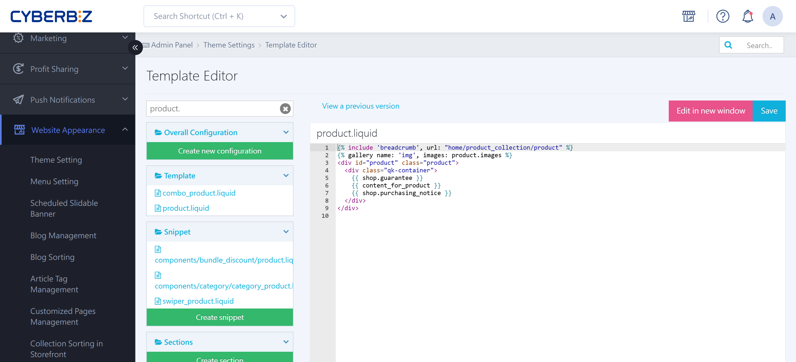

{ title="Disable Product Image Zoom Preview" .hero-page }

## About Disabling Product Image Zoom Preview { #intro-product-zoom }

**Disabling product image zoom preview** means editing code to hide or turn off the magnifier preview on product page images. Merchants usually do this when product images have too low a resolution and look blurry when zoomed in.

## Turn Off Zoom Preview { #operate-product-zoom }

!!! warning "Version Backup and Theme Limitations"
	- **Back up a version first**: Editing templates is an advanced task. Before you make changes, use "View Previous Versions" in the editor to check the current state, or copy the original code as a backup.
	- **Scope**: This guide **applies only to "Default Themes (standard themes)."** This method does not work for drag-and-drop themes.

Follow this path to open the code editor and make the change:

1. **Go to**: Sign in to the CYBERBIZ admin and go to **Website Appearance > Theme Setting > Actions > CSS/HTML Editor**.
2. **Open the file**: Search for and open the **`product.liquid`** file in the editor.
3. **Search for the keyword**: Search the file for "**圖片放大**" (image zoom).
4. **Edit the code**: Add **two slashes `//`** in front of the "image zoom" code you found.
    - _How it works: Adding `//` turns that line into a "comment." The system ignores it when rendering the page, so it no longer takes effect._
5. **Save**: After you click "Save," product pages on the storefront no longer offer image zoom preview.

``` javascript hl_lines="3" title="product.liquid"
   });

    // 圖片放大
    $('.product_photos .swiper-container .swiper-button').on('click', function(e){
      e.stopPropagation()
    })
```

!!! tip "Recovery"
	If the page breaks or the layout shifts after your changes, use **View Previous Versions** in the editor to [roll back to an earlier version](../code-customization/restore-code-theme-editor.md#operate-restore-theme){ title="Restore a Template Editor Version" }.

## Important Notes { #prerequisites-product-zoom }

- **Theme limitation**: **Drag-and-drop themes** do not support some code editing. Go by the features actually available in your admin.
- **Recommended specs**: To keep the zoom feature without blurriness, upload images that follow CYBERBIZ's recommended image specs.

## FAQ { #faq-product-zoom }

??? quote "Why does image zoom still work on the storefront after I added `//`?"
	This is usually caused by the **browser cache**. Try checking in a private (incognito) window, or press `Ctrl + F5` (Windows) / `Cmd + Shift + R` (Mac) to force a page refresh. If the problem continues, make sure you saved the `product.liquid` file correctly.

??? quote "What if I can't find the "圖片放大" (image zoom) keyword in my file?"
	Comment text can differ slightly between themes. Try searching for keywords such as `zoom`, `fancybox`, or `swiper` instead, to find the JavaScript section that handles clicks on product images. If you are not sure what a piece of code does, do not change it.

??? quote "Will turning off zoom affect SEO or search ranking?"
	No. This change affects only the front-end user experience (UI/UX). It does not change the page's structured data or how images are indexed, so it has no direct negative effect on SEO.

??? quote "Will editing the code cause my site updates to fail?"
	When the system runs a core upgrade, Liquid files you edited manually are usually not overwritten automatically (to protect your customizations). However, this also means you may not get new feature updates for that file right away. Before making major changes, record the line numbers and content you changed.
