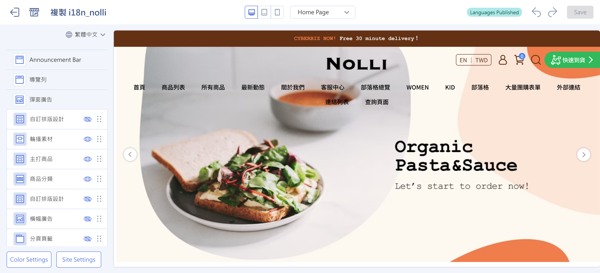{ .hero-page }

## About Global Settings { #intro-global-settings }

Global settings don't belong to a single page. They apply to your **entire website**. At the bottom of the left panel in the drag-and-drop theme editor, you can click the navigation bar, pop-up ads, footer, color settings, and site-wide settings directly. There's no separate "Global Settings" button to click first.

Global settings are in the drag-and-drop theme editor. To learn how to open the editor, see [Drag-and-Drop Theme Site Settings](theme-editor.md){ title="Drag-and-Drop Theme Site Settings" }.

## Prerequisites and Limitations { #prerequisites-global-settings }

Before you start, make sure that:

- [x] **The drag-and-drop theme editor is open:** Open the drag-and-drop theme editor first. See [Open the Drag-and-Drop Theme Editor](theme-editor.md#operate-theme-editor-enter){ title="Open the Drag-and-Drop Theme Editor" }.
- [x] **You're using a drag-and-drop theme:** The settings in this article apply only to themes labeled "draggable."

!!! plan "Differences by Plan"
    Some settings (such as color settings) don't appear on the POS-only plan. The items you see depend on your plan and the features you have turned on.

---

## Navigation Bar and Footer { #operate-global-settings-navbar-footer }

The navigation bar and footer have more settings and are covered in a separate article:

- :lucide-menu:{ .lg }  
  [__Navigation Bar__](../navigation/setup-menus-navigation.md){ title="Set Up Menus and the Navigation Bar" }  
  Set the menu layout (default / side-by-side left / side-by-side right), whether the background is transparent, and whether submenus expand together.

- :lucide-arrow-down-to-line:{ .lg }  
  [__Footer__](../navigation/setup-menus-navigation.md#operate-menus-nav-footer-content){ title="Set Up Menus and the Navigation Bar" }  
  Choose a "top and bottom" or "left and right" layout, and turn on social media icons and their links.

---

## Pop-Up Ads { #operate-global-settings-popup }

Pop-up ads open automatically when customers visit your store. In global settings, you can choose one of the following content types and set display conditions:

1. At the bottom of the editor's left panel, click "Pop-Up Ad."
2. Choose the pop-up content type:

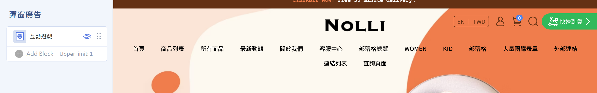

=== "Image Pop-Up"

    1. Upload desktop, tablet, and mobile images. (The desktop image is required. If you don't upload tablet or mobile images, the desktop image is used.)
    2. Set the **thumbnail size** (small / medium / large) to control the size of the small icon after the pop-up is minimized. If you don't upload one, the desktop image is used by default.
    3. Set the **image link** to go to a specific page or URL when the pop-up is clicked.
    4. To let customers open the link without leaving your website, select "Open link in new tab."

    

    ??? note "How the Pop-Up Shows and Minimizes"
        Image pop-ups don't have a "display frequency" field. The system handles display automatically: the pop-up opens when customers visit, and after a customer minimizes it, it stays minimized for **24 hours**. Pop-ups don't appear on the cart or checkout pages.

        

=== "Video Pop-Up"

    1. Paste a YouTube video link.
    2. Press ++enter++ to apply the change.

    

=== "Interactive Game"

    1. Choose a "Spin the Wheel" or "Red Envelope Draw" game you created from the drop-down menu.
    2. Go to the [interactive games setup guide](../../marketing/other-tools/interactive-games.md){ title="Interactive Games (EC)" } to create a Spin the Wheel or Red Envelope Draw campaign.

    !!! info "Participation Restrictions"
        This feature is for website members only. Customers must sign in to take part.

    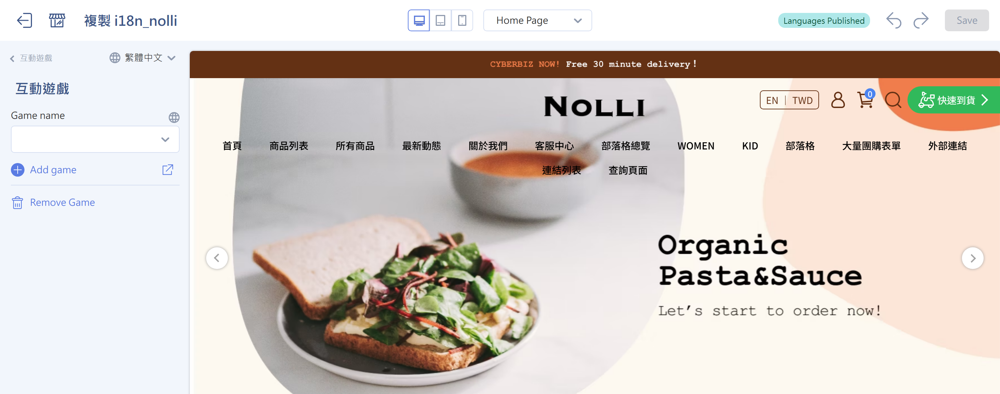

=== "Scheduled Carousel"

    1. Choose the carousel content to load from the "Carousel Advanced Settings" group.
    2. Go to the [scheduled carousel setup guide](configure-scheduled-carousels.md){ title="Create and Manage Scheduled Carousels" } to set publish and unpublish times for ad campaigns.

    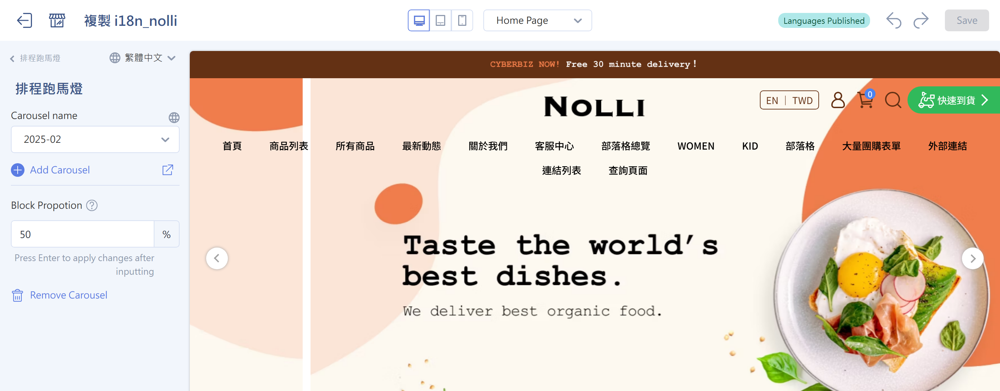

---

## Color Settings { #operate-global-settings-color }

Define the basic visual elements for your whole website:

1. At the bottom of the editor's left panel, click "Color Settings."
2. Choose a **primary color** to change the main color across your website.
3. Choose an **accent color**. The system applies it to several dynamic UI elements automatically (see below).
4. Adjust the **site-wide font color**.

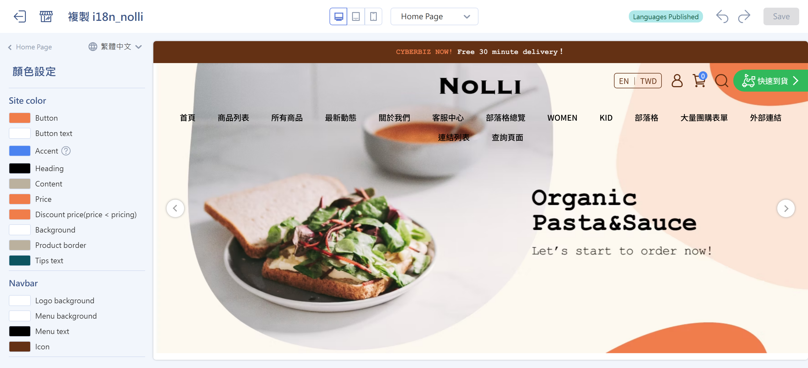

??? info "Where the Accent Color Applies"
    After you choose an "accent color" in color settings, the system applies it automatically to:

    - **Product labels:** Including the **subscription**, **sale**, and **out of stock** labels the system shows automatically, and your **5 custom labels**.
    - **Sale countdown:** If a product isn't on sale yet, the **countdown background color** on the storefront product page or collection list uses the accent color automatically.
    - **Order:** Labels appear from left to right in a set order (subscription > sale > out of stock > custom labels), all in the accent color.

??? note "Color Settings for Specific Blocks"
    Besides the site-wide colors, some blocks let you customize colors in more detail:

    - **[Pinned Post](../navigation/setup-menus-navigation.md#operate-menus-nav-announce){ title="Set Up Menus and the Navigation Bar" }:** Set the pinned post's **image link background color** and the **countdown text and background colors** separately.
    - **[Collapsible Content](setup-theme-page-settings.md#operate-page-settings-collapsible){ title="Page Settings Guide" }:** A block used for FAQs or shopping notes. You can set its display colors separately.
    - **[Image and Text](setup-theme-page-settings.md#operate-page-settings-graphic-intro){ title="Page Settings Guide" }:** You can customize the **button color** in this block.

---

## Site-Wide Settings { #operate-global-settings-shop }

Manage your website's core settings in one place, including its visual identity, search engine optimization (SEO), global product display behavior, and site protection.

### Visual Identity and Brand Assets { #brand }

1. In "Site-Wide Settings," set the **website icons**:
    - Upload a **favicon**, the small icon shown on the browser tab.

        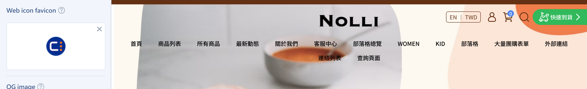

    - Upload an **OG image** (the default image for shared links) to set the default thumbnail shown when your website links are shared on Facebook or LINE. [See the setup guide](../site-settings/setup-og-image.md){ title="Set Up the Shared Link Thumbnail (OG Image)" }
    
        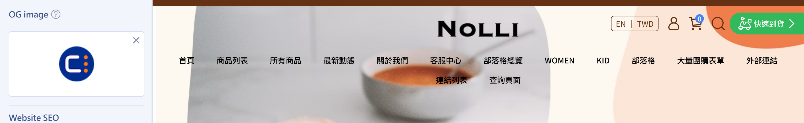

2. Choose a **navigation bar icon** style (3 built-in styles), or upload your own icon file.

    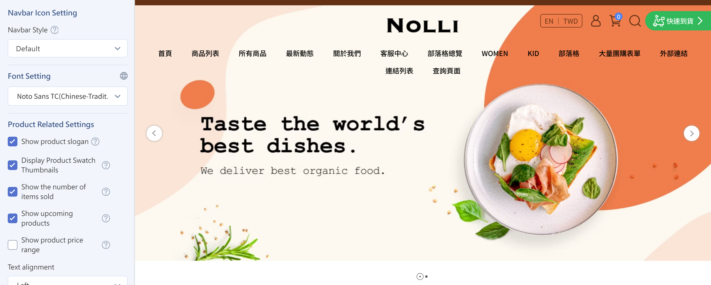

    ??? info "One-Page Store Limitation"
        Custom navigation bar icons are supported only for one-page stores created **after July 2025**.

3. In "Font Settings," choose the font style for your whole website.

    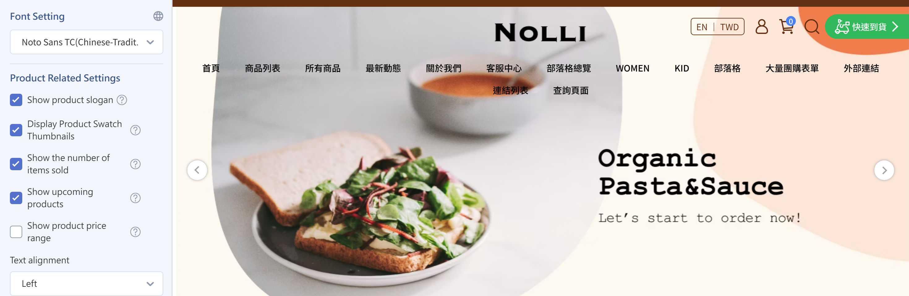

4. Set the **homepage entrance animation**:

    1. Find the **homepage entrance animation** setting and select it to turn it on.
    2. Choose an animation style from the drop-down menu:

        === "Rise and Fade In"

            

            - **Animation effect**: Blocks gently float up from below and fade in as they enter the screen
            - **Recommendation**: The most versatile effect. It doesn't distract from reading and suits most homepage blocks.

        === "Expand from Center"

            

            - **Animation effect**: Content expands outward from the center as the page scrolls.
            - **Recommendation**: More visual impact. Suits image-focused layouts.

    ??? quote "Why don't some blocks animate in "Expand from Center" mode?"

        Not every block uses it. Some blocks are harder to read with "Expand from Center," so the system doesn't animate them. Support by block:

        | Homepage block | Rise and Fade In | Expand from Center |
        | ------- | -------- | ------- |
        | Image and text | ✓ | ✓ (image area only, not text) |
        | Custom layout design | ✓ | ✓ |
        | Banner ad | ✓ | ✓ |
        | Carousel | ✓ | ✓ |
        | Video settings | ✓ | ✓ |
        | Product collection | ✓ | ✕ |
        | Featured product | ✓ | ✕ |
        | Text editor | ✓ | ✕ |
        | Collapsible content | ✓ | ✕ |
        | Tabs | ✓ | ✕ |
        | Custom HTML | ✕ | ✕ |

    ??? quote "I turned on animation, but I don't see it on my computer or phone. Why?"

        If your device has the accessibility setting **Reduce Motion** turned on, your website turns off animation automatically and shows content directly. This is expected behavior, not a bug.

        To see the animation, turn off that setting:

        - **Mac**: System Settings > Accessibility > Display > turn off "Reduce Motion"
        - **iPhone/iPad**: Settings > Accessibility > Motion > turn off "Reduce Motion"
        - **Windows**: Settings > Accessibility > Visual effects > turn on "Animation effects"

---

### Website SEO and Protection { #specs-global-settings-seo }

1. In "Site-Wide Settings," enter your website's **title**, **description**, and **keywords** to improve how search engines index and rank your website. If you leave the title blank, the system uses your store name as the title. [See the setup guide](../site-settings/setup-site-title-seo.md){ title="Set Up the Website Title and SEO" }

    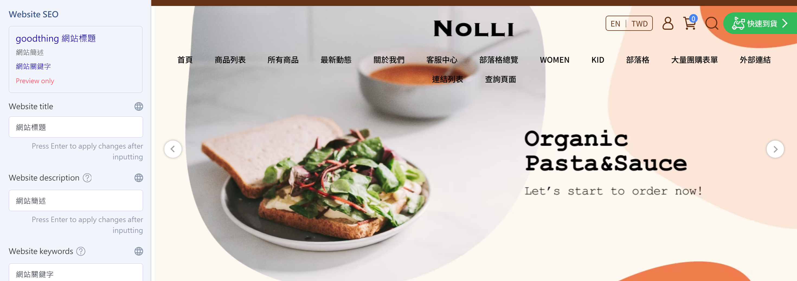

2. To protect your original content, select **"Disable Right-Click"** to stop visitors from downloading images or copying text with a right-click. [See the setup guide](../site-settings/setup-right-click-protection.md){ title="Disable Right-Click to Protect Images and Text" }

    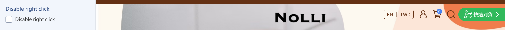

---

### Global Product Display Behavior { #operate-global-settings-shop-product }

!!! plan "Feature Limitations"
    Some features require specific plans. These are noted in each item's title.

These settings **apply to every product list and product page on your website** (homepage product blocks, product collection pages, multi-level categories, search pages, product detail pages, and more). They keep product cards and prices consistent, so you don't have to set each product individually. For related settings, see [Basic Display Options](#operate-global-settings-product-display-basic), [Layout and Style Settings](#operate-global-settings-product-layout), and [Images and Hover Effects](#operate-global-settings-product-image-effects).

#### Basic Display Options { #operate-global-settings-product-display-basic }

Turn on the following as needed:

- **Show product taglines:** Show product features or promotional taglines below the product image or name. [See the setup guide](../../products/create-and-manage/edit-product-slogan-and-description.md){ title="Edit Product Summaries and Taglines" }

    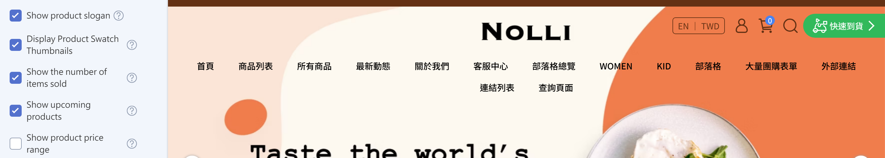

- **Show product color swatches `Enterprise`:** Show small variant color images on product collection pages and multi-level category pages. [See the setup guide](../../products/create-and-manage/product-swatches-variant-images-drag-drop.md){ title="Set Up Product Color Swatches and Variant Images (Drag-and-Drop Themes)" }

    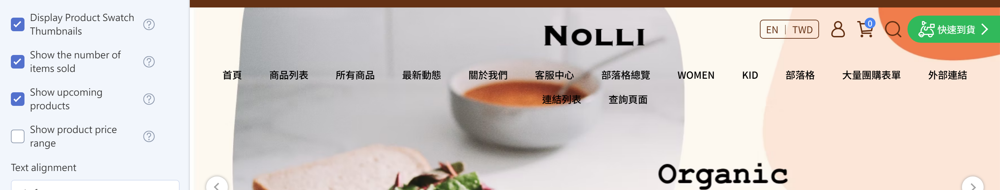

- **Show quantity sold:** Show the total quantity sold below the product name to build a sense of popularity.

    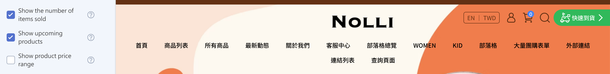

- **Show product sale start time `PLUS / Enterprise`:** When a product has a publish time but isn't on sale yet, the storefront shows a countdown to the sale (except on the Bonus Mall page).

    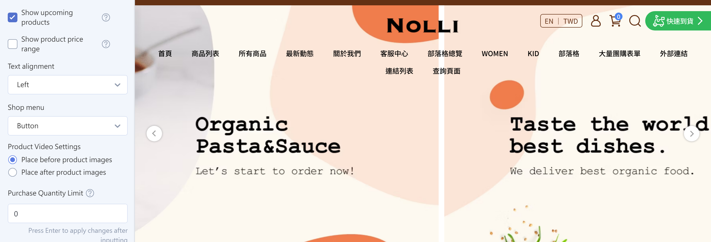

- **Show product price range:** When variants have different prices, the sale price shows as a "lowest–highest" range and the list price is hidden. If this is off, the lowest sale price and the list price are shown.

    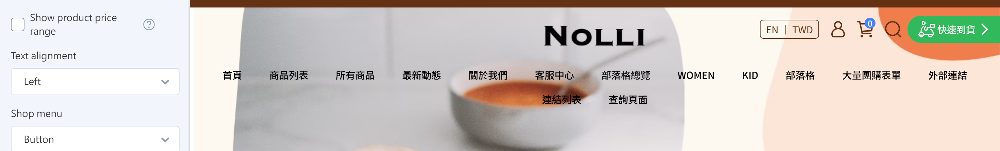

    !!! warning "Important"
        This doesn't apply to product pages with "Select the first variant by default" turned on, product pop-ups, or homepage featured products.

---

#### Layout and Style Settings { #operate-global-settings-product-layout }

- Choose the **Text Alignment** (left / center / right; left by default).

    === "Left"
        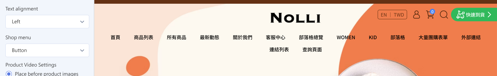
    === "Center"
        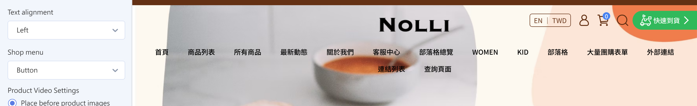
    === "Right"
        

- Choose the **variant menu** style (drop-down / buttons; buttons by default).

    === "Buttons"
        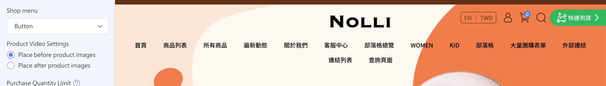{ title="Product variant menu - buttons" }
    === "Drop-Down"
        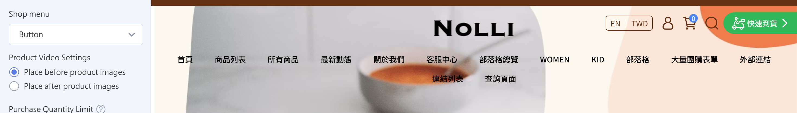{ title="Product variant menu - drop-down" }

- Set whether the **product video** appears before or after the product images `PLUS / Enterprise`. [See the setup guide](../../products/create-and-manage/setup-product-videos.md){ title="Set Up Product Videos" }

    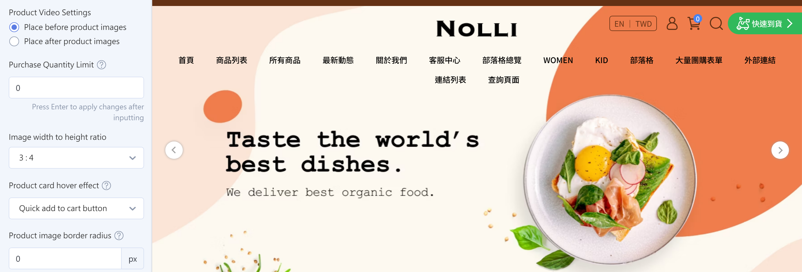

- Set the **maximum purchase quantity**, the maximum number of each variant that can be added to the cart (leave it blank or enter 0 for no limit).

    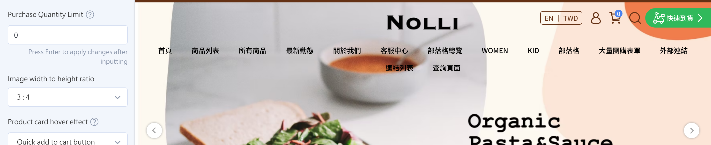

---

#### Images and Hover Effects { #operate-global-settings-product-image-effects }

- Choose the **image aspect ratio** (1:1 / 3:4; 1:1 by default).

    === "1:1"
        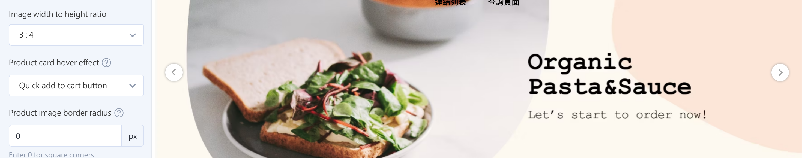

    === "3:4"
        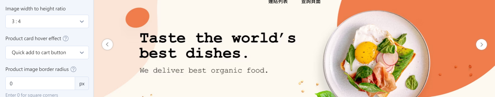

- Choose a **product image hover effect**:

    === "Quick Add to Cart Button"
        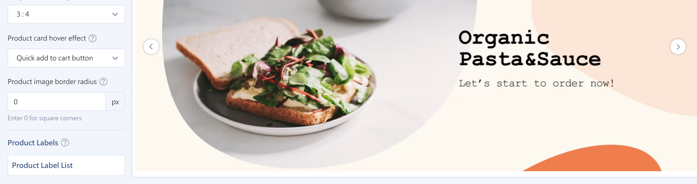{ title="Product image hover effect - add to cart button" }
    === "Image Swap"
        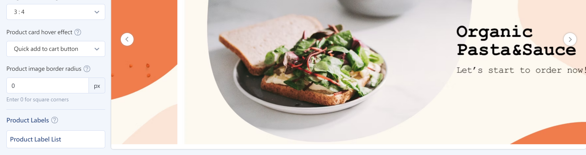{ title="Product image hover effect - image swap" }
    === "Shadow and Border Highlight"
        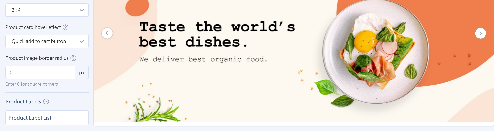{ title="Product image hover effect - shadow and border" }
    === "Zoom"
        { title="Product image hover effect - zoom" }

- Set the **product image corner radius**. We recommend 0–20px.

    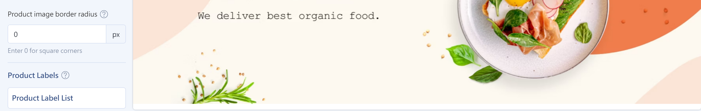

[^1]: And when the "Product Labels" feature isn't in use.

---

### Product Label Stickers { #operate-global-settings-product-labels }

=== "Professional (incl. PLUS), Advanced (incl. PLUS), Expert"

    - **Show subscription campaign labels**: Shown automatically when a product is linked to a subscription campaign.
    - **Discount stickers (sale labels)**: Shown automatically when the sale price of any variant is lower than the list price. If you select **Show subscription campaign labels**, this setting doesn't apply.
    - **Image aspect ratio**: Choose the display ratio that matches the product images you upload. (If some products have blank space above and below, try changing the display ratio.)

    

=== "Expert PLUS, Enterprise"

    #### Label Types and Supported Plans { #specs-global-settings-product-labels-types }

    | Label type | Supported plans | Number allowed | Style options |
    | ------- | ------- | ---------- | ------- |
    | **Discount Label** | Expert PLUS Enterprise | 1 | Image Text Discount rate |
    | **Out-of-Stock Label** | Expert PLUS Enterprise | 1 | Image Text |
    | **Periodic Event Label** | Expert PLUS Enterprise | 1 | Image Text |
    | **Custom labels** | Enterprise | Up to 30 Up to 5 labels per product[^2] | Image Text |

    #### Application Rules { #specs-global-settings-product-labels-rules }

    | Label type | Application rule | Label category | Description |
    | ------- | ------- | ------- | ------- |
    | **Discount Label** | Shown when the sale price of any variant is lower than the list price | Default label | Can be set to public / private Can't be added or deleted |
    | **Out-of-Stock Label** | Single-variant products: shown when stock is 0 and the product is set to stop selling at 0 stock Multi-variant products: shown only when every variant has 0 stock and is set to stop selling at 0 stock | Default label | Can be set to public / private Can't be added or deleted |
    | **Periodic Event Label** | Shown automatically when the product is linked to a subscription campaign | Default label | Can be set to public / private Can't be added or deleted |
    | **Custom labels** | A custom label must be linked to a product tag in the admin. After you link it, the custom label applies automatically to every product with that product tag  [See the setup guide](../../products/categories-and-tags/manage-product-tags.md){ title="Manage Product Tags" } | Custom label | Can be set to public / private Can be added or deleted |

    #### Steps { #operate-global-settings-product-labels-step }

    1. In "Site-Wide Settings," click **Product Label List** to open the settings page.

        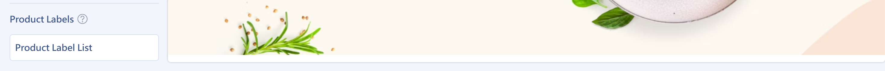

    2. [Turn on](theme-editor.md#operate-theme-editor-visibility){ title="Drag-and-Drop Theme Site Settings" } the label types you need:

        

    3. Click an item in the label list to open its settings page and choose a **display style** for each label:

        - **Text:** Enter the label text you want to show.
        - **Image:** Upload a label image and choose the image label size (**large / small**).
        - **Discount Rate:** Available only for the "Discount Label." Shows the discount automatically based on the sale price and list price.

        === "Text"
            

        === "Image"
            

        === "Discount Rate"
            

    !!! info "The label background uses the accent color from "[Color Settings](#operate-global-settings-color)" by default. When several labels apply at once, they appear side by side in a fixed system order."

    [^2]: If there are more than 5, the storefront shows only the first 5 in order. The 6th and later aren't shown. This limit counts only custom labels. System default labels (sale, out of stock, subscription) don't count toward it, and a product can show both. For example, if a product qualifies for 3 system default labels and 6 custom labels, the storefront shows the 3 default labels plus the first 5 custom labels, 8 in total.

---

## Next Steps { #next-steps-global-settings }

- :lucide-palette:{ .lg }  
  [__Drag-and-Drop Theme Site Settings__](theme-editor.md){ title="Drag-and-Drop Theme Site Settings" }  
  Learn how to open the drag-and-drop theme editor and set up your website

- :lucide-menu:{ .lg }  
  [__Set Up Menus and the Navigation Bar__](../navigation/setup-menus-navigation.md){ title="Set Up Menus and the Navigation Bar" }  
  Set the menu layout and footer display

- :lucide-gamepad-2:{ .lg }  
  [__Interactive Games (EC)__](../../marketing/other-tools/interactive-games.md){ title="Interactive Games (EC)" }  
  Create Spin the Wheel or Red Envelope Draw campaigns

- :lucide-images:{ .lg }  
  [__Create and Manage Scheduled Carousels__](configure-scheduled-carousels.md){ title="Create and Manage Scheduled Carousels" }  
  Set publish and unpublish times for ad campaigns

## References { #reference-global-settings }

- [Block Types You Can Add Reference](../references/theme-editor-sections.md)
