## About Page Settings { #overview-page-settings }

Drag-and-drop themes use the **page drop-down menu** in the top toolbar to switch between pages. The homepage, custom pages, and single pages let you combine content freely with "Add Block." On all other pages, the system sets the layout, and each page offers only its own settings.

You set up each page in the drag-and-drop theme editor. To learn how to open the editor, see [Drag-and-Drop Theme Site Settings](theme-editor.md){ title="Drag-and-Drop Theme Site Settings" }.

!!! note "Note"
    The pages that actually appear in the drop-down menu vary with the theme you installed and the features you have turned on. Go by what the editor shows.

!!! example "Use Cases"
    | Scenario | Block to use |
    |:-----|:---------|
    | Add an FAQ to the homepage | [Collapsible content](#operate-page-settings-collapsible) |
    | Create shopping notes or return and exchange information | [Collapsible content](#operate-page-settings-collapsible) |
    | Show product usage steps or precautions | [Collapsible content](#operate-page-settings-collapsible) |
    | Add a large campaign entry image to the homepage | [Banner ad](#operate-page-settings-banner) |
    | Embed a YouTube video | [Video settings](#operate-page-settings-video) |
    | Show a product list | [Product collection](#operate-page-settings-collection) |

## Prerequisites and Limitations { #prerequisites-page-settings }

Before you start, make sure that:

- [x] **The drag-and-drop theme editor is open:** Open the drag-and-drop theme editor first. See [Open the Drag-and-Drop Theme Editor](theme-editor.md#operate-theme-editor-enter){ title="Open the Drag-and-Drop Theme Editor" }.
- [x] **You're using a drag-and-drop theme:** The settings in this article apply only to themes labeled "draggable."
- [x] **Some pages need setup first:** For example, multi-level categories, customer service features, or store location settings. Check the section for each page.

!!! plan "Differences by Plan"
     The pages and blocks you can edit depend on your plan and the features you have turned on.

## Steps { #operate-page-settings }

Jump to the page type you need: [Homepage](#operate-page-settings-homepage), [Product Page](#operate-page-settings-product), [Product Collection Page](#operate-page-settings-group), [Multi-Level Product Categories](#operate-page-settings-category), [Blog Page](#operate-page-settings-blog), [Blog Post Page](#operate-page-settings-article), [Customer Service Page](#operate-page-settings-contact), [404 Page](#operate-page-settings-not-found), [Express Delivery Page](#operate-page-settings-express), [Search Page](#operate-page-settings-search).

### Homepage { #operate-page-settings-homepage }

You can add the following 13 block types to the homepage. Most blocks' settings panels include an expandable **Other Layout Settings** panel. Besides each block's own settings, it always includes a shared set of **layout margins** (in px). The block sections below **list only each block's own settings**.

??? info "Layout Margin Settings"

    | Setting | Description | Common default |
    |------|------|----------|
    | Desktop - left/right outer margin | **Set to 0px for full width** (flush with the left and right edges of the screen) | 0 |
    | Desktop - bottom outer margin | Distance from the block below. Set to 0px to join the two blocks with no gap | 50 |
    | Mobile - left/right outer margin | Same as above, for tablet/mobile | 0 |
    | Mobile - bottom outer margin | Same as above, for tablet/mobile | 24 or 50 |

    ??? note-clean "Exceptions"
        - **Featured product** has larger default margins (80px left/right on desktop, 16px left/right on mobile).
        - **Collapsible content** uses **inner padding** instead of outer margins, plus an extra set of top/bottom padding.
        - Blocks such as **App and CMS** don't have layout margin settings.

General steps:

1. Choose "Homepage" in the page drop-down menu. To learn about previewing, see [Switch Pages and Preview](theme-editor.md#operate-theme-editor-preview){ title="Switch Pages and Preview" data-preview }.
2. In the block list on the left, click "Add Block" and choose the block type to add.
3. Click a block and edit its content and settings in the panel on the right.
4. When you finish, click "Save" to save your changes.

---

#### Carousel { #operate-page-settings-slider }

A hero block that holds multiple carousel "slides."

1. Add a "Carousel" block.
2. In the settings panel, click **Other Layout Settings** to expand it, and set the **block-level** properties:

    - **Image display time**: How many seconds each slide stays before moving to the next (default 3 seconds).
    - **Image transition speed**: The speed of the transition animation. Larger values mean slower transitions (default 0.3 seconds).

    { title="Carousel - shared settings" }

    === "Desktop"

        - Left/right outer margin (default 0px, **set to 0 for full width**) and bottom outer margin (default 50px).
        - **Number of images**: How many images appear side by side per slide. **Desktop allows 1–8** (default 1).
        - **Image spacing**: The distance between images (default 12px; applies only with 2 or more images).

        { title="Desktop - layout margins" }

    === "Tablet and Mobile"

        - Left/right outer margin (default 0px) and bottom outer margin (default 50px).
        - **Number of images**: **Mobile allows only 1–3** (default 1).
        - **Image spacing**: Default 8px.

        { title="Mobile/tablet - layout margins" }

3. Set images for **each slide**:

    - Upload **desktop (recommended width 1920px) / tablet (960px) / mobile (480px)** images, up to 1 MB each. JPG, PNG, JPEG, and GIF are supported.

        === "Desktop"

            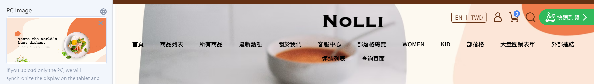{ title="Desktop - upload image" }
 
        === "Tablet"

            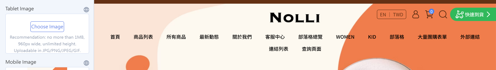{ title="Tablet - upload image" }

        === "Mobile"

            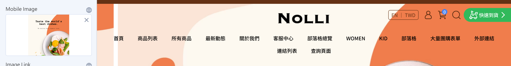{ title="Mobile - upload image" }

    - **If you upload only the desktop image, tablet and mobile use the same image automatically.**
    - Set the **image link** (you can select "Open link in new tab") and **image alt text** (helps SEO).

        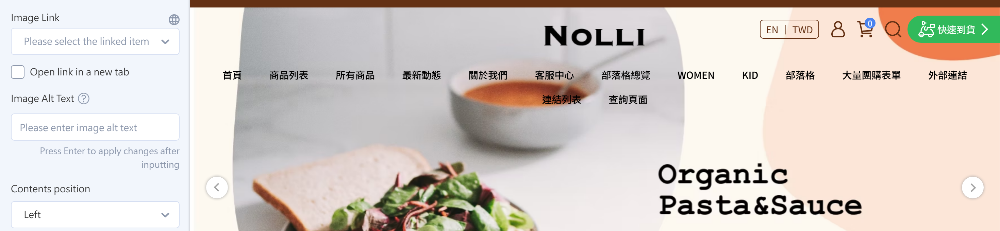{ title="Carousel - image link" }

        ??? info "Where Image Links Can Go"
            **Image link** is a drop-down menu. Choose a destination type first, and then the target: store homepage, all products, a specific product, a product collection (custom/conditional category, pick-any discount), blog, other pages, the lookup page, the customer service form, or choose **external link** and paste an outside URL.

            !!! warning-clean "Prerequisites"
                Options such as multi-level product categories, Mix & Match bundle campaigns, and Bonus Mall appear in the drop-down menu only after you turn on the matching feature.

4. Set the **slide text** (also set separately for each slide):

    - **Content position**: Controls how the title, body text, and button align on the image. Choose **left (default) / center / right**.

        === "Left"

            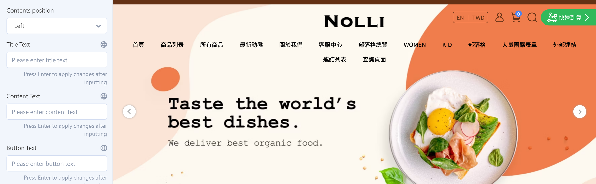{ title="Carousel content position - left" }

        === "Center"

            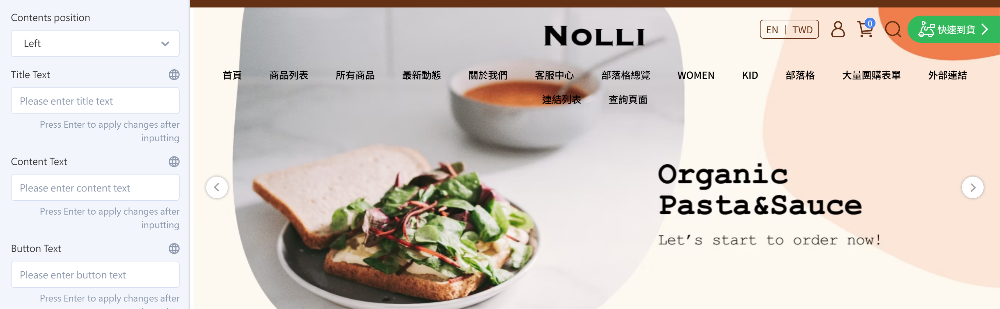{ title="Carousel content position - center" }

        === "Right"

            { title="Carousel content position - right" }

    - **Text content**: Enter the **title text, body text, and button text** in order (all optional; leave one blank to hide that element).
    - **Button link**: A **link field**. You can select **Open link in new tab**.

        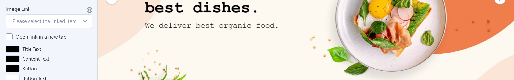{ title="Carousel - button link" }

        ??? info "Where Button Links Can Go"
            The button link is a drop-down menu. Choose a destination type first, and then the target: store homepage, all products, a specific product, a product collection (custom/conditional category, pick-any discount), blog, other pages, the lookup page, the customer service form, or choose **external link** and paste an outside URL.

            !!! warning "Prerequisites"
                Options such as multi-level product categories, Mix & Match bundle campaigns, and Bonus Mall appear in the drop-down menu only after you turn on the matching feature.

    - **Text Color**: Set the color of each of the four elements separately (click a swatch to pick a color).

        { title="Carousel - text color" }

---

#### Banner Ad <small>Large Campaign Entry Image</small> { #operate-page-settings-banner }

A single banner image, often used as a campaign entry point.

1. Add a "Banner Ad" block.
2. Upload **desktop (recommended width 1920px) / tablet (960px) / mobile (480px)** images, up to 1 MB each. JPG, PNG, JPEG, and GIF are supported. **If you upload only the desktop image, tablet and mobile use the same image automatically.**

    === "Desktop"

        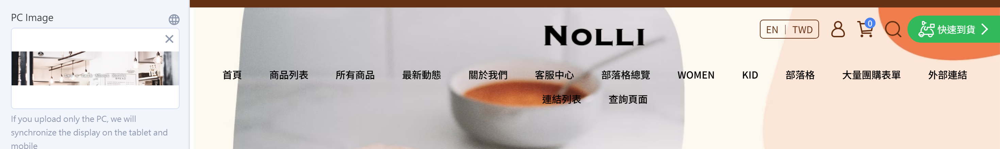{ title="Desktop - upload image" }

    === "Tablet"

        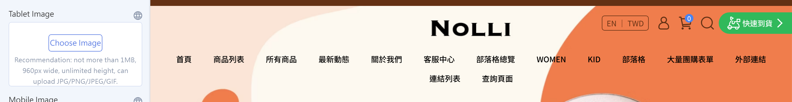{ title="Tablet - upload image" }

    === "Mobile"

        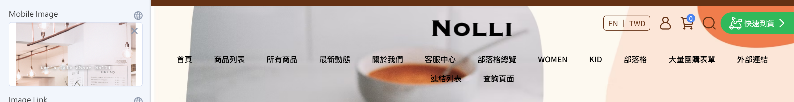{ title="Mobile - upload image" }

3. Set the **image link** (you can select "Open link in new tab") and **image alt text**.

    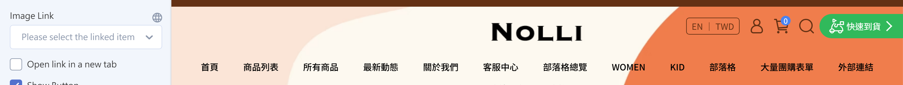

    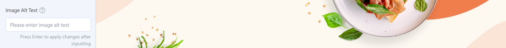

4. You can select **Show button**. After you turn it on, set the **button position** (top center, center, bottom center), **button text**, and the button's **background color / text color**.

    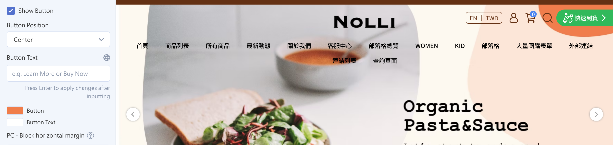

5. Adjust the layout margins (desktop left/right and bottom, mobile left/right and bottom; **mobile bottom outer margin defaults to 24px**).

    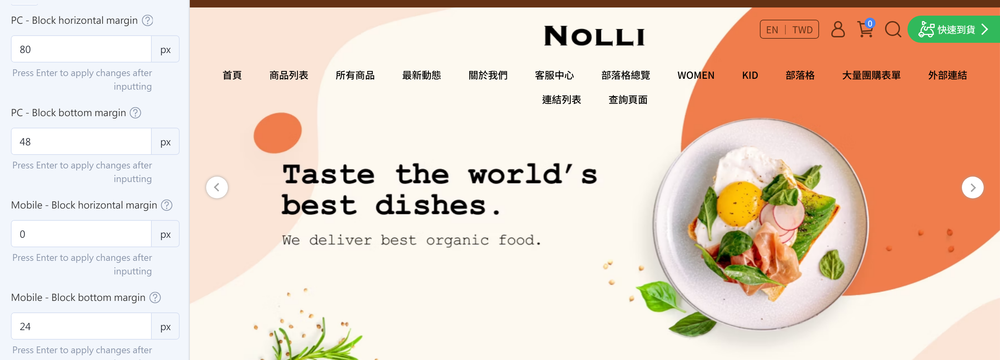{ title="Banner ad - layout margins"}

---

#### Product Collection <small>Product List Display</small> { #operate-page-settings-collection }

A list block that pulls in products from a specific product collection.

1. Add a "Product Collection" block.
2. Enter a **title**, and click **Select Product Collection** to choose the collection to show.
3. Set the **maximum number of products** (products shown at a time, default 12) and how **products expand**.

    === "Swipe Left and Right"

        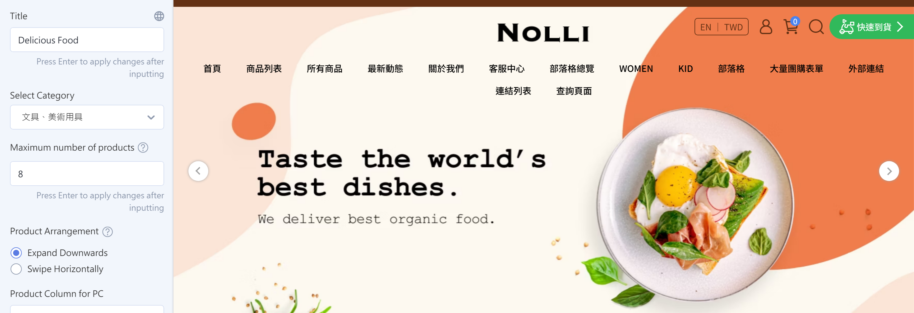

    === "Expand Downward"

        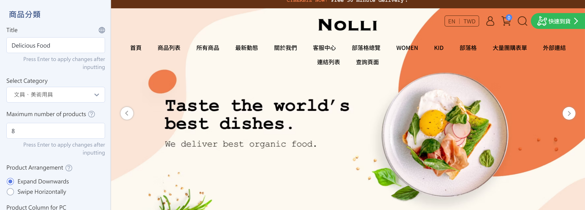

4. Adjust the **layout settings**:

    - **Product columns**: **2–6 columns** on desktop (default 4), **1–3 columns** on mobile (default 2).
    - **Product alignment**: Left / center / right.
    - **Text Alignment**: Left / center / right (default center).

    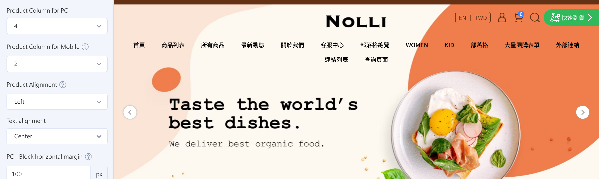

5. Choose the **style settings**:

    - **Desktop product collection style**: Default (product image) / Show partial content (product image, name, price) / Show all (product image, name, price, buy button).

        === "Default"

            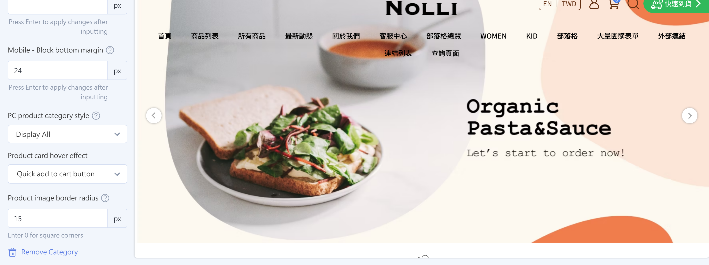

        === "Show Partial Content"

            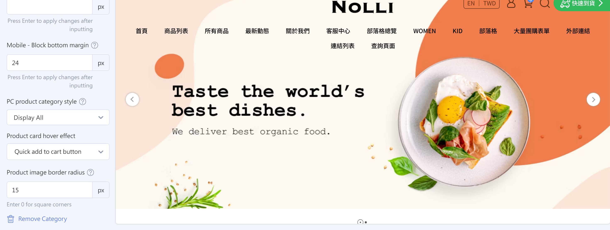

        === "Show All"

            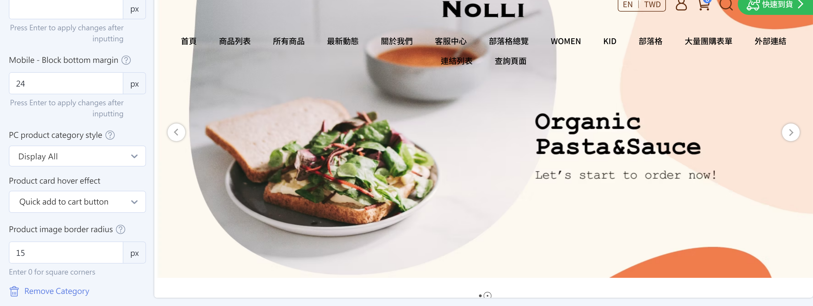
    
    { #operate-page-settings-hover-effect }

    - **Product image hover effect**: Quick add to cart button, image swap, shadow/border highlight, zoom.

        === "Quick Add to Cart Button"
            
            The quick add to cart button looks different depending on the **desktop product collection style** setting (default / show partial content / show all):

            === "Default"
                
                - **Cart button format**: Round icon button
                - **Position**: Bottom right of the product image
                - **Note**: When the product is out of stock, the round icon is grayed out and can't be clicked

                

                - { title="Out of stock / cart button style" }
                - { title="In stock / cart button style" }

                

            === "Show Partial Content"
                
                - **Cart button format**: Round icon button
                - **Position**: Bottom right of the product image
                - **Note**: When the product is out of stock, the round icon is grayed out and can't be clicked

                

                - 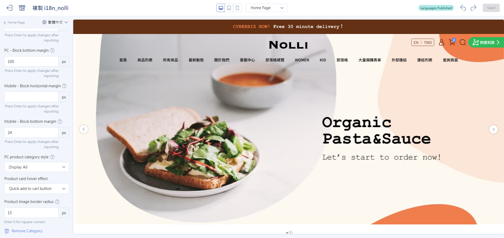{ title="Out of stock / cart button style" }
                - 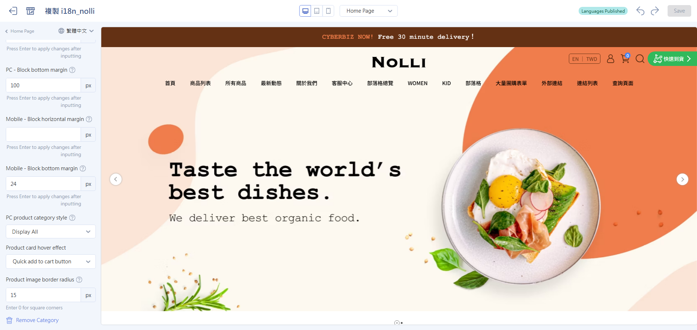{ title="In stock / cart button style" }

                

            === "Show All"

                - **Cart button format**: Rectangular text button
                - **Position**: Below the product name and price
                - **Note**: When the product is out of stock, the text changes to **Sold Out**, and the button is grayed out and can't be clicked

                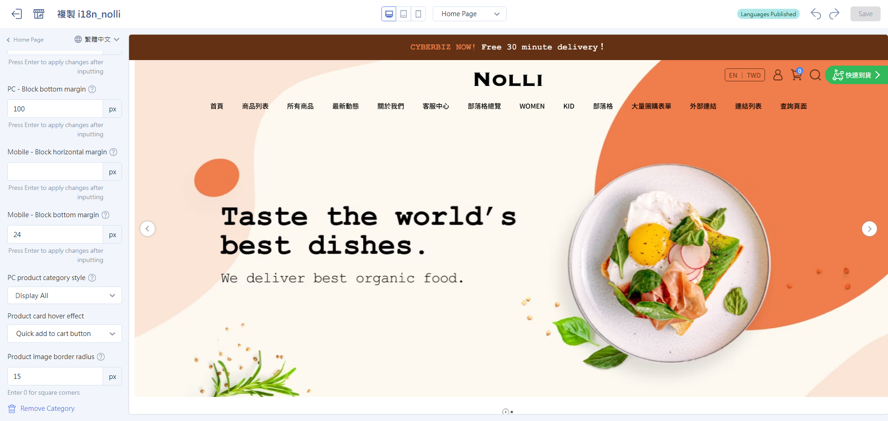{ .screenshot }

        === "Image Swap"
            { title="Image swap" }

        === "Shadow/Border Highlight"
            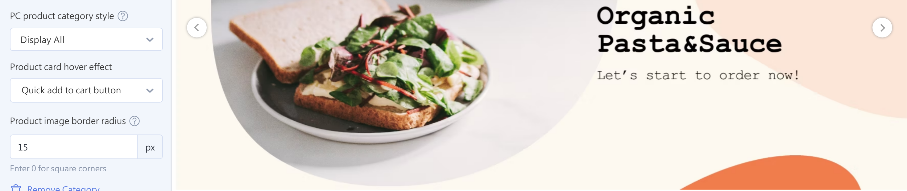{ title="Shadow/border highlight" }

        === "Zoom"
            { title="Zoom" }

    - **Product image corner radius** (default 15px).

        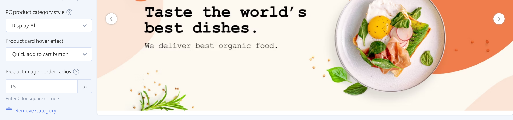{ title="Product image corner radius setting" }

---

#### Video Settings <small>YouTube Embed</small> { #operate-page-settings-video }

Embed a single video.

1. Add a "Video Settings" block.
2. Enter a **title** and **video link**.

    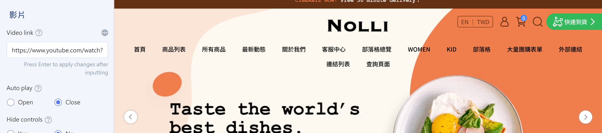{ title="Video title and link" }

    !!! info "Only YouTube Videos Are Supported"
        Paste the full video link, for example: https://www.youtube.com/watch?

3. Set the playback behavior (all yes/no):

    - **Autoplay** (off by default): The video plays automatically when visitors scroll to the video block. Because of browser restrictions, videos with autoplay turned on play muted.
    - **Hide frame** (off by default): When autoplay and hide frame are both turned on, the YouTube video can't be paused
    - **Loop** (**on by default**).

    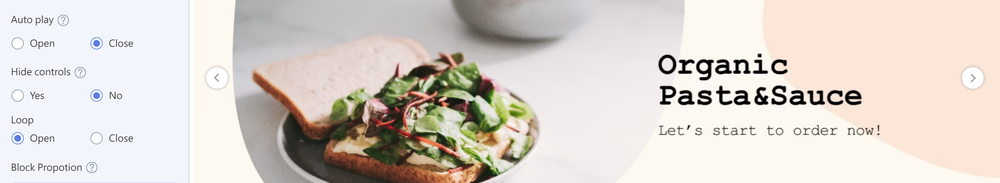{ title="Video playback settings" }

4. Adjust the desktop/mobile layout margins (all four margins default to 0 for this block).

    { title="Video layout margin settings" }

---

#### Tabs { #operate-page-settings-blog-tabs }

Shows posts from multiple blogs in tabs.

1. Add a "Tabs" block.
2. In **Other Layout Settings**, enter a title, adjust the layout margins, and set the number of post columns.

    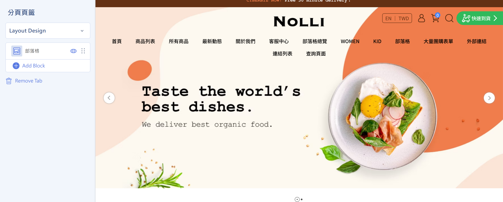

3. In each **Blog** sub-block, choose the blog to show.

    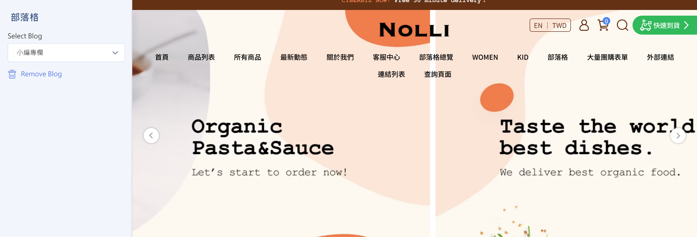

---

#### Custom Layout Design { #operate-page-settings-custom-blocks }

A flexible layout that combines different sub-blocks freely.

1. Add a "Custom Layout Design" block.
2. Set the layout in **Other Layout Settings**:

    - Desktop/mobile **layout margins**.
    - **Block spacing**: The distance between sub-blocks. Set separately for desktop and mobile (default 10px).
    - **Mobile layout**: Controls how sub-blocks are arranged on mobile.

3. Click **Add Sub-Block** and choose the type of element to add. **Every sub-block type has a "screen width share" setting** that controls its width:

    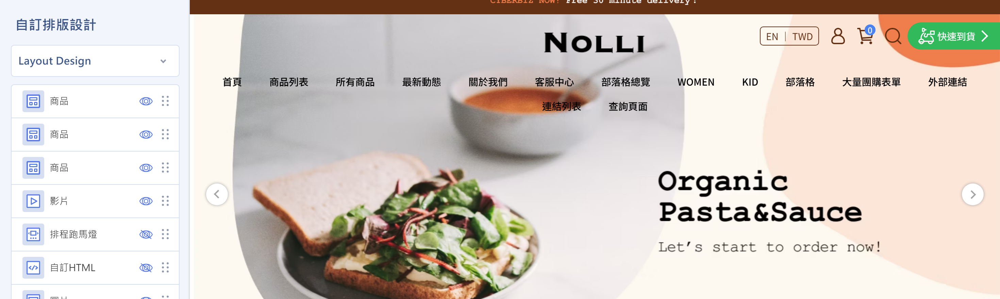{ title="Add sub-block" }

    === "Image"

        1. Upload desktop/tablet/mobile images (if you upload only the desktop image, it's used for the others).
        2. Enter the **image title, image description (advanced text), image link (can open in a new tab), and image alt text**.
        3. Set the **screen width share**.

        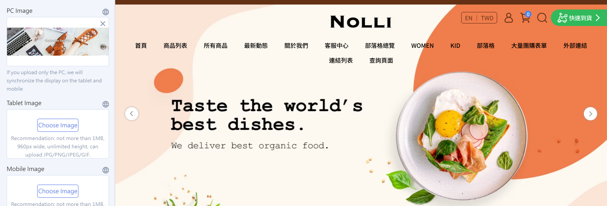

    === "Video"

        1. Paste the **video link**.
        2. Set **autoplay / hide frame / loop** (loop is on by default).
        3. Set the **screen width share**.

        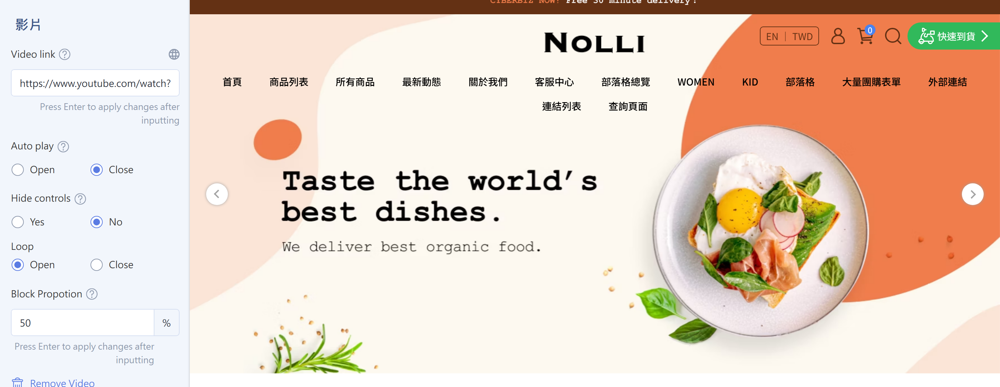

    === "Scheduled Carousel"

        1. Load a prebuilt **carousel group**.
        2. Set the **screen width share**.
        3. For details, see the [scheduled carousel setup guide](configure-scheduled-carousels.md){ title="Create and Manage Scheduled Carousels" }.

        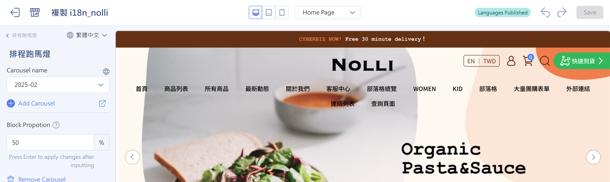

    === "Custom HTML"

        1. Click "Edit" to open the HTML editing page.
        2. Paste your custom HTML/CSS code.
        3. Set the **screen width share**.

        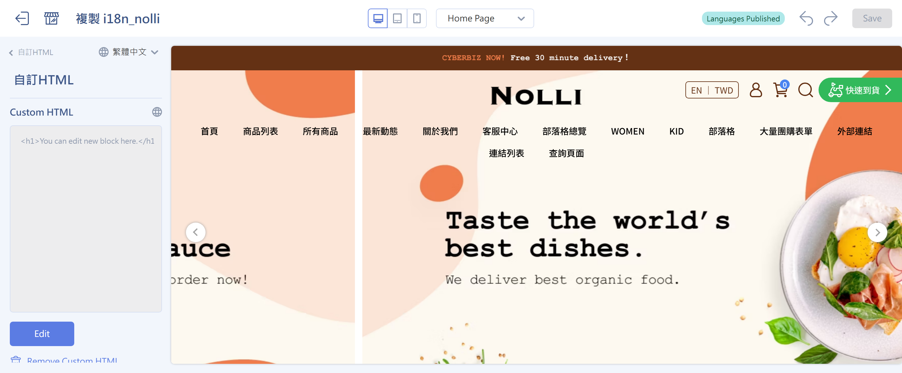

    === "Product"

        1. Click "Select Products" to find a product (you can select only one product).

            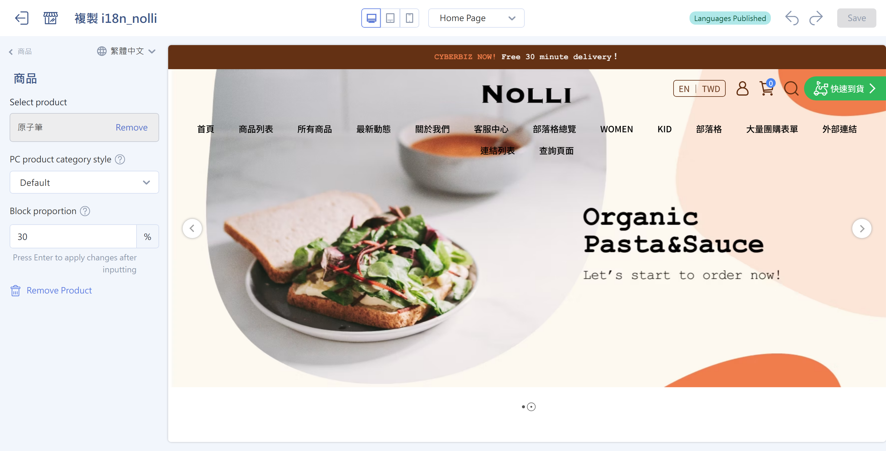

        2. Set the **desktop product collection style** and **screen width share**.

            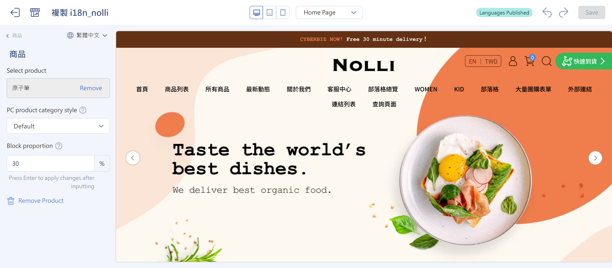

    !!! tip "Layout Proportions for Design Modules"
        Use "**screen width share**" to control the width of each sub-block so several sub-blocks sit side by side in one row. Each row can total up to 100%. Anything beyond that wraps to the next row automatically.

<!---->
<!-- #### Custom Layout Design -->
<!---->
<!-- A flexible layout that combines different sub-blocks freely. You can set block spacing and the mobile layout. -->
<!---->
<!-- 1. Add a "Custom Layout Design" block. -->
<!-- 2. Click **Add Sub-Block** and choose the type of element to add: -->
<!---->
<!--     { title="Add sub-block" } -->
<!---->
<!-- === "Image" -->
<!---->
<!--     1. Upload desktop/tablet/mobile images. -->
<!--     2. Enter the title, image description, link, and alt text. -->
<!--     3. Set the **screen width share** (controls the block's share of the row width). -->
<!---->
<!--      -->
<!---->
<!-- === "Video" -->
<!---->
<!--     1. Paste the video link. -->
<!--     2. Set autoplay / hide frame / loop. -->
<!--     3. Set the **screen width share**. -->
<!---->
<!--      -->
<!---->
<!-- === "Scheduled Carousel" -->
<!---->
<!--     1. Load a prebuilt carousel group. -->
<!--     2. Set the **screen width share**. -->
<!--     3. For details, see the [scheduled carousel setup guide](configure-scheduled-carousels.md){ title="Create and Manage Scheduled Carousels" }. -->
<!---->
<!--      -->
<!---->
<!-- === "Custom HTML" -->
<!---->
<!--     1. Click "Edit" to open the HTML editing page. -->
<!--     2. Paste your custom HTML/CSS code. -->
<!--     3. Set the **screen width share**. -->
<!---->
<!--      -->
<!---->
<!-- === "Product" -->
<!---->
<!--     1. Click "Select Products," find a product with advanced filters or keywords, and click "Confirm Add." You can select only one product. -->
<!--     2. Set the desktop product collection style and **screen width share**. -->
<!---->
<!--      -->
<!---->
<!--      -->
<!---->
<!-- !!! tip "Layout Proportions for Design Modules" -->
<!--     Set the "**screen width share**" to control each block's width on the screen so several blocks can sit side by side in one row. -->
<!---->
<!--     **How arrangement works:** -->
<!---->
<!--     - Blocks are arranged from left to right in order. -->
<!--     - Each row can total up to 100%. When side-by-side blocks exceed 100%, the system wraps automatically, moving the overflowing block and those after it to the next row, and so on. -->
<!---->
<!--     ??? example "Common Layout Examples" -->
<!--         === "Three Columns" -->
<!--             Create 3 blocks and set each to 33%. As long as the three total no more than 100%, they sit side by side. -->
<!---->
<!--             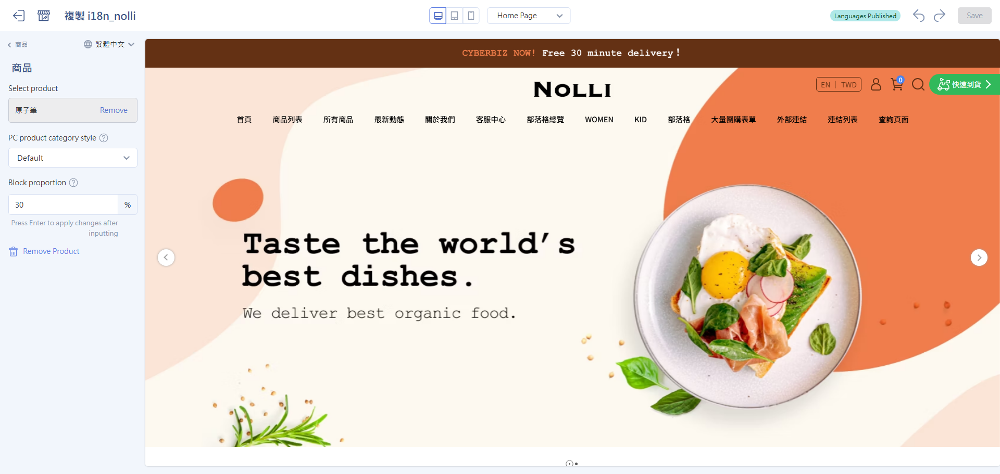 -->
<!---->
<!--         === "Two Columns" -->
<!--             Create 2 blocks. Use combinations that total 100%, such as 60% + 40% or 50% + 50%. -->
<!---->
<!--              -->
<!---->
<!--         === "One Column" -->
<!--             If a single block should span the full width, set it to 100%. -->
<!---->
<!--             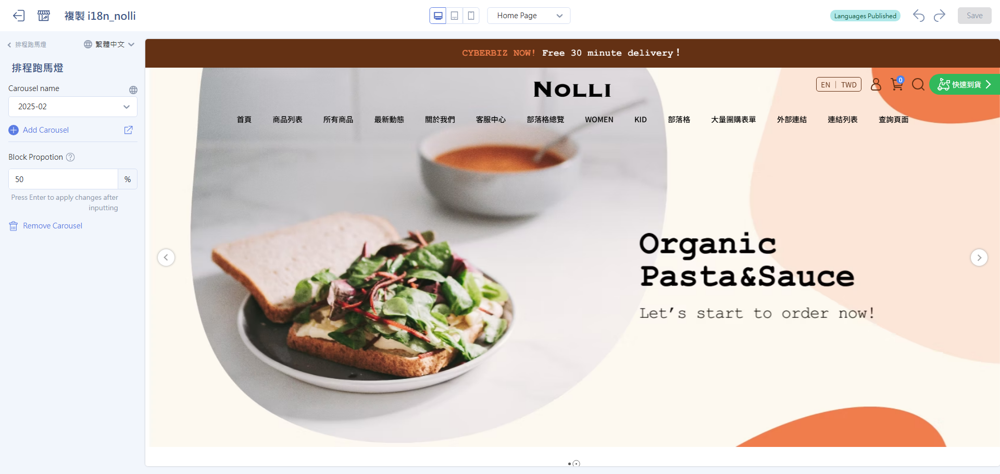 -->

---

#### Image and Text { #operate-page-settings-graphic-intro }

An introduction block with an image, text, and a button.

1. Add an "Image and Text" block.
2. Click **Other Layout Design** and set the following:

    - **Text layout**: Choose the text alignment (left / center / right).
    - **Text**: Set the text color (click a swatch to pick a color).
    - **Background**: Set the block's background color.

    

    === "Desktop"

        - **Left/right outer margin**: Set to 0px for full width. Press Enter to apply.
        - **Bottom outer margin**: Distance from the block below.

        

    === "Tablet and Mobile"

        - **Left/right outer margin**: Same as desktop.
        - **Bottom outer margin**: Same as desktop.

        

3. Click **Image Design** and upload desktop (recommended width 1920px) / tablet (960px) / mobile (480px) images. **If you upload only the desktop image, tablet and mobile use the same image automatically.**

    - **Image position**: Place the image on the left or right of the block.
    - **Image alt text**: Enter a description of the image (helps SEO), and then press Enter to apply.
    - **Desktop width share**: Controls the image's share of the block width.

      

4. In the **sub-blocks**, edit the title (font size adjustable), body text (font size adjustable), and button (text, background/text color, link).

    

    === "Title"

        

    === "Body Text"

        

    === "Button"

        - **Button text**: Enter the text shown on the button (default "Learn More"), and then press Enter to apply. Click the swatches to set the button's **background color** and **text color**.
        - **Button link**: Choose a link target from the drop-down menu. You can select **Open link in new tab**.

        

        ??? info "Where Button Links Can Go"
            The button link is a drop-down menu. Choose a destination type first, and then the target: store homepage, all products, a specific product, a product collection (custom/conditional category, pick-any discount), blog, other pages, the lookup page, the customer service form, or choose **external link** and paste an outside URL.

            !!! warning "Prerequisites"
                Options such as multi-level product categories, Mix & Match bundle campaigns, and Bonus Mall appear in the drop-down menu only after you turn on the matching feature.

---

#### Custom HTML { #operate-page-settings-custom-html }

Paste HTML code directly. Good for third-party code or custom content.

1. Add a "Custom HTML" block.
2. Click "Edit" and paste your code in the HTML editor.

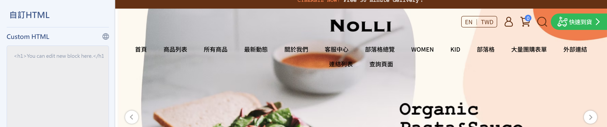

---

#### App { #operate-page-settings-app }

Add an installed app component.

1. Add an "App" block.
2. Click **Select App** and choose an installed app.

---

#### Text Editor { #operate-page-settings-text }

A text editing block with an advanced text editor.

1. Add a "Text Editor" block.
2. Enter content in the advanced text editor. You can use headings, styles, links, and more.

---

<!-- #### CMS `Plan-Specific` -->
<!---->
<!-- An advanced custom block with HTML/CSS/JS/Import code editors. It can pull in a specific product collection with a maximum number of products. -->
<!---->
<!-- 1. Add a "CMS" block (requires the CMS feature). -->
<!-- 2. Write or paste HTML/CSS/JS code in the code editor. -->
<!-- 3. Set the product collection to pull in and the maximum number of products. -->

---

#### Featured Product { #operate-page-settings-flagship }

Highlights a single product and lets customers buy it.

1. Add a "Featured Product" block.
2. Click **Other Layout Design** and adjust the layout margins.

    === "Desktop"

        - **Left/right outer margin**: Set to 0px for full width. Press Enter to apply.
        - **Bottom outer margin**: Distance from the block below.

        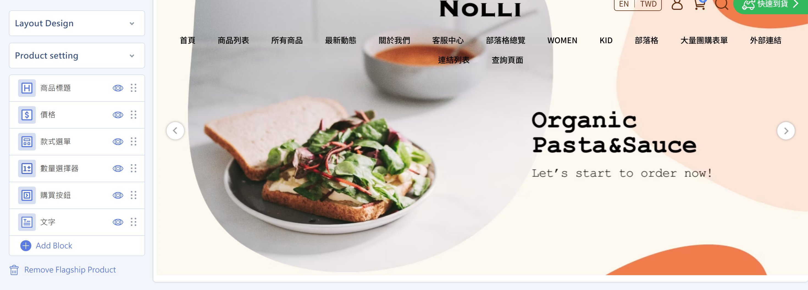

    === "Tablet and Mobile"

        - **Left/right outer margin**: Same as desktop.
        - **Bottom outer margin**: Same as desktop.

        

3. Click the **Product Settings** drop-down and set the following:

    - **Select Products**: Click **Add Product** to choose the product to show.
    - **Product image position**: Place the image on the left or right.

    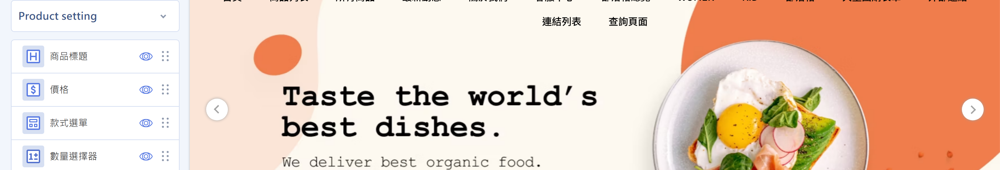

4. In the **sub-blocks**, set the product title (font size, optional product link), text, buy button, price, variant menu, and quantity selector.

    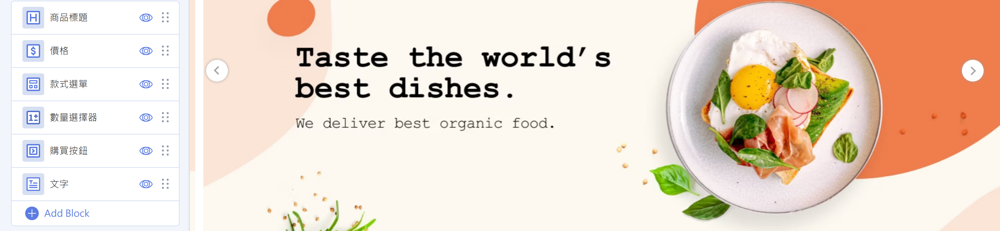

    === "Product Title"

        - **Font size**: Set the title font size (default 24px).
        - **Include product link**: Select this to link the title to the product page (on by default).
        - **Open product link in new tab**: Select this to open the link in a new tab (on by default).

        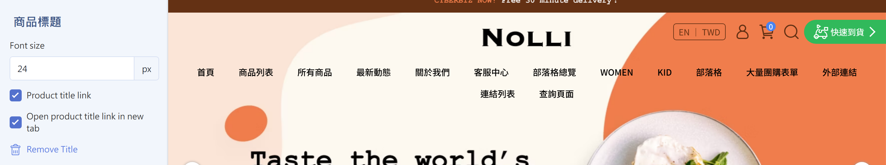

    === "Price"

        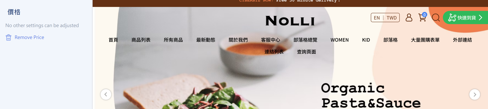

    === "Variant Menu"

        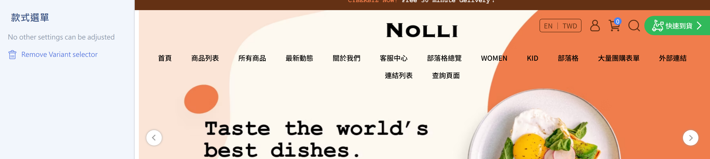

    === "Quantity Selector"

        

    === "Buy Button"

        - **Show Buy Now button**: Select this to show the buy button (on by default).

        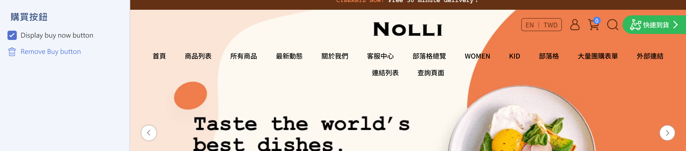

---

#### Collapsible Content <small>FAQ / Shopping Notes</small> { #operate-page-settings-collapsible }

A content block that expands and collapses. It's the main tool for building an **FAQ**, shopping notes, return and exchange information, and more.

1. Add a "Collapsible Content" block.
2. Click **Other Layout Design** and set the following:

    - **Title**: Enter the block title (default "Collapsible Content"), and then press Enter to apply.
    - **Colors**: Click the swatches to set the background, item background, item border, and text and icon colors.

    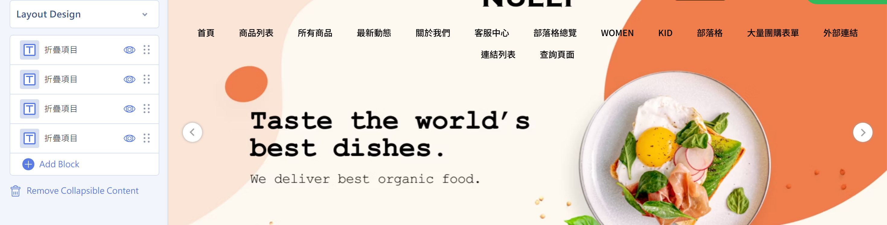

    === "Desktop"

        - **Left/right inner padding**: Press Enter to apply (default 160px).
        - **Top/bottom inner padding**: Same as above (default 48px).
        - **Bottom outer margin**: Distance from the block below (default 30px).

        

    === "Tablet and Mobile"

        - **Left/right inner padding**: Press Enter to apply (default 16px).
        - **Top/bottom inner padding**: Same as above (default 24px).
        - **Bottom outer margin**: Distance from the block below (default 10px).

        

3. In the **Collapsible Item** sub-blocks, edit the item title, title icon, and content (advanced text editor).

    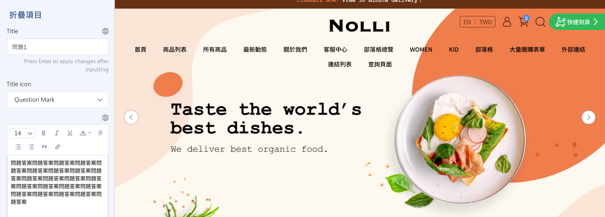

---

### Product Page { #operate-page-settings-product }

The product page has four main sections. Turn them on or reorder them as needed.

Choose "Product Page" in the page drop-down menu to set the following:

=== "Basic Settings"

    Controls the stock status, price label logic, and purchase behavior shown on the storefront.

    - Set whether to **show the product SKU**.

        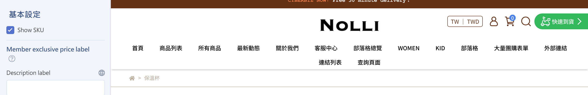

    - Turn on **member-exclusive price labels**: When a product has a member-exclusive price, this label appears next to the price for visitors who aren't signed in. After you turn it on, set the following:

        - **Description label**: Enter the label text, and then press Enter to apply.
        - **Description label link**: Enter a URL and press Enter to apply. Clicking the label goes to that page.

        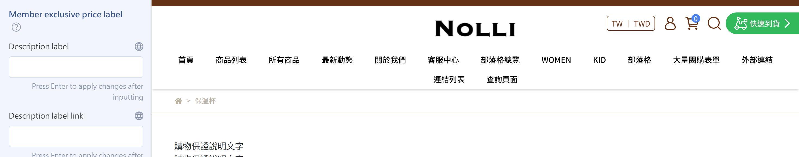

    - Select **Product price label** to show "Sale Price" or "Suggested Retail Price" text.

        === "Sale Price"

            

        === "Suggested Retail Price"

            

    - **Product variant settings**:

        - Select **Select the first variant by default**.

            

        - Out-of-stock style behavior:

            === "Variant Can't Be Selected"

                

            === "Variant Can Be Selected"

                

    - **Other settings**:

        - **Show product vendor**: Select this to show the product vendor name on the storefront.

            

        - **Show promotions section**: Select this to show the promotions block.

            

        - **Show product stock**: Select this to show the product stock quantity on the storefront.

            

=== "Product Description"

    Set the title of the product description section, and choose whether to show it on the storefront.

    

=== "Product Reviews"

    Contact customer support to turn on this feature first. After it's turned on, you can choose whether comments need review, hide part of reviewers' names, and use Google reCAPTCHA to block bot attacks.

    

    

    - :lucide-message-square:{ .lg } [__Manage Product Reviews__](../../products/engagement/manage-product-reviews.md){ title="Manage Product Reviews" }

    - :lucide-shield-check:{ .lg } [__Enable reCAPTCHA for Comments__](../customer-interaction/enable-comment-recaptcha.md){ title="Enable reCAPTCHA for Comments" }

    

=== "Related Products"
    { #operate-page-settings-related-products }

    Choose to show "other products in the product collection" (random products from the same collection) or "custom related collection products."

    - **Show other products in the same collection**: Randomly shows other items from this product's product collection.
    - **Show custom related collection products**: Shows, in order, the related collection items set for this product on its product page ([related product collections](../../products/create-and-manage/create-update-products.md#operate-product-edit-settings){ title="Set Up Related Product Collections" }).
    - **Related products label text**: Enter the label text, and then press Enter to apply.
    - **Maximum number of products**: Set how many products to show.

    

---

### Product Collection Page { #operate-page-settings-group }

For collection pages, you can choose which navigation menu to use (set it up first in [Menu Setting](../navigation/setup-menus-navigation.md){ title="Set Up Menus and the Navigation Bar" }).

1. Choose "Product Collection Page" in the page drop-down menu, and click **Product Collection Settings** to open the settings page.

    { title="Product collection page - open settings" }

2. Set the following:

    === "Left Menu"

        - **Left menu link**: Choose the menu to show from the drop-down, or choose "Don't show menu" to hide the left menu. Set it up first in [Menu Setting](../navigation/setup-menus-navigation.md){ title="Set Up Menus and the Navigation Bar" }.

            === "With Main Menu"

                { title="Product collection page - with main menu" }

            === "Without Main Menu"

                { title="Product collection page - without main menu" }

        - **Expand left menu by default**: Set whether the left menu is expanded by default.

    === "Product Settings"

        - **Product columns (desktop)**: Choose how many products to show per row (drop-down).
        - **Maximum number of products**: Set how many products to show per page.
        - **How more products load**: Choose pagination or infinite scroll.

        { title="Product collection page - product settings" }

---

### Multi-Level Product Categories { #operate-page-settings-category }

Fine-tune how multi-level category pages look. First [create your multi-level product category structure](../../products/categories-and-tags/multi-level-category-setup.md){ title="Set Up Multi-Level Product Categories" }.

1. Choose "Multi-Level Product Categories" in the page drop-down menu, and click **Multi-Level Product Category Settings** to open the settings page.

    { title="Multi-level product categories - open settings" }

2. Set the following:

    - **Expand left product category menu by default**: Set whether the left menu is expanded by default.
    - **Maximum number of product category blocks**: Set how many product category blocks to show.
    - **Maximum number of products in the product carousel**: Set how many products the carousel shows.
    - **Maximum number of products**: Set how many products to show per page.

    

---

### Blog Page { #operate-page-settings-blog }

Shows a list of post summaries.

1. Choose "Blog Page" in the page drop-down menu, and click **Blog Settings** to open the settings page.

    

2. Set the following:

    - **Posts per page**: Set how many posts to show per page.
    - **Show featured posts**: Select this to show specific featured posts at the bottom of the blog list page.
    - **Featured post group**: Choose which blog group to show as featured content.

    

---

### Blog Post Page { #operate-page-settings-article }

Shows the full content of a single post.

1. Choose "Blog Post Page" in the page drop-down menu, and click **Blog Post Settings** to open the settings page.

    

2. Set the following:

    - **Show right menu**: Select this to show a menu block to the right of the post.
    - **Post tags section title**: Set the title shown for the post tags block. The system automatically collects all post tags in the post's group and shows them here.
    - **Maximum number of featured posts**: Set the maximum number of featured posts to show.

    

---

### Customer Service Page <small>Contact Us Form</small> { #operate-page-settings-contact }

On the storefront, the customer service page is mainly a "Contact Us" form where visitors can leave inquiries.

1. Choose "Customer Service Page" in the page drop-down menu.
2. We recommend also setting your full company phone number, address, and email in the [**footer**](../navigation/setup-menus-navigation.md#operate-menus-nav-footer-content){ title="Set Up Footer Content" } block to build brand trust.
3. To block bot attacks, [enable reCAPTCHA for comments](../customer-interaction/enable-comment-recaptcha.md){ title="Enable reCAPTCHA for Comments" }.

---

### 404 Page <small>Broken Link Message</small> { #operate-page-settings-not-found }

The page shown when customers visit a broken link. Customize its look to soften the bad experience.

1. Choose "404 Page" in the page drop-down menu.
2. Upload a custom image. We recommend an on-brand or playful image that guides visitors.
3. Set the **title** and the **back to homepage button text**.

---

### Express Delivery Page { #operate-page-settings-express }

Customize the look of the Express Delivery section and make its entry stand out.

1. Choose "Express Delivery Page" in the page drop-down menu, and click **Express Delivery Settings** to open the settings page.

    

2. Set the following:

    **Navigation bar settings**

    - **Show out-of-stock products**: Select this to also show out-of-stock products in the Express Delivery section.
    - **Show Express Delivery button**: Select this to show a prominent section entry above the site-wide navigation bar.
    - **Express Delivery text**: Customize the text on the Express Delivery button. Press Enter to apply the change.

    **Icon settings**

    - **Choose Image**: We recommend no more than 1 MB, 80px wide, and 80px high. JPG/PNG/JPEG/GIF are supported.
    - **Logo background**: Set the background color of the navigation bar and Express Delivery button to help customers tell the Express Delivery section apart from regular sections.
    - **Icon**: Click the swatch to change the color of the icon and Express Delivery text in the navigation bar.

    

---

### Search Page <small>Site Search Results</small> { #operate-page-settings-search }

1. Choose "Search Page" in the page drop-down menu.
2. Choose the **menu** to use on the left of the search page ([create a menu](../navigation/setup-menus-navigation.md){ title="Set Up Menus and the Navigation Bar" } first).
3. Products in search results follow the display rules in "[Global Settings](setup-global-theme-settings.md#operate-global-settings-shop-product){ title="Global Settings" }" (price range, product taglines, quantity sold, and more).
4. The search results page can show subscription, sale, out of stock, and custom labels.

??? info "Search Scope and Logic"
    - **Search scope:** Search covers not only the "product name" but also **product collection names, product vendors, and product descriptions**.
    - **Word segmentation:** Product titles support segmented search, and a search must fully match a segment to find a product. For example, a "space" or "-" splits a title into words: if the title is "ER-1410," searching "1410" finds it; if the title is "ER1410," searching "1410" doesn't.
    - **Exclude from search:** If you don't want some products to appear on the search page, turn off "Product Search" in "Basic Settings" on the product edit page. The product then can't be found in the site search box, all product lists, or external Google search.

---

## Next Steps { #next-steps-page-settings }

- :lucide-palette:{ .lg }  
  [__Drag-and-Drop Theme Site Settings__](theme-editor.md){ title="Drag-and-Drop Theme Site Settings" }  
  Learn how to open the drag-and-drop theme editor and set up your website

- :lucide-settings-2:{ .lg }  
  [__Global Settings__](setup-global-theme-settings.md){ title="Global Settings" }  
  Set pop-up ads, colors, brand identity, SEO, product display behavior, and dynamic labels

## References { #reference-page-settings }

- [Block Types You Can Add Reference](../references/theme-editor-sections.md)
- [Drag-and-Drop Editable Pages Reference](../references/theme-editor-pages.md)

 ---
 <!---->
 <!-- #### Image and Text  -->
 <!---->
 <!-- An introduction block with an image, text, and a button.  -->
 <!---->
 <!-- 1. Add an "Image and Text" block.  -->
 <!-- 2. Set the **text layout** (left / center / right), **text color**, and **background color**.  -->
 <!-- 3. Upload desktop/tablet/mobile images, and choose the **image position** (left/right) and **desktop width share** (default 50%).  -->
 <!-- 4. Edit the **sub-blocks**:  -->
 <!---->
 <!--     - **Title**: Text content (default "Product Introduction"). You can set the **font size** (default 24px).  -->
 <!--     - **Body text**: Advanced text editor. You can set the **font size** (default 14px).  -->
 <!--     - **Button**: Button text (default "Learn More"), button background/text color, and button link (can open in a new tab).  -->
 <!---->
 <!--   -->
 <!---->
 <!-- ---  -->
 <!---->
 <!-- #### Custom HTML  -->
 <!---->
 <!-- Paste HTML code directly. Good for third-party code or custom content.  -->
 <!---->
 <!-- 1. Add a "Custom HTML" block.  -->
 <!-- 2. Click "Edit" and paste your code in the HTML code editor.  -->
 <!-- 3. Adjust the desktop/mobile layout margins in **Other Layout Settings** (all four margins default to 0 for this block).  -->
 <!---->
 <!--   -->
 <!---->
 <!-- ---  -->
 <!---->
 <!-- #### App  -->
 <!---->
 <!-- Add an installed app component.  -->
 <!---->
 <!-- 1. Add an "App" block.  -->
 <!-- 2. Click **Select App** and choose an installed app (this is the block's only setting; it has no layout margins).  -->
 <!---->
 <!--   -->
 <!---->
 <!-- ---  -->
 <!---->
 <!-- #### Text Editor  -->
 <!---->
 <!-- A text editing block with an advanced text editor.  -->
 <!---->
 <!-- 1. Add a "Text Editor" block.  -->
 <!-- 2. Enter content in the advanced text editor. You can use headings, styles, links, and more.  -->
 <!-- 3. Adjust the desktop/mobile layout margins in **Other Layout Settings** (all four margins default to 0).  -->
 <!---->
 <!--   -->
 <!---->
 <!-- ---  -->
 <!---->
 <!-- #### CMS `Plan-Specific`  -->
 <!---->
 <!-- An advanced custom block with a code editor. It can pull in a specific product collection.  -->
 <!---->
 <!-- 1. Add a "CMS" block (requires the CMS feature).  -->
 <!-- 2. Write code in the code editor, which has **4 fields**: **Root (HTML) / CSS / JS / Import**.  -->
 <!-- 3. Set the **product collection** to pull in and the **maximum number of products**.  -->
 <!---->
 <!-- ---  -->
 <!---->
 <!-- #### Featured Product  -->
 <!---->
 <!-- Highlights a single product and lets customers buy it.  -->
 <!---->
 <!-- 1. Add a "Featured Product" block.  -->
 <!-- 2. Click **Select Products** to choose the product to show, and choose the **product image position** (left/right).  -->
 <!-- 3. Set the following in the **sub-blocks**:  -->
 <!---->
 <!--     - **Product title**: You can set the **font size** (default 24px) and select "**Include product link**" and "**Open product link in new tab**" (both on by default).  -->
 <!--     - **Text**: Advanced text editor. You can set the font size (default 14px).  -->
 <!--     - **Buy button**: You can select "**Show Buy Now button**" (on by default).  -->
 <!--     - **Price / variant menu / quantity selector**: Fixed sub-blocks with no other settings.  -->
 <!---->
 <!-- 4. This block has **larger default layout margins** (desktop 80px left/right and 50px bottom; mobile 16px left/right and 24px bottom).  -->
 <!---->
 <!--   -->
 <!---->
 <!-- ---  -->
 <!---->
 <!-- #### Collapsible Content  -->
 <!---->
 <!-- A content block that expands and collapses. Good for FAQs or shopping notes.  -->
 <!---->
 <!-- 1. Add a "Collapsible Content" block.  -->
 <!-- 2. Enter a **title** (default "Collapsible Content").  -->
 <!-- 3. Set the **colors**: background, item background, item border, and text and icons (4 colors in total).  -->
 <!-- 4. Set the **margins** (this block uses **inner padding**, not outer margins):  -->
 <!---->
 <!--     - Desktop: left/right inner padding (default 160px), top/bottom inner padding (default 48px), bottom outer margin (default 30px).  -->
 <!--     - Mobile: left/right inner padding (default 16px), top/bottom inner padding (default 24px), bottom outer margin (default 10px).  -->
 <!---->
 <!-- 5. In the **Collapsible Item** sub-blocks, edit the **item title**, **title icon** (none / question mark / pin / check mark / light bulb, 5 in total), and **content** (advanced text editor).  -->
 <!---->
 <!--   -->
