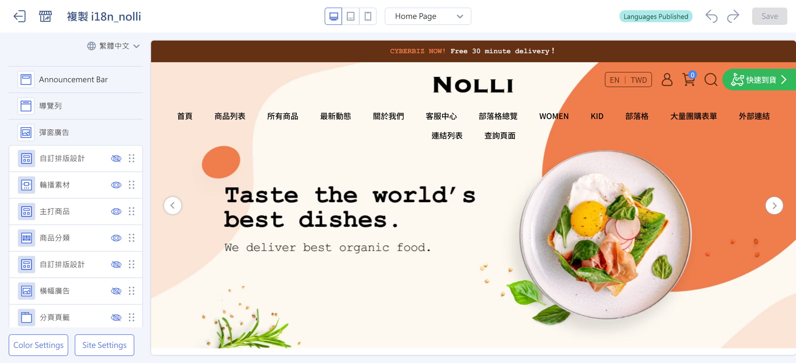{ .hero-page }

## About Drag-and-Drop Themes { #intro-theme-editor }

"Drag-and-drop themes" are CYBERBIZ's new generation of themes. Storefront pages are made up of **blocks**. Each block is a section of content on the page, such as a hero carousel, an image-and-text introduction, or a product list. In the drag-and-drop theme editor, you can:

- **Add and remove blocks:** Freely add or remove content sections on the page.
- **Drag to reorder:** Drag blocks up or down with your mouse to change their order on the page.
- **Edit content:** Click a block, and then enter text, upload images, set links, and choose products in the panel.
- **Preview live:** The center view shows your changes as you make them, and you can switch between desktop, tablet, and mobile views.
- **Publish:** When everything looks right, publish with one click to apply the theme to your live website.

The editor has three main areas: **the block list on the left, the live preview in the center, and the block settings on the left**. Everything you do happens in these three areas.

## Page Overview { #overview-theme-editor }

| Area | Location | Purpose |
| :-- | :-- | :-- |
| Top toolbar | Top of the editor | Switch the page being edited, preview device, undo/redo, preview the storefront, save, and publish |
| Block list | Left panel | Lists all blocks on the current page. Add, drag to reorder, show/hide, or click to edit |
| Live preview | Center view | Shows the actual storefront result as you edit. Switch between desktop/tablet/mobile |
| Block settings | Left panel | Opens when you click a block. Edit the block's text, images, links, products, and more |

=== ":lucide-wrench: Top Toolbar"

	

=== ":lucide-panel-left: Block List"

	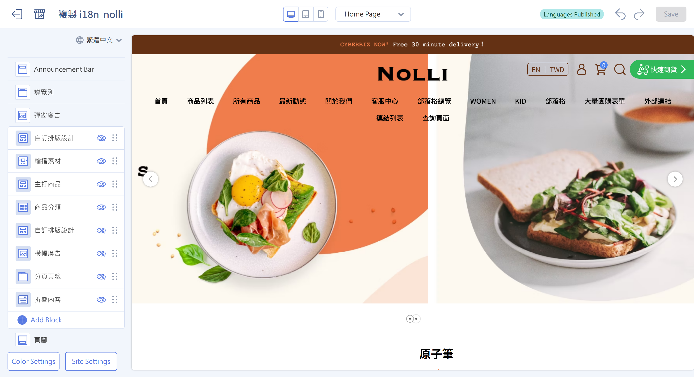

	The left panel lists all blocks on the current page:

	- :lucide-eye: Click to show or hide a block.
	- :lucide-grip-vertical: Hold and drag to reorder blocks.
	- :lucide-circle-plus: Click to add a block.

=== ":lucide-panel-left-open: Live Preview"

	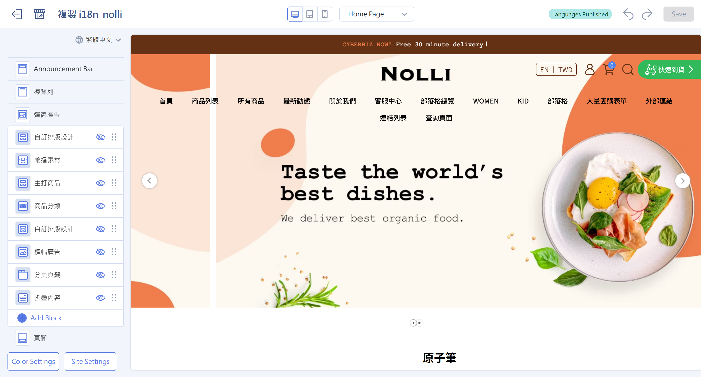

	The center view shows the actual storefront result as you edit. Switch between desktop, tablet, and mobile to check each device.

=== ":lucide-panel-left: Block Settings"

	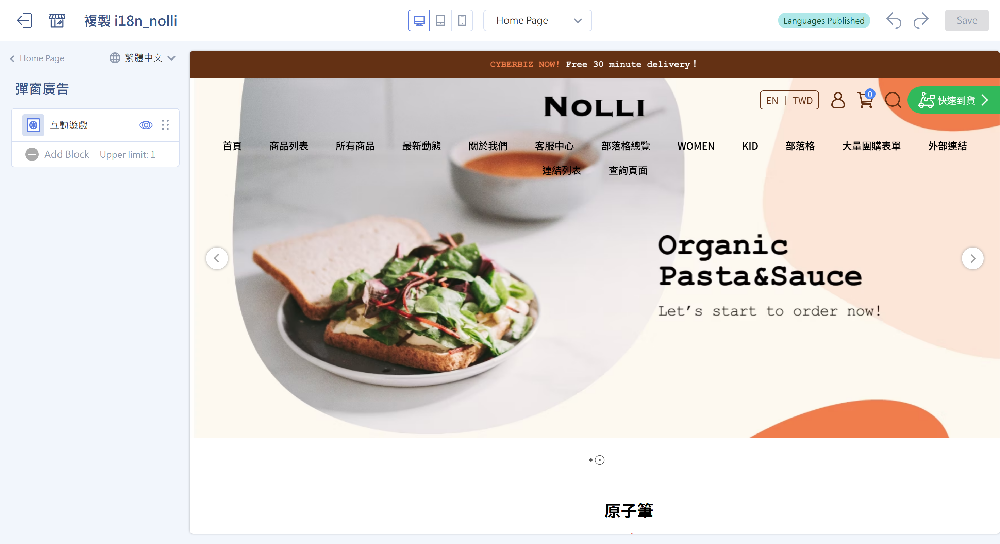

	The left panel opens when you click a block and shows that block's settings:

	- **Text**: Enter titles and description text.
	- **Image**: Upload an image or paste an image URL.
	- **Link**: Set the page or URL to go to when clicked.
	- **Product**: Choose the products to show in the block.

## Prerequisites and Limitations { #prerequisites-theme-editor }

Before you start, check the following. These affect whether you can use the drag-and-drop editor and which pages you can edit:

- [x] **The theme must be a "drag-and-drop theme":** Only themes labeled **draggable** can use the drag-and-drop editor in this article. The older "default themes" use a separate website settings flow that this article doesn't cover.
- [x] **Only some pages support drag and drop:** Currently, pages such as the homepage, product pages, and custom pages support drag-and-drop editing. Not every page does. For the full list, see [Pages You Can Edit with Drag and Drop](../references/theme-editor-pages.md#reference-theme-editor-pages){ title="Drag-and-Drop Editable Pages Reference" data-preview }.
- [x] **Some blocks require features to be turned on:** Most blocks are available in all drag-and-drop themes. A few (such as product reviews and the store locations list) appear only when your plan has the matching feature turned on. See [Block Types You Can Add](../references/theme-editor-sections.md#reference-theme-editor-sections){ title="Block Types You Can Add Reference" data-preview }.

---

## Steps { #operate-theme-editor }

The steps below follow everyday use, from opening the editor to publishing.

### Open the Drag-and-Drop Theme Editor { #operate-theme-editor-enter }

1. **Open the themes page:** In the admin, go to the "**Website Appearance/Theme Setting > Themes**" page, which lists all themes installed in your store.
2. **Find a drag-and-drop theme:** Check whether the theme card is labeled **draggable**, which means it supports drag-and-drop editing.
3. **Open the editor:** Click the **Theme Setting** button on the theme card to open the drag-and-drop theme editor[^default-theme].

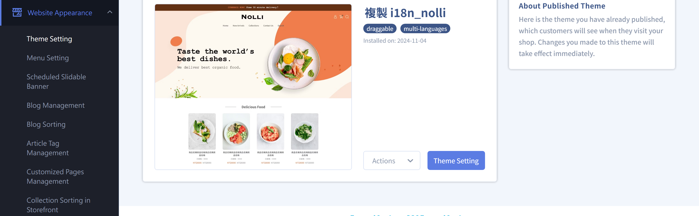

[^default-theme]: If a theme isn't labeled "draggable" (that is, an older default theme), clicking "Theme Setting" opens the legacy website settings page instead of the drag-and-drop editor described here.

---

### Add a Block { #operate-theme-editor-add-section }

1. **Click Add:** Below the block list on the left, click **Add Block**.
2. **Choose a block type:** In the list that appears, choose the block style you want[^section-names], such as a carousel, image and text, or product list.
3. **Confirm Add:** Click **Confirm Add**. The new block is added to the page and appears in the list on the left. Click it to edit its content.

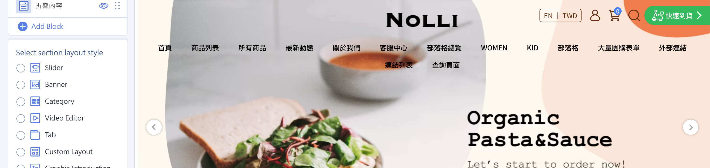

!!! note "Note"
    "Add Block" appears only on pages that support drag and drop (the homepage, product pages, custom pages, and so on). If you switch to a page that doesn't, you won't see the option to add blocks.

[^section-names]: The blocks you can actually choose, and their names, vary with the drag-and-drop theme you installed. Go by what the editor shows.

---

### Edit Block Content { #operate-theme-editor-edit-settings }

1. **Click a block:** Click any block in the list on the left, and the panel shows that block's settings.
2. **Fill in the content:** Enter content based on the block type. Common settings include:
    * **Text:** Type titles and description text, and then press ++enter++ to apply the change.
    * **Image:** Click **Choose Image** or **Upload image** to upload a file, or choose **Paste image URL** to enter an external image URL.
    * **Link:** Set the page or URL to go to when the block is clicked.
    * **Product:** Use **Select Products** to choose the products to show in the block.
3. **Edit nested blocks:** Some blocks (such as carousels) contain several smaller blocks. Click into each one to set it.

!!! tip "Tip"
    After making changes, check the live preview in the center to make sure the content looks as expected. For text fields, press ++enter++ or ++tab++ to apply your changes.

---

### Reorder Blocks { #operate-theme-editor-reorder }

1. **Find the drag handle:** In the block list on the left, each block you can move has a drag icon :lucide-grip-vertical: (move handle).
2. **Drag up or down:** Hold the drag handle, drag the block up or down to where you want it, and release. The order on your storefront page changes to match.

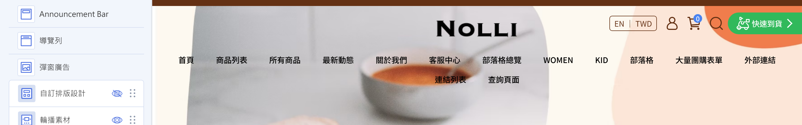

!!! note "Note"
    Some fixed blocks (such as the header menu and footer) can't be dragged to a new position. These blocks don't show a drag handle.

---

### Show or Hide Blocks { #operate-theme-editor-visibility }

You can temporarily hide any block instead of deleting it:

1. **Click the eye icon:** In the list on the left, click the eye icon :lucide-eye: on a block to switch between **show** and **hide**.
2. **Check the result:** Hidden blocks don't appear on the storefront, but your settings are kept. Show the block again later to restore it.

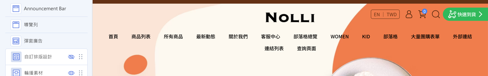

---

### Remove a Block { #operate-theme-editor-remove }

1. **Open the block settings:** Click the block you want to delete to open its settings panel.
2. **Click Remove:** Click **"Remove" :lucide-trash-2:**, and the block is deleted from the page.

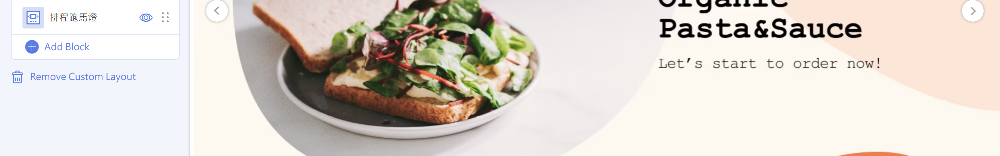

!!! info "Tip"
    Removing a block deletes the whole block and its content. If you only want to hide it for now, [show or hide the block](#operate-theme-editor-visibility) instead, which is safer.

---

### Switch Pages and Preview { #operate-theme-editor-preview }

1. **Switch the page you're editing:** Use the page drop-down menu in the top toolbar to switch the page you're editing and previewing (for example, the homepage or a product page).

    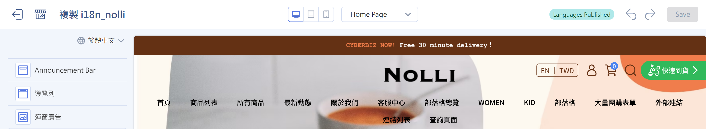

2. **Switch the preview device:** Click the **desktop / tablet / mobile** icons at the top. The preview adjusts to that device's width so you can check the responsive (RWD) layout.

    === "Desktop"
        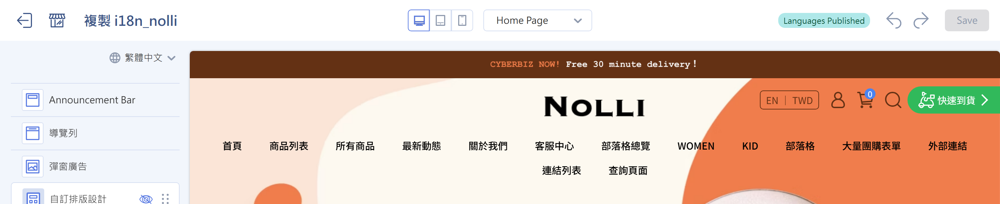

    === "Tablet"
        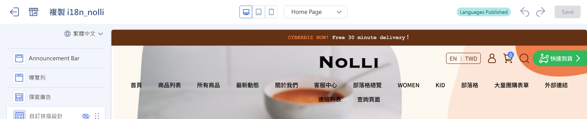

    === "Mobile"
        

3. **Preview the actual storefront:** Click **Preview** to open a new tab that shows your current edits as they'll look on the storefront.

    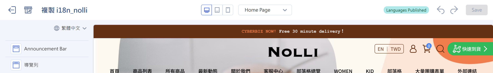

- :lucide-panel-top:{ .lg }
  __[Page Settings Guide](setup-theme-page-settings.md){ title="Page Settings Guide" }__

---

### Switch Languages { #operate-theme-editor-language }

If your store has multiple languages turned on (more than one language), a **language switcher** appears in the top toolbar:

1. **Choose a language:** Click the language you want to edit in the toolbar.
2. **Set content for each language:** After you switch, you're editing and previewing that language's version of the theme. You can set text and images separately for each language.

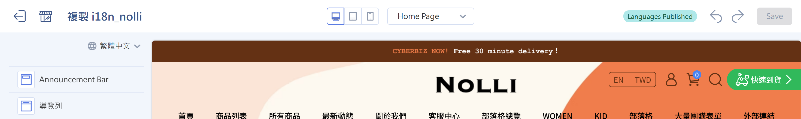

!!! note "Note"
    You see the language switcher only when your store has multiple languages turned on. Single-language stores don't show this option. For details, see [Set Up Multiple Storefront Languages and Currencies](../../website-management/setup-multi-language-and-multi-currency.md).

---

### Undo, Redo, and Save { #operate-theme-editor-save }

1. **Undo / redo:** To go back a step while editing, click the **Undo** :lucide-undo-2: icon at the top. To reapply it, click **Redo** :lucide-redo-2:.
2. **Save changes:** When you finish editing, click **Save** at the top right.

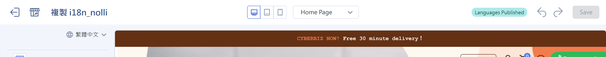

!!! info "Do Changes Take Effect Right After I Save?"
    It depends on which theme you're editing:

    * **Editing the "published" theme:** Your changes **appear on your live website right away** after you save.
    * **Editing an "unpublished" theme:** Saving only keeps a draft and doesn't affect the storefront. You need to complete the next step, **Publish**, for it to go live.

---

### Publish the Theme { #operate-theme-editor-publish }

If you're editing an unpublished theme, publish it when you finish to apply it to the storefront:

1. **Click Publish:** At the top of the editor, click **Publish**.
2. **Confirm the replacement:** The system shows "This will replace your current theme and move it to unpublished themes...". Click **Confirm and Publish** to confirm.
3. **Go live:** This theme becomes your live storefront theme, and customers see the new layout when they visit your store.

!!! note "Note"
    Only one theme can be "published" at a time. After you publish a new theme, the previous one moves to "Unpublished Themes" automatically, and you can switch back anytime.

---

### Global Settings and Page Settings { #operate-theme-editor-global }

Besides the block actions above, drag-and-drop themes have the following additional settings. See the matching guides:

- :lucide-settings-2:{ .lg }  
  [__Global Settings__](setup-global-theme-settings.md){ title="Global Settings" }  
  Set pop-up ads, colors, brand identity, SEO, product display behavior, and dynamic labels.

- :lucide-panel-top:{ .lg }  
  [__Page Settings__](setup-theme-page-settings.md){ title="Page Settings Guide" }  
  Fine-tune settings by page type, including homepage blocks, product pages, blogs, the customer service page, and more.

---

## Important Rules and Limitations { #specs-theme-editor }

- **Only drag-and-drop themes support drag-and-drop editing:** Only themes labeled "draggable" use the editor in this article. For default themes, use the legacy website settings.
- **Only some pages are editable:** Only the homepage, product pages, custom pages, and similar pages support drag and drop. Product collection pages, blog pages, search pages, and others don't. For the full list, see [Pages You Can Edit with Drag and Drop](../references/theme-editor-pages.md){ title="Drag-and-Drop Editable Pages Reference" }.
- **Some blocks require features to be turned on:** A few blocks appear in the add list only when the matching feature is turned on. For details, see [Block Types You Can Add](../references/theme-editor-sections.md){ title="Block Types You Can Add Reference" }.
- **Some blocks have limits:** Some blocks, or the smaller blocks inside them, have a maximum number. Once you reach it, you can't add more.
- **Scheduling (optional):** Some themes let you set start and end times for blocks so they appear on the storefront only during a set period. This feature must be turned on separately.

---

## Next Steps { #next-steps-theme-editor }

- :lucide-package:{ .lg }  
  [__Add Products__](../../products/create-and-manage/create-update-products.md){ title="Add and Update Products" }  
  Create your products first so blocks such as the homepage product list and featured product have products to show.

- :lucide-layout-list:{ .lg }  
  [__Block Types You Can Add__](../references/theme-editor-sections.md)  
  See what each block is for and what it requires, and plan your page content.

- :lucide-file-text:{ .lg }  
  [__Pages You Can Edit with Drag and Drop__](../references/theme-editor-pages.md)  
  Learn which pages support drag-and-drop editing.

---

## FAQ { #faq-theme-editor }

??? quote "I can't find the "Add Block" button, or I can't drag blocks"
    { #faq-theme-editor-no-drag }
    There are two possible reasons:

    - Your theme isn't a "drag-and-drop theme." Go back to the themes page and check that the theme card is labeled **draggable**.
    - The current page doesn't support drag and drop. Only the homepage, product pages, custom pages, and similar pages do. See [Pages You Can Edit with Drag and Drop](../references/theme-editor-pages.md){ title="Drag-and-Drop Editable Pages Reference" data-preview }.

??? quote "I made changes and saved, but the storefront looks the same"
    { #faq-theme-editor-no-effect }
    Check the following in order:

    - If you're editing an **unpublished** theme, you need to **Publish** it to apply it to the storefront.
    - If you're editing the **published** theme, make sure you clicked **Save**.
    - If it still hasn't updated, clear your browser cache or refresh the storefront page.

??? quote "The block I want isn't in the add list"
    { #faq-theme-editor-missing-section }
    The blocks you can add vary with the theme you installed, and a few (such as product reviews and the store locations list) appear only when the matching feature is turned on. For details, see [Block Types You Can Add](../references/theme-editor-sections.md){ title="Block Types You Can Add Reference" data-preview }.

??? quote "What's the difference between hiding and removing a block?"
    { #faq-theme-editor-hide-vs-remove }
    Both keep the block off the storefront. The difference is:

    - **Hide:** The block and its settings are kept, and you can show it again anytime.
    - **Remove:** Deletes the whole block, and its content isn't kept.

    If you only want to hide it for now, use hide.

??? quote "Will changing or publishing a theme affect my product or order data?"
    { #faq-theme-editor-data-safe }
    No. Themes affect only the **look and layout** of your storefront. They don't change operational data such as products, orders, or members. After you publish a new theme, the old one stays in "Unpublished Themes," and you can switch back anytime.
