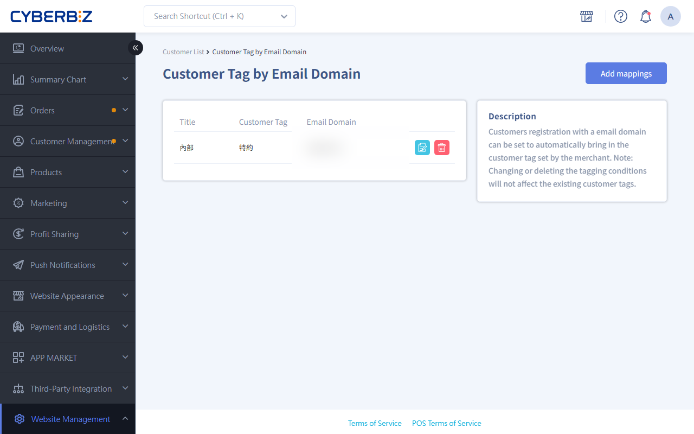
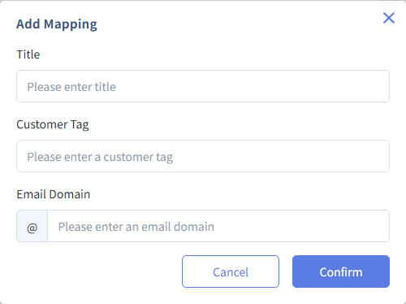

# Apply Member Tags to Specific Email Domains

With email domain settings, the system can automatically tag members from specific organizations (such as company employees or school members) when they finish registering. You can then offer them exclusive promotions or segmented services.
{ .subtitle }

[:lucide-tag:{ title="Applicable Plans" }](../../resources/conventions#適用方案) | Enterprise
{ .doc-badge }

{ .hero-page }

!!! tip "Use Cases"
    - **Employee purchase programs**: Set your company domain (such as `@cyberbiz.at`) so that employees are automatically tagged **Employee Purchase** when they register and get exclusive discounts.
    - **Partner organization management**: Automatically tag members from partner or specific educational institution domains for segmented push notifications.
    - **Brand ambassador tracking**: Automatically group members from specific partner domains when they register, which simplifies list management.

## Before You Start { #prerequisites-domain-tags }

Before you set up domain tag rules, note the following limits:

- **Who it applies to**: Only members who **register after** the rule is set up. The system does not go back and tag members who existed before the rule was set.
- **Import limits**: Customer data added through **Excel bulk import** does **not** support automatic tagging.

     > When you use [Excel bulk import members](../members/batch-import-and-edit-members.md#specs-batch-members){ title="Bulk import or edit members" }, just fill in the tag field in the template, and the tags are applied automatically when you import.

- **Effect of changes**: Changing or deleting an existing domain tag setting does not affect members who already have the tag.
- **Format rules**: Make sure to enter the correct email domain (the text after @). Spaces or typos will cause automatic tagging to fail.

## Steps { #operate-domain-tags }

### Step 1: Create a Tag Condition { #operate-domain-tags-create }

1. Log in to the CYBERBIZ admin panel and go to **Website Management > Email Domain Tag Settings**.
2. Click **Add mappings** in the upper-right corner of the page.

### Step 2: Enter the Settings { #operate-domain-tags-fill }

Enter the following information in the pop-up window or edit page:

1. **Title**: Enter a name to identify the rule (for example, 2024 Corporate Partnership). This field is only used to identify the rule in the admin panel.
2. **Member tag**: Enter the tag name the system should apply automatically (for example, Employee Purchase or Partner).
    - If the tag does not exist yet, it is created when you enter it.
3. **Email domain**: Enter the domain string to match.
    - **Format**: Enter only the part after `@`.
    - **Example**: For `name@gmail.com`, enter `gmail.com`.

### Step 3: Save and Verify { #operate-domain-tags-save }

1. After you check the information, click **Confirm** to save the setting.
2. **Testing tip**: Register a test account with an email address in that domain, and then go to **Customer Management > All Customers** to check that the account has the correct tag.

## FAQ { #faq-domain-tags }

??? quote "If a member matches more than one domain condition, are all the tags applied?"
    If the email domain a member registers with matches several rules (for example, a subdomain rule and a parent domain rule), the system applies all the tags from the matching rules.

??? quote "If I change a domain tag setting, do existing members' tags change too?"
    No. Domain tag settings are triggered **at the time of registration**. Once a member has registered and been tagged, later changes to or deletion of the rule do not change the tags that member already has.

## Related Reading { #reference-domain-tags }

- :lucide-tags:{ .lg }
  [__Manage Tags for Individual Members__](../members/manage-member-profiles.md#operate-member-profiles-tags){ title="Manage member profiles" }
  Learn how to manually add tags to or remove tags from individual members.

