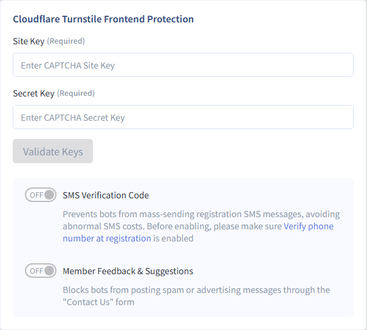

# Set up Bot Protection and SMS Verification

If your online store uses SMS verification for members (especially international SMS), add bot verification before the verification code is sent. This stops malicious programs from triggering a flood of SMS messages in a short time and driving up your SMS costs.
{ .subtitle }

[:lucide-tag:{ title="Applicable Plans" }](../../resources/conventions#適用方案) | All plans
{ .doc-badge }

## About Security Setting { #intro-security }

Security Setting is the security control center of the CYBERBIZ admin panel. It helps lower the risk of account theft, customer data leaks, and malicious visits. The page is under **Website Management > Security Setting** in the admin panel and covers three main areas:

- **[Member Security](member-security-settings/)**: Protects your website and customer data.
- **[Admin Login](admin-security-settings/)**: Protects how you and your staff log in to the admin panel.
- **Bot Protection**: Filters out malicious visitors and sets up the first line of defense before SMS messages are sent.

## Prerequisites and Limitations { #prerequisites-security }

Before you start, check the following:

- [x] **Settings permission**: This tab requires your account to have the **Settings** permission in **User Account Settings** to view and edit it. You can [change admin permissions](add-admin-set-permissions/#operate-admin-perms-edit).

## SMS Verification for Member Registration { #operate-security-sms-bot-protection }

If you have turned on SMS verification for member registration and international SMS, malicious programs may repeatedly trigger Send Verification Code on your website and **run up large international SMS charges** in a short time. With this feature on, customers must pass Cloudflare Turnstile bot verification before they click Send Verification Code, and the system sends the SMS only after they pass. This reduces losses from such attacks.

### Step 1: Get Verification Keys { #operate-security-sms-key }

1. **Go to the Cloudflare dashboard**: [Sign up for or log in to a Cloudflare account](https://dash.cloudflare.com/login), and search for **Turnstile** in the Cloudflare dashboard.

    { .screenshot }

2. **Create a Turnstile widget**: Click **Add widget** to add it manually.

    { .screenshot }

    - **Widget name**: Enter a name that identifies this widget.

        { .screenshot }

    - **Hostname management**: In the **Hostname** field, enter your store's domain.

        { .screenshot }

        !!! tip "Add Both Types of Domains"
            When you add hostnames, add both your store's **custom domain** and its **CYBERBIZ domain**:

            - **Custom domain**: If your store uses several custom domains, **add each one**. Remove `https://` from the beginning of the URL and keep only the full domain name.

                - Example URL: `https://www.your-domain.com`
                - **Enter as**: `www.your-domain.com`
                - Example URL: `https://www.your-domain.com.tw`
                - **Enter as**: `www.your-domain.com.tw`

            - **CYBERBIZ domain**:
                - Example URL: `https://your-store-name.cyberbiz.co`
                - **Enter as**: `your-store-name.cyberbiz.co`

    - **Widget mode**: Choose the mode you need.

        { .screenshot }

3. **Get the keys**: Click **Create** to get the **Site key** and **Secret key**.

    { .screenshot }

### Step 2: Add the Keys in the Admin Panel { #operate-security-sms-bind }

1. **Open the settings page:** Go to **Website Management > Security Setting > 機器人防護**.
2. **Enter the keys:** Enter the **Site key** and the **Secret key**.

    

3. **Test the keys:** Click **Validate Keys** and check that `驗證成功` appears. If `驗證失敗：無效金鑰` appears, check the keys again before you save.

    

4. **Turn on protection:** Turn on the **SMS Verification Code** switch and save.

Once this is on, when customers click **Send Verification Code** on the registration page, a small bot verification pop-up appears first. After they pass, the pop-up closes automatically and the system sends the SMS verification code.

!!! note "Clearing the Keys"
    If you clear the saved keys, the **Enable verification** switch also turns off, and the storefront no longer shows bot verification.

## FAQ { #faq-security }

??? quote "What if I get the error **The current domain is not authorized. Add the domain to the allowlist in the Cloudflare dashboard**?"
    1. Log in to the Cloudflare dashboard, open the Turnstile widget page, click to edit the widget, and go to **Hostname management**.
    2. Add every domain your store uses.
    3. When you enter a domain, remove `http://` or `https://` from the beginning and keep only the full domain name.

        **Examples**: `abc.cyberbiz.co`, `www.abc.com.tw`, `www.abc.com`

??? quote "What if I get the error **Invalid Site Key**?"
    Compare the **Site Key** in the Cloudflare dashboard with the one in the CYBERBIZ admin panel. Make sure they match exactly, and then enter it again.

??? quote "What if I get the error **This Site Key has been disabled**?"
    Log in to the Cloudflare dashboard, find the Site Key, and turn it back on. Then go back to the CYBERBIZ admin panel and enter the key again.

??? quote "What if I get the error **Site Key not found. Check the key or your Cloudflare dashboard settings**?"
    Check that both the **Site Key** and **Secret Key** from the Cloudflare dashboard are entered correctly in the CYBERBIZ admin panel, and that both keys belong to the same Turnstile widget.